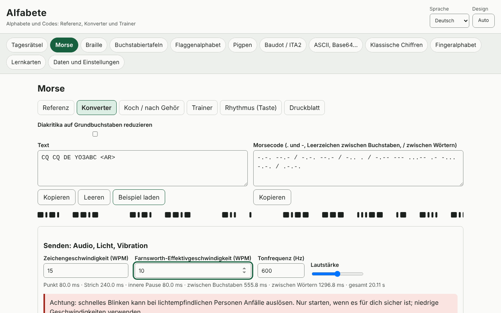

# Alfabete

[English](README.md) · [Română](README.ro.md) · [Français](README.fr.md) · [Italiano](README.it.md) · [Español](README.es.md) · [Português](README.pt.md) · **Deutsch** · [Magyar](README.hu.md)

**Version:** 1.0.1 · **Zuletzt aktualisiert:** 2026-10-19

Oberflächensprachen: **Română, English, Français, Italiano, Español, Português (PT), Deutsch, Magyar**

Alfabete ist eine Offline-App für Alphabete und Codes: Zu jedem Code gibt es eine visuelle Referenz, einen Konverter in beide Richtungen, einen Trainer mit Überprüfung und ein druckbares Merkblatt. Sie deckt Morse (Audio mit WPM/Farnsworth, Licht, Vibration, Koch, Gehörtraining, Rhythmus), lateinische Braille-Schrift der Stufe 1 (Unicode, BRF, SVG, Perkins-Schreibweise), Buchstabieralphabete (ITU/NATO, rumänisch, DIN 5009, französisch), Winkeralphabet, Pigpen, Baudot/ITA2, ASCII/binär/hex/oktal/Base64/URL/Unicode-Escapes, klassische Chiffren mit erklärten Schritten und Häufigkeitsanalyse, die Tagesaufgabe sowie Karteikarten mit verteilter Wiederholung (SM-2) ab. Sie ergänzt die Apps Eter (Morse/Koch) und Atingere (Braille).

**Online-App:** https://chiuta.github.io/apps/Alfabete/

## Bedienung

Wähle in der oberen Leiste ein Feld und dann einen Unterreiter: Referenz, Konverter, Trainer, Druckbares Merkblatt. In den Konvertern schreibst du in eines der Felder, und das andere wird aktualisiert. Bei Morse kannst du den Ton, das Licht oder die Vibration abspielen (soweit der Browser es erlaubt) und als WAV exportieren. Bei Braille kannst du BRF oder SVG herunterladen. Die „Tagesaufgabe“ wird deterministisch aus dem Datum erzeugt. Die Sprache (ro, en, fr, it, es, pt, hu, de) und das Design (automatisch/hell/dunkel) werden in der Kopfzeile gewechselt; der eingegebene Text bleibt erhalten.

## Was die App NICHT kann, und Grenzen

- Braille: nur **Stufe 1** (Buchstabe für Buchstabe). Stufe 2 (Kürzungen) ist nicht implementiert und wird auch nicht behauptet. Die rumänischen Buchstaben (ă â î ș ț) wurden nicht anhand einer offiziellen Quelle überprüft: Es werden wählbare Profile angeboten (Arbeitsprofil, Zurückführung auf den Grundbuchstaben, benutzerdefiniert), als solche gekennzeichnet. Die Zeichensetzung unterscheidet sich zwischen den Sprachen.
- Das rumänische Buchstabieralphabet, Morse-Diakritika und nationale Varianten sind nicht genormt; sie sind als „inoffiziell“/„Variante“ gekennzeichnet. Die ITU/NATO-Alphabete und die Zeichen nach ITU-R M.1677-1 sind die Standards.
- Fingeralphabet: **keine Abbildungen** (wir zeichnen keine ungefähren Hände); nur kurze Beschreibungen und der Verweis auf offizielle Quellen. Die ASL-Beschreibungen und die Bedeutung der Prosigns erscheinen außerhalb der Sprachen ro/en auf Englisch.
- Winkeralphabet: Die Tabelle wurde mit einer öffentlichen Quelle abgeglichen, sollte aber mit einer offiziellen Quelle überprüft werden; die Zeichen für Ziffern und Aufhebung sind nicht gezeichnet.
- Die klassischen Chiffren sind didaktisch und **bieten keine Sicherheit**. Der Angriff auf Caesar/Vigenère funktioniert bei ausreichend langen Texten, auf Englisch oder mit eigenen Häufigkeiten.
- Die Vibration hängt von der Vibration-API ab (fehlt unter iOS/Desktop); schnell blinkendes Licht kann lichtempfindliche Personen beeinträchtigen.

## Datenschutz

Die App läuft lokal und sendet nirgendwohin etwas. Die einzigen Daten (Einstellungen, Statistiken, Karten, Entwürfe) liegen im localStorage unter dem Präfix `fff.alfabete.`.

## Formate

Datenexport/-import: `.fff.json` (Format `fff-bundle`, Schema 1). Ausgaben: WAV (Morse), BRF und SVG (Braille), druckbare Merkblätter (Druck/PDF).

## Technik

Eine einzige Datei `index.html`, JS und CSS inline, strenge CSP mit Hash, keine externen Ressourcen. Tests: `node tests/test.mjs` (Playwright; 44 Tests: bekannte Vektoren, Hin- und Rückweg für jeden Code, Morse-Dauern berechnet und am gerenderten Audio/Blinken gemessen, axe 0 in beiden Designs, Layout bei 360 und 1280 px).

## Drittanbieter

Es wird kein Code von Dritten verwendet.

## Übersetzungen

Rumänisch und Englisch sind von Hand geschrieben; Französisch, Italienisch, Spanisch, Portugiesisch, Ungarisch und Deutsch sind maschinelle Übersetzungen, die nicht von Muttersprachlern überprüft wurden.

## Lizenz

MIT — siehe die Datei `LICENSE` im Stammverzeichnis des Repositorys.

## Verlauf

- 1.0.0 — 2026-10-14: erste Version
- 1.0.1 — 2026-10-19: Das Feld wird nur aus dem Teil der Adresse vor dem ersten „&“ gewählt (#feld&from=…), damit Links aus ETER/INDICATIV das richtige Feld öffnen.
