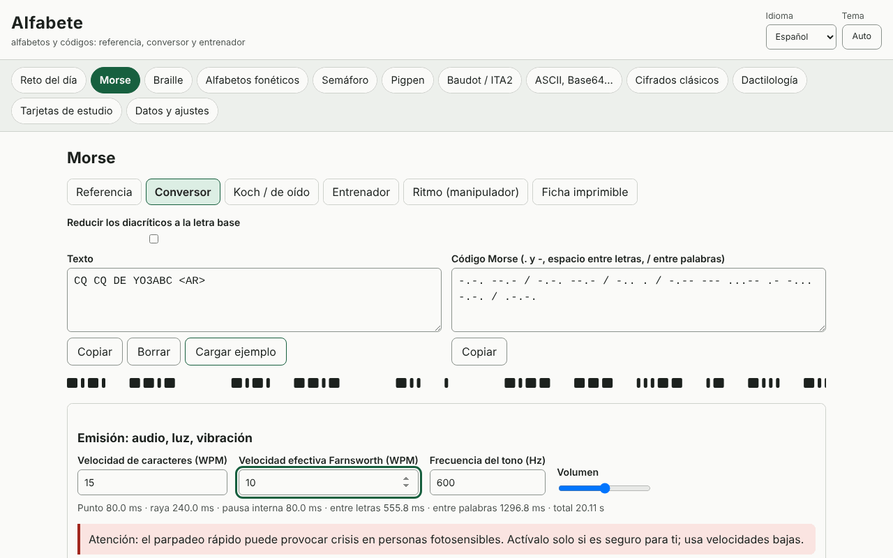

# Alfabete

[English](README.md) · [Română](README.ro.md) · [Français](README.fr.md) · [Italiano](README.it.md) · **Español** · [Português](README.pt.md) · [Deutsch](README.de.md) · [Magyar](README.hu.md)

**Versión:** 1.0.1 · **Última actualización:** 2026-10-19

Idiomas de la interfaz: **Română, English, Français, Italiano, Español, Português (PT), Deutsch, Magyar**

Alfabete es una aplicación sin conexión para alfabetos y códigos: para cada código tienes una referencia visual, un conversor en ambos sentidos, un entrenador con verificación y una ficha imprimible. Cubre el Morse (audio con WPM/Farnsworth, luz, vibraciones, Koch, oído, ritmo), el braille latino de grado 1 (Unicode, BRF, SVG, escritura Perkins), los alfabetos fonéticos (UIT/OTAN, rumano, DIN 5009, francés), la semaforía, el pigpen, el Baudot/ITA2, ASCII/binario/hexadecimal/octal/Base64/URL/secuencias de escape Unicode, los cifrados clásicos con pasos explicados y análisis de frecuencias, el reto del día y tarjetas de repetición espaciada (SM-2). Complementa las aplicaciones Eter (Morse/Koch) y Atingere (braille).

**Aplicación en línea:** https://chiuta.github.io/apps/Alfabete/

## Cómo se usa

Elige un panel en la barra superior y luego una subpestaña: Referencia, Conversor, entrenador, Ficha imprimible. En los conversores escribes en cualquiera de los campos y el otro se actualiza. En Morse puedes reproducir el sonido, la luz o la vibración (donde el navegador lo permita) y exportar a WAV. En braille puedes descargar BRF o SVG. El «reto del día» se genera de forma determinista a partir de la fecha. El idioma (ro, en, fr, it, es, pt, hu, de) y el tema (automático/claro/oscuro) se cambian desde la cabecera; el texto introducido se conserva.

## Lo que NO hace y límites

- Braille: solo **grado 1** (letra por letra). El grado 2 (contracciones) no está implementado y no se afirma lo contrario. Las letras rumanas (ă â î ș ț) no se han verificado con una fuente oficial: se ofrecen perfiles seleccionables (de trabajo, reducción a la letra base, personalizado), marcados como tales. La puntuación varía entre idiomas.
- El alfabeto fonético rumano, los diacríticos Morse y las variantes nacionales no están normalizados; se marcan como «no oficial»/«variante». Los de la UIT/OTAN y los signos de la UIT-R M.1677-1 son los estándar.
- Dactilología: **sin figuras** (no dibujamos manos aproximadas); solo descripciones breves y una remisión a las fuentes oficiales. Las descripciones ASL y el significado de los prosignos aparecen en inglés fuera de los idiomas ro/en.
- Semaforía: la tabla se contrastó con una fuente pública, pero conviene verificarla con una fuente oficial; los signos de los números y de anulación no están dibujados.
- Los cifrados clásicos son didácticos y **no ofrecen seguridad**. El ataque contra César/Vigenère funciona con textos suficientemente largos, en inglés o con frecuencias propias.
- Las vibraciones dependen de la API Vibration (ausente en iOS/escritorio); la luz parpadeante rápida puede afectar a las personas fotosensibles.

## Privacidad

Se ejecuta en local y no envía nada a ninguna parte. Los únicos datos (ajustes, estadísticas, tarjetas, borradores) se guardan en localStorage con el prefijo `fff.alfabete.`.

## Formatos

Exportación/importación de datos: `.fff.json` (formato `fff-bundle`, esquema 1). Salidas: WAV (Morse), BRF y SVG (braille), fichas imprimibles (impresión/PDF).

## Técnica

Un único archivo `index.html`, JS y CSS en línea, CSP estricta con hash, sin recursos externos. Pruebas: `node tests/test.mjs` (Playwright; 44 pruebas: vectores conocidos, ida y vuelta para cada código, duraciones Morse calculadas y medidas sobre el audio renderizado/el parpadeo, axe 0 en ambos temas, diseño a 360 y 1280 px).

## Terceros

No utiliza código de terceros.

## Traducciones

El rumano y el inglés están escritos a mano; el francés, el italiano, el español, el portugués, el húngaro y el alemán son traducciones automáticas, no verificadas por hablantes nativos.

## Licencia

MIT — véase el archivo `LICENSE` en la raíz del repositorio.

## Historial

- 1.0.0 — 2026-10-14: primera versión
- 1.0.1 — 2026-10-19: el panel se elige solo a partir de la parte de la dirección anterior al primer «&» (#panel&from=…), para que los enlaces desde ETER/INDICATIV abran el panel correcto.
