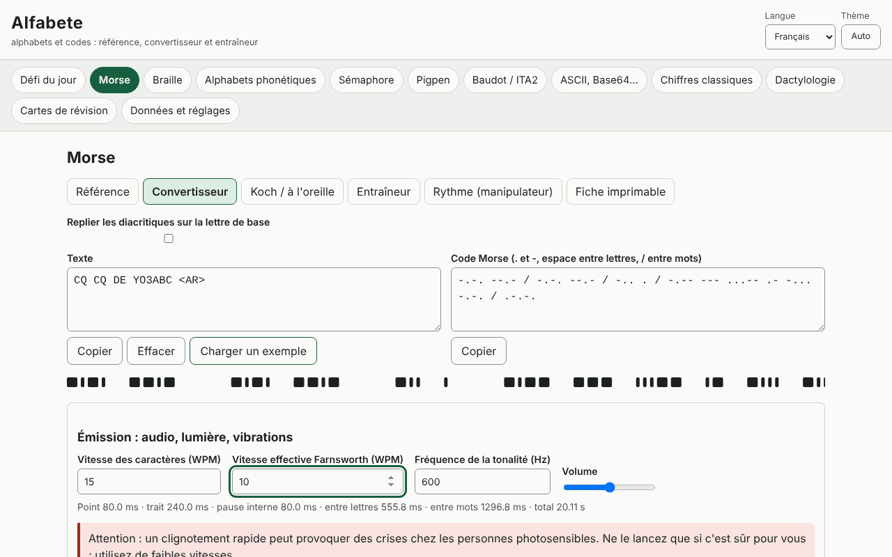

# Alfabete

[English](README.md) · [Română](README.ro.md) · **Français** · [Italiano](README.it.md) · [Español](README.es.md) · [Português](README.pt.md) · [Deutsch](README.de.md) · [Magyar](README.hu.md)

**Version :** 1.0.1 · **Dernière mise à jour :** 2026-10-19

Langues de l'interface : **Română, English, Français, Italiano, Español, Português (PT), Deutsch, Magyar**

Alfabete est une application hors ligne pour les alphabets et les codes : pour chaque code, tu disposes d'une référence visuelle, d'un convertisseur dans les deux sens, d'un entraîneur avec vérification et d'une fiche imprimable. Elle couvre le Morse (audio avec WPM/Farnsworth, lumière, vibrations, Koch, écoute, rythme), le braille latin de degré 1 (Unicode, BRF, SVG, écriture Perkins), les alphabets phonétiques (UIT/OTAN, roumain, DIN 5009, français), le sémaphore, le pigpen, le Baudot/ITA2, l'ASCII/binaire/hexadécimal/octal/Base64/URL/séquences d'échappement Unicode, les chiffrements classiques avec étapes expliquées et analyse de fréquence, le défi du jour et des cartes à répétition espacée (SM-2). Elle complète les applications Eter (Morse/Koch) et Atingere (braille).

**Application en ligne :** https://chiuta.github.io/apps/Alfabete/

## Mode d'emploi

Choisis un panneau dans la barre du haut, puis un sous-onglet : Référence, Convertisseur, entraîneur, Fiche imprimable. Dans les convertisseurs, tu écris dans l'un des champs et l'autre se met à jour. Pour le Morse, tu peux jouer le son, la lumière ou la vibration (là où le navigateur le permet) et exporter en WAV. Pour le braille, tu peux télécharger du BRF ou du SVG. Le « défi du jour » est généré de façon déterministe à partir de la date. La langue (ro, en, fr, it, es, pt, hu, de) et le thème (automatique/clair/sombre) se changent depuis l'en-tête ; le texte saisi est conservé.

## Ce que l'application NE fait PAS, et ses limites

- Braille : uniquement le **degré 1** (lettre par lettre). Le degré 2 (contractions) n'est pas implémenté et n'est pas revendiqué. Les lettres roumaines (ă â î ș ț) n'ont pas été vérifiées par rapport à une source officielle : des profils sélectionnables sont proposés (de travail, repli sur la lettre de base, personnalisé), signalés comme tels. La ponctuation varie d'une langue à l'autre.
- L'alphabet phonétique roumain, les diacritiques Morse et les variantes nationales ne sont pas normalisés ; ils sont marqués « non officiel »/« variante ». Ceux de l'UIT/OTAN et les signes de l'UIT-R M.1677-1 sont les normes.
- Dactylologie : **pas de figures** (nous ne dessinons pas de mains approximatives) ; seulement de courtes descriptions et un renvoi aux sources officielles. Les descriptions ASL et le sens des prosignes apparaissent en anglais hors des langues ro/en.
- Sémaphore : le tableau a été recoupé avec une source publique, mais mérite d'être vérifié auprès d'une source officielle ; les signes pour les chiffres et l'annulation ne sont pas dessinés.
- Les chiffrements classiques sont didactiques et **n'offrent aucune sécurité**. L'attaque sur César/Vigenère fonctionne sur des textes suffisamment longs, en anglais ou avec des fréquences propres.
- Les vibrations dépendent de l'API Vibration (absente sur iOS/ordinateur de bureau) ; une lumière clignotant rapidement peut affecter les personnes photosensibles.

## Confidentialité

L'application s'exécute en local et n'envoie rien nulle part. Les seules données (réglages, statistiques, cartes, brouillons) sont conservées dans le localStorage sous le préfixe `fff.alfabete.`.

## Formats

Export/import de données : `.fff.json` (format `fff-bundle`, schéma 1). Sorties : WAV (Morse), BRF et SVG (braille), fiches imprimables (impression/PDF).

## Technique

Un seul fichier `index.html`, JS et CSS en ligne, CSP stricte avec hachage, aucune ressource externe. Tests : `node tests/test.mjs` (Playwright ; 44 tests : vecteurs connus, aller-retour pour chaque code, durées Morse calculées et mesurées sur l'audio rendu/le clignotement, axe 0 dans les deux thèmes, mise en page à 360 et 1280 px).

## Tiers

Elle n'utilise aucun code tiers.

## Traductions

Le roumain et l'anglais sont rédigés à la main ; le français, l'italien, l'espagnol, le portugais, le hongrois et l'allemand sont des traductions automatiques, non vérifiées par des locuteurs natifs.

## Licence

MIT — voir le fichier `LICENSE` à la racine du dépôt.

## Historique

- 1.0.0 — 2026-10-14 : première version
- 1.0.1 — 2026-10-19 : le panneau est choisi uniquement à partir de la partie de l'adresse située avant le premier « & » (#panneau&from=…), afin que les liens depuis ETER/INDICATIV ouvrent le bon panneau.
