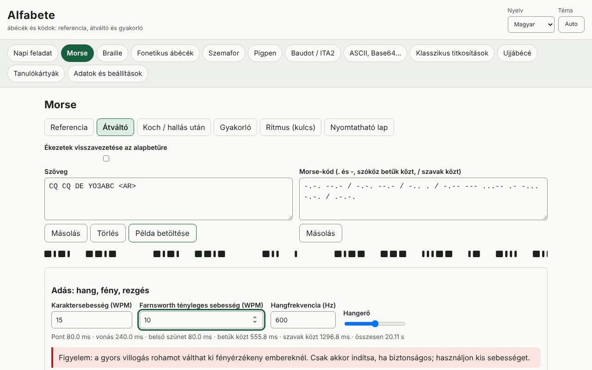

# Alfabete

[English](README.md) · [Română](README.ro.md) · [Français](README.fr.md) · [Italiano](README.it.md) · [Español](README.es.md) · [Português](README.pt.md) · [Deutsch](README.de.md) · **Magyar**

**Verzió:** 1.0.1 · **Utolsó frissítés:** 2026-10-19

A felület nyelvei: **Română, English, Français, Italiano, Español, Português (PT), Deutsch, Magyar**

Az Alfabete egy offline alkalmazás ábécékhez és kódokhoz: minden kódhoz kapsz vizuális referenciát, kétirányú átalakítót, ellenőrzéssel ellátott gyakorlót és nyomtatható lapot. Lefedi a Morse-kódot (hang WPM/Farnsworth beállítással, fény, rezgés, Koch-módszer, hallás utáni gyakorlás, ritmus), a latin 1. fokozatú Braille-írást (Unicode, BRF, SVG, Perkins-féle írás), a fonetikus ábécéket (ITU/NATO, román, DIN 5009, francia), a jelzőzászlós (szemafor) ábécét, a pigpent, a Baudot/ITA2-t, az ASCII/bináris/hexa/oktális/Base64/URL/Unicode escape-formátumokat, a klasszikus titkosításokat magyarázott lépésekkel és gyakorisági elemzéssel, a nap kihívását, valamint a térközű ismétlésen alapuló kártyákat (SM-2). Kiegészíti az Eter (Morse/Koch) és az Atingere (Braille) alkalmazásokat.

**Online alkalmazás:** https://chiuta.github.io/apps/Alfabete/

## Használat

Válassz egy panelt a felső sávból, majd egy almenüt: Referencia, Átalakító, gyakorló, Nyomtatható lap. Az átalakítókban bármelyik mezőbe írhatsz, a másik frissül. Morse-kódnál lejátszhatod a hangot, a fényt vagy a rezgést (ahol a böngésző megengedi), és exportálhatsz WAV-ot. Braille-nál letölthetsz BRF-et vagy SVG-t. A „nap kihívása” a dátumból determinisztikusan generálódik. A nyelvet (ro, en, fr, it, es, pt, hu, de) és a témát (automatikus/világos/sötét) a fejlécben lehet váltani; a beírt szöveg megmarad.

## Mit NEM tud, és korlátok

- Braille: csak **1. fokozat** (betűről betűre). A 2. fokozat (rövidítések) nincs megvalósítva, és nem is állítjuk. A román betűket (ă â î ș ț) nem vetettük össze hivatalos forrással: választható profilok állnak rendelkezésre (munkaprofil, visszavezetés az alapbetűre, egyéni), ennek megfelelően megjelölve. Az írásjelek nyelvenként eltérnek.
- A román fonetikus ábécé, a Morse-ékezetek és a nemzeti változatok nem szabványosak; „nem hivatalos”/„változat” jelöléssel szerepelnek. Az ITU/NATO-s ábécék és az ITU-R M.1677-1 jelei a szabványosak.
- Ujjábécé: **nincsenek ábrák** (nem rajzolunk hozzávetőleges kezeket); csak rövid leírások és hivatkozás hivatalos forrásokra. Az ASL-leírások és a prosignok jelentése a ro/en nyelveken kívül angolul jelenik meg.
- Szemafor: a táblázatot egy nyilvános forrással vetettük össze, de érdemes hivatalos forrással is ellenőrizni; a számjegyek és a törlés jelei nincsenek lerajzolva.
- A klasszikus titkosítások oktató jellegűek, és **nem nyújtanak biztonságot**. A Caesar/Vigenère elleni támadás kellően hosszú szövegeken működik, angolul vagy saját gyakoriságokkal.
- A rezgés a Vibration API-tól függ (iOS-en/asztali gépen hiányzik); a gyorsan villogó fény fényérzékeny személyeket károsan érinthet.

## Adatvédelem

Helyben fut, és sehová nem küld semmit. Az egyetlen adat (beállítások, statisztikák, kártyák, piszkozatok) a localStorage-ban található, az `fff.alfabete.` előtag alatt.

## Formátumok

Adatok exportja/importja: `.fff.json` (`fff-bundle` formátum, 1. séma). Kimenetek: WAV (Morse), BRF és SVG (Braille), nyomtatható lapok (nyomtatás/PDF).

## Technikai részletek

Egyetlen `index.html` fájl, beágyazott JS és CSS, szigorú CSP hash-sel, külső erőforrások nélkül. Tesztek: `node tests/test.mjs` (Playwright; 44 teszt: ismert vektorok, oda-vissza átalakítás minden kódnál, kiszámított és a renderelt hangon/villogáson megmért Morse-időtartamok, axe 0 mindkét témában, elrendezés 360 és 1280 px-en).

## Harmadik felek

Nem használ harmadik féltől származó kódot.

## Fordítások

A román és az angol szöveg kézzel készült; a francia, olasz, spanyol, portugál, magyar és német gépi fordítás, anyanyelvi beszélők által nem ellenőrizve.

## Licenc

MIT — lásd a `LICENSE` fájlt a tároló gyökerében.

## Előzmények

- 1.0.0 — 2026-10-14: első verzió
- 1.0.1 — 2026-10-19: a panelt csak a cím első „&” előtti részéből választja ki (#panel&from=…), hogy az ETER/INDICATIV hivatkozásai a megfelelő panelt nyissák meg.
