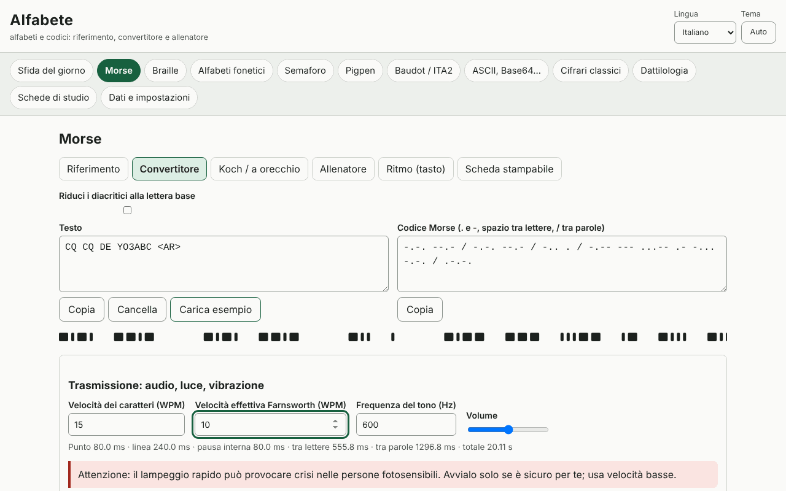

# Alfabete

[English](README.md) · [Română](README.ro.md) · [Français](README.fr.md) · **Italiano** · [Español](README.es.md) · [Português](README.pt.md) · [Deutsch](README.de.md) · [Magyar](README.hu.md)

**Versione:** 1.0.1 · **Ultimo aggiornamento:** 2026-10-19

Lingue dell'interfaccia: **Română, English, Français, Italiano, Español, Português (PT), Deutsch, Magyar**

Alfabete è un'applicazione offline per alfabeti e codici: per ogni codice hai un riferimento visivo, un convertitore bidirezionale, un allenatore con verifica e una scheda stampabile. Copre il Morse (audio con WPM/Farnsworth, luce, vibrazioni, Koch, ascolto, ritmo), il braille latino di grado 1 (Unicode, BRF, SVG, scrittura Perkins), gli alfabeti fonetici (ITU/NATO, rumeno, DIN 5009, francese), il semaforo, il pigpen, il Baudot/ITA2, ASCII/binario/esadecimale/ottale/Base64/URL/sequenze di escape Unicode, i cifrari classici con passaggi spiegati e analisi delle frequenze, la sfida del giorno e le schede a ripetizione dilazionata (SM-2). Completa le applicazioni Eter (Morse/Koch) e Atingere (braille).

**Applicazione online:** https://chiuta.github.io/apps/Alfabete/

## Come si usa

Scegli un pannello dalla barra in alto, poi una sottoscheda: Riferimento, Convertitore, allenatore, Scheda stampabile. Nei convertitori scrivi in uno qualsiasi dei campi e l'altro si aggiorna. Per il Morse puoi riprodurre il suono, la luce o la vibrazione (dove il browser lo consente) ed esportare in WAV. Per il braille puoi scaricare BRF o SVG. La «sfida del giorno» viene generata in modo deterministico a partire dalla data. La lingua (ro, en, fr, it, es, pt, hu, de) e il tema (automatico/chiaro/scuro) si cambiano dall'intestazione; il testo inserito viene conservato.

## Cosa NON fa, e limiti

- Braille: solo **grado 1** (lettera per lettera). Il grado 2 (contrazioni) non è implementato e non viene dichiarato. Le lettere rumene (ă â î ș ț) non sono state verificate rispetto a una fonte ufficiale: sono offerti profili selezionabili (di lavoro, riduzione alla lettera base, personalizzato), indicati come tali. La punteggiatura varia da una lingua all'altra.
- L'alfabeto fonetico rumeno, i diacritici Morse e le varianti nazionali non sono standardizzati; sono contrassegnati «non ufficiale»/«variante». Quelli ITU/NATO e i segni ITU-R M.1677-1 sono quelli standard.
- Alfabeto manuale: **nessuna figura** (non disegniamo mani approssimative); solo brevi descrizioni e un rimando alle fonti ufficiali. Le descrizioni ASL e il significato dei prosegni compaiono in inglese al di fuori delle lingue ro/en.
- Semaforo: la tabella è stata verificata incrociando una fonte pubblica, ma merita di essere controllata con una fonte ufficiale; i segni per le cifre e per l'annullamento non sono disegnati.
- I cifrari classici sono didattici e **non offrono alcuna sicurezza**. L'attacco a Cesare/Vigenère funziona su testi sufficientemente lunghi, in inglese o con frequenze proprie.
- Le vibrazioni dipendono dall'API Vibration (assente su iOS/desktop); la luce lampeggiante rapida può danneggiare le persone fotosensibili.

## Privacy

Funziona in locale e non invia nulla da nessuna parte. Gli unici dati (impostazioni, statistiche, schede, bozze) si trovano in localStorage con il prefisso `fff.alfabete.`.

## Formati

Esportazione/importazione dei dati: `.fff.json` (formato `fff-bundle`, schema 1). Uscite: WAV (Morse), BRF e SVG (braille), schede stampabili (stampa/PDF).

## Tecnica

Un unico file `index.html`, JS e CSS inline, CSP rigorosa con hash, nessuna risorsa esterna. Test: `node tests/test.mjs` (Playwright; 44 test: vettori noti, andata e ritorno per ogni codice, durate Morse calcolate e misurate sull'audio renderizzato/sul lampeggio, axe 0 in entrambi i temi, layout a 360 e 1280 px).

## Terze parti

Non utilizza codice di terze parti.

## Traduzioni

Il rumeno e l'inglese sono scritti a mano; il francese, l'italiano, lo spagnolo, il portoghese, l'ungherese e il tedesco sono traduzioni automatiche, non verificate da madrelingua.

## Licenza

MIT — vedi il file `LICENSE` nella radice del repository.

## Cronologia

- 1.0.0 — 2026-10-14: prima versione
- 1.0.1 — 2026-10-19: il pannello viene scelto solo dalla parte dell'indirizzo che precede la prima «&» (#pannello&from=…), così i link da ETER/INDICATIV aprono il pannello corretto.
