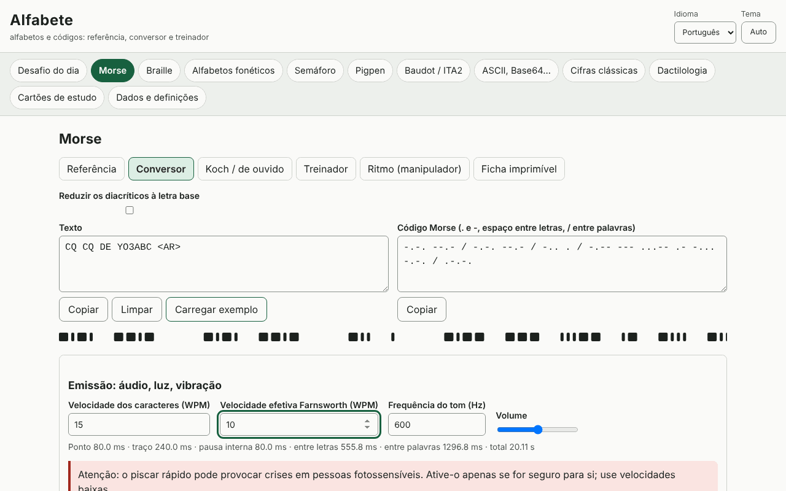

# Alfabete

[English](README.md) · [Română](README.ro.md) · [Français](README.fr.md) · [Italiano](README.it.md) · [Español](README.es.md) · **Português** · [Deutsch](README.de.md) · [Magyar](README.hu.md)

**Versão:** 1.0.1 · **Última atualização:** 2026-10-19

Idiomas da interface: **Română, English, Français, Italiano, Español, Português (PT), Deutsch, Magyar**

O Alfabete é uma aplicação offline para alfabetos e códigos: para cada código tem uma referência visual, um conversor nos dois sentidos, um treinador com verificação e uma ficha imprimível. Abrange o Morse (áudio com WPM/Farnsworth, luz, vibrações, Koch, audição, ritmo), o braille latino de grau 1 (Unicode, BRF, SVG, escrita Perkins), os alfabetos fonéticos (UIT/OTAN, romeno, DIN 5009, francês), o semáforo, o pigpen, o Baudot/ITA2, ASCII/binário/hexadecimal/octal/Base64/URL/sequências de escape Unicode, as cifras clássicas com passos explicados e análise de frequências, o desafio do dia e cartões de repetição espaçada (SM-2). Complementa as aplicações Eter (Morse/Koch) e Atingere (braille).

**Aplicação online:** https://chiuta.github.io/apps/Alfabete/

## Como se utiliza

Escolha um painel na barra superior e, depois, um separador secundário: Referência, Conversor, treinador, Ficha imprimível. Nos conversores escreve num dos campos e o outro é atualizado. No Morse pode reproduzir o som, a luz ou a vibração (onde o navegador o permitir) e exportar para WAV. No braille pode descarregar BRF ou SVG. O «desafio do dia» é gerado de forma determinista a partir da data. O idioma (ro, en, fr, it, es, pt, hu, de) e o tema (automático/claro/escuro) alteram-se a partir do cabeçalho; o texto introduzido é conservado.

## O que NÃO faz e limites

- Braille: apenas **grau 1** (letra a letra). O grau 2 (contrações) não está implementado e não é afirmado. As letras romenas (ă â î ș ț) não foram verificadas face a uma fonte oficial: são oferecidos perfis selecionáveis (de trabalho, redução à letra base, personalizado), assinalados como tal. A pontuação varia de língua para língua.
- O alfabeto fonético romeno, os diacríticos Morse e as variantes nacionais não estão normalizados; são assinalados como «não oficial»/«variante». Os da UIT/OTAN e os sinais da UIT-R M.1677-1 são os padrão.
- Dactilologia: **sem figuras** (não desenhamos mãos aproximadas); apenas descrições breves e a remissão para fontes oficiais. As descrições ASL e o significado dos prosinais aparecem em inglês fora dos idiomas ro/en.
- Semáforo: a tabela foi confrontada com uma fonte pública, mas convém verificá-la numa fonte oficial; os sinais para algarismos e anulação não estão desenhados.
- As cifras clássicas são didáticas e **não oferecem segurança**. O ataque a César/Vigenère funciona em textos suficientemente longos, em inglês ou com frequências próprias.
- As vibrações dependem da API Vibration (inexistente em iOS/computador); a luz intermitente rápida pode afetar pessoas fotossensíveis.

## Privacidade

Funciona localmente e não envia nada para lado nenhum. Os únicos dados (definições, estatísticas, cartões, rascunhos) ficam no localStorage com o prefixo `fff.alfabete.`.

## Formatos

Exportação/importação de dados: `.fff.json` (formato `fff-bundle`, esquema 1). Saídas: WAV (Morse), BRF e SVG (braille), fichas imprimíveis (impressão/PDF).

## Técnica

Um único ficheiro `index.html`, JS e CSS inline, CSP estrita com hash, sem recursos externos. Testes: `node tests/test.mjs` (Playwright; 44 testes: vetores conhecidos, ida e volta para cada código, durações Morse calculadas e medidas no áudio renderizado/na intermitência, axe 0 nos dois temas, disposição a 360 e 1280 px).

## Terceiros

Não utiliza código de terceiros.

## Traduções

O romeno e o inglês são escritos à mão; o francês, o italiano, o espanhol, o português, o húngaro e o alemão são traduções automáticas, não verificadas por falantes nativos.

## Licença

MIT — ver o ficheiro `LICENSE` na raiz do repositório.

## Histórico

- 1.0.0 — 2026-10-14: primeira versão
- 1.0.1 — 2026-10-19: o painel é escolhido apenas a partir da parte do endereço anterior ao primeiro «&» (#painel&from=…), para que as ligações a partir de ETER/INDICATIV abram o painel correto.
