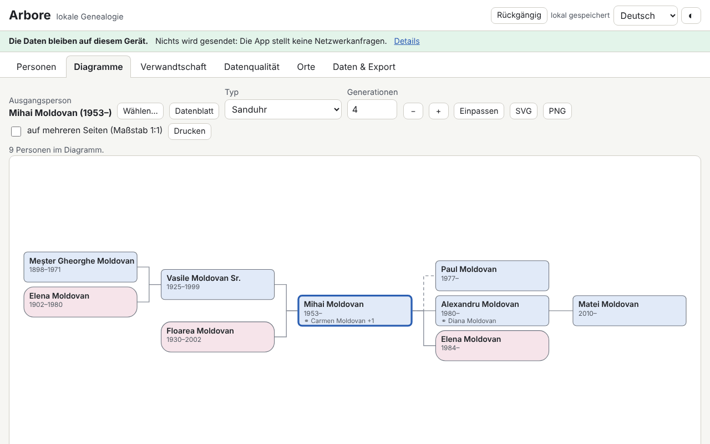

# Arbore — lokale Genealogie

[English](README.md) · [Română](README.ro.md) · [Français](README.fr.md) · [Italiano](README.it.md) · [Español](README.es.md) · [Português](README.pt.md) · **Deutsch** · [Magyar](README.hu.md)

**Version:** 1.0.5 · **Zuletzt aktualisiert:** 2026-10-23

Oberflächensprachen: **Română, English, Français, Italiano, Español, Português (PT), Deutsch, Magyar**

Arbore ist ein Genealogieprogramm, das vollständig im Browser läuft: Personen (mehrere Namen, Mädchennamen, unvollständige Daten, Orte, Berufe, eigene Ereignisse, Notizen, Quellen, Schlagwörter, kleine Fotos), Familien (Partner, Art der Verbindung, leibliche/adoptierte/Stiefkinder, Heirat und Scheidung), GEDCOM-5.5.1-Import/-Export, SVG-Diagramme (Ahnentafel über 3–7 Generationen, Nachkommen, Sanduhr, Fächer), persönliches Datenblatt, Zeitleiste, Ortsliste, Verwandtschaftsrechner mit rumänischer Terminologie und Datenqualitätsprüfungen (Duplikate, Unstimmigkeiten, Zusammenführen mit Rückgängig-Funktion).

**Online-App:** https://chiuta.github.io/apps/Arbore/

## Verwendung

1. Drücke **Beispiel laden** (eine fiktive Familie) oder **Daten und Export → Import** für eine `.ged`- / `.fff.json`-Datei; oder füge Personen mit **+ Person** hinzu.
2. **Personen**: Suche (Name, Jahr, Ort, Schlagwort), Filter, persönliches Datenblatt mit Ereignissen, Eltern, Geschwistern, Verbindungen und Kindern.
3. **Diagramme**: Wähle die Ausgangsperson, den Typ und die Anzahl der Generationen. Pfeile = zwischen Personen navigieren, Enter = neu zentrieren, Umschalt+Enter = Datenblatt, `+`/`-`/`0` = Zoom/Einpassen; Maus (Ziehen, Mausrad) und Touch (Verschieben, Pinch). Export als SVG/PNG, Drucken (auch über mehrere Seiten im Maßstab 1:1).
4. **Verwandtschaft**: Wähle zwei Personen; das Ergebnis liefert den rumänischen Begriff, den kanonischen und den zivilrechtlichen Grad und den erläuterten Weg.
5. **Datenqualität**: Prüfungen ausführen, die Person aus dem Bericht öffnen, Duplikate suchen und mit verfügbarer Funktion **Rückgängig** zusammenführen.
6. **Daten und Export**: optionale Passwortverschlüsselung, Datenschutzoptionen beim Export, GEDCOM, JSON, CSV, druckbarer Bericht, **Alles löschen**.

## Was die App NICHT kann, und Grenzen

- Sie synchronisiert nicht zwischen Geräten und hat keine Cloud-Kopie: Exportiere regelmäßig.
- Die Daten liegen im Browser (localStorage, mit IndexedDB als Rückfallebene); das Löschen der Websitedaten oder der private Modus können sie entfernen.
- GEDCOM 5.5.1 UTF-8 für den üblichen Gebrauch; ANSEL/ANSI nur minimal, mit Warnung. GEDCOM 7 und ZIP/GEDZIP werden nicht unterstützt. Unbekannte Tags bleiben beim Round-Trip erhalten, sind aber nicht bearbeitbar.
- Nicht-gregorianische Kalender werden als Text gespeichert und in den Prüfungen näherungsweise behandelt.
- Verwandtschaftsbegriffe gibt es nur auf Rumänisch (die Oberfläche ist übersetzt, die Terminologie nicht); sehr komplexe Fälle (wiederholte Heiraten unter Verwandten) erhalten eine ungefähre Beschreibung oder den kürzesten Weg. Dies ist keine Rechts- oder Religionsberatung.
- Duplikate sind Vorschläge; prüfe vor dem Zusammenführen.
- Es gibt keine Karte (Orte sind nur eine Liste, ohne Geokodierung).
- Fotos sind optional, werden auf höchstens 400 px verkleinert und als `data:` im Stammbaum gespeichert; viele Fotos beanspruchen einen großen Teil des Browser-Speicherkontingents.
- Das Verschlüsselungspasswort wird nicht gespeichert: **Passwort verloren = Daten verloren**.

## Datenschutz

Familiendaten sind sensibel. Die Anwendung läuft lokal und sendet nichts: Sie hat keinen Server, keine Konten, keine Analyse und keine Netzwerkanfragen (CSP mit `connect-src 'none'`), und das Banner oben weist darauf hin. Der Stammbaum wird nur in deinem Browser gespeichert, optional mit AES-GCM 256 verschlüsselt, mit einem per PBKDF2-SHA256 abgeleiteten Schlüssel (600.000 Iterationen, zufälliger Salt und IV). Exporte (GEDCOM, JSON, CSV, Bericht) maskieren lebende Personen standardmäßig (oder entfernen sie vollständig; optional auch die in den letzten N Jahren Geborenen); ein unmaskierter Export erfordert eine ausdrückliche Bestätigung. Eine Person gilt als lebend, wenn sie keinen Sterbeeintrag hat und nicht vor mehr als 110 Jahren geboren wurde, sofern sie nicht manuell markiert ist.

## Unterstützte Formate

- Import: GEDCOM 5.5.1 (`.ged`, UTF-8 mit oder ohne BOM; ANSI/ANSEL minimal), `.fff.json` (auch verschlüsselt).
- Export: GEDCOM 5.5.1 UTF-8 (`CHAR UTF-8`, Zeilen ≤ 255 mit CONC/CONT), `.fff.json` (optional verschlüsselt), CSV (Personen, Familien), druckbarer HTML-Bericht, SVG, PNG.
- GEDCOM-Tags: INDI, FAM, NAME (GIVN/SURN/NPFX/NSFX/NICK), SEX, BIRT/DEAT/BURI/CHR/MARR/DIV/OCCU/RESI/EVEN mit DATE/PLAC/NOTE/SOUR, HUSB/WIFE/CHIL/FAMC/FAMS, SOUR/REPO, OBJE, ASSO; der Rest bleibt unverändert erhalten.
- Dateien mit Problemen werden so weit wie möglich importiert, mit einem Bericht über Fehler und Warnungen.

## Technisches

Eine einzige Datei `index.html`, ohne externe Bibliotheken, läuft offline über `file://`. Strenge CSP (`default-src 'none'`, Skript mit SHA-256-Hash, ohne `unsafe-eval`, ohne Inline-Handler); `style-src 'unsafe-inline'` ist für die Inline-Stile der SVG-Diagramme erforderlich, und `img-src`/`worker-src` mit `data:`/`blob:` für Fotos und den PNG-Export. GEDCOM-Parsing, Indizierung, Prüfungen und Duplikatsuche laufen in Zeitscheiben (ohne die Oberfläche zu blockieren); die Personenliste ist virtualisiert (getestet mit 10.000 Personen). Der Verwandtschaftsrechner findet die nächsten gemeinsamen Vorfahren, leitet den Grad ab (zivilrechtlich = Summe der Stufen, kanonisch = Maximum) und wendet Tabellen rumänischer Begriffe an, mit Schwägerschaft, Paten/Patenkindern und dem kürzesten Weg als Rückfall.

Tests: `node tests/test.mjs` (Playwright/Chromium, Netzwerk gesperrt): Start/CSP, GEDCOM-Round-Trip mit realistischen Dateien (diakritische Zeichen, CONC/CONT, ungefähre Daten, unbekannte Tags, problematische Datei), Daten, Verwandtschaft, Konsistenz/Duplikate/Zusammenführen, Maskieren lebender Personen, Verschlüsselung, 10.000 Personen, Diagramme/Tastatur/Export, axe, horizontaler Überlauf, Themes.

## Drittanbieter

Es wird kein Drittanbieter-Code verwendet.

## Übersetzungen

Die Oberfläche ist in ro, en, fr, it, es, pt, hu, de verfügbar. Die Übersetzungen fr/it/es/pt/hu/de sind maschinell erstellt und wurden nicht von Muttersprachlern geprüft.

## Lizenz

MIT — siehe die Datei `LICENSE` im Stammverzeichnis des Repositorys.

## Verlauf

- 1.0.0 — 2026-10-14: erste Version.
- 1.0.1 — 2026-10-22: die Passwortverschlüsselung leitet den Schlüssel jetzt mit PBKDF2-SHA256 bei 600.000 Iterationen ab (OWASP); vorhandene Kopien mit 310.000 lassen sich weiterhin öffnen und werden beim nächsten Speichern nach dem Entsperren aktualisiert; Erinnerung (mit Schaltfläche „Jetzt exportieren“), wenn seit 30 Tagen keine JSON/GEDCOM-Sicherung existiert; der CSV-Export entschärft Textzellen, die mit = + - @ (und Tab/CR) beginnen; Touch-Ziele von mindestens 24 px.
- 1.0.2 — 2026-10-22: fff-kit 1.1.2: PBKDF2 mit 600.000 Iterationen, Schutz vor Clickjacking.
- 1.0.3 — 2026-10-22: fff-kit 1.1.4: Touch-Ziele und Mindestschriftgröße in der gemeinsamen Oberfläche.
- 1.0.5 — 2026-10-23: Adversarial-Audit: GEDCOM-IDs wie „constructor“/„__proto__“ werden nicht mehr als Duplikate abgelehnt; das Zusammenführen eines Vorfahren mit seinem Nachkommen (z. B. Großvater und gleichnamiger Enkel) wird abgelehnt und nicht mehr als Duplikat vorgeschlagen; unmögliche Tage (30 FEB, 31 APR, 29 FEB in Nicht-Schaltjahren) gelten als nicht erkanntes Datum; neue Prüfung auf Geburten/Sterbefälle in der Zukunft; unlesbare gespeicherte Daten bleiben in `fff.arbore.tree.bak` erhalten, und ein unlesbarer IndexedDB-Baum wird beim ersten Speichern nicht mehr gelöscht; der JSON-Import lehnt feindliche IDs und Fotos ab, die kein `data:image/` sind; GEDCOM mit riesiger Verschachtelung lässt den Stack nicht mehr überlaufen; fehlende portugiesische Übersetzung von „lim5“; 44-px-Touch-Ziele auf Touchscreens; Versionskonstante im Code und `sw.js` an die App-Version angeglichen.
