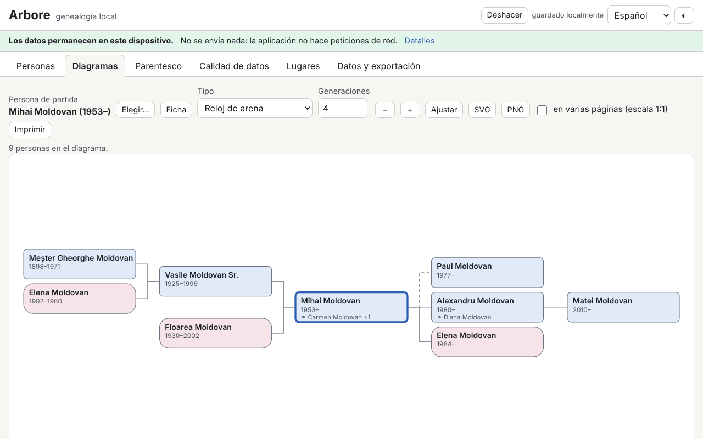

# Arbore — genealogía local

[English](README.md) · [Română](README.ro.md) · [Français](README.fr.md) · [Italiano](README.it.md) · **Español** · [Português](README.pt.md) · [Deutsch](README.de.md) · [Magyar](README.hu.md)

**Versión:** 1.0.0 · **Última actualización:** 2026-10-14

Idiomas de la interfaz: **Română, English, Français, Italiano, Español, Português (PT), Deutsch, Magyar**

Arbore es un programa de genealogía que funciona íntegramente en el navegador: personas (varios nombres, apellidos de soltera, fechas incompletas, lugares, ocupaciones, eventos propios, notas, fuentes, etiquetas, fotografías pequeñas), familias (parejas, tipo de unión, hijos biológicos/adoptados/políticos, matrimonio y divorcio), importación/exportación GEDCOM 5.5.1, diagramas SVG (ascendencia de 3 a 7 generaciones, descendencia, reloj de arena, abanico), ficha personal, cronología, lista de lugares, calculadora de parentesco con la terminología rumana y comprobaciones de calidad de los datos (duplicados, incoherencias, fusión con opción de deshacer).

**Aplicación en línea:** https://chiuta.github.io/apps/Arbore/

## Cómo se usa

1. Pulsa **Cargar ejemplo** (una familia ficticia) o **Datos y exportación → Importar** para un archivo `.ged` / `.fff.json`; o añade personas con **+ Persona**.
2. **Personas**: búsqueda (nombre, año, lugar, etiqueta), filtros, ficha personal con eventos, padres, hermanos, uniones e hijos.
3. **Diagramas**: elige la persona base, el tipo y el número de generaciones. Flechas = moverse entre personas, Intro = recentrar, Mayús+Intro = ficha, `+`/`-`/`0` = zoom/ajuste; ratón (arrastrar, rueda) y táctil (desplazar, pellizcar). Exportación SVG/PNG, impresión (también en varias páginas a escala 1:1).
4. **Parentesco**: elige dos personas; el resultado da el término rumano, el grado canónico y civil y el camino explicado.
5. **Calidad de los datos**: ejecuta las comprobaciones, abre la persona desde el informe, busca duplicados y fusiona con **Deshacer** disponible.
6. **Datos y exportación**: cifrado opcional con contraseña, opciones de privacidad al exportar, GEDCOM, JSON, CSV, informe imprimible, **Borrar todo**.

## Lo que NO hace y límites

- No sincroniza entre dispositivos ni tiene copia en la nube: exporta periódicamente.
- Los datos permanecen en el navegador (localStorage, con IndexedDB como respaldo); borrar los datos del sitio o el modo privado pueden eliminarlos.
- GEDCOM 5.5.1 UTF-8 para el uso corriente; ANSEL/ANSI solo de forma mínima, con aviso. GEDCOM 7 y ZIP/GEDZIP no son compatibles. Las etiquetas desconocidas se conservan en el viaje de ida y vuelta, pero no son editables.
- Los calendarios no gregorianos se conservan como texto y se tratan de forma aproximada en las comprobaciones.
- Los términos de parentesco están solo en rumano (la interfaz está traducida, la terminología no); los casos muy complejos (matrimonios repetidos entre parientes) reciben una descripción aproximada o el camino más corto. No es asesoramiento jurídico ni religioso.
- Los duplicados son sugerencias; comprueba antes de fusionar.
- No hay mapa (los lugares son solo una lista, sin geocodificación).
- Las fotografías son opcionales, se redimensionan a un máximo de 400 px y se almacenan como `data:` en el árbol; muchas fotografías ocupan gran parte de la cuota del navegador.
- La contraseña de cifrado no se almacena: **contraseña perdida = datos perdidos**.

## Privacidad

Los datos familiares son sensibles. La aplicación funciona en local y no envía nada: no tiene servidor, cuentas, analítica ni peticiones de red (CSP con `connect-src 'none'`), y el aviso de la parte superior lo indica. El árbol se guarda solo en tu navegador, opcionalmente cifrado con AES-GCM 256 con una clave derivada mediante PBKDF2-SHA256 (310 000 iteraciones, sal y IV aleatorios). Las exportaciones (GEDCOM, JSON, CSV, informe) enmascaran por defecto a las personas vivas (o las eliminan por completo; opcionalmente también a las nacidas en los últimos N años); una exportación sin enmascarar requiere confirmación explícita. Se considera que una persona está viva si no tiene fallecimiento registrado y no nació hace más de 110 años, salvo marcado manual.

## Formatos admitidos

- Importación: GEDCOM 5.5.1 (`.ged`, UTF-8 con o sin BOM; ANSI/ANSEL mínimo), `.fff.json` (también cifrado).
- Exportación: GEDCOM 5.5.1 UTF-8 (`CHAR UTF-8`, líneas ≤ 255 con CONC/CONT), `.fff.json` (opcionalmente cifrado), CSV (personas, familias), informe HTML imprimible, SVG, PNG.
- Etiquetas GEDCOM: INDI, FAM, NAME (GIVN/SURN/NPFX/NSFX/NICK), SEX, BIRT/DEAT/BURI/CHR/MARR/DIV/OCCU/RESI/EVEN con DATE/PLAC/NOTE/SOUR, HUSB/WIFE/CHIL/FAMC/FAMS, SOUR/REPO, OBJE, ASSO; el resto se conserva tal cual.
- Los archivos con problemas se importan en la medida de lo posible, con un informe de errores y advertencias.

## Aspectos técnicos

Un único archivo `index.html`, sin bibliotecas externas, funciona sin conexión desde `file://`. CSP estricta (`default-src 'none'`, script con hash SHA-256, sin `unsafe-eval`, sin manejadores en línea); `style-src 'unsafe-inline'` es necesario para los estilos en línea de los diagramas SVG, y `img-src`/`worker-src` con `data:`/`blob:` para las fotografías y la exportación PNG. El análisis de GEDCOM, la indexación, las comprobaciones y los duplicados se ejecutan por fracciones de tiempo (sin bloquear la interfaz); la lista de personas está virtualizada (probada con 10 000 personas). La calculadora de parentesco encuentra los antepasados comunes más cercanos, deduce el grado (civil = suma de los grados, canónico = máximo) y aplica tablas de términos rumanos, con afinidad, padrinos/ahijados y el camino más corto como último recurso.

Pruebas: `node tests/test.mjs` (Playwright/Chromium, red bloqueada): arranque/CSP, ida y vuelta GEDCOM con archivos realistas (diacríticos, CONC/CONT, fechas aproximadas, etiquetas desconocidas, archivo con problemas), fechas, parentesco, coherencia/duplicados/fusión, enmascaramiento de personas vivas, cifrado, 10 000 personas, diagramas/teclado/exportación, axe, desbordamiento horizontal, temas.

## Terceros

No se utiliza código de terceros.

## Traducciones

La interfaz está disponible en ro, en, fr, it, es, pt, hu, de. Las traducciones fr/it/es/pt/hu/de son automáticas y no han sido revisadas por hablantes nativos.

## Licencia

MIT — véase el archivo `LICENSE` en la raíz del repositorio.

## Historial

- 1.0.0 — 2026-10-14: primera versión.
