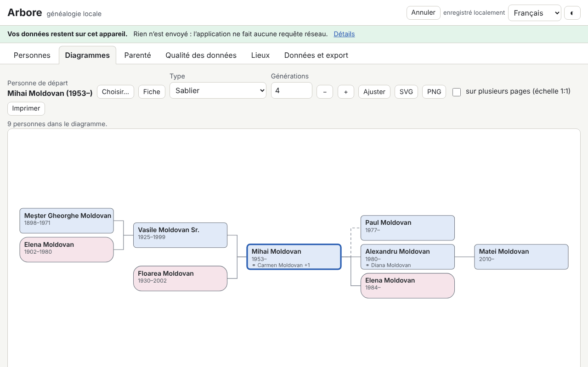

# Arbore — généalogie locale

[English](README.md) · [Română](README.ro.md) · **Français** · [Italiano](README.it.md) · [Español](README.es.md) · [Português](README.pt.md) · [Deutsch](README.de.md) · [Magyar](README.hu.md)

**Version :** 1.0.5 · **Dernière mise à jour :** 2026-10-23

Langues de l'interface : **Română, English, Français, Italiano, Español, Português (PT), Deutsch, Magyar**

Arbore est un logiciel de généalogie qui fonctionne entièrement dans le navigateur : personnes (noms multiples, noms de jeune fille, dates incomplètes, lieux, professions, événements personnalisés, notes, sources, étiquettes, petites photos), familles (partenaires, type d'union, enfants biologiques/adoptés/par alliance, mariage et divorce), import/export GEDCOM 5.5.1, diagrammes SVG (ascendance sur 3 à 7 générations, descendance, sablier, éventail), fiche personnelle, chronologie, liste des lieux, calculateur de parenté selon la terminologie roumaine et contrôles de qualité des données (doublons, incohérences, fusion avec annulation).

**Application en ligne :** https://chiuta.github.io/apps/Arbore/

## Mode d'emploi

1. Appuyez sur **Charger l'exemple** (une famille fictive) ou sur **Données et export → Import** pour un fichier `.ged` / `.fff.json` ; ou ajoutez des personnes avec **+ Personne**.
2. **Personnes** : recherche (nom, année, lieu, étiquette), filtres, fiche personnelle avec événements, parents, frères et sœurs, unions et enfants.
3. **Diagrammes** : choisissez la personne de base, le type et le nombre de générations. Flèches = navigation entre les personnes, Entrée = recentrer, Maj+Entrée = fiche, `+`/`-`/`0` = zoom/ajustement ; souris (glisser, molette) et tactile (déplacement, pincement). Export SVG/PNG, impression (aussi sur plusieurs pages à l'échelle 1:1).
4. **Parenté** : choisissez deux personnes ; le résultat donne le terme roumain, le degré canonique et civil, et le chemin expliqué.
5. **Qualité des données** : lancez les contrôles, ouvrez la personne depuis le rapport, cherchez les doublons et fusionnez avec **Annuler** disponible.
6. **Données et export** : chiffrement facultatif par mot de passe, options de confidentialité à l'export, GEDCOM, JSON, CSV, rapport imprimable, **Tout supprimer**.

## Ce que l'application NE fait PAS, et ses limites

- Elle ne se synchronise pas entre appareils et n'a pas de copie dans le cloud : faites des exports régulièrement.
- Les données restent dans le navigateur (localStorage, avec IndexedDB en secours) ; l'effacement des données du site ou la navigation privée peuvent les supprimer.
- GEDCOM 5.5.1 UTF-8 pour l'usage courant ; ANSEL/ANSI de façon minimale seulement, avec avertissement. GEDCOM 7 et ZIP/GEDZIP ne sont pas pris en charge. Les balises inconnues sont conservées lors d'un aller-retour, mais ne sont pas modifiables.
- Les calendriers non grégoriens sont conservés sous forme de texte et traités de façon approximative dans les contrôles.
- Les termes de parenté sont uniquement en roumain (l'interface est traduite, pas la terminologie) ; les cas très complexes (mariages répétés entre parents) reçoivent une description approximative ou le chemin le plus court. Ce n'est pas un conseil juridique ou religieux.
- Les doublons sont des suggestions ; vérifiez avant de fusionner.
- Il n'y a pas de carte (les lieux ne forment qu'une liste, sans géocodage).
- Les photos sont facultatives, redimensionnées à 400 px au maximum et stockées en `data:` dans l'arbre ; de nombreuses photos occupent une grande partie du quota du navigateur.
- Le mot de passe de chiffrement n'est pas stocké : **mot de passe perdu = données perdues**.

## Confidentialité

Les données familiales sont sensibles. L'application fonctionne en local et n'envoie rien : elle n'a ni serveur, ni comptes, ni analyse d'audience, ni requêtes réseau (CSP avec `connect-src 'none'`), et le bandeau en haut de la page le dit. L'arbre est enregistré uniquement dans votre navigateur, éventuellement chiffré en AES-GCM 256 avec une clé dérivée par PBKDF2-SHA256 (600 000 itérations, sel et IV aléatoires). Les exports (GEDCOM, JSON, CSV, rapport) masquent par défaut les personnes vivantes (ou les suppriment complètement ; en option, aussi celles nées au cours des N dernières années) ; un export non masqué demande une confirmation explicite. Une personne est considérée comme vivante si elle n'a pas de décès enregistré et n'est pas née il y a plus de 110 ans, sauf marquage manuel.

## Formats pris en charge

- Import : GEDCOM 5.5.1 (`.ged`, UTF-8 avec ou sans BOM ; ANSI/ANSEL minimal), `.fff.json` (y compris chiffré).
- Export : GEDCOM 5.5.1 UTF-8 (`CHAR UTF-8`, lignes ≤ 255 avec CONC/CONT), `.fff.json` (éventuellement chiffré), CSV (personnes, familles), rapport HTML imprimable, SVG, PNG.
- Balises GEDCOM : INDI, FAM, NAME (GIVN/SURN/NPFX/NSFX/NICK), SEX, BIRT/DEAT/BURI/CHR/MARR/DIV/OCCU/RESI/EVEN avec DATE/PLAC/NOTE/SOUR, HUSB/WIFE/CHIL/FAMC/FAMS, SOUR/REPO, OBJE, ASSO ; le reste est conservé tel quel.
- Les fichiers présentant des problèmes sont importés dans la mesure du possible, avec un rapport d'erreurs et d'avertissements.

## Aspects techniques

Un seul fichier `index.html`, sans bibliothèque externe, fonctionne hors ligne depuis `file://`. CSP stricte (`default-src 'none'`, script avec hachage SHA-256, sans `unsafe-eval`, sans gestionnaires en ligne) ; `style-src 'unsafe-inline'` est nécessaire pour les styles en ligne des diagrammes SVG, et `img-src`/`worker-src` avec `data:`/`blob:` pour les photos et l'export PNG. L'analyse GEDCOM, l'indexation, les contrôles et les doublons s'exécutent par tranches de temps (sans bloquer l'interface) ; la liste des personnes est virtualisée (testée avec 10 000 personnes). Le calculateur de parenté trouve les ancêtres communs les plus proches, déduit le degré (civil = somme des degrés, canonique = maximum) et applique des tables de termes roumains, avec alliance, parrains/filleuls et chemin le plus court en dernier recours.

Tests : `node tests/test.mjs` (Playwright/Chromium, réseau bloqué) : démarrage/CSP, aller-retour GEDCOM sur des fichiers réalistes (diacritiques, CONC/CONT, dates approximatives, balises inconnues, fichier à problèmes), dates, parenté, cohérence/doublons/fusion, masquage des personnes vivantes, chiffrement, 10 000 personnes, diagrammes/clavier/export, axe, débordement horizontal, thèmes.

## Tiers

Aucun code tiers n'est utilisé.

## Traductions

L'interface est disponible en ro, en, fr, it, es, pt, hu, de. Les traductions fr/it/es/pt/hu/de sont automatiques et n'ont pas été vérifiées par des locuteurs natifs.

## Licence

MIT — voir le fichier `LICENSE` à la racine du dépôt.

## Historique

- 1.0.0 — 2026-10-14 : première version.
- 1.0.1 — 2026-10-22 : le chiffrement par mot de passe dérive désormais la clé avec PBKDF2-SHA256 à 600 000 itérations (OWASP) ; les copies existantes à 310 000 s’ouvrent toujours et sont mises à niveau à la prochaine sauvegarde après déverrouillage ; rappel (avec un bouton « Exporter maintenant ») sans sauvegarde JSON/GEDCOM depuis 30 jours ; l’export CSV neutralise les cellules de texte commençant par = + - @ (et tabulation/CR) ; cibles tactiles d’au moins 24 px.
- 1.0.2 — 2026-10-22 : fff-kit 1.1.2 : PBKDF2 à 600 000 itérations, protection anti-clickjacking.
- 1.0.3 — 2026-10-22 : fff-kit 1.1.4 : cibles tactiles et taille minimale du texte dans l’interface commune.
- 1.0.5 — 2026-10-23 : audit adverse : les identifiants GEDCOM comme « constructor »/« __proto__ » ne sont plus rejetés comme doublons ; la fusion d’un ancêtre avec son descendant (p. ex. grand-père et petit-fils de même nom) est refusée et n’est plus proposée comme doublon ; les jours impossibles (30 FEB, 31 APR, 29 FEB hors années bissextiles) sont traités comme date non reconnue ; nouvelle vérification des naissances/décès dans le futur ; les données illisibles sont conservées dans `fff.arbore.tree.bak` et un arbre IndexedDB illisible n’est plus supprimé à la première sauvegarde ; l’import JSON refuse les identifiants hostiles et les photos qui ne sont pas `data:image/` ; un GEDCOM à imbrication énorme ne fait plus déborder la pile ; traduction portugaise manquante de « lim5 » ; cibles tactiles de 44 px sur écran tactile ; constante de version du code et `sw.js` alignées sur la version de l’application.
