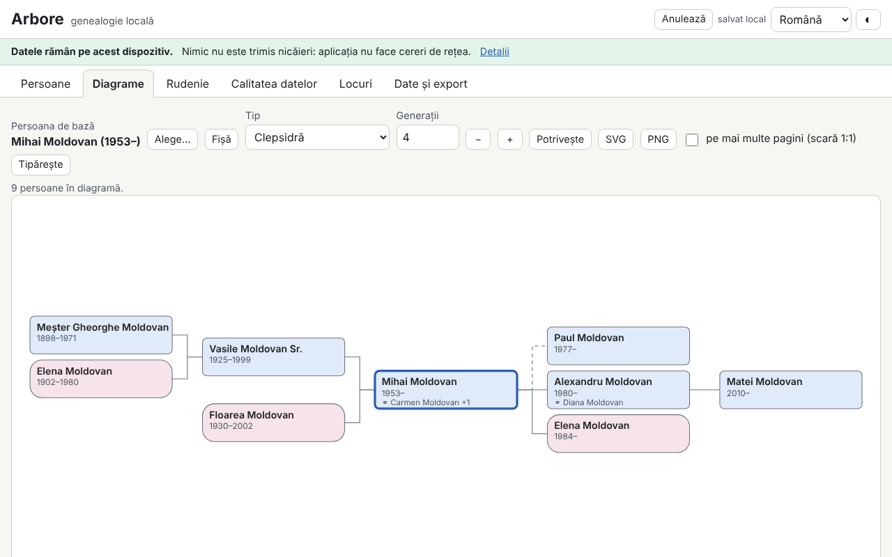

# Arbore — genealogia locale

[English](README.md) · [Română](README.ro.md) · [Français](README.fr.md) · **Italiano** · [Español](README.es.md) · [Português](README.pt.md) · [Deutsch](README.de.md) · [Magyar](README.hu.md)

**Versione:** 1.0.0 · **Ultimo aggiornamento:** 2026-10-14

Lingue dell'interfaccia: **Română, English, Français, Italiano, Español, Português (PT), Deutsch, Magyar**

Arbore è un programma di genealogia che funziona interamente nel browser: persone (nomi multipli, cognomi da nubile, date incomplete, luoghi, professioni, eventi personalizzati, note, fonti, etichette, piccole fotografie), famiglie (partner, tipo di unione, figli biologici/adottati/acquisiti, matrimonio e divorzio), importazione/esportazione GEDCOM 5.5.1, diagrammi SVG (ascendenza su 3–7 generazioni, discendenza, clessidra, ventaglio), scheda personale, cronologia, elenco dei luoghi, calcolatore di parentela con la terminologia rumena e controlli di qualità dei dati (duplicati, incongruenze, unione con annullamento).

**App online:** https://chiuta.github.io/apps/Arbore/

## Come si usa

1. Premi **Carica esempio** (una famiglia fittizia) oppure **Dati ed esportazione → Importa** per un file `.ged` / `.fff.json`; oppure aggiungi persone con **+ Persona**.
2. **Persone**: ricerca (nome, anno, luogo, etichetta), filtri, scheda personale con eventi, genitori, fratelli e sorelle, unioni e figli.
3. **Diagrammi**: scegli la persona di partenza, il tipo e il numero di generazioni. Frecce = spostamento tra le persone, Invio = ricentra, Maiusc+Invio = scheda, `+`/`-`/`0` = zoom/adattamento; mouse (trascinamento, rotellina) e tocco (spostamento, pizzico). Esportazione SVG/PNG, stampa (anche su più pagine in scala 1:1).
4. **Parentela**: scegli due persone; il risultato fornisce il termine rumeno, il grado canonico e civile e il percorso spiegato.
5. **Qualità dei dati**: esegui i controlli, apri la persona dal rapporto, cerca i duplicati e unisci con **Annulla** disponibile.
6. **Dati ed esportazione**: cifratura facoltativa con password, opzioni di riservatezza all'esportazione, GEDCOM, JSON, CSV, rapporto stampabile, **Elimina tutto**.

## Cosa NON fa e limiti

- Non sincronizza tra dispositivi e non ha copia nel cloud: esporta periodicamente.
- I dati risiedono nel browser (localStorage, con IndexedDB come riserva); la cancellazione dei dati del sito o la modalità privata possono rimuoverli.
- GEDCOM 5.5.1 UTF-8 per l'uso corrente; ANSEL/ANSI solo in modo minimo, con avviso. GEDCOM 7 e ZIP/GEDZIP non sono supportati. I tag sconosciuti vengono conservati nel round-trip, ma non sono modificabili.
- I calendari non gregoriani vengono conservati come testo e trattati in modo approssimativo nei controlli.
- I termini di parentela sono solo in rumeno (l'interfaccia è tradotta, la terminologia no); i casi molto complessi (matrimoni ripetuti tra parenti) ricevono una descrizione approssimativa o il percorso più breve. Non costituisce consulenza legale o religiosa.
- I duplicati sono suggerimenti; verifica prima di unire.
- Non c'è una mappa (i luoghi sono solo un elenco, senza geocodifica).
- Le fotografie sono facoltative, ridimensionate a un massimo di 400 px e memorizzate come `data:` nell'albero; molte fotografie occupano gran parte della quota del browser.
- La password di cifratura non viene memorizzata: **password persa = dati persi**.

## Riservatezza

I dati di famiglia sono sensibili. L'applicazione funziona in locale e non invia nulla: non ha server, account, analisi o richieste di rete (CSP con `connect-src 'none'`), e il banner in alto lo dichiara. L'albero viene salvato solo nel tuo browser, facoltativamente cifrato con AES-GCM 256 con una chiave derivata tramite PBKDF2-SHA256 (310.000 iterazioni, sale e IV casuali). Le esportazioni (GEDCOM, JSON, CSV, rapporto) oscurano per impostazione predefinita le persone viventi (o le eliminano del tutto; facoltativamente anche quelle nate negli ultimi N anni); un'esportazione non oscurata richiede una conferma esplicita. Una persona è considerata vivente se non ha un decesso registrato e non è nata più di 110 anni fa, salvo marcatura manuale.

## Formati supportati

- Importazione: GEDCOM 5.5.1 (`.ged`, UTF-8 con o senza BOM; ANSI/ANSEL minimo), `.fff.json` (anche cifrato).
- Esportazione: GEDCOM 5.5.1 UTF-8 (`CHAR UTF-8`, righe ≤ 255 con CONC/CONT), `.fff.json` (facoltativamente cifrato), CSV (persone, famiglie), rapporto HTML stampabile, SVG, PNG.
- Tag GEDCOM: INDI, FAM, NAME (GIVN/SURN/NPFX/NSFX/NICK), SEX, BIRT/DEAT/BURI/CHR/MARR/DIV/OCCU/RESI/EVEN con DATE/PLAC/NOTE/SOUR, HUSB/WIFE/CHIL/FAMC/FAMS, SOUR/REPO, OBJE, ASSO; il resto viene conservato così com'è.
- I file con problemi vengono importati per quanto possibile, con un rapporto di errori e avvisi.

## Aspetti tecnici

Un unico file `index.html`, senza librerie esterne, funziona offline da `file://`. CSP rigorosa (`default-src 'none'`, script con hash SHA-256, senza `unsafe-eval`, senza gestori inline); `style-src 'unsafe-inline'` è necessario per gli stili inline dei diagrammi SVG, e `img-src`/`worker-src` con `data:`/`blob:` per le fotografie e l'esportazione PNG. L'analisi GEDCOM, l'indicizzazione, i controlli e i duplicati vengono eseguiti a fette di tempo (senza bloccare l'interfaccia); l'elenco delle persone è virtualizzato (testato con 10.000 persone). Il calcolatore di parentela trova gli antenati comuni più vicini, deduce il grado (civile = somma dei gradi, canonico = massimo) e applica tabelle di termini rumeni, con affinità, padrini/figliocci e percorso più breve come ripiego.

Test: `node tests/test.mjs` (Playwright/Chromium, rete bloccata): avvio/CSP, round-trip GEDCOM su file realistici (segni diacritici, CONC/CONT, date approssimative, tag sconosciuti, file con problemi), date, parentela, coerenza/duplicati/unione, oscuramento delle persone viventi, cifratura, 10.000 persone, diagrammi/tastiera/esportazione, axe, overflow orizzontale, temi.

## Terze parti

Non viene utilizzato codice di terze parti.

## Traduzioni

L'interfaccia è disponibile in ro, en, fr, it, es, pt, hu, de. Le traduzioni fr/it/es/pt/hu/de sono automatiche e non sono state verificate da madrelingua.

## Licenza

MIT — vedi il file `LICENSE` nella radice del repository.

## Cronologia

- 1.0.0 — 2026-10-14: prima versione.
