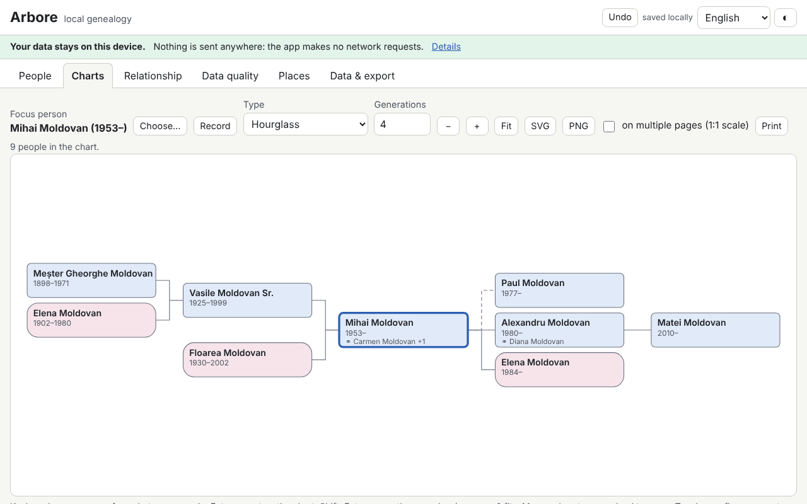

# Arbore — local genealogy

**English** · [Română](README.ro.md) · [Français](README.fr.md) · [Italiano](README.it.md) · [Español](README.es.md) · [Português](README.pt.md) · [Deutsch](README.de.md) · [Magyar](README.hu.md)

**Version:** 1.0.3 · **Last updated:** 2026-10-22

Interface languages: **Română, English, Français, Italiano, Español, Português (PT), Deutsch, Magyar**

Arbore is a genealogy program that runs entirely in the browser: persons (multiple names, maiden names, incomplete dates, places, occupations, custom events, notes, sources, tags, small photos), families (partners, type of union, biological/adopted/step children, marriage and divorce), GEDCOM 5.5.1 import/export, SVG charts (ancestors over 3–7 generations, descendants, hourglass, fan), personal record sheet, timeline, list of places, a kinship calculator using Romanian terminology, and data-quality checks (duplicates, inconsistencies, merging with undo).

**Live app:** https://chiuta.github.io/apps/Arbore/

## How to use

1. Press **Load example** (a fictional family) or **Data and export → Import** for a `.ged` / `.fff.json` file; or add people with **+ Person**.
2. **People**: search (name, year, place, tag), filters, personal record sheet with events, parents, siblings, unions and children.
3. **Charts**: choose the base person, the type and the number of generations. Arrows = move between people, Enter = recenter, Shift+Enter = record sheet, `+`/`-`/`0` = zoom/fit; mouse (drag, wheel) and touch (pan, pinch). Export to SVG/PNG, printing (also across several pages at 1:1 scale).
4. **Kinship**: choose two people; the result gives the Romanian term, the canonical and civil degree, and the explained path.
5. **Data quality**: run the checks, open the person from the report, look for duplicates and merge with **Undo** available.
6. **Data and export**: optional password encryption, privacy options at export, GEDCOM, JSON, CSV, printable report, **Delete everything**.

## What it does NOT do, and limits

- It does not sync between devices and has no cloud copy: export periodically.
- Data lives in the browser (localStorage, with IndexedDB as fallback); clearing site data or private mode can remove it.
- GEDCOM 5.5.1 UTF-8 for everyday use; ANSEL/ANSI only minimally, with a warning. GEDCOM 7 and ZIP/GEDZIP are not supported. Unknown tags are kept on round-trip but are not editable.
- Non-Gregorian calendars are kept as text and treated approximately in the checks.
- Kinship terms are in Romanian only (the interface is translated, the terminology is not); very complex cases (repeated marriages between relatives) get an approximate description or the shortest path. This is not legal or religious advice.
- Duplicates are suggestions; check before merging.
- There is no map (places are only a list, without geocoding).
- Photos are optional, resized to at most 400 px and stored as `data:` in the tree; many photos take up a lot of the browser quota.
- The encryption password is not stored: **lost password = lost data**.

## Privacy

Family data is sensitive. The application runs locally and sends nothing: it has no server, accounts, analytics or network requests (CSP with `connect-src 'none'`), and the banner at the top says so. The tree is saved only in your browser, optionally encrypted with AES-GCM 256 using a key derived through PBKDF2-SHA256 (600,000 iterations, random salt and IV). Exports (GEDCOM, JSON, CSV, report) mask living persons by default (or remove them entirely; optionally also those born in the last N years); an unmasked export requires explicit confirmation. A person is considered living if they have no death record and were not born more than 110 years ago, unless marked manually.

## Supported formats

- Import: GEDCOM 5.5.1 (`.ged`, UTF-8 with or without BOM; minimal ANSI/ANSEL), `.fff.json` (including encrypted).
- Export: GEDCOM 5.5.1 UTF-8 (`CHAR UTF-8`, lines ≤ 255 with CONC/CONT), `.fff.json` (optionally encrypted), CSV (persons, families), printable HTML report, SVG, PNG.
- GEDCOM tags: INDI, FAM, NAME (GIVN/SURN/NPFX/NSFX/NICK), SEX, BIRT/DEAT/BURI/CHR/MARR/DIV/OCCU/RESI/EVEN with DATE/PLAC/NOTE/SOUR, HUSB/WIFE/CHIL/FAMC/FAMS, SOUR/REPO, OBJE, ASSO; the rest is kept as is.
- Files with problems are imported as far as possible, with a report of errors and warnings.

## Technical

A single `index.html` file, no external libraries, works offline from `file://`. Strict CSP (`default-src 'none'`, script with SHA-256 hash, no `unsafe-eval`, no inline handlers); `style-src 'unsafe-inline'` is needed for the inline styles of the SVG charts, and `img-src`/`worker-src` with `data:`/`blob:` for photos and PNG export. GEDCOM parsing, indexing, checks and duplicates run in time slices (without blocking the interface); the list of people is virtualized (tested with 10,000 people). The kinship calculator finds the nearest common ancestors, deduces the degree (civil = sum of steps, canonical = maximum) and applies tables of Romanian terms, with affinity, godparents/godchildren and the shortest path as a fallback.

Tests: `node tests/test.mjs` (Playwright/Chromium, network blocked): startup/CSP, GEDCOM round-trip on realistic files (diacritics, CONC/CONT, approximate dates, unknown tags, a problematic file), dates, kinship, consistency/duplicates/merging, masking of living persons, encryption, 10,000 people, charts/keyboard/export, axe, horizontal overflow, themes.

## Third parties

No third-party code is used.

## Translations

The interface is available in ro, en, fr, it, es, pt, hu, de. The fr/it/es/pt/hu/de translations are machine-made and have not been checked by native speakers.

## License

MIT — see the `LICENSE` file at the root of the repository.

## History

- 1.0.0 — 2026-10-14: first version.
- 1.0.1 — 2026-10-22: password encryption now derives the key with PBKDF2-SHA256 at 600,000 iterations (OWASP); existing copies at 310,000 still open and are upgraded on the next save after unlocking; reminder (with an Export now button) when there has been no JSON/GEDCOM backup for 30 days; CSV export neutralises text cells starting with = + - @ (and tab/CR); touch targets of at least 24 px.
- 1.0.2 — 2026-10-22: fff-kit 1.1.2: PBKDF2 with 600,000 iterations, anti-clickjacking protection.
- 1.0.3 — 2026-10-22: fff-kit 1.1.4: touch targets and minimum text size in the shared interface.
