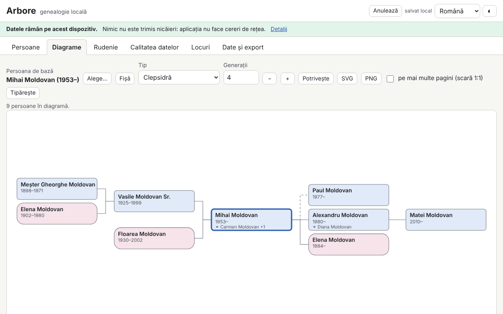

# Arbore — genealogie locală

[English](README.md) · **Română** · [Français](README.fr.md) · [Italiano](README.it.md) · [Español](README.es.md) · [Português](README.pt.md) · [Deutsch](README.de.md) · [Magyar](README.hu.md)

**Versiune:** 1.0.2 · **Ultima actualizare:** 2026-10-22

Limbile interfeței: **Română, English, Français, Italiano, Español, Português (PT), Deutsch, Magyar**

Arbore este un program de genealogie care rulează integral în browser: persoane (nume multiple, nume de fată, date incomplete, locuri, ocupații, evenimente proprii, note, surse, etichete, fotografii mici), familii (parteneri, tip de uniune, copii biologici/adoptați/vitregi, căsătorie și divorț), import/export GEDCOM 5.5.1, diagrame SVG (ascendență pe 3–7 generații, descendență, clepsidră, evantai), fișă personală, cronologie, lista locurilor, calculator de rudenie în terminologia românească și verificări ale calității datelor (duplicate, inconsistențe, îmbinare cu anulare).

**Live:** https://chiuta.github.io/apps/Arbore/

## Cum se folosește

1. Apasă **Încarcă exemplu** (o familie fictivă) sau **Date și export → Import** pentru un fișier `.ged` / `.fff.json`; sau adaugă persoane cu **+ Persoană**.
2. **Persoane**: căutare (nume, an, loc, etichetă), filtre, fișă personală cu evenimente, părinți, frați, uniuni și copii.
3. **Diagrame**: alege persoana de bază, tipul și numărul de generații. Săgeți = navigare între persoane, Enter = recentrare, Shift+Enter = fișa, `+`/`-`/`0` = zoom/potrivire; mouse (tragere, rotiță) și tactil (deplasare, ciupire). Export SVG/PNG, tipărire (și pe mai multe pagini la scara 1:1).
4. **Rudenie**: alege două persoane; rezultatul dă termenul românesc, gradul canonic și civil și calea explicată.
5. **Calitatea datelor**: rulează verificările, deschide persoana din raport, caută duplicate și îmbină cu **Anulează** disponibil.
6. **Date și export**: criptare opțională cu parolă, opțiunile de confidențialitate la export, GEDCOM, JSON, CSV, raport tipăribil, **Șterge tot**.

## Ce NU face și limitele

- Nu sincronizează între dispozitive și nu are copie în cloud: fă periodic export.
- Datele stau în browser (localStorage, cu rezervă IndexedDB); ștergerea datelor site-ului sau modul privat le pot elimina.
- GEDCOM 5.5.1 UTF-8 pentru uz curent; ANSEL/ANSI doar minimal, cu avertisment. GEDCOM 7 și ZIP/GEDZIP nu sunt acceptate. Etichetele necunoscute se păstrează la round-trip, dar nu sunt editabile.
- Calendarele non-gregoriene se păstrează ca text și sunt tratate aproximativ în verificări.
- Termenii de rudenie sunt doar în română (interfața e tradusă, terminologia nu); cazurile foarte complexe (căsătorii repetate între rude) primesc o descriere aproximativă sau calea cea mai scurtă. Nu este consultanță juridică sau religioasă.
- Duplicatele sunt sugestii; verifică înainte de îmbinare.
- Nu există hartă (locurile sunt doar o listă, fără geocodare).
- Fotografiile sunt opționale, redimensionate la cel mult 400 px și stocate ca `data:` în arbore; multe fotografii ocupă mult din cota browserului.
- Parola de criptare nu este stocată: **parolă pierdută = date pierdute**.

## Confidențialitate

Datele de familie sunt sensibile. Aplicația rulează local și nu trimite nimic: nu are server, conturi, analiză sau cereri de rețea (CSP cu `connect-src 'none'`), iar bannerul din partea de sus spune acest lucru. Arborele este salvat doar în browserul tău, opțional criptat AES-GCM 256 cu cheie derivată prin PBKDF2-SHA256 (600 000 iterații, sare și IV aleatorii). Exporturile (GEDCOM, JSON, CSV, raport) maschează implicit persoanele în viață (sau le elimină complet; opțional și cele născute în ultimii N ani); exportul nemascat cere confirmare explicită. O persoană este considerată în viață dacă nu are deces și nu a fost născută cu mai mult de 110 de ani în urmă, dacă nu este marcată manual.

## Formate acceptate

- Import: GEDCOM 5.5.1 (`.ged`, UTF-8 cu sau fără BOM; ANSI/ANSEL minimal), `.fff.json` (și criptat).
- Export: GEDCOM 5.5.1 UTF-8 (`CHAR UTF-8`, linii ≤ 255 cu CONC/CONT), `.fff.json` (opțional criptat), CSV (persoane, familii), raport HTML tipăribil, SVG, PNG.
- Etichete GEDCOM: INDI, FAM, NAME (GIVN/SURN/NPFX/NSFX/NICK), SEX, BIRT/DEAT/BURI/CHR/MARR/DIV/OCCU/RESI/EVEN cu DATE/PLAC/NOTE/SOUR, HUSB/WIFE/CHIL/FAMC/FAMS, SOUR/REPO, OBJE, ASSO; restul se păstrează ca atare.
- Fișierele cu probleme se importă cât se poate, cu raport de erori și avertismente.

## Tehnic

Un singur fișier `index.html`, fără biblioteci externe, funcționează offline din `file://`. CSP strict (`default-src 'none'`, script cu hash SHA-256, fără `unsafe-eval`, fără handlere inline); `style-src 'unsafe-inline'` este necesar pentru stilurile inline ale diagramelor SVG, iar `img-src`/`worker-src` cu `data:`/`blob:` pentru fotografii și exportul PNG. Parsarea GEDCOM, indexarea, verificările și duplicatele rulează în felii de timp (fără blocarea interfeței); lista de persoane este virtualizată (testat cu 10 000 de persoane). Calculatorul de rudenie găsește strămoșii comuni cei mai apropiați, deduce gradul (civil = suma treptelor, canonic = maximul) și aplică tabele de termeni românești, cu afinitate, nași/fini și cale cea mai scurtă ca rezervă.

Teste: `node tests/test.mjs` (Playwright/Chromium, rețea blocată): pornire/CSP, round-trip GEDCOM pe fișiere realiste (diacritice, CONC/CONT, date aproximative, etichete necunoscute, fișier cu probleme), date, rudenie, consistență/duplicate/îmbinare, mascarea persoanelor în viață, criptare, 10 000 de persoane, diagrame/tastatură/export, axe, depășire orizontală, teme.

## Terți

Nu se folosește cod terț.

## Traduceri

Interfața este în ro, en, fr, it, es, pt, hu, de. Traducerile fr/it/es/pt/hu/de sunt automate, neverificate de vorbitori nativi.

## Licență

MIT — vezi fișierul `LICENSE` din rădăcina depozitului.

## Istoric

- 1.0.0 — 2026-10-14: prima versiune.
- 1.0.1 — 2026-10-22: criptarea cu parolă derivă acum cheia cu PBKDF2-SHA256 la 600.000 de iterații (OWASP); copiile existente la 310.000 se deschid în continuare și sunt actualizate la prima salvare după deblocare; memento (cu buton „Exportă acum”) când nu există o copie JSON/GEDCOM de 30 de zile; exportul CSV neutralizează celulele text care încep cu = + - @ (și tab/CR); ținte tactile de cel puțin 24 px.
- 1.0.2 — 2026-10-22: fff-kit 1.1.2: PBKDF2 cu 600.000 de iterații, protecție anti-clickjacking.
