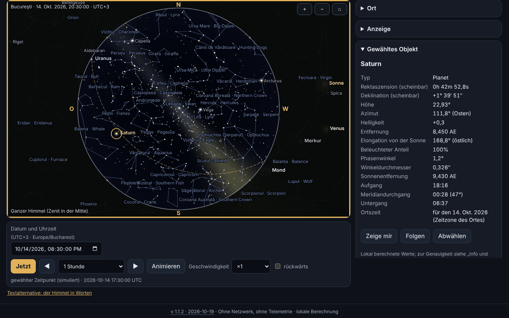

# Bolta — Offline-Planetarium

[English](README.md) · [Română](README.ro.md) · [Français](README.fr.md) · [Italiano](README.it.md) · [Español](README.es.md) · [Português](README.pt.md) · **Deutsch** · [Magyar](README.hu.md)

**Version:** 1.1.2 · **Zuletzt aktualisiert:** 2026-10-19

Oberflächensprachen: **Română, English, Français, Italiano, Español, Português (PT), Deutsch, Magyar**

Bolta zeigt den Himmel für jeden Ort der Erde und jeden Zeitpunkt zwischen 1900 und 2100: die Sonne, den Mond (mit korrekt gezeichneter Phase), die Planeten, 1627 Sterne bis zur Helligkeit 5,0, die Sternbilder (mit rumänischen und englischen Namen), die Ekliptik, den Äquator, die Gitter und eine stilisierte Milchstraße. Es berechnet Aufgang, Meridiandurchgang und Untergang, kann die nahen Ereignisse auflisten (Mondphasen, Konjunktionen, Oppositionen, Elongationen, Jahreszeiten, Finsternisse) mit `.ics`-Export und hat eine eigene Seite für die totale Sonnenfinsternis vom 2. August 2027, mit lokalen Umständen, Countdown, Simulation der Scheiben und Schema des Totalitätsstreifens. Alles läuft im Browser, ohne Netzwerk.



Der Screenshot zeigt den realen Zustand der App für Bukarest, 14. Oktober 2026, 20:30 Uhr (UTC+3), mit ausgewähltem Saturn; alle Werte werden lokal berechnet, nichts ist simuliert.

**Online:** https://chiuta.github.io/apps/Bolta/

## So wird es benutzt

1. **Der Himmel.** Wähle den Ort (interne Liste mit 282 Städten, von dir eingegebene Koordinaten — auch in der Form `44°25′36″ N` — oder die GPS-Schaltfläche) und den Zeitpunkt (Datums-/Zeitfeld, „Jetzt“, Schritte vor/zurück, Animation von ×1 bis ×100000, optional rückwärts). Die Zeitzone kommt von `Intl`; bei manuell eingegebenen Koordinaten kannst du sie ändern.
2. **Die Ansicht.** „Ganzer Himmel“ zeigt die gesamte Halbkugel (Zenit in der Mitte, Norden oben, Osten links, wie auf einer von unten betrachteten Himmelskarte); sonst siehst du ein Fenster mit veränderlichem Feld. Stereografische oder azimutale äquidistante Projektion. Mausrad oder Pinch-Geste zoomen, Ziehen bewegt den Blick. Der Abschnitt „Anzeige“ schaltet die Himmelsrichtungen, den Horizont, die Namen von Sternen und Sternbildern, die Linien, die Milchstraße, die Ekliptik, den Äquator, das alt-azimutale und das äquatoriale Gitter, Neptun/Pluto, die Atmosphäre (Taghimmel und Dämmerung), die Refraktion und die Grenzhelligkeit um.
3. **Objekte.** Klick/Tippen auf ein Objekt oder Suche nach Namen (auch die rumänischen Sternbildnamen): Feld mit scheinbarer Rektaszension und Deklination, Höhe, Azimut, Helligkeit, Entfernung, Elongation, Phase, Aufgang/Durchgang/Untergang; „Zeig mir“ zentriert die Ansicht, „Verfolgen“ hält sie zentriert.
4. **Ereignisse.** Du wählst das Intervall und die Kategorien; Bolta rechnet im Hintergrund (ohne die Seite zu blockieren), zeigt die Tabelle in der Ortszeit des Ortes, „Zum Zeitpunkt springen“ führt den Himmel zu diesem Zeitpunkt, „.ics exportieren“ lädt einen RFC-5545-Kalender herunter.
5. **Finsternis 2027.** Die Sicherheitshinweise kommen zuerst; es folgen die lokalen Umstände (C1, Maximum, C4, Größe, Bedeckung, Sonnenhöhe, und im Totalitätsstreifen auch C2/C3 mit der Dauer der Totalität), der Countdown, die Simulation der Mondscheibe vor der Sonne, das Streifenschema und die Tabelle der für die Städte Rumäniens berechneten Bedeckung.
6. **Der Himmel in Worten.** Textbeschreibung des Himmels und Tabelle mit den nach Höhe geordneten Objekten, jedes mit „Am Himmel zeigen“.
7. **Orte und Daten.** Gespeicherte Orte, `.fff.json`-Sicherung, Import, „Alles löschen“.
8. **Roter Nachtmodus** (Theme-Auswahl): Alle Farben, auch die im Canvas, werden rot. Es gibt außerdem das helle und das dunkle Theme (standardmäßig nach System).
9. **Drucken und Export.** „Drucken“ verwendet die Karte als Vektor-SVG; SVG und PNG können heruntergeladen werden (mit Option für invertierte Farben fürs Papier).
10. **Tastatur.** Der Canvas lässt sich vollständig steuern: Pfeile (bewegen den Blick), `+`/`−`, `Home`, `Leertaste` (Animation), `N` (jetzt), `,` und `.` (Schritt), `F` (ganzer Himmel), `G` (Gitter), `C` (Sternbilder), `0`–`8` (Sonne, Mond, Planeten), `Eingabe`, `Esc`, und die Tabs wechselt man mit den Pfeilen.

## Was es NICHT tut, und die Grenzen

- **Es ist kein Navigationsinstrument** und nicht für präzise Astrofotografie oder für Bedeckungen geeignet.
- **Die Genauigkeit** ist die in `fff-kit/docs/ephem.md` erklärte: scheinbare Positionen von Sonne und Planeten ≤ 3″ (Neptun ≤ 5″), Mond ≤ 1,5″, Auf-/Untergang der Sonne ≤ 6 s und des Mondes ≤ 25 s gegenüber dem Referenzmodell, Mondphasen ≤ 30 s, in 1900–2100. Das zukünftige ΔT ist unsicher (Sekunden bis 2035, Minuten gegen 2100). Tägliche Aberration, stellare Parallaxe und lokales Gelände sind nicht modelliert.
- **Sterne:** nur solche mit Helligkeit ≤ 5,0 (1627, aus Hipparcos); **es gibt keine NGC-/Messier-Objekte**, Kometen, Asteroiden oder Satelliten. Die Eigennamen sind die der IAU (156 Sterne ≤ 3,0).
- **Die Milchstraße ist stilisiert** (Modell aus der galaktischen Matrix, kein Foto) und dient nur der Orientierung. Die Farbe des Dämmerungshimmels, die Helligkeit und die Grenzhelligkeit in Abhängigkeit von der Sonne sind visuelle Näherungen, kein photometrisches Modell. Die Sternfarbe stammt aus dem B−V-Index (Näherung).
- **Die Koordinaten der Städte** sind gerundet (≈ 0,01°); ich habe keine Koordinaten erfunden: Die Liste enthält nur bekannte Städte. Für Genauigkeit gib deine eigenen Koordinaten ein. Die Zeitzone stammt aus der Datenbank des Browsers (`Intl`), daher können Zonen mit neuen Regeln in alten Browsern veraltet sein.
- **Die Refraktion** (Sæmundsson, 1010 hPa, 10 °C) ist optional und nahe dem Horizont näherungsweise.
- **Ereignisse:** Die Mond-Planeten-Konjunktionen sind geozentrisch (die Parallaxe des Mondes kann die Annäherung für einen Beobachter um bis zu ~1° verschieben); Finsternisse werden, außer der von 2027, nur **angezeigt**, wenn der Neu-/Vollmond nahe am Knoten steht (|β| < 1,58°), ohne Typ oder Sichtbarkeit; Mondfinsternisse werden nicht im Detail berechnet. Die Finsternis von 2027 ist die einzige, die mit lokalen Umständen berechnet wird.
- **Die Finsternis von 2027:** Die Werte werden von Bolta berechnet, **sie sind nicht offiziell**; verlasse dich nicht darauf, um den Filter abzunehmen. Für Rumänien die in `docs/ephem.md` erklärte Fehlermarge: Kontakte und Maximum ≈ ±3 s gegenüber der unabhängigen Referenzrechnung; Bedeckung ≤ 0,05 Prozentpunkte (max. 0,01 gegenüber der Referenz) plus die ΔT-Unsicherheit (≈ ±1 s ⇒ ±0,01 PP). Das Streifenschema hat keine Basiskarte (nur ein Koordinatengitter und Orientierungsorte); die Grenzen der Partialzone werden nicht berechnet. Die Simulation der Scheiben ist illustrativ (die Korona ist stilisiert).
- **Sicherheit:** Schaue nicht ohne zertifizierte ISO-12312-2-Filter in die Sonne; in Rumänien ist die Finsternis nur partiell, daher ist der Filter durchgehend nötig.
- Das Zeitintervall ist auf 1900–2100 begrenzt; die Ereignissuche auf höchstens ~20 Jahre auf einmal.
- Die Übersetzungen sind automatisch (siehe unten).

## Datenschutz

Läuft lokal, sendet nichts. Die CSP blockiert jede Netzwerkverbindung (`connect-src 'none'`). Die GPS-Position wird **nur** angefordert, wenn du die Schaltfläche „Meinen Standort verwenden (GPS)“ drückst (mit vorheriger Erklärung), sie wird einmalig verwendet und nicht übertragen. Lokal (localStorage, Schlüssel `fff.bolta.*`) werden nur Sprache, Theme, Anzeigeoptionen, der letzte Ort und die gespeicherten Orte behalten. „Alles löschen“ entfernt alles.

## Formate

- **Eingabe:** `.fff.json`-Sicherung (`{"format":"fff-bundle","schema":1,"app":"Bolta",…}`) mit den gespeicherten Orten; Dezimalkoordinaten oder Grad–Minuten–Sekunden (`44°25′36″ N`, `12.5 W`).
- **Ausgabe:** `.ics` (RFC 5545: CRLF, auf 75 UTF-8-Bytes gefaltete Zeilen, Escapes, eindeutige UIDs), SVG, PNG, `.fff.json`, Druck.

## Technik

Eine einzige Datei `index.html` (≈ 575 KiB), ohne externe Bibliotheken oder Schriftarten. Die astronomischen Module `ephem.js` und `ephem-stars.js` aus `fff-kit` sind **inline kopiert, unverändert**, damit die App eigenständig bleibt; das Kit wird nicht injiziert und nicht verändert.

- **Zeichnen:** 2D-Canvas. Stereografische Projektion (k = 2/(1+Z)) oder azimutale äquidistante (k = θ/sin θ) auf einer orthonormalen Ansichtsbasis; im Modus „ganzer Himmel“ liegt die Ansicht im Zenit (188,8° stereografisch / 195,6° äquidistant). Der Horizont ist das abgetastete Polygon des Großkreises alt = 0, und der Boden wird nach der Even-Odd-Regel gefüllt.
- **Sterne:** Die Positionen kommen aus `starPosition` der Bibliothek (Eigenbewegung, Präzession, Nutation, Aberration). Aus Geschwindigkeitsgründen wird in jedem Frame eine Rotationsmatrix aus 3 Basisaufrufen und ein Aberrationsvektor erster Ordnung berechnet; der Unterschied zum direkten Aufruf für jeden Stern beträgt ≤ 0,16″ bei 4660 Sternen in den untenstehenden Tests.
- **Himmel:** Der Tag-/Dämmerungs-/Nachthintergrund ist ein Bild niedriger Auflösung in Abhängigkeit von der Sonnenhöhe; die Grenzhelligkeit sinkt tagsüber; die Milchstraße ist ein Modell in galaktischen Koordinaten.
- **Mondphase:** Der Terminator ist eine Ellipse; die Orientierung ist die Richtung zur Sonne auf dem Großkreis, auf dem Bildschirm.
- **Ereignisse:** Der Mond wird alle 4 h abgetastet, die Planeten täglich mit Catmull–Rom-Interpolation, Verfeinerung durch ternäre Suche/Bisektion; Ausführung in asynchronen Scheiben. Jahreszeiten per Bisektion auf der Sonnenlänge.
- **Die Finsternis:** lokale Umstände aus `E.eclipse.local` (Bessel-Elemente, direkt aus den Ephemeriden berechnet); die Simulation verwendet die Überlappungsfläche zweier Kreise mit dem topozentrischen Radius des Mondes (k = 0,2725076).
- **CSP:** `default-src 'none'; script-src` mit sha256-Hashes (neu berechnet mit `fff-kit/lib/csp.mjs`, 6 Inline-Skripte); `style-src 'unsafe-inline'` (der Stil steht inline in der Datei); `img-src data: blob:` (exportiertes PNG, Symbol); `worker-src blob:` und `media-src data: blob:` bleiben aus der gemeinsamen Vorlage, ungenutzt; `connect-src 'none'`. Kein `eval`, keine Inline-Handler. Keine Lockerung gegenüber der Vorlage.
- **Die Tests** (`tests/test.mjs`, Playwright, Netzwerk gesperrt, CSP angewendet) vergleichen die angezeigten Positionen mit der Referenzbibliothek an 20 Zeitpunkten/Orten, prüfen die Projektion (der Stern im Zenit in der Mitte, Projektion/Umkehrung), die Mondphasen 2026–2027 mit einer unabhängigen Implementierung von Meeus (Kap. 49) und mit veröffentlichten Daten, die bekannten Oppositionen/Elongationen/Jahreszeiten, die Gültigkeit der `.ics` (eigener Validator und `icalendar` aus Python), die Finsternis 2027 (Maximum 10:07:50 TD, Luxor total 380 s, Bukarest 51,2 %), axe-core (0 Verstöße in 3 Themes × 6 Tabs), Tastatur, Mobilgerät 360 px, Export/Import und Rendering-Leistung.

**Gemessene Leistung** (Headless-Chromium, Software-Rendering, mit anderen Prozessen geteilter Rechner, daher sind die Zahlen Richtwerte): 1627 Sterne mit Linien, Namen und Milchstraße, Canvas 864×548: Median eines vollständigen Frames (Berechnung + Zeichnen) ≈ 3,3 ms (≈ 300 Frames/s theoretisch), Mittelwert ≈ 15 ms wegen sporadischer Unterbrechungen der ausgelasteten Maschine; in einer `requestAnimationFrame`-Schleife mit Animation wurden unter Last ≈ 48 Frames/s gemessen. Das Ziel von 60 Frames/s wird im Median erreicht, auf einem ausgelasteten Gerät nicht garantiert.

## Dritte

Der eingebettete astronomische Code stammt aus `fff-kit` (Quellen und Lizenzen in `fff-kit/THIRD-PARTY.md`):

- **VSOP87D** (Bretagnon & Francou 1988; CDS VI/81), über `astronomia` extrahiert (Sonia Keys, commenthol) — freie wissenschaftliche Daten; MIT-Verpackung.
- **ELP/MPP02** (Chapront & Francou 2002) und die Tabellen von **Meeus** (*Astronomical Algorithms*, 2. Aufl.: Mond, Nutation, Pluto) — numerische Koeffizienten mit Quellenangabe; Transkription aus `astronomia` (MIT).
- **ΔT:** Polynome von Espenak–Meeus (NASA TP-2006-214141, öffentlich) und die IERS-Tabelle 1973–2027 (öffentliche Daten).
- **Sternkatalog:** Hipparcos, neue Reduktion (van Leeuwen 2007; ESA — öffentliche Daten), über `hipparcos-catalog` (MIT); V, B−V, Bezeichnungen, Sternbildfiguren aus **d3-celestial** (Olaf Frohn, BSD-3-Clause), abgeleitet aus XHIP und der IAU-WGSN-Liste.
- Die rumänischen Sternbildnamen sind gebräuchlich/vorgeschlagen, **keine offizielle Nomenklatur**.

Die Lizenztexte, die für die Weitergabe erforderlich sind:

```
astronomia — The MIT License (MIT)
Copyright (c) 2013 Sonia Keys
Copyright (c) 2016 Commenthol

Permission is hereby granted, free of charge, to any person obtaining a copy of
this software and associated documentation files (the "Software"), to deal in
the Software without restriction, including without limitation the rights to
use, copy, modify, merge, publish, distribute, sublicense, and/or sell copies of
the Software, and to permit persons to whom the Software is furnished to do so,
subject to the following conditions:

The above copyright notice and this permission notice shall be included in all
copies or substantial portions of the Software.

THE SOFTWARE IS PROVIDED "AS IS", WITHOUT WARRANTY OF ANY KIND, EXPRESS OR
IMPLIED, INCLUDING BUT NOT LIMITED TO THE WARRANTIES OF MERCHANTABILITY, FITNESS
FOR A PARTICULAR PURPOSE AND NONINFRINGEMENT. IN NO EVENT SHALL THE AUTHORS OR
COPYRIGHT HOLDERS BE LIABLE FOR ANY CLAIM, DAMAGES OR OTHER LIABILITY, WHETHER
IN AN ACTION OF CONTRACT, TORT OR OTHERWISE, ARISING FROM, OUT OF OR IN
CONNECTION WITH THE SOFTWARE OR THE USE OR OTHER DEALINGS IN THE SOFTWARE.
```

```
d3-celestial — BSD-3-Clause
Copyright (c) 2015, Olaf Frohn
All rights reserved.

Redistribution and use in source and binary forms, with or without modification, are permitted provided that the following conditions are met:

1. Redistributions of source code must retain the above copyright notice, this list of conditions and the following disclaimer.

2. Redistributions in binary form must reproduce the above copyright notice, this list of conditions and the following disclaimer in the documentation and/or other materials provided with the distribution.

3. Neither the name of the copyright holder nor the names of its contributors may be used to endorse or promote products derived from this software without specific prior written permission.

THIS SOFTWARE IS PROVIDED BY THE COPYRIGHT HOLDERS AND CONTRIBUTORS "AS IS" AND ANY EXPRESS OR IMPLIED WARRANTIES, INCLUDING, BUT NOT LIMITED TO, THE IMPLIED WARRANTIES OF MERCHANTABILITY AND FITNESS FOR A PARTICULAR PURPOSE ARE DISCLAIMED. IN NO EVENT SHALL THE COPYRIGHT HOLDER OR CONTRIBUTORS BE LIABLE FOR ANY DIRECT, INDIRECT, INCIDENTAL, SPECIAL, EXEMPLARY, OR CONSEQUENTIAL DAMAGES (INCLUDING, BUT NOT LIMITED TO, PROCUREMENT OF SUBSTITUTE GOODS OR SERVICES; LOSS OF USE, DATA, OR PROFITS; OR BUSINESS INTERRUPTION) HOWEVER CAUSED AND ON ANY THEORY OF LIABILITY, WHETHER IN CONTRACT, STRICT LIABILITY, OR TORT (INCLUDING NEGLIGENCE OR OTHERWISE) ARISING IN ANY WAY OUT OF THE USE OF THIS SOFTWARE, EVEN IF ADVISED OF THE POSSIBILITY OF SUCH DAMAGE.
```

Hipparcos (ESA) wird als öffentliche Daten verteilt; JPL DE421/DE423 dienten nur zur Überprüfung der Bibliothek (in `fff-kit`), sie sind nicht enthalten.

## Übersetzungen

Die Oberfläche hat 8 Sprachen: Rumänisch (Standard) und Englisch, vom Autor geschrieben; Französisch, Italienisch, Spanisch, Portugiesisch, Ungarisch und Deutsch sind automatische Übersetzungen, nicht von Muttersprachlern geprüft. Die Sternbildnamen werden auf Rumänisch und Englisch angegeben.

## Lizenz

MIT — siehe Datei `LICENSE` im Stammverzeichnis des Repositorys. Die Komponenten Dritter bleiben unter ihren eigenen Lizenzen, oben aufgeführt.

## Verlauf

- **1.1.2 — 2026-10-19:** Schaltfläche „← zurück zu <Quelle>“ für `from=terra|orarium|vatra|fieldobserver|nota-zero` (8 Sprachen; andere Werte werden ignoriert). Der Parameter `from` wird nicht gespeichert.
- **1.1.1 — 2026-10-18:** der Ort aus dem Link gilt nur für die Sitzung, `#t&ll` ohne Tab, echte Datumsvalidierung.
- **1.1.0 — 2026-10-18:** Deep-Link `#sky&t=&ll=`.
- **1.0.0 — 2026-10-14:** erste Version.

## Deep-Links

`#sky&t=2087-05-17T02:35:00Z&ll=59.9139,10.7522` öffnet den Himmel zum angegebenen Zeitpunkt (UTC, 1900–2100) und Ort; ungültige Parameter (auch nicht existierende Daten wie 2026-02-31) werden mit einer Meldung ignoriert. Der Ort aus dem Link gilt nur für die aktuelle Sitzung: Er wird nicht gespeichert und ersetzt nicht deinen Ort (es wird die Zeitzone des Geräts verwendet). Der Link funktioniert auch ohne Tab-Namen (`#t=…&ll=…`). `#<Tab>` (sky, events usw.) bleibt gültig.
