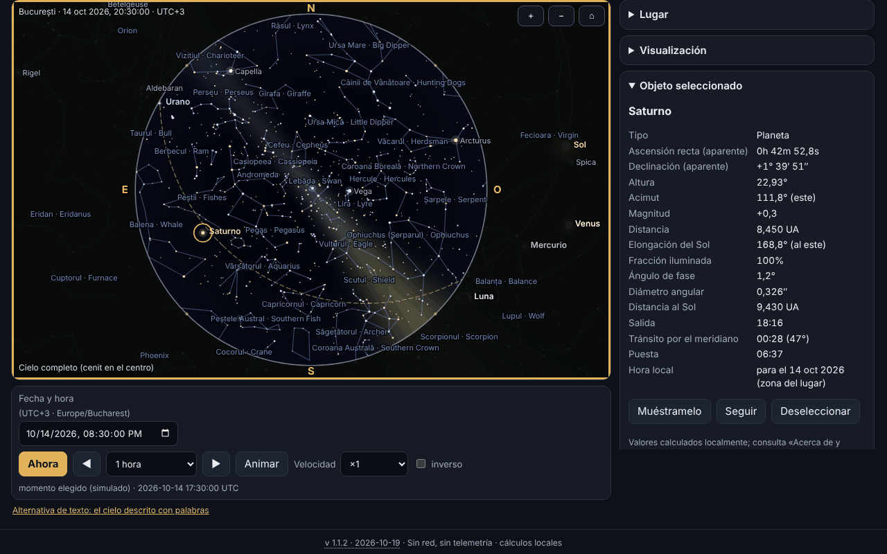

# Bolta — planetario sin conexión

[English](README.md) · [Română](README.ro.md) · [Français](README.fr.md) · [Italiano](README.it.md) · **Español** · [Português](README.pt.md) · [Deutsch](README.de.md) · [Magyar](README.hu.md)

**Versión:** 1.1.2 · **Última actualización:** 2026-10-19

Idiomas de la interfaz: **Română, English, Français, Italiano, Español, Português (PT), Deutsch, Magyar**

Bolta muestra el cielo de cualquier lugar de la Tierra y de cualquier momento entre 1900 y 2100: el Sol, la Luna (con la fase dibujada correctamente), los planetas, 1627 estrellas hasta la magnitud 5,0, las constelaciones (con nombres rumanos e ingleses), la eclíptica, el ecuador, las cuadrículas y una Vía Láctea estilizada. Calcula la salida, el tránsito por el meridiano y la puesta, puede listar los eventos próximos (fases lunares, conjunciones, oposiciones, elongaciones, estaciones, eclipses) con exportación `.ics`, y tiene una página dedicada al eclipse total de Sol del 2 de agosto de 2027, con circunstancias locales, cuenta atrás, simulación de los discos y esquema de la banda de totalidad. Todo se ejecuta en el navegador, sin red.



La captura muestra el estado real de la aplicación para Bucarest, el 14 de octubre de 2026, a las 20:30 (UTC+3), con Saturno seleccionado; todos los valores se calculan localmente, nada está simulado.

**En línea:** https://chiuta.github.io/apps/Bolta/

## Cómo se usa

1. **El cielo.** Elige el lugar (lista interna de 282 ciudades, coordenadas escritas por ti — también en la forma `44°25′36″ N` —, o el botón GPS) y el momento (campo de fecha/hora, «Ahora», pasos adelante/atrás, animación de ×1 a ×100000, opcionalmente inversa). La zona horaria viene de `Intl`; para coordenadas introducidas a mano puedes cambiarla.
2. **La vista.** «Cielo completo» muestra todo el hemisferio (cenit en el centro, norte arriba, este a la izquierda, como en un mapa del cielo visto desde abajo); si no, ves una ventana con campo variable. Proyección estereográfica o acimutal equidistante. La rueda del ratón o el pellizco acercan, arrastrar mueve la mirada. La sección «Visualización» activa o desactiva los puntos cardinales, el horizonte, los nombres de estrellas y constelaciones, las líneas, la Vía Láctea, la eclíptica, el ecuador, las cuadrículas altacimutal y ecuatorial, Neptuno/Plutón, la atmósfera (cielo diurno y crepúsculo), la refracción y la magnitud límite.
3. **Objetos.** Clic/toque sobre un objeto o búsqueda por nombre (incluidos los nombres rumanos de las constelaciones): panel con ascensión recta y declinación aparentes, altura, acimut, magnitud, distancia, elongación, fase, salida/tránsito/puesta; «Muéstrame» centra la vista, «Seguir» la mantiene centrada.
4. **Eventos.** Eliges el intervalo y las categorías; Bolta calcula en segundo plano (sin bloquear la página), muestra la tabla en la hora local del lugar, «Ir al momento» lleva el cielo a ese momento, «Exportar .ics» descarga un calendario RFC 5545.
5. **Eclipse 2027.** Las advertencias de seguridad van primero; siguen las circunstancias locales (C1, máximo, C4, magnitud, oscurecimiento, altura del Sol, y en la banda de totalidad también C2/C3 con la duración de la totalidad), la cuenta atrás, la simulación del disco de la Luna sobre el Sol, el esquema de la banda y la tabla del oscurecimiento calculado para las ciudades de Rumanía.
6. **El cielo en palabras.** Descripción textual del cielo y tabla con los objetos ordenados por altura, cada uno con «Mostrar en el cielo».
7. **Lugares y datos.** Lugares guardados, copia de seguridad `.fff.json`, importación, «Borrar todo».
8. **Modo rojo nocturno** (selector de tema): todos los colores, incluidos los del canvas, se vuelven rojos. También existen el tema claro y el oscuro (por defecto según el sistema).
9. **Impresión y exportación.** «Imprimir» usa el mapa como SVG vectorial; se pueden descargar SVG y PNG (con opción de colores invertidos para papel).
10. **Teclado.** El canvas se controla por completo: flechas (mueven la mirada), `+`/`−`, `Home`, `Espacio` (animación), `N` (ahora), `,` y `.` (paso), `F` (cielo completo), `G` (cuadrícula), `C` (constelaciones), `0`–`8` (Sol, Luna, planetas), `Intro`, `Esc`, y las pestañas se cambian con las flechas.

## Lo que NO hace y los límites

- **No es un instrumento de navegación** y no es adecuado para astrofotografía de precisión ni para ocultaciones.
- **La precisión** es la declarada en `fff-kit/docs/ephem.md`: posiciones aparentes del Sol y de los planetas ≤ 3″ (Neptuno ≤ 5″), Luna ≤ 1,5″, salida/puesta del Sol ≤ 6 s y de la Luna ≤ 25 s respecto al modelo de referencia, fases lunares ≤ 30 s, en 1900–2100. El ΔT futuro es incierto (segundos hasta 2035, minutos hacia 2100). No se modelan la aberración diurna, el paralaje estelar ni el relieve local.
- **Estrellas:** solo las de magnitud ≤ 5,0 (1627, de Hipparcos); **no hay objetos NGC/Messier**, cometas, asteroides ni satélites. Los nombres propios son los de la UAI (156 estrellas ≤ 3,0).
- **La Vía Láctea está estilizada** (modelo a partir de la matriz galáctica, no una fotografía) y sirve solo para orientarse. El color del cielo crepuscular, el brillo y la magnitud límite en función del Sol son aproximaciones visuales, no un modelo fotométrico. El color de las estrellas viene del índice B−V (aproximación).
- **Las coordenadas de las ciudades** están redondeadas (≈ 0,01°); no he inventado coordenadas: la lista solo contiene ciudades conocidas. Para mayor precisión, introduce tus coordenadas. La zona horaria viene de la base de datos del navegador (`Intl`), por lo que las zonas con reglas nuevas pueden estar desactualizadas en navegadores antiguos.
- **La refracción** (Sæmundsson, 1010 hPa, 10 °C) es opcional y aproximada cerca del horizonte.
- **Eventos:** las conjunciones Luna–planeta son geocéntricas (el paralaje de la Luna puede desplazar el acercamiento hasta ~1° para un observador); los eclipses, aparte del de 2027, solo se **señalan** cuando la Luna nueva/llena está cerca del nodo (|β| < 1,58°), sin tipo ni visibilidad; los eclipses de Luna no se calculan en detalle. El eclipse de 2027 es el único calculado con circunstancias locales.
- **El eclipse de 2027:** los valores los calcula Bolta, **no son oficiales**; no te fíes de ellos para quitarte el filtro. Para Rumanía, el margen de error declarado en `docs/ephem.md`: contactos y máximo ≈ ±3 s respecto al cálculo independiente de referencia; oscurecimiento ≤ 0,05 puntos porcentuales (máx. 0,01 respecto a la referencia) más la incertidumbre de ΔT (≈ ±1 s ⇒ ±0,01 p.p.). El esquema de la banda no tiene mapa base (solo una cuadrícula de coordenadas y localidades de referencia); los límites de la zona parcial no se calculan. La simulación de los discos es ilustrativa (la corona está estilizada).
- **Seguridad:** no mires al Sol sin filtros certificados ISO 12312-2; en Rumanía el eclipse es solo parcial, por lo que el filtro es necesario en todo momento.
- El intervalo de tiempo está limitado a 1900–2100; el escaneo de eventos a ~20 años como máximo cada vez.
- Las traducciones son automáticas (véase más abajo).

## Privacidad

Se ejecuta en local, no envía nada. La CSP bloquea cualquier conexión de red (`connect-src 'none'`). La posición GPS se solicita **solo** cuando pulsas el botón «Usar mi ubicación (GPS)» (con una explicación previa), se usa una sola vez y no se transmite. En local (localStorage, claves `fff.bolta.*`) solo se conservan el idioma, el tema, las opciones de visualización, el último lugar y los lugares guardados. «Borrar todo» elimina todo.

## Formatos

- **Entrada:** copia de seguridad `.fff.json` (`{"format":"fff-bundle","schema":1,"app":"Bolta",…}`) con los lugares guardados; coordenadas decimales o grados–minutos–segundos (`44°25′36″ N`, `12.5 W`).
- **Salida:** `.ics` (RFC 5545: CRLF, líneas plegadas a 75 bytes UTF-8, escapes, UID únicos), SVG, PNG, `.fff.json`, impresión.

## Aspectos técnicos

Un único archivo `index.html` (≈ 575 KiB), sin bibliotecas ni fuentes externas. Los módulos astronómicos `ephem.js` y `ephem-stars.js` de `fff-kit` están **copiados en línea, sin modificar**, para que la aplicación siga siendo autónoma; el kit no se inyecta y no se modifica.

- **Dibujo:** canvas 2D. Proyección estereográfica (k = 2/(1+Z)) o acimutal equidistante (k = θ/sin θ) sobre una base de vista ortonormal; en el modo «todo el cielo» la vista está en el cenit (188,8° estereográfica / 195,6° equidistante). El horizonte es el polígono muestreado del círculo máximo alt = 0, y el suelo se rellena con la regla par–impar.
- **Estrellas:** las posiciones vienen de `starPosition` de la biblioteca (movimiento propio, precesión, nutación, aberración). Por velocidad, en cada fotograma se calcula una matriz de rotación a partir de 3 llamadas de base y un vector de aberración de primer orden; la diferencia respecto a la llamada directa para cada estrella es ≤ 0,16″ sobre 4660 estrellas en las pruebas siguientes.
- **Cielo:** el fondo de día/crepúsculo/noche es una imagen de baja resolución en función de la altura del Sol; la magnitud límite baja de día; la Vía Láctea es un modelo en coordenadas galácticas.
- **Fase de la Luna:** el terminador es una elipse; la orientación es la dirección hacia el Sol sobre el círculo máximo, en pantalla.
- **Eventos:** la Luna muestreada cada 4 h, los planetas a diario con interpolación de Catmull–Rom, refinado por búsqueda ternaria/bisección; ejecución en porciones asíncronas. Las estaciones por bisección sobre la longitud del Sol.
- **El eclipse:** circunstancias locales de `E.eclipse.local` (elementos de Bessel calculados directamente de las efemérides); la simulación usa el área de solapamiento de dos círculos con el radio topocéntrico de la Luna (k = 0,2725076).
- **CSP:** `default-src 'none'; script-src` con hashes sha256 (recalculados con `fff-kit/lib/csp.mjs`, 6 scripts en línea); `style-src 'unsafe-inline'` (el estilo está en línea en el archivo); `img-src data: blob:` (PNG exportado, icono); `worker-src blob:` y `media-src data: blob:` permanecen de la plantilla común, sin usar; `connect-src 'none'`. Sin `eval`, sin manejadores en línea. Ninguna relajación respecto a la plantilla.
- **Las pruebas** (`tests/test.mjs`, Playwright, red bloqueada, CSP aplicada) comparan las posiciones mostradas con la biblioteca de referencia en 20 momentos/lugares, comprueban la proyección (la estrella en el cenit en el centro, proyección/inversa), las fases lunares 2026–2027 con una implementación independiente de Meeus (cap. 49) y con datos publicados, las oposiciones/elongaciones/estaciones conocidas, la validez del `.ics` (validador propio y `icalendar` de Python), el eclipse de 2027 (máximo 10:07:50 TD, Luxor total 380 s, Bucarest 51,2 %), axe-core (0 infracciones en 3 temas × 6 pestañas), teclado, móvil 360 px, exportación/importación y rendimiento de renderizado.

**Rendimiento medido** (Chromium headless, renderizado por software, ordenador compartido con otros procesos, por lo que las cifras son orientativas): 1627 estrellas con líneas, nombres y Vía Láctea, canvas 864×548: mediana de un fotograma completo (cálculo + dibujo) ≈ 3,3 ms (≈ 300 fotogramas/s teóricos), media ≈ 15 ms por interrupciones esporádicas de la máquina cargada; en un bucle `requestAnimationFrame` con animación se midieron ≈ 48 fotogramas/s bajo carga. El objetivo de 60 fotogramas/s se alcanza en la mediana, no está garantizado en un dispositivo cargado.

## Terceros

El código astronómico incorporado procede de `fff-kit` (fuentes y licencias en `fff-kit/THIRD-PARTY.md`):

- **VSOP87D** (Bretagnon & Francou 1988; CDS VI/81), extraído mediante `astronomia` (Sonia Keys, commenthol) — datos científicos libres; empaquetado MIT.
- **ELP/MPP02** (Chapront & Francou 2002) y las tablas de **Meeus** (*Astronomical Algorithms*, 2.ª ed.: Luna, nutación, Plutón) — coeficientes numéricos con cita; transcripción de `astronomia` (MIT).
- **ΔT:** polinomios de Espenak–Meeus (NASA TP-2006-214141, público) y tabla del IERS 1973–2027 (datos públicos).
- **Catálogo estelar:** Hipparcos, nueva reducción (van Leeuwen 2007; ESA — datos públicos), mediante `hipparcos-catalog` (MIT); V, B−V, denominaciones, figuras de las constelaciones de **d3-celestial** (Olaf Frohn, BSD-3-Clause), derivado de XHIP y de la lista WGSN de la UAI.
- Los nombres rumanos de las constelaciones son de uso corriente/propuestos, **no una nomenclatura oficial**.

Los textos de las licencias, necesarios para la redistribución:

```
astronomia — The MIT License (MIT)
Copyright (c) 2013 Sonia Keys
Copyright (c) 2016 Commenthol

Permission is hereby granted, free of charge, to any person obtaining a copy of
this software and associated documentation files (the "Software"), to deal in
the Software without restriction, including without limitation the rights to
use, copy, modify, merge, publish, distribute, sublicense, and/or sell copies of
the Software, and to permit persons to whom the Software is furnished to do so,
subject to the following conditions:

The above copyright notice and this permission notice shall be included in all
copies or substantial portions of the Software.

THE SOFTWARE IS PROVIDED "AS IS", WITHOUT WARRANTY OF ANY KIND, EXPRESS OR
IMPLIED, INCLUDING BUT NOT LIMITED TO THE WARRANTIES OF MERCHANTABILITY, FITNESS
FOR A PARTICULAR PURPOSE AND NONINFRINGEMENT. IN NO EVENT SHALL THE AUTHORS OR
COPYRIGHT HOLDERS BE LIABLE FOR ANY CLAIM, DAMAGES OR OTHER LIABILITY, WHETHER
IN AN ACTION OF CONTRACT, TORT OR OTHERWISE, ARISING FROM, OUT OF OR IN
CONNECTION WITH THE SOFTWARE OR THE USE OR OTHER DEALINGS IN THE SOFTWARE.
```

```
d3-celestial — BSD-3-Clause
Copyright (c) 2015, Olaf Frohn
All rights reserved.

Redistribution and use in source and binary forms, with or without modification, are permitted provided that the following conditions are met:

1. Redistributions of source code must retain the above copyright notice, this list of conditions and the following disclaimer.

2. Redistributions in binary form must reproduce the above copyright notice, this list of conditions and the following disclaimer in the documentation and/or other materials provided with the distribution.

3. Neither the name of the copyright holder nor the names of its contributors may be used to endorse or promote products derived from this software without specific prior written permission.

THIS SOFTWARE IS PROVIDED BY THE COPYRIGHT HOLDERS AND CONTRIBUTORS "AS IS" AND ANY EXPRESS OR IMPLIED WARRANTIES, INCLUDING, BUT NOT LIMITED TO, THE IMPLIED WARRANTIES OF MERCHANTABILITY AND FITNESS FOR A PARTICULAR PURPOSE ARE DISCLAIMED. IN NO EVENT SHALL THE COPYRIGHT HOLDER OR CONTRIBUTORS BE LIABLE FOR ANY DIRECT, INDIRECT, INCIDENTAL, SPECIAL, EXEMPLARY, OR CONSEQUENTIAL DAMAGES (INCLUDING, BUT NOT LIMITED TO, PROCUREMENT OF SUBSTITUTE GOODS OR SERVICES; LOSS OF USE, DATA, OR PROFITS; OR BUSINESS INTERRUPTION) HOWEVER CAUSED AND ON ANY THEORY OF LIABILITY, WHETHER IN CONTRACT, STRICT LIABILITY, OR TORT (INCLUDING NEGLIGENCE OR OTHERWISE) ARISING IN ANY WAY OUT OF THE USE OF THIS SOFTWARE, EVEN IF ADVISED OF THE POSSIBILITY OF SUCH DAMAGE.
```

Hipparcos (ESA) se distribuye como datos públicos; JPL DE421/DE423 sirvieron solo para verificar la biblioteca (en `fff-kit`), no están incluidos.

## Traducciones

La interfaz tiene 8 idiomas: rumano (por defecto) e inglés, escritos por el autor; francés, italiano, español, portugués, húngaro y alemán son traducciones automáticas, no verificadas por hablantes nativos. Los nombres de las constelaciones se dan en rumano e inglés.

## Licencia

MIT — consulta el archivo `LICENSE` en la raíz del repositorio. Los componentes de terceros siguen bajo sus propias licencias, enumeradas arriba.

## Historial

- **1.1.2 — 2026-10-19:** botón «← volver a <origen>» para `from=terra|orarium|vatra|fieldobserver|nota-zero` (8 idiomas; otros valores se ignoran). El parámetro `from` no se guarda.
- **1.1.1 — 2026-10-18:** el lugar del enlace solo vale para la sesión, `#t&ll` sin pestaña, validación real de la fecha.
- **1.1.0 — 2026-10-18:** enlace profundo `#sky&t=&ll=`.
- **1.0.0 — 2026-10-14:** primera versión.

## Enlaces profundos

`#sky&t=2087-05-17T02:35:00Z&ll=59.9139,10.7522` abre el cielo en el momento (UTC, 1900–2100) y el lugar indicados; los parámetros no válidos (incluidas fechas inexistentes como 2026-02-31) se ignoran, con un mensaje. El lugar del enlace solo es válido para la sesión actual: no se guarda y no sustituye tu lugar (se usa la zona horaria del dispositivo). El enlace funciona también sin nombre de pestaña (`#t=…&ll=…`). `#<pestaña>` (sky, events, etc.) sigue siendo válido.
