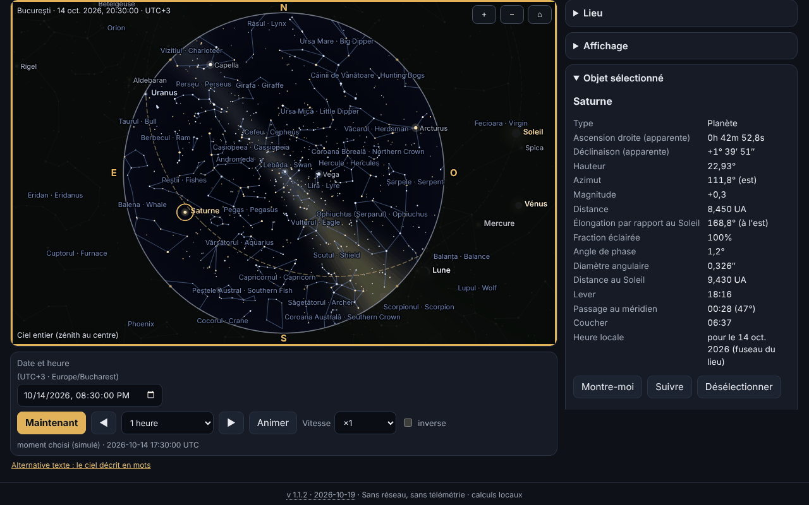

# Bolta — planétarium hors ligne

[English](README.md) · [Română](README.ro.md) · **Français** · [Italiano](README.it.md) · [Español](README.es.md) · [Português](README.pt.md) · [Deutsch](README.de.md) · [Magyar](README.hu.md)

**Version :** 1.1.2 · **Dernière mise à jour :** 2026-10-19

Langues de l'interface : **Română, English, Français, Italiano, Español, Português (PT), Deutsch, Magyar**

Bolta montre le ciel pour n'importe quel lieu de la Terre et n'importe quel moment entre 1900 et 2100 : le Soleil, la Lune (avec sa phase dessinée correctement), les planètes, 1627 étoiles jusqu'à la magnitude 5,0, les constellations (avec des noms roumains et anglais), l'écliptique, l'équateur, les grilles et une Voie lactée stylisée. Il calcule le lever, le passage au méridien et le coucher, peut lister les événements proches (phases lunaires, conjonctions, oppositions, élongations, saisons, éclipses) avec export `.ics`, et possède une page dédiée à l'éclipse totale de Soleil du 2 août 2027, avec circonstances locales, compte à rebours, simulation des disques et schéma de la bande de totalité. Tout s'exécute dans le navigateur, sans réseau.



La capture montre l'état réel de l'application pour Bucarest, le 14 octobre 2026, à 20 h 30 (UTC+3), avec Saturne sélectionnée ; toutes les valeurs sont calculées localement, rien n'est simulé.

**En ligne :** https://chiuta.github.io/apps/Bolta/

## Mode d'emploi

1. **Le ciel.** Choisissez le lieu (liste interne de 282 villes, coordonnées saisies par vous — y compris sous la forme `44°25′36″ N` —, ou le bouton GPS) et le moment (champ date/heure, « Maintenant », pas avant/arrière, animation de ×1 à ×100000, éventuellement inversée). Le fuseau horaire vient de `Intl` ; pour des coordonnées saisies à la main, vous pouvez le modifier.
2. **La vue.** « Ciel entier » montre tout l'hémisphère (zénith au centre, nord en haut, est à gauche, comme sur une carte du ciel vue d'en dessous) ; sinon vous voyez une fenêtre à champ variable. Projection stéréographique ou azimutale équidistante. La molette de la souris ou le pincement zooment, le glissement déplace le regard. La section « Affichage » active ou désactive les points cardinaux, l'horizon, les noms d'étoiles et de constellations, les lignes, la Voie lactée, l'écliptique, l'équateur, les grilles alt-azimutale et équatoriale, Neptune/Pluton, l'atmosphère (ciel de jour et crépuscule), la réfraction et la magnitude limite.
3. **Objets.** Clic/toucher sur un objet ou recherche par nom (y compris les noms roumains des constellations) : panneau avec ascension droite et déclinaison apparentes, hauteur, azimut, magnitude, distance, élongation, phase, lever/passage/coucher ; « Montre-moi » centre la vue, « Suivre » la maintient centrée.
4. **Événements.** Vous choisissez l'intervalle et les catégories ; Bolta calcule en arrière-plan (sans bloquer la page), affiche le tableau en heure locale du lieu, « Aller au moment » amène le ciel à ce moment, « Exporter .ics » télécharge un calendrier RFC 5545.
5. **Éclipse 2027.** Les avertissements de sécurité viennent en premier ; suivent les circonstances locales (C1, maximum, C4, magnitude, obscuration, hauteur du Soleil, et dans la bande de totalité aussi C2/C3 avec la durée de la totalité), le compte à rebours, la simulation du disque de la Lune sur le Soleil, le schéma de la bande et le tableau de l'obscuration calculée pour les villes de Roumanie.
6. **Le ciel en mots.** Description textuelle du ciel et tableau des objets classés par hauteur, chacun avec « Montrer dans le ciel ».
7. **Lieux et données.** Lieux enregistrés, sauvegarde `.fff.json`, import, « Tout supprimer ».
8. **Mode nuit rouge** (sélecteur de thème) : toutes les couleurs, y compris celles du canvas, deviennent rouges. Il existe aussi le thème clair et le thème sombre (par défaut selon le système).
9. **Impression et export.** « Imprimer » utilise la carte en SVG vectoriel ; SVG et PNG peuvent être téléchargés (avec option de couleurs inversées pour le papier).
10. **Clavier.** Le canvas se commande entièrement : flèches (déplacent le regard), `+`/`−`, `Home`, `Espace` (animation), `N` (maintenant), `,` et `.` (pas), `F` (ciel entier), `G` (grille), `C` (constellations), `0`–`8` (Soleil, Lune, planètes), `Entrée`, `Échap`, et les onglets se changent avec les flèches.

## Ce qu'il NE fait PAS et ses limites

- **Ce n'est pas un instrument de navigation** et il ne convient pas à l'astrophotographie de précision ni aux occultations.
- **La précision** est celle déclarée dans `fff-kit/docs/ephem.md` : positions apparentes du Soleil et des planètes ≤ 3″ (Neptune ≤ 5″), Lune ≤ 1,5″, lever/coucher du Soleil ≤ 6 s et de la Lune ≤ 25 s par rapport au modèle de référence, phases lunaires ≤ 30 s, sur 1900–2100. Le ΔT futur est incertain (secondes jusqu'en 2035, minutes vers 2100). L'aberration diurne, la parallaxe stellaire et le relief local ne sont pas modélisés.
- **Étoiles :** uniquement celles de magnitude ≤ 5,0 (1627, issues de Hipparcos) ; **il n'y a pas d'objets NGC/Messier**, de comètes, d'astéroïdes ni de satellites. Les noms propres sont ceux de l'UAI (156 étoiles ≤ 3,0).
- **La Voie lactée est stylisée** (modèle issu de la matrice galactique, pas une photographie) et ne sert qu'à l'orientation. La couleur du ciel crépusculaire, l'éclat et la magnitude limite en fonction du Soleil sont des approximations visuelles, pas un modèle photométrique. La couleur des étoiles provient de l'indice B−V (approximation).
- **Les coordonnées des villes** sont arrondies (≈ 0,01°) ; je n'ai pas inventé de coordonnées : la liste ne contient que des villes connues. Pour la précision, saisissez vos coordonnées. Le fuseau horaire provient de la base de données du navigateur (`Intl`), donc les zones aux règles nouvelles peuvent être obsolètes dans les anciens navigateurs.
- **La réfraction** (Sæmundsson, 1010 hPa, 10 °C) est facultative et approximative près de l'horizon.
- **Événements :** les conjonctions Lune–planète sont géocentriques (la parallaxe de la Lune peut déplacer le rapprochement jusqu'à ~1° pour un observateur) ; les éclipses, hormis celle de 2027, sont seulement **signalées** quand la Nouvelle/Pleine Lune est proche du nœud (|β| < 1,58°), sans type ni visibilité ; les éclipses de Lune ne sont pas calculées en détail. L'éclipse de 2027 est la seule calculée avec des circonstances locales.
- **L'éclipse de 2027 :** les valeurs sont calculées par Bolta, **elles ne sont pas officielles** ; ne vous y fiez pas pour retirer le filtre. Pour la Roumanie, la marge d'erreur déclarée dans `docs/ephem.md` : contacts et maximum ≈ ±3 s par rapport au calcul indépendant de référence ; obscuration ≤ 0,05 point de pourcentage (max. 0,01 par rapport à la référence) plus l'incertitude sur ΔT (≈ ±1 s ⇒ ±0,01 p.p.). Le schéma de la bande n'a pas de fond de carte (seulement une grille de coordonnées et des localités repères) ; les limites de la zone partielle ne sont pas calculées. La simulation des disques est illustrative (la couronne est stylisée).
- **Sécurité :** ne regardez pas le Soleil sans filtres certifiés ISO 12312-2 ; en Roumanie l'éclipse n'est que partielle, donc le filtre est nécessaire tout le temps.
- L'intervalle de temps est limité à 1900–2100 ; le balayage des événements à ~20 ans au plus à la fois.
- Les traductions sont automatiques (voir ci-dessous).

## Confidentialité

Fonctionne en local, n'envoie rien. La CSP bloque toute connexion réseau (`connect-src 'none'`). La position GPS est demandée **uniquement** quand vous appuyez sur le bouton « Utiliser ma position (GPS) » (avec une explication au préalable), elle est utilisée une seule fois et n'est pas transmise. En local (localStorage, clés `fff.bolta.*`) ne sont conservés que la langue, le thème, les options d'affichage, le dernier lieu et les lieux enregistrés. « Tout supprimer » efface tout.

## Formats

- **Entrée :** sauvegarde `.fff.json` (`{"format":"fff-bundle","schema":1,"app":"Bolta",…}`) avec les lieux enregistrés ; coordonnées décimales ou degrés–minutes–secondes (`44°25′36″ N`, `12.5 W`).
- **Sortie :** `.ics` (RFC 5545 : CRLF, lignes repliées à 75 octets UTF-8, échappements, UID uniques), SVG, PNG, `.fff.json`, impression.

## Technique

Un seul fichier `index.html` (≈ 575 Kio), sans bibliothèques ni polices externes. Les modules astronomiques `ephem.js` et `ephem-stars.js` de `fff-kit` sont **copiés en ligne, sans modification**, afin que l'application reste autonome ; le kit n'est pas injecté et n'est pas modifié.

- **Dessin :** canvas 2D. Projection stéréographique (k = 2/(1+Z)) ou azimutale équidistante (k = θ/sin θ) sur une base de vue orthonormée ; en mode « tout le ciel », la vue est au zénith (188,8° stéréographique / 195,6° équidistante). L'horizon est le polygone échantillonné du grand cercle alt = 0, et le sol est rempli selon la règle pair–impair.
- **Étoiles :** les positions viennent de `starPosition` de la bibliothèque (mouvement propre, précession, nutation, aberration). Pour la vitesse, à chaque image on calcule une matrice de rotation à partir de 3 appels de base et un vecteur d'aberration du premier ordre ; la différence avec l'appel direct pour chaque étoile est ≤ 0,16″ sur 4660 étoiles dans les tests ci-dessous.
- **Ciel :** le fond jour/crépuscule/nuit est une image basse résolution en fonction de la hauteur du Soleil ; la magnitude limite baisse le jour ; la Voie lactée est un modèle en coordonnées galactiques.
- **Phase de la Lune :** le terminateur est une ellipse ; l'orientation est la direction vers le Soleil sur le grand cercle, à l'écran.
- **Événements :** la Lune échantillonnée toutes les 4 h, les planètes quotidiennement avec interpolation de Catmull–Rom, affinement par recherche ternaire/bissection ; exécution par tranches asynchrones. Saisons par bissection sur la longitude du Soleil.
- **L'éclipse :** circonstances locales issues de `E.eclipse.local` (éléments de Bessel calculés directement à partir des éphémérides) ; la simulation utilise l'aire de recouvrement de deux cercles avec le rayon topocentrique de la Lune (k = 0,2725076).
- **CSP :** `default-src 'none'; script-src` avec hachages sha256 (recalculés avec `fff-kit/lib/csp.mjs`, 6 scripts en ligne) ; `style-src 'unsafe-inline'` (le style est en ligne dans le fichier) ; `img-src data: blob:` (PNG exporté, icône) ; `worker-src blob:` et `media-src data: blob:` restent du modèle commun, inutilisés ; `connect-src 'none'`. Pas d'`eval`, pas de gestionnaires en ligne. Aucun assouplissement par rapport au modèle.
- **Les tests** (`tests/test.mjs`, Playwright, réseau bloqué, CSP appliquée) comparent les positions affichées avec la bibliothèque de référence sur 20 moments/lieux, vérifient la projection (l'étoile au zénith au centre, projection/inverse), les phases lunaires 2026–2027 avec une implémentation indépendante de Meeus (chap. 49) et avec des données publiées, les oppositions/élongations/saisons connues, la validité du `.ics` (validateur maison et `icalendar` de Python), l'éclipse de 2027 (maximum 10:07:50 TD, Louxor totale 380 s, Bucarest 51,2 %), axe-core (0 violation dans 3 thèmes × 6 onglets), le clavier, le mobile 360 px, l'export/import et les performances de rendu.

**Performances mesurées** (Chromium headless, rendu logiciel, ordinateur partagé avec d'autres processus, donc chiffres indicatifs) : 1627 étoiles avec lignes, noms et Voie lactée, canvas 864×548 : médiane d'une image complète (calcul + dessin) ≈ 3,3 ms (≈ 300 images/s en théorie), moyenne ≈ 15 ms à cause d'interruptions sporadiques de la machine chargée ; dans une boucle `requestAnimationFrame` avec animation, ≈ 48 images/s ont été mesurées sous charge. L'objectif de 60 images/s est atteint sur la médiane, non garanti sur un appareil chargé.

## Tiers

Le code astronomique intégré provient de `fff-kit` (sources et licences dans `fff-kit/THIRD-PARTY.md`) :

- **VSOP87D** (Bretagnon & Francou 1988 ; CDS VI/81), extrait via `astronomia` (Sonia Keys, commenthol) — données scientifiques libres ; emballage MIT.
- **ELP/MPP02** (Chapront & Francou 2002) et les tables de **Meeus** (*Astronomical Algorithms*, 2e éd. : Lune, nutation, Pluton) — coefficients numériques avec citation ; transcription depuis `astronomia` (MIT).
- **ΔT :** polynômes d'Espenak–Meeus (NASA TP-2006-214141, public) et table de l'IERS 1973–2027 (données publiques).
- **Catalogue stellaire :** Hipparcos, nouvelle réduction (van Leeuwen 2007 ; ESA — données publiques), via `hipparcos-catalog` (MIT) ; V, B−V, désignations, figures des constellations de **d3-celestial** (Olaf Frohn, BSD-3-Clause), dérivé de XHIP et de la liste WGSN de l'UAI.
- Les noms roumains des constellations sont d'usage courant/proposés, **pas une nomenclature officielle**.

Les textes des licences, nécessaires à la redistribution :

```
astronomia — The MIT License (MIT)
Copyright (c) 2013 Sonia Keys
Copyright (c) 2016 Commenthol

Permission is hereby granted, free of charge, to any person obtaining a copy of
this software and associated documentation files (the "Software"), to deal in
the Software without restriction, including without limitation the rights to
use, copy, modify, merge, publish, distribute, sublicense, and/or sell copies of
the Software, and to permit persons to whom the Software is furnished to do so,
subject to the following conditions:

The above copyright notice and this permission notice shall be included in all
copies or substantial portions of the Software.

THE SOFTWARE IS PROVIDED "AS IS", WITHOUT WARRANTY OF ANY KIND, EXPRESS OR
IMPLIED, INCLUDING BUT NOT LIMITED TO THE WARRANTIES OF MERCHANTABILITY, FITNESS
FOR A PARTICULAR PURPOSE AND NONINFRINGEMENT. IN NO EVENT SHALL THE AUTHORS OR
COPYRIGHT HOLDERS BE LIABLE FOR ANY CLAIM, DAMAGES OR OTHER LIABILITY, WHETHER
IN AN ACTION OF CONTRACT, TORT OR OTHERWISE, ARISING FROM, OUT OF OR IN
CONNECTION WITH THE SOFTWARE OR THE USE OR OTHER DEALINGS IN THE SOFTWARE.
```

```
d3-celestial — BSD-3-Clause
Copyright (c) 2015, Olaf Frohn
All rights reserved.

Redistribution and use in source and binary forms, with or without modification, are permitted provided that the following conditions are met:

1. Redistributions of source code must retain the above copyright notice, this list of conditions and the following disclaimer.

2. Redistributions in binary form must reproduce the above copyright notice, this list of conditions and the following disclaimer in the documentation and/or other materials provided with the distribution.

3. Neither the name of the copyright holder nor the names of its contributors may be used to endorse or promote products derived from this software without specific prior written permission.

THIS SOFTWARE IS PROVIDED BY THE COPYRIGHT HOLDERS AND CONTRIBUTORS "AS IS" AND ANY EXPRESS OR IMPLIED WARRANTIES, INCLUDING, BUT NOT LIMITED TO, THE IMPLIED WARRANTIES OF MERCHANTABILITY AND FITNESS FOR A PARTICULAR PURPOSE ARE DISCLAIMED. IN NO EVENT SHALL THE COPYRIGHT HOLDER OR CONTRIBUTORS BE LIABLE FOR ANY DIRECT, INDIRECT, INCIDENTAL, SPECIAL, EXEMPLARY, OR CONSEQUENTIAL DAMAGES (INCLUDING, BUT NOT LIMITED TO, PROCUREMENT OF SUBSTITUTE GOODS OR SERVICES; LOSS OF USE, DATA, OR PROFITS; OR BUSINESS INTERRUPTION) HOWEVER CAUSED AND ON ANY THEORY OF LIABILITY, WHETHER IN CONTRACT, STRICT LIABILITY, OR TORT (INCLUDING NEGLIGENCE OR OTHERWISE) ARISING IN ANY WAY OUT OF THE USE OF THIS SOFTWARE, EVEN IF ADVISED OF THE POSSIBILITY OF SUCH DAMAGE.
```

Hipparcos (ESA) est distribué comme données publiques ; JPL DE421/DE423 n'ont servi qu'à vérifier la bibliothèque (dans `fff-kit`), ils ne sont pas inclus.

## Traductions

L'interface compte 8 langues : le roumain (par défaut) et l'anglais, rédigés par l'auteur ; le français, l'italien, l'espagnol, le portugais, le hongrois et l'allemand sont des traductions automatiques, non vérifiées par des locuteurs natifs. Les noms des constellations sont donnés en roumain et en anglais.

## Licence

MIT — voir le fichier `LICENSE` à la racine du dépôt. Les composants tiers restent sous leurs propres licences, énumérées ci-dessus.

## Historique

- **1.1.2 — 2026-10-19 :** bouton « ← retour à <source> » pour `from=terra|orarium|vatra|fieldobserver|nota-zero` (8 langues ; autres valeurs ignorées). Le paramètre `from` n'est pas enregistré.
- **1.1.1 — 2026-10-18 :** le lieu du lien est valable pour la session seulement, `#t&ll` sans onglet, vraie validation de la date.
- **1.1.0 — 2026-10-18 :** lien profond `#sky&t=&ll=`.
- **1.0.0 — 2026-10-14 :** première version.

## Liens profonds

`#sky&t=2087-05-17T02:35:00Z&ll=59.9139,10.7522` ouvre le ciel au moment (UTC, 1900–2100) et au lieu indiqués ; les paramètres invalides (y compris les dates inexistantes comme 2026-02-31) sont ignorés, avec un message. Le lieu du lien n'est valable que pour la session en cours : il n'est pas enregistré et ne remplace pas votre lieu (le fuseau horaire de l'appareil est utilisé). Le lien fonctionne aussi sans nom d'onglet (`#t=…&ll=…`). `#<onglet>` (sky, events, etc.) reste valable.
