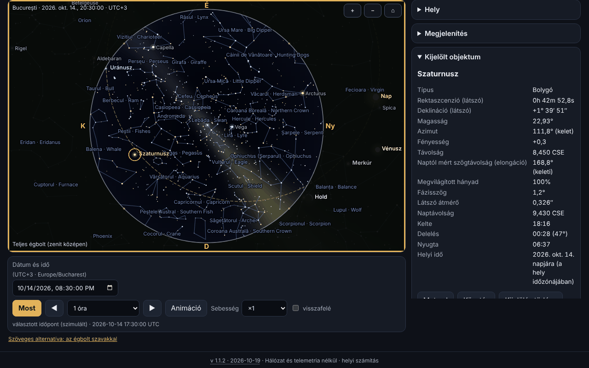

# Bolta — offline planetárium

[English](README.md) · [Română](README.ro.md) · [Français](README.fr.md) · [Italiano](README.it.md) · [Español](README.es.md) · [Português](README.pt.md) · [Deutsch](README.de.md) · **Magyar**

**Verzió:** 1.1.2 · **Utolsó frissítés:** 2026-10-19

A felület nyelvei: **Română, English, Français, Italiano, Español, Português (PT), Deutsch, Magyar**

A Bolta a Föld bármely helyéhez és 1900 és 2100 közötti bármely időponthoz megmutatja az eget: a Napot, a Holdat (helyesen megrajzolt fázissal), a bolygókat, 1627 csillagot 5,0 magnitúdóig, a csillagképeket (román és angol nevekkel), az ekliptikát, az egyenlítőt, a hálókat és egy stilizált Tejútrendszert. Kiszámítja a kelést, a meridiánátvonulást és a nyugvást, felsorolhatja a közeli eseményeket (holdfázisok, együttállások, oppozíciók, elongációk, évszakok, fogyatkozások) `.ics` exporttal, és külön oldala van a 2027. augusztus 2-i teljes napfogyatkozásnak, helyi körülményekkel, visszaszámlálással, a korongok szimulációjával és a teljességi sáv vázlatával. Minden a böngészőben fut, hálózat nélkül.



A képernyőkép az alkalmazás valós állapotát mutatja Bukarestre, 2026. október 14-re, 20:30-ra (UTC+3), a Szaturnusz kijelölésével; minden érték helyben számolt, semmi sem szimulált.

**Élő verzió:** https://chiuta.github.io/apps/Bolta/

## Hogyan kell használni

1. **Az ég.** Válaszd ki a helyet (282 városból álló belső lista, általad beírt koordináták — a `44°25′36″ N` alakban is —, vagy a GPS gomb) és az időpontot (dátum/idő mező, „Most”, lépések előre/hátra, animáció ×1-től ×100000-ig, opcionálisan visszafelé). Az időzóna az `Intl`-ből jön; kézzel megadott koordinátáknál megváltoztathatod.
2. **A nézet.** A „Teljes ég” a teljes félgömböt mutatja (zenit középen, észak felül, kelet balra, mint egy alulról nézett csillagtérképen); egyébként változó látószögű ablakot látsz. Sztereografikus vagy azimutális egyenlő távolságú vetítés. Az egérgörgő vagy a csíptetés nagyít, a húzás elmozdítja a tekintetet. A „Megjelenítés” szakasz kapcsolja az égtájakat, a horizontot, a csillagok és csillagképek nevét, a vonalakat, a Tejutat, az ekliptikát, az egyenlítőt, az alt-azimutális és az egyenlítői hálót, a Neptunuszt/Plútót, a légkört (nappali ég és szürkület), a refrakciót és a határmagnitúdót.
3. **Objektumok.** Kattintás/érintés egy objektumra vagy keresés név szerint (a csillagképek román nevét is beleértve): panel a látszólagos rektaszcenzióval és deklinációval, magassággal, azimuttal, magnitúdóval, távolsággal, elongációval, fázissal, kelés/átvonulás/nyugvás adatokkal; a „Mutasd” középre helyezi a nézetet, a „Követés” középen tartja.
4. **Események.** Kiválasztod az időközt és a kategóriákat; a Bolta a háttérben számol (az oldal blokkolása nélkül), a táblázatot a hely helyi idejében mutatja, az „Ugrás az időpontra” az eget arra az időpontra viszi, az „.ics exportálása” RFC 5545 naptárat tölt le.
5. **2027-es fogyatkozás.** A biztonsági figyelmeztetések az elsők; ezt követik a helyi körülmények (C1, maximum, C4, magnitúdó, takarás, a Nap magassága, a teljességi sávban a C2/C3 is a teljesség időtartamával), a visszaszámlálás, a Hold korongjának szimulációja a Nap előtt, a sáv vázlata és a romániai városokra kiszámolt takarás táblázata.
6. **Az ég szavakban.** Az ég szöveges leírása és a magasság szerint rendezett objektumok táblázata, mindegyik „Mutasd az égen” gombbal.
7. **Helyek és adatok.** Mentett helyek, `.fff.json` biztonsági mentés, importálás, „Mindent töröl”.
8. **Vörös éjszakai mód** (a témaválasztóban): minden szín, a vászonon lévők is, vörösre vált. Van világos és sötét téma is (alapértelmezés szerint a rendszer szerint).
9. **Nyomtatás és export.** A „Nyomtatás” a térképet vektoros SVG-ként használja; az SVG és a PNG letölthető (fordított színek opciójával papírhoz).
10. **Billentyűzet.** A vászon teljesen vezérelhető: nyilak (mozgatják a tekintetet), `+`/`−`, `Home`, `Szóköz` (animáció), `N` (most), `,` és `.` (lépés), `F` (teljes ég), `G` (háló), `C` (csillagképek), `0`–`8` (Nap, Hold, bolygók), `Enter`, `Esc`, a füleket a nyilakkal lehet váltani.

## Amit NEM csinál, és a korlátok

- **Nem navigációs eszköz**, és nem alkalmas precíziós asztrofotózásra vagy fedésekhez.
- **A pontosság** az `fff-kit/docs/ephem.md` fájlban megadott: a Nap és a bolygók látszólagos helyzete ≤ 3″ (Neptunusz ≤ 5″), Hold ≤ 1,5″, a Nap kelése/nyugvása ≤ 6 s és a Holdé ≤ 25 s a referenciamodellhez képest, holdfázisok ≤ 30 s, 1900–2100 között. A jövőbeli ΔT bizonytalan (másodpercek 2035-ig, percek 2100 felé). A napi aberráció, a csillagparallaxis és a helyi domborzat nincs modellezve.
- **Csillagok:** csak az ≤ 5,0 magnitúdójúak (1627, a Hipparcosból); **nincsenek NGC/Messier objektumok**, üstökösök, kisbolygók vagy műholdak. A tulajdonnevek az IAU-éi (156 csillag ≤ 3,0).
- **A Tejút stilizált** (a galaktikus mátrixból származó modell, nem fénykép), és csak tájékozódásra szolgál. A szürkületi ég színe, a fényesség és a határmagnitúdó a Nap függvényében vizuális közelítés, nem fotometriai modell. A csillagok színe a B−V indexből származik (közelítés).
- **A városok koordinátái** kerekítettek (≈ 0,01°); nem találtam ki koordinátákat: a lista csak ismert városokat tartalmaz. Pontossághoz add meg a saját koordinátáidat. Az időzóna a böngésző adatbázisából (`Intl`) jön, ezért az új szabályú zónák régi böngészőkben elavultak lehetnek.
- **A refrakció** (Sæmundsson, 1010 hPa, 10 °C) opcionális, és a horizont közelében közelítő.
- **Események:** a Hold–bolygó együttállások geocentrikusak (a Hold parallaxisa a közeledést megfigyelőtől függően akár ~1°-kal eltolhatja); a fogyatkozásokat a 2027-esen kívül csak **jelzi**, ha az újhold/telihold közel van a csomóponthoz (|β| < 1,58°), típus és láthatóság nélkül; a holdfogyatkozásokat nem számolja részletesen. A 2027-es fogyatkozás az egyetlen, amelyet helyi körülményekkel számol.
- **A 2027-es fogyatkozás:** az értékeket a Bolta számolja, **nem hivatalosak**; ne ezekre támaszkodva vedd le a szűrőt. Romániára a `docs/ephem.md` fájlban megadott hibahatár: az érintések és a maximum ≈ ±3 s a független referenciaszámításhoz képest; takarás ≤ 0,05 százalékpont (legfeljebb 0,01 a referenciához képest) plusz a ΔT bizonytalansága (≈ ±1 s ⇒ ±0,01 százalékpont). A sáv vázlatának nincs alaptérképe (csak koordinátaháló és tájékozódási települések); a részleges zóna határai nincsenek kiszámolva. A korongok szimulációja szemléltető jellegű (a korona stilizált).
- **Biztonság:** ne nézz a Napba tanúsított ISO 12312-2 szűrők nélkül; Romániában a fogyatkozás csak részleges, ezért a szűrő mindvégig szükséges.
- Az időtartomány 1900–2100 közé korlátozott; az események keresése egyszerre legfeljebb ~20 évre.
- A fordítások automatikusak (lásd lentebb).

## Adatvédelem

Helyben fut, nem küld semmit. A CSP minden hálózati kapcsolatot blokkol (`connect-src 'none'`). A GPS-pozíciót **csak** akkor kéri, amikor megnyomod a „Saját helyzetem használata (GPS)” gombot (előzetes magyarázattal), egyszer használja, és nem továbbítja. Helyben (localStorage, `fff.bolta.*` kulcsok) csak a nyelv, a téma, a megjelenítési beállítások, az utolsó hely és a mentett helyek maradnak meg. A „Mindent töröl” mindent eltávolít.

## Formátumok

- **Bemenet:** `.fff.json` biztonsági mentés (`{"format":"fff-bundle","schema":1,"app":"Bolta",…}`) a mentett helyekkel; tizedes koordináták vagy fok–perc–másodperc (`44°25′36″ N`, `12.5 W`).
- **Kimenet:** `.ics` (RFC 5545: CRLF, 75 UTF-8 bájtnál tördelt sorok, escape-ek, egyedi UID-k), SVG, PNG, `.fff.json`, nyomtatás.

## Műszaki részletek

Egyetlen `index.html` fájl (≈ 575 KiB), külső függvénytárak és külső betűtípusok nélkül. Az `fff-kit` `ephem.js` és `ephem-stars.js` csillagászati moduljai **beágyazva, módosítatlanul másoltak**, hogy az alkalmazás önálló maradjon; a készletet nem injektálják, és nem módosítják.

- **Rajzolás:** 2D vászon. Sztereografikus vetítés (k = 2/(1+Z)) vagy azimutális egyenlő távolságú (k = θ/sin θ) ortonormált nézetbázison; „teljes ég” módban a nézet a zenitben van (188,8° sztereografikus / 195,6° egyenlő távolságú). A horizont az alt = 0 főkör mintavételezett sokszöge, a talaj kitöltése páros–páratlan szabállyal történik.
- **Csillagok:** a pozíciók a könyvtár `starPosition` függvényéből jönnek (sajátmozgás, precesszió, nutáció, aberráció). A sebesség érdekében minden képkockánál egy forgatómátrixot számol 3 alaphívásból és egy elsőrendű aberrációs vektort; az egyes csillagokra vonatkozó közvetlen hívástól való eltérés ≤ 0,16″ 4660 csillagon az alábbi tesztekben.
- **Ég:** a nappali/szürkületi/éjszakai háttér a Nap magasságának függvényében kis felbontású kép; a határmagnitúdó nappal csökken; a Tejút galaktikus koordinátákban megadott modell.
- **A Hold fázisa:** a terminátor ellipszis; az orientáció a Nap felé mutató irány a főkörön, a képernyőn.
- **Események:** a Hold 4 óránként mintavételezve, a bolygók naponta Catmull–Rom-interpolációval, finomítás hármas kereséssel/felezéssel; végrehajtás aszinkron szeletekben. Az évszakok felezéssel a Nap hosszúságán.
- **A fogyatkozás:** helyi körülmények az `E.eclipse.local` függvényből (az efemeriszekből közvetlenül számolt Bessel-elemek); a szimuláció két kör átfedési területét használja a Hold topocentrikus sugarával (k = 0,2725076).
- **CSP:** `default-src 'none'; script-src` sha256 hashekkel (az `fff-kit/lib/csp.mjs` fájllal újraszámolva, 6 beágyazott szkript); `style-src 'unsafe-inline'` (a stílus beágyazott a fájlban); `img-src data: blob:` (exportált PNG, ikon); a `worker-src blob:` és a `media-src data: blob:` a közös sablonból maradt, használatlanul; `connect-src 'none'`. Nincs `eval`, nincsenek beágyazott eseménykezelők. A sablonhoz képest nincs enyhítés.
- **A tesztek** (`tests/test.mjs`, Playwright, letiltott hálózat, alkalmazott CSP) összehasonlítják a megjelenített pozíciókat a referenciakönyvtárral 20 időpontban/helyen, ellenőrzik a vetítést (a zenitben lévő csillag középen, vetítés/inverz), a 2026–2027-es holdfázisokat Meeus független megvalósításával (49. fejezet) és közölt adatokkal, az ismert oppozíciókat/elongációkat/évszakokat, az `.ics` érvényességét (saját validátor és a Python `icalendar`), a 2027-es fogyatkozást (maximum 10:07:50 TD, Luxor teljes 380 s, Bukarest 51,2 %), az axe-core-t (0 szabálysértés 3 témában × 6 fülön), a billentyűzetet, a 360 px-es mobilt, az exportot/importot és a renderelési teljesítményt.

**Mért teljesítmény** (headless Chromium, szoftveres renderelés, más folyamatokkal megosztott számítógép, ezért a számok tájékoztató jellegűek): 1627 csillag vonalakkal, nevekkel és Tejúttal, vászon 864×548: egy teljes képkocka (számítás + rajzolás) mediánja ≈ 3,3 ms (elméletben ≈ 300 képkocka/s), az átlag ≈ 15 ms a terhelt gép szórványos megszakításai miatt; `requestAnimationFrame` ciklusban animációval terhelés alatt ≈ 48 képkocka/s-ot mértek. A 60 képkocka/s célt a medián eléri, terhelt eszközön nem garantált.

## Harmadik felek

A beágyazott csillagászati kód az `fff-kit`-ből származik (források és licencek: `fff-kit/THIRD-PARTY.md`):

- **VSOP87D** (Bretagnon & Francou 1988; CDS VI/81), az `astronomia` (Sonia Keys, commenthol) segítségével kivonva — szabad tudományos adatok; MIT csomagolás.
- **ELP/MPP02** (Chapront & Francou 2002) és a **Meeus**-táblázatok (*Astronomical Algorithms*, 2. kiad.: Hold, nutáció, Plútó) — hivatkozással ellátott numerikus együtthatók; átírás az `astronomia`-ból (MIT).
- **ΔT:** Espenak–Meeus-polinomok (NASA TP-2006-214141, nyilvános) és az IERS 1973–2027 táblázata (nyilvános adatok).
- **Csillagkatalógus:** Hipparcos, az új redukció (van Leeuwen 2007; ESA — nyilvános adatok), a `hipparcos-catalog` (MIT) útján; V, B−V, megnevezések, csillagkép-ábrák a **d3-celestial**-ból (Olaf Frohn, BSD-3-Clause), amely az XHIP-ből és az IAU WGSN listájából származik.
- A csillagképek román nevei szokásosak/javasoltak, **nem hivatalos nómenklatúra**.

A licencszövegek, amelyek az újraterjesztéshez szükségesek:

```
astronomia — The MIT License (MIT)
Copyright (c) 2013 Sonia Keys
Copyright (c) 2016 Commenthol

Permission is hereby granted, free of charge, to any person obtaining a copy of
this software and associated documentation files (the "Software"), to deal in
the Software without restriction, including without limitation the rights to
use, copy, modify, merge, publish, distribute, sublicense, and/or sell copies of
the Software, and to permit persons to whom the Software is furnished to do so,
subject to the following conditions:

The above copyright notice and this permission notice shall be included in all
copies or substantial portions of the Software.

THE SOFTWARE IS PROVIDED "AS IS", WITHOUT WARRANTY OF ANY KIND, EXPRESS OR
IMPLIED, INCLUDING BUT NOT LIMITED TO THE WARRANTIES OF MERCHANTABILITY, FITNESS
FOR A PARTICULAR PURPOSE AND NONINFRINGEMENT. IN NO EVENT SHALL THE AUTHORS OR
COPYRIGHT HOLDERS BE LIABLE FOR ANY CLAIM, DAMAGES OR OTHER LIABILITY, WHETHER
IN AN ACTION OF CONTRACT, TORT OR OTHERWISE, ARISING FROM, OUT OF OR IN
CONNECTION WITH THE SOFTWARE OR THE USE OR OTHER DEALINGS IN THE SOFTWARE.
```

```
d3-celestial — BSD-3-Clause
Copyright (c) 2015, Olaf Frohn
All rights reserved.

Redistribution and use in source and binary forms, with or without modification, are permitted provided that the following conditions are met:

1. Redistributions of source code must retain the above copyright notice, this list of conditions and the following disclaimer.

2. Redistributions in binary form must reproduce the above copyright notice, this list of conditions and the following disclaimer in the documentation and/or other materials provided with the distribution.

3. Neither the name of the copyright holder nor the names of its contributors may be used to endorse or promote products derived from this software without specific prior written permission.

THIS SOFTWARE IS PROVIDED BY THE COPYRIGHT HOLDERS AND CONTRIBUTORS "AS IS" AND ANY EXPRESS OR IMPLIED WARRANTIES, INCLUDING, BUT NOT LIMITED TO, THE IMPLIED WARRANTIES OF MERCHANTABILITY AND FITNESS FOR A PARTICULAR PURPOSE ARE DISCLAIMED. IN NO EVENT SHALL THE COPYRIGHT HOLDER OR CONTRIBUTORS BE LIABLE FOR ANY DIRECT, INDIRECT, INCIDENTAL, SPECIAL, EXEMPLARY, OR CONSEQUENTIAL DAMAGES (INCLUDING, BUT NOT LIMITED TO, PROCUREMENT OF SUBSTITUTE GOODS OR SERVICES; LOSS OF USE, DATA, OR PROFITS; OR BUSINESS INTERRUPTION) HOWEVER CAUSED AND ON ANY THEORY OF LIABILITY, WHETHER IN CONTRACT, STRICT LIABILITY, OR TORT (INCLUDING NEGLIGENCE OR OTHERWISE) ARISING IN ANY WAY OUT OF THE USE OF THIS SOFTWARE, EVEN IF ADVISED OF THE POSSIBILITY OF SUCH DAMAGE.
```

A Hipparcos (ESA) nyilvános adatként terjed; a JPL DE421/DE423 csak a könyvtár ellenőrzésére szolgált (az `fff-kit`-ben), nincsenek mellékelve.

## Fordítások

A felület 8 nyelvű: román (alapértelmezett) és angol, a szerző írta; a francia, olasz, spanyol, portugál, magyar és német automatikus fordítás, anyanyelvi beszélők által nem ellenőrzött. A csillagképek nevei románul és angolul vannak megadva.

## Licenc

MIT — lásd a `LICENSE` fájlt a tároló gyökerében. A harmadik felek komponensei a saját licenceik alatt maradnak, amelyeket fentebb soroltunk fel.

## Előzmények

- **1.1.2 — 2026-10-19:** „← vissza ide: <forrás>” gomb a `from=terra|orarium|vatra|fieldobserver|nota-zero` értékekhez (8 nyelv; más értékeket figyelmen kívül hagy). A `from` paraméter nem mentődik.
- **1.1.1 — 2026-10-18:** a hivatkozásban lévő hely csak a munkamenetre érvényes, `#t&ll` fül nélkül, valódi dátumellenőrzés.
- **1.1.0 — 2026-10-18:** mély hivatkozás `#sky&t=&ll=`.
- **1.0.0 — 2026-10-14:** első verzió.

## Mély hivatkozások

A `#sky&t=2087-05-17T02:35:00Z&ll=59.9139,10.7522` a megadott időpontban (UTC, 1900–2100) és helyen nyitja meg az eget; az érvénytelen paramétereket (a nem létező dátumokat, például 2026-02-31, is beleértve) üzenettel figyelmen kívül hagyja. A hivatkozásban lévő hely csak az aktuális munkamenetre érvényes: nem mentődik, és nem váltja fel a te helyedet (az eszköz időzónáját használja). A hivatkozás fülnév nélkül is működik (`#t=…&ll=…`). A `#<fül>` (sky, events stb.) továbbra is érvényes.
