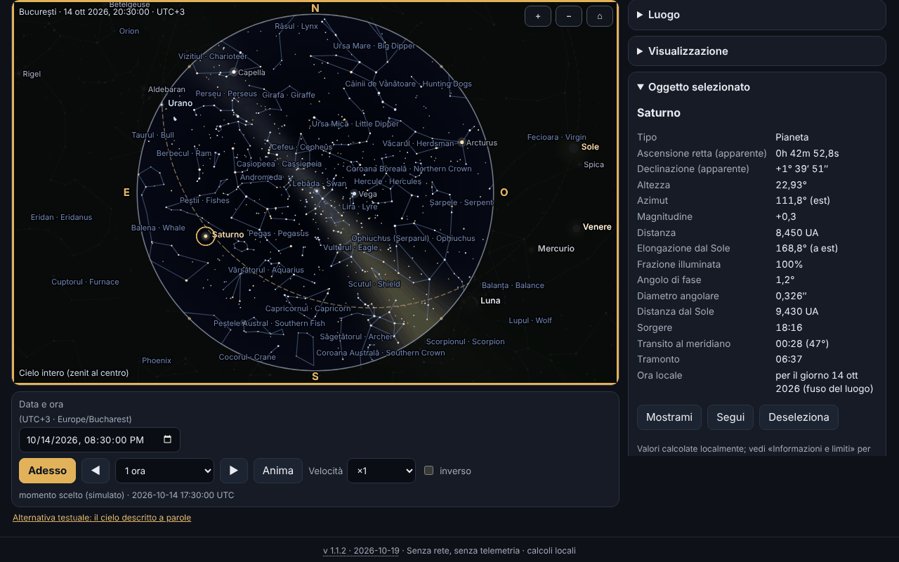

# Bolta — planetario offline

[English](README.md) · [Română](README.ro.md) · [Français](README.fr.md) · **Italiano** · [Español](README.es.md) · [Português](README.pt.md) · [Deutsch](README.de.md) · [Magyar](README.hu.md)

**Versione:** 1.1.2 · **Ultimo aggiornamento:** 2026-10-19

Lingue dell'interfaccia: **Română, English, Français, Italiano, Español, Português (PT), Deutsch, Magyar**

Bolta mostra il cielo per qualsiasi luogo della Terra e qualsiasi momento tra il 1900 e il 2100: il Sole, la Luna (con la fase disegnata correttamente), i pianeti, 1627 stelle fino alla magnitudine 5,0, le costellazioni (con nomi rumeni e inglesi), l'eclittica, l'equatore, le griglie e una Via Lattea stilizzata. Calcola il sorgere, il transito al meridiano e il tramonto, può elencare gli eventi vicini (fasi lunari, congiunzioni, opposizioni, elongazioni, stagioni, eclissi) con esportazione `.ics`, e ha una pagina dedicata all'eclissi totale di Sole del 2 agosto 2027, con circostanze locali, conto alla rovescia, simulazione dei dischi e schema della fascia di totalità. Tutto funziona nel browser, senza rete.



La schermata mostra lo stato reale dell'app per Bucarest, 14 ottobre 2026, ore 20:30 (UTC+3), con Saturno selezionato; tutti i valori sono calcolati localmente, nulla è simulato.

**Online:** https://chiuta.github.io/apps/Bolta/

## Come si usa

1. **Il cielo.** Scegli il luogo (elenco interno di 282 città, coordinate scritte da te — anche nella forma `44°25′36″ N` —, o il pulsante GPS) e il momento (campo data/ora, «Adesso», passi avanti/indietro, animazione da ×1 a ×100000, eventualmente inversa). Il fuso orario viene da `Intl`; per le coordinate inserite a mano puoi cambiarlo.
2. **La vista.** «Cielo intero» mostra tutto l'emisfero (zenit al centro, nord in alto, est a sinistra, come su una mappa del cielo vista da sotto); altrimenti vedi una finestra a campo variabile. Proiezione stereografica o azimutale equidistante. La rotellina del mouse o il pizzico ingrandiscono, il trascinamento sposta lo sguardo. La sezione «Visualizzazione» attiva o disattiva i punti cardinali, l'orizzonte, i nomi delle stelle e delle costellazioni, le linee, la Via Lattea, l'eclittica, l'equatore, le griglie alt-azimutale ed equatoriale, Nettuno/Plutone, l'atmosfera (cielo diurno e crepuscolo), la rifrazione e la magnitudine limite.
3. **Oggetti.** Clic/tocco su un oggetto o ricerca per nome (compresi i nomi rumeni delle costellazioni): pannello con ascensione retta e declinazione apparenti, altezza, azimut, magnitudine, distanza, elongazione, fase, sorgere/transito/tramonto; «Mostrami» centra la vista, «Segui» la mantiene centrata.
4. **Eventi.** Scegli l'intervallo e le categorie; Bolta calcola in background (senza bloccare la pagina), mostra la tabella nell'ora locale del luogo, «Vai al momento» porta il cielo a quel momento, «Esporta .ics» scarica un calendario RFC 5545.
5. **Eclissi 2027.** Le avvertenze di sicurezza vengono per prime; seguono le circostanze locali (C1, massimo, C4, magnitudine, oscuramento, altezza del Sole, e nella fascia di totalità anche C2/C3 con la durata della totalità), il conto alla rovescia, la simulazione del disco della Luna sul Sole, lo schema della fascia e la tabella dell'oscuramento calcolato per le città della Romania.
6. **Il cielo a parole.** Descrizione testuale del cielo e tabella con gli oggetti ordinati per altezza, ciascuno con «Mostra nel cielo».
7. **Luoghi e dati.** Luoghi salvati, backup `.fff.json`, importazione, «Cancella tutto».
8. **Modalità rossa notturna** (selettore del tema): tutti i colori, compresi quelli nel canvas, diventano rossi. Esistono anche il tema chiaro e quello scuro (per impostazione predefinita secondo il sistema).
9. **Stampa ed esportazione.** «Stampa» usa la mappa come SVG vettoriale; SVG e PNG si possono scaricare (con opzione di colori invertiti per la carta).
10. **Tastiera.** Il canvas si controlla completamente: frecce (spostano lo sguardo), `+`/`−`, `Home`, `Spazio` (animazione), `N` (adesso), `,` e `.` (passo), `F` (cielo intero), `G` (griglia), `C` (costellazioni), `0`–`8` (Sole, Luna, pianeti), `Invio`, `Esc`, e le schede si cambiano con le frecce.

## Cosa NON fa e i limiti

- **Non è uno strumento di navigazione** e non è adatto all'astrofotografia di precisione né alle occultazioni.
- **La precisione** è quella dichiarata in `fff-kit/docs/ephem.md`: posizioni apparenti del Sole e dei pianeti ≤ 3″ (Nettuno ≤ 5″), Luna ≤ 1,5″, sorgere/tramonto del Sole ≤ 6 s e della Luna ≤ 25 s rispetto al modello di riferimento, fasi lunari ≤ 30 s, nel 1900–2100. Il ΔT futuro è incerto (secondi fino al 2035, minuti verso il 2100). Non sono modellate l'aberrazione diurna, la parallasse stellare e il rilievo locale.
- **Stelle:** solo quelle di magnitudine ≤ 5,0 (1627, da Hipparcos); **non ci sono oggetti NGC/Messier**, comete, asteroidi o satelliti. I nomi propri sono quelli IAU (156 stelle ≤ 3,0).
- **La Via Lattea è stilizzata** (modello dalla matrice galattica, non una fotografia) e serve solo per l'orientamento. Il colore del cielo al crepuscolo, la luminosità e la magnitudine limite in funzione del Sole sono approssimazioni visive, non un modello fotometrico. Il colore delle stelle viene dall'indice B−V (approssimazione).
- **Le coordinate delle città** sono arrotondate (≈ 0,01°); non ho inventato coordinate: l'elenco contiene solo città note. Per la precisione, inserisci le tue coordinate. Il fuso orario viene dal database del browser (`Intl`), quindi le zone con regole nuove possono essere obsolete nei browser vecchi.
- **La rifrazione** (Sæmundsson, 1010 hPa, 10 °C) è opzionale e approssimativa vicino all'orizzonte.
- **Eventi:** le congiunzioni Luna–pianeta sono geocentriche (la parallasse della Luna può spostare l'avvicinamento fino a ~1° per un osservatore); le eclissi, a parte quella del 2027, sono solo **segnalate** quando la Luna nuova/piena è vicina al nodo (|β| < 1,58°), senza tipo né visibilità; le eclissi di Luna non sono calcolate nel dettaglio. L'eclissi del 2027 è l'unica calcolata con circostanze locali.
- **L'eclissi del 2027:** i valori sono calcolati da Bolta, **non sono ufficiali**; non fare affidamento su di essi per togliere il filtro. Per la Romania, il margine di errore dichiarato in `docs/ephem.md`: contatti e massimo ≈ ±3 s rispetto al calcolo indipendente di riferimento; oscuramento ≤ 0,05 punti percentuali (max. 0,01 rispetto al riferimento) più l'incertezza su ΔT (≈ ±1 s ⇒ ±0,01 p.p.). Lo schema della fascia non ha mappa di base (solo griglia di coordinate e località di riferimento); i limiti della zona parziale non sono calcolati. La simulazione dei dischi è illustrativa (la corona è stilizzata).
- **Sicurezza:** non guardare il Sole senza filtri certificati ISO 12312-2; in Romania l'eclissi è solo parziale, quindi il filtro è necessario sempre.
- L'intervallo di tempo è limitato al 1900–2100; la scansione degli eventi a ~20 anni al massimo per volta.
- Le traduzioni sono automatiche (vedi sotto).

## Privacy

Funziona in locale, non invia nulla. La CSP blocca qualsiasi connessione di rete (`connect-src 'none'`). La posizione GPS viene richiesta **solo** quando premi il pulsante «Usa la mia posizione (GPS)» (con una spiegazione prima), viene usata una sola volta e non viene trasmessa. In locale (localStorage, chiavi `fff.bolta.*`) si conservano solo la lingua, il tema, le opzioni di visualizzazione, l'ultimo luogo e i luoghi salvati. «Cancella tutto» elimina tutto.

## Formati

- **Ingresso:** backup `.fff.json` (`{"format":"fff-bundle","schema":1,"app":"Bolta",…}`) con i luoghi salvati; coordinate decimali o gradi–primi–secondi (`44°25′36″ N`, `12.5 W`).
- **Uscita:** `.ics` (RFC 5545: CRLF, righe ripiegate a 75 byte UTF-8, escape, UID univoci), SVG, PNG, `.fff.json`, stampa.

## Aspetti tecnici

Un unico file `index.html` (≈ 575 KiB), senza librerie né font esterni. I moduli astronomici `ephem.js` e `ephem-stars.js` di `fff-kit` sono **copiati inline, non modificati**, in modo che l'app resti autonoma; il kit non viene iniettato e non viene modificato.

- **Disegno:** canvas 2D. Proiezione stereografica (k = 2/(1+Z)) o azimutale equidistante (k = θ/sin θ) su una base di vista ortonormale; nella modalità «tutto il cielo» la vista è allo zenit (188,8° stereografica / 195,6° equidistante). L'orizzonte è il poligono campionato del cerchio massimo alt = 0, e il suolo si riempie con la regola pari–dispari.
- **Stelle:** le posizioni vengono da `starPosition` della libreria (moto proprio, precessione, nutazione, aberrazione). Per velocità, a ogni fotogramma si calcola una matrice di rotazione da 3 chiamate di base e un vettore di aberrazione del primo ordine; la differenza rispetto alla chiamata diretta per ogni stella è ≤ 0,16″ su 4660 stelle nei test seguenti.
- **Cielo:** lo sfondo giorno/crepuscolo/notte è un'immagine a bassa risoluzione in funzione dell'altezza del Sole; la magnitudine limite scende di giorno; la Via Lattea è un modello in coordinate galattiche.
- **Fase della Luna:** il terminatore è un'ellisse; l'orientamento è la direzione verso il Sole sul cerchio massimo, sullo schermo.
- **Eventi:** la Luna campionata ogni 4 h, i pianeti ogni giorno con interpolazione di Catmull–Rom, raffinamento con ricerca ternaria/bisezione; esecuzione a fette asincrone. Le stagioni per bisezione sulla longitudine del Sole.
- **L'eclissi:** circostanze locali da `E.eclipse.local` (elementi di Bessel calcolati direttamente dalle effemeridi); la simulazione usa l'area di sovrapposizione di due cerchi con il raggio topocentrico della Luna (k = 0,2725076).
- **CSP:** `default-src 'none'; script-src` con hash sha256 (ricalcolati con `fff-kit/lib/csp.mjs`, 6 script inline); `style-src 'unsafe-inline'` (lo stile è inline nel file); `img-src data: blob:` (PNG esportato, icona); `worker-src blob:` e `media-src data: blob:` restano dal modello comune, non usati; `connect-src 'none'`. Niente `eval`, niente gestori inline. Nessun allentamento rispetto al modello.
- **I test** (`tests/test.mjs`, Playwright, rete bloccata, CSP applicata) confrontano le posizioni mostrate con la libreria di riferimento su 20 momenti/luoghi, verificano la proiezione (la stella allo zenit al centro, proiezione/inversa), le fasi lunari 2026–2027 con un'implementazione indipendente di Meeus (cap. 49) e con dati pubblicati, le opposizioni/elongazioni/stagioni note, la validità del `.ics` (validatore proprio e `icalendar` di Python), l'eclissi del 2027 (massimo 10:07:50 TD, Luxor totale 380 s, Bucarest 51,2 %), axe-core (0 violazioni in 3 temi × 6 schede), tastiera, mobile 360 px, esportazione/importazione e prestazioni di rendering.

**Prestazioni misurate** (Chromium headless, rendering software, computer condiviso con altri processi, quindi cifre indicative): 1627 stelle con linee, nomi e Via Lattea, canvas 864×548: mediana di un fotogramma completo (calcolo + disegno) ≈ 3,3 ms (≈ 300 fotogrammi/s teorici), media ≈ 15 ms a causa di interruzioni sporadiche della macchina carica; in un ciclo `requestAnimationFrame` con animazione sono stati misurati ≈ 48 fotogrammi/s sotto carico. L'obiettivo di 60 fotogrammi/s è raggiunto sulla mediana, non garantito su un dispositivo carico.

## Terze parti

Il codice astronomico incorporato proviene da `fff-kit` (fonti e licenze in `fff-kit/THIRD-PARTY.md`):

- **VSOP87D** (Bretagnon & Francou 1988; CDS VI/81), estratto tramite `astronomia` (Sonia Keys, commenthol) — dati scientifici liberi; confezionamento MIT.
- **ELP/MPP02** (Chapront & Francou 2002) e le tabelle di **Meeus** (*Astronomical Algorithms*, 2ª ed.: Luna, nutazione, Plutone) — coefficienti numerici con citazione; trascrizione da `astronomia` (MIT).
- **ΔT:** polinomi di Espenak–Meeus (NASA TP-2006-214141, pubblico) e tabella IERS 1973–2027 (dati pubblici).
- **Catalogo stellare:** Hipparcos, nuova riduzione (van Leeuwen 2007; ESA — dati pubblici), tramite `hipparcos-catalog` (MIT); V, B−V, denominazioni, figure delle costellazioni da **d3-celestial** (Olaf Frohn, BSD-3-Clause), derivato da XHIP e dall'elenco WGSN della IAU.
- I nomi rumeni delle costellazioni sono d'uso comune/proposti, **non una nomenclatura ufficiale**.

I testi delle licenze, necessari per la ridistribuzione:

```
astronomia — The MIT License (MIT)
Copyright (c) 2013 Sonia Keys
Copyright (c) 2016 Commenthol

Permission is hereby granted, free of charge, to any person obtaining a copy of
this software and associated documentation files (the "Software"), to deal in
the Software without restriction, including without limitation the rights to
use, copy, modify, merge, publish, distribute, sublicense, and/or sell copies of
the Software, and to permit persons to whom the Software is furnished to do so,
subject to the following conditions:

The above copyright notice and this permission notice shall be included in all
copies or substantial portions of the Software.

THE SOFTWARE IS PROVIDED "AS IS", WITHOUT WARRANTY OF ANY KIND, EXPRESS OR
IMPLIED, INCLUDING BUT NOT LIMITED TO THE WARRANTIES OF MERCHANTABILITY, FITNESS
FOR A PARTICULAR PURPOSE AND NONINFRINGEMENT. IN NO EVENT SHALL THE AUTHORS OR
COPYRIGHT HOLDERS BE LIABLE FOR ANY CLAIM, DAMAGES OR OTHER LIABILITY, WHETHER
IN AN ACTION OF CONTRACT, TORT OR OTHERWISE, ARISING FROM, OUT OF OR IN
CONNECTION WITH THE SOFTWARE OR THE USE OR OTHER DEALINGS IN THE SOFTWARE.
```

```
d3-celestial — BSD-3-Clause
Copyright (c) 2015, Olaf Frohn
All rights reserved.

Redistribution and use in source and binary forms, with or without modification, are permitted provided that the following conditions are met:

1. Redistributions of source code must retain the above copyright notice, this list of conditions and the following disclaimer.

2. Redistributions in binary form must reproduce the above copyright notice, this list of conditions and the following disclaimer in the documentation and/or other materials provided with the distribution.

3. Neither the name of the copyright holder nor the names of its contributors may be used to endorse or promote products derived from this software without specific prior written permission.

THIS SOFTWARE IS PROVIDED BY THE COPYRIGHT HOLDERS AND CONTRIBUTORS "AS IS" AND ANY EXPRESS OR IMPLIED WARRANTIES, INCLUDING, BUT NOT LIMITED TO, THE IMPLIED WARRANTIES OF MERCHANTABILITY AND FITNESS FOR A PARTICULAR PURPOSE ARE DISCLAIMED. IN NO EVENT SHALL THE COPYRIGHT HOLDER OR CONTRIBUTORS BE LIABLE FOR ANY DIRECT, INDIRECT, INCIDENTAL, SPECIAL, EXEMPLARY, OR CONSEQUENTIAL DAMAGES (INCLUDING, BUT NOT LIMITED TO, PROCUREMENT OF SUBSTITUTE GOODS OR SERVICES; LOSS OF USE, DATA, OR PROFITS; OR BUSINESS INTERRUPTION) HOWEVER CAUSED AND ON ANY THEORY OF LIABILITY, WHETHER IN CONTRACT, STRICT LIABILITY, OR TORT (INCLUDING NEGLIGENCE OR OTHERWISE) ARISING IN ANY WAY OUT OF THE USE OF THIS SOFTWARE, EVEN IF ADVISED OF THE POSSIBILITY OF SUCH DAMAGE.
```

Hipparcos (ESA) è distribuito come dati pubblici; JPL DE421/DE423 sono serviti solo a verificare la libreria (in `fff-kit`), non sono inclusi.

## Traduzioni

L'interfaccia ha 8 lingue: rumeno (predefinita) e inglese, scritte dall'autore; francese, italiano, spagnolo, portoghese, ungherese e tedesco sono traduzioni automatiche, non verificate da madrelingua. I nomi delle costellazioni sono dati in rumeno e inglese.

## Licenza

MIT — vedi il file `LICENSE` nella radice del repository. I componenti di terzi restano sotto le proprie licenze, elencate sopra.

## Cronologia

- **1.1.2 — 2026-10-19:** pulsante «← torna a <fonte>» per `from=terra|orarium|vatra|fieldobserver|nota-zero` (8 lingue; altri valori ignorati). Il parametro `from` non viene salvato.
- **1.1.1 — 2026-10-18:** il luogo del link vale solo per la sessione, `#t&ll` senza scheda, vera validazione della data.
- **1.1.0 — 2026-10-18:** link profondo `#sky&t=&ll=`.
- **1.0.0 — 2026-10-14:** prima versione.

## Link profondi

`#sky&t=2087-05-17T02:35:00Z&ll=59.9139,10.7522` apre il cielo al momento (UTC, 1900–2100) e al luogo indicati; i parametri non validi (comprese date inesistenti come 2026-02-31) vengono ignorati, con un messaggio. Il luogo del link vale solo per la sessione corrente: non viene salvato e non sostituisce il tuo luogo (si usa il fuso orario del dispositivo). Il link funziona anche senza nome di scheda (`#t=…&ll=…`). `#<scheda>` (sky, events ecc.) resta valido.
