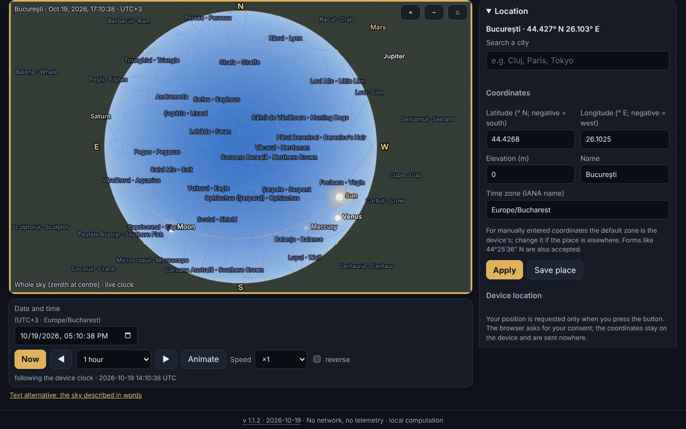

# Bolta — offline planetarium

**English** · [Română](README.ro.md) · [Français](README.fr.md) · [Italiano](README.it.md) · [Español](README.es.md) · [Português](README.pt.md) · [Deutsch](README.de.md) · [Magyar](README.hu.md)

**Version:** 1.1.2 · **Last updated:** 2026-10-19

Interface languages: **Română, English, Français, Italiano, Español, Português (PT), Deutsch, Magyar**

Bolta shows the sky for any place on Earth and any moment between 1900 and 2100: the Sun, the Moon (with its phase drawn correctly), the planets, 1627 stars down to magnitude 5.0, the constellations (with Romanian and English names), the ecliptic, the equator, the grids and a stylized Milky Way. It computes sunrise, meridian transit and sunset, can list the nearby events (lunar phases, conjunctions, oppositions, elongations, seasons, eclipses) with `.ics` export, and has a dedicated page for the total solar eclipse of 2 August 2027, with local circumstances, a countdown, a simulation of the discs and a diagram of the totality band. Everything runs in the browser, with no network.



The screenshot shows the real state of the app for Bucharest, 14 October 2026, 20:30 (UTC+3), with Saturn selected; all values are computed locally, nothing is simulated.

**Live:** https://chiuta.github.io/apps/Bolta/

## How to use it

1. **The sky.** Choose the place (an internal list of 282 cities, coordinates you type — also in the form `44°25′36″ N` —, or the GPS button) and the moment (the date/time field, "Now", forward/backward steps, animation from ×1 to ×100000, optionally reversed). The time zone comes from `Intl`; for manually entered coordinates you can change it.
2. **The view.** "Whole sky" shows the entire hemisphere (zenith in the centre, north up, east on the left, like a sky map seen from below); otherwise you see a window with a variable field. Stereographic or azimuthal equidistant projection. The mouse wheel or pinching zooms, dragging moves the view. The "Display" section toggles the cardinal points, the horizon, star and constellation names, the lines, the Milky Way, the ecliptic, the equator, the alt-azimuth and equatorial grids, Neptune/Pluto, the atmosphere (day sky and twilight), refraction and the limiting magnitude.
3. **Objects.** Click/tap on an object or search by name (including the Romanian names of the constellations): a panel with apparent right ascension and declination, altitude, azimuth, magnitude, distance, elongation, phase, rise/transit/set; "Show me" centres the view, "Track" keeps it centred.
4. **Events.** You choose the interval and the categories; Bolta computes in the background (without blocking the page), shows the table in the local time of the place, "Jump to moment" takes the sky to that moment, "Export .ics" downloads an RFC 5545 calendar.
5. **Eclipse 2027.** The safety warnings come first; then the local circumstances (C1, maximum, C4, magnitude, obscuration, the Sun's altitude, and in the totality band also C2/C3 with the duration of totality), the countdown, the simulation of the Moon's disc over the Sun, the band diagram and the table of the obscuration computed for the cities of Romania.
6. **The sky in words.** A text description of the sky and a table with the objects ordered by altitude, each with "Show in the sky".
7. **Places and data.** Saved places, `.fff.json` backup, import, "Delete all".
8. **Red night mode** (the theme selector): all colours, including those in the canvas, turn red. There are also the light theme and the dark one (by default following the system).
9. **Printing and export.** "Print" uses the map as vector SVG; SVG and PNG can be downloaded (with an option for inverted colours for paper).
10. **Keyboard.** The canvas is fully controllable: arrows (move the view), `+`/`−`, `Home`, `Space` (animation), `N` (now), `,` and `.` (step), `F` (whole sky), `G` (grid), `C` (constellations), `0`–`8` (Sun, Moon, planets), `Enter`, `Esc`, and the tabs are switched with the arrows.

## What it does NOT do, and the limits

- **It is not a navigation instrument** and is not suitable for precision astrophotography or for occultations.
- **Precision** is as declared in `fff-kit/docs/ephem.md`: apparent positions of the Sun and planets ≤ 3″ (Neptune ≤ 5″), Moon ≤ 1.5″, sunrise/sunset of the Sun ≤ 6 s and of the Moon ≤ 25 s relative to the reference model, lunar phases ≤ 30 s, in 1900–2100. Future ΔT is uncertain (seconds until 2035, minutes towards 2100). Diurnal aberration, stellar parallax and local terrain are not modelled.
- **Stars:** only those with magnitude ≤ 5.0 (1627, from Hipparcos); **there are no NGC/Messier objects**, comets, asteroids or satellites. The proper names are the IAU ones (156 stars ≤ 3.0).
- **The Milky Way is stylized** (a model from the galactic matrix, not a photograph) and serves only for orientation. The colour of the twilight sky, the brightness and the limiting magnitude as a function of the Sun are visual approximations, not a photometric model. The colour of the stars comes from the B−V index (approximation).
- **City coordinates** are rounded (≈ 0.01°); I did not invent coordinates: the list contains only well-known cities. For precision, enter your own coordinates. The time zone comes from the browser's database (`Intl`), so zones with new rules may be out of date in old browsers.
- **Refraction** (Sæmundsson, 1010 hPa, 10 °C) is optional and approximate near the horizon.
- **Events:** Moon–planet conjunctions are geocentric (the Moon's parallax can shift the approach by up to ~1° for an observer); eclipses, apart from the one in 2027, are only **flagged** when the new/full Moon is near the node (|β| < 1.58°), without type or visibility; lunar eclipses are not computed in detail. The 2027 eclipse is the only one computed with local circumstances.
- **The 2027 eclipse:** the values are computed by Bolta, **they are not official**; do not rely on them to take off the filter. For Romania, the margin of error declared in `docs/ephem.md`: contacts and maximum ≈ ±3 s relative to the independent reference calculation; obscuration ≤ 0.05 percentage points (max. 0.01 relative to the reference) plus the ΔT uncertainty (≈ ±1 s ⇒ ±0.01 p.p.). The band diagram has no base map (only a coordinate grid and landmark localities); the limits of the partial zone are not computed. The simulation of the discs is illustrative (the corona is stylized).
- **Safety:** do not look at the Sun without ISO 12312-2 certified filters; in Romania the eclipse is only partial, so the filter is needed at all times.
- The time interval is limited to 1900–2100; the event scan to at most ~20 years at a time.
- The translations are automatic (see below).

## Privacy

It runs locally and sends nothing. The CSP blocks any network connection (`connect-src 'none'`). The GPS position is requested **only** when you press the "Use my location (GPS)" button (with an explanation beforehand), is used once and is not transmitted. Locally (localStorage, keys `fff.bolta.*`) only the language, the theme, the display options, the last place and the saved places are kept. "Delete all" removes everything.

## Formats

- **Input:** `.fff.json` backup (`{"format":"fff-bundle","schema":1,"app":"Bolta",…}`) with the saved places; decimal coordinates or degrees–minutes–seconds (`44°25′36″ N`, `12.5 W`).
- **Output:** `.ics` (RFC 5545: CRLF, lines folded at 75 UTF-8 bytes, escapes, unique UIDs), SVG, PNG, `.fff.json`, printing.

## Technical

A single `index.html` file (≈ 575 KiB), with no external libraries or external fonts. The astronomical modules `ephem.js` and `ephem-stars.js` from `fff-kit` are **copied inline, unmodified**, so that the app stays self-contained; the kit is not injected and is not modified.

- **Drawing:** 2D canvas. Stereographic projection (k = 2/(1+Z)) or azimuthal equidistant (k = θ/sin θ) on an orthonormal view basis; in "whole sky" mode the view is at the zenith (188.8° stereographic / 195.6° equidistant). The horizon is the sampled polygon of the great circle alt = 0, and the ground is filled with the even–odd rule.
- **Stars:** the positions come from the library's `starPosition` (proper motion, precession, nutation, aberration). For speed, on each frame a rotation matrix is computed from 3 base calls and a first-order aberration vector; the difference from the direct call for each star is ≤ 0.16″ over 4660 stars in the tests below.
- **Sky:** the day/twilight/night background is a low-resolution image as a function of the Sun's altitude; the limiting magnitude drops during the day; the Milky Way is a model in galactic coordinates.
- **Moon phase:** the terminator is an ellipse; the orientation is the direction towards the Sun on the great circle, on screen.
- **Events:** the Moon sampled every 4 h, the planets daily with Catmull–Rom interpolation, refinement by ternary search/bisection; execution in asynchronous slices. Seasons by bisection on the Sun's longitude.
- **The eclipse:** local circumstances from `E.eclipse.local` (Bessel elements computed directly from the ephemerides); the simulation uses the overlap area of two circles with the Moon's topocentric radius (k = 0.2725076).
- **CSP:** `default-src 'none'; script-src` with sha256 hashes (recomputed with `fff-kit/lib/csp.mjs`, 6 inline scripts); `style-src 'unsafe-inline'` (the style is inline in the file); `img-src data: blob:` (exported PNG, icon); `worker-src blob:` and `media-src data: blob:` remain from the shared template, unused; `connect-src 'none'`. No `eval`, no inline handlers. No relaxation relative to the template.
- **The tests** (`tests/test.mjs`, Playwright, network blocked, CSP applied) compare the displayed positions with the reference library at 20 moments/places, check the projection (the star at the zenith in the centre, projection/inverse), the lunar phases 2026–2027 against an independent implementation of Meeus (ch. 49) and against published data, the known oppositions/elongations/seasons, the validity of the `.ics` (own validator and Python's `icalendar`), the 2027 eclipse (maximum 10:07:50 TD, Luxor total 380 s, Bucharest 51.2%), axe-core (0 violations in 3 themes × 6 tabs), keyboard, mobile 360 px, export/import and rendering performance.

**Measured performance** (headless Chromium, software rendering, a computer shared with other processes, so the figures are indicative): 1627 stars with lines, names and the Milky Way, canvas 864×548: the median of a full frame (computation + drawing) ≈ 3.3 ms (≈ 300 frames/s theoretical), the mean ≈ 15 ms due to sporadic interruptions of the loaded machine; in a `requestAnimationFrame` loop with animation ≈ 48 frames/s were measured under load. The 60 frames/s target is reached on the median, not guaranteed on a loaded device.

## Third parties

The embedded astronomical code comes from `fff-kit` (sources and licenses in `fff-kit/THIRD-PARTY.md`):

- **VSOP87D** (Bretagnon & Francou 1988; CDS VI/81), extracted through `astronomia` (Sonia Keys, commenthol) — free scientific data; MIT packaging.
- **ELP/MPP02** (Chapront & Francou 2002) and the **Meeus** tables (*Astronomical Algorithms*, 2nd ed.: Moon, nutation, Pluto) — numeric coefficients with citation; transcription from `astronomia` (MIT).
- **ΔT:** Espenak–Meeus polynomials (NASA TP-2006-214141, public) and the IERS table 1973–2027 (public data).
- **Star catalogue:** Hipparcos, the new reduction (van Leeuwen 2007; ESA — public data), through `hipparcos-catalog` (MIT); V, B−V, designations, constellation figures from **d3-celestial** (Olaf Frohn, BSD-3-Clause), derived from XHIP and the IAU WGSN list.
- The Romanian names of the constellations are customary/proposed, **not an official nomenclature**.

The license texts, required for redistribution:

```
astronomia — The MIT License (MIT)
Copyright (c) 2013 Sonia Keys
Copyright (c) 2016 Commenthol

Permission is hereby granted, free of charge, to any person obtaining a copy of
this software and associated documentation files (the "Software"), to deal in
the Software without restriction, including without limitation the rights to
use, copy, modify, merge, publish, distribute, sublicense, and/or sell copies of
the Software, and to permit persons to whom the Software is furnished to do so,
subject to the following conditions:

The above copyright notice and this permission notice shall be included in all
copies or substantial portions of the Software.

THE SOFTWARE IS PROVIDED "AS IS", WITHOUT WARRANTY OF ANY KIND, EXPRESS OR
IMPLIED, INCLUDING BUT NOT LIMITED TO THE WARRANTIES OF MERCHANTABILITY, FITNESS
FOR A PARTICULAR PURPOSE AND NONINFRINGEMENT. IN NO EVENT SHALL THE AUTHORS OR
COPYRIGHT HOLDERS BE LIABLE FOR ANY CLAIM, DAMAGES OR OTHER LIABILITY, WHETHER
IN AN ACTION OF CONTRACT, TORT OR OTHERWISE, ARISING FROM, OUT OF OR IN
CONNECTION WITH THE SOFTWARE OR THE USE OR OTHER DEALINGS IN THE SOFTWARE.
```

```
d3-celestial — BSD-3-Clause
Copyright (c) 2015, Olaf Frohn
All rights reserved.

Redistribution and use in source and binary forms, with or without modification, are permitted provided that the following conditions are met:

1. Redistributions of source code must retain the above copyright notice, this list of conditions and the following disclaimer.

2. Redistributions in binary form must reproduce the above copyright notice, this list of conditions and the following disclaimer in the documentation and/or other materials provided with the distribution.

3. Neither the name of the copyright holder nor the names of its contributors may be used to endorse or promote products derived from this software without specific prior written permission.

THIS SOFTWARE IS PROVIDED BY THE COPYRIGHT HOLDERS AND CONTRIBUTORS "AS IS" AND ANY EXPRESS OR IMPLIED WARRANTIES, INCLUDING, BUT NOT LIMITED TO, THE IMPLIED WARRANTIES OF MERCHANTABILITY AND FITNESS FOR A PARTICULAR PURPOSE ARE DISCLAIMED. IN NO EVENT SHALL THE COPYRIGHT HOLDER OR CONTRIBUTORS BE LIABLE FOR ANY DIRECT, INDIRECT, INCIDENTAL, SPECIAL, EXEMPLARY, OR CONSEQUENTIAL DAMAGES (INCLUDING, BUT NOT LIMITED TO, PROCUREMENT OF SUBSTITUTE GOODS OR SERVICES; LOSS OF USE, DATA, OR PROFITS; OR BUSINESS INTERRUPTION) HOWEVER CAUSED AND ON ANY THEORY OF LIABILITY, WHETHER IN CONTRACT, STRICT LIABILITY, OR TORT (INCLUDING NEGLIGENCE OR OTHERWISE) ARISING IN ANY WAY OUT OF THE USE OF THIS SOFTWARE, EVEN IF ADVISED OF THE POSSIBILITY OF SUCH DAMAGE.
```

Hipparcos (ESA) is distributed as public data; JPL DE421/DE423 served only to verify the library (in `fff-kit`), they are not included.

## Translations

The interface has 8 languages: Romanian (default) and English, written by the author; French, Italian, Spanish, Portuguese, Hungarian and German are automatic translations, not verified by native speakers. The constellation names are given in Romanian and English.

## License

MIT — see the `LICENSE` file at the root of the repository. The third-party components remain under their own licenses, listed above.

## History

- **1.1.2 — 2026-10-19:** a "← back to <source>" button for `from=terra|orarium|vatra|fieldobserver|nota-zero` (8 languages; other values ignored). The `from` parameter is not saved.
- **1.1.1 — 2026-10-18:** the place from the link is for the session only, `#t&ll` without a tab, real date validation.
- **1.1.0 — 2026-10-18:** deep link `#sky&t=&ll=`.
- **1.0.0 — 2026-10-14:** first version.

## Deep links

`#sky&t=2087-05-17T02:35:00Z&ll=59.9139,10.7522` opens the sky at the indicated moment (UTC, 1900–2100) and place; invalid parameters (including non-existent dates such as 2026-02-31) are ignored, with a message. The place from the link is valid only for the current session: it is not saved and does not replace your place (the device's time zone is used). The link also works without a tab name (`#t=…&ll=…`). `#<tab>` (sky, events etc.) remains valid.
