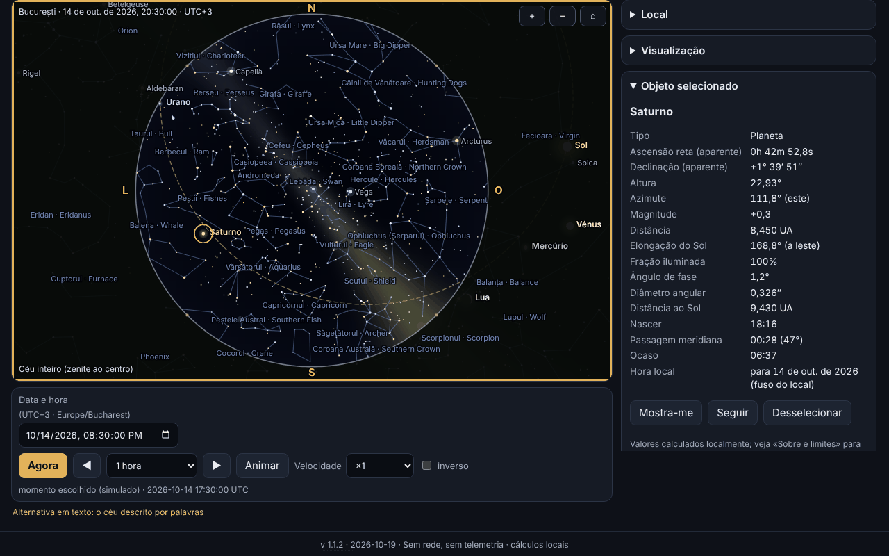

# Bolta — planetário offline

[English](README.md) · [Română](README.ro.md) · [Français](README.fr.md) · [Italiano](README.it.md) · [Español](README.es.md) · **Português** · [Deutsch](README.de.md) · [Magyar](README.hu.md)

**Versão:** 1.1.2 · **Última atualização:** 2026-10-19

Idiomas da interface: **Română, English, Français, Italiano, Español, Português (PT), Deutsch, Magyar**

O Bolta mostra o céu para qualquer local da Terra e qualquer momento entre 1900 e 2100: o Sol, a Lua (com a fase desenhada corretamente), os planetas, 1627 estrelas até à magnitude 5,0, as constelações (com nomes romenos e ingleses), a eclítica, o equador, as grelhas e uma Via Láctea estilizada. Calcula o nascer, a passagem meridiana e o pôr, pode listar os eventos próximos (fases da Lua, conjunções, oposições, elongações, estações do ano, eclipses) com exportação `.ics`, e tem uma página dedicada ao eclipse total do Sol de 2 de agosto de 2027, com circunstâncias locais, contagem decrescente, simulação dos discos e esquema da faixa de totalidade. Tudo corre no navegador, sem rede.



A captura mostra o estado real da aplicação para Bucareste, 14 de outubro de 2026, às 20:30 (UTC+3), com Saturno selecionado; todos os valores são calculados localmente, nada é simulado.

**Online:** https://chiuta.github.io/apps/Bolta/

## Como se usa

1. **O céu.** Escolhe o local (lista interna de 282 cidades, coordenadas escritas por ti — também na forma `44°25′36″ N` —, ou o botão GPS) e o momento (campo de data/hora, «Agora», passos para a frente/para trás, animação de ×1 a ×100000, opcionalmente inversa). O fuso horário vem do `Intl`; para coordenadas introduzidas à mão podes alterá-lo.
2. **A vista.** «Céu inteiro» mostra todo o hemisfério (zénite ao centro, norte em cima, este à esquerda, como num mapa do céu visto de baixo); caso contrário vês uma janela com campo variável. Projeção estereográfica ou azimutal equidistante. A roda do rato ou o gesto de pinça aproximam, arrastar move o olhar. A secção «Apresentação» liga ou desliga os pontos cardeais, o horizonte, os nomes das estrelas e das constelações, as linhas, a Via Láctea, a eclítica, o equador, as grelhas alt-azimutal e equatorial, Neptuno/Plutão, a atmosfera (céu diurno e crepúsculo), a refração e a magnitude limite.
3. **Objetos.** Clique/toque num objeto ou pesquisa por nome (incluindo os nomes romenos das constelações): painel com ascensão reta e declinação aparentes, altura, azimute, magnitude, distância, elongação, fase, nascer/passagem/pôr; «Mostra-me» centra a vista, «Seguir» mantém-na centrada.
4. **Eventos.** Escolhes o intervalo e as categorias; o Bolta calcula em segundo plano (sem bloquear a página), mostra a tabela na hora local do local, «Saltar para o momento» leva o céu a esse momento, «Exportar .ics» descarrega um calendário RFC 5545.
5. **Eclipse 2027.** Os avisos de segurança vêm primeiro; seguem-se as circunstâncias locais (C1, máximo, C4, magnitude, obscurecimento, altura do Sol, e na faixa de totalidade também C2/C3 com a duração da totalidade), a contagem decrescente, a simulação do disco da Lua sobre o Sol, o esquema da faixa e a tabela do obscurecimento calculado para as cidades da Roménia.
6. **O céu em palavras.** Descrição em texto do céu e tabela com os objetos ordenados por altura, cada um com «Mostrar no céu».
7. **Locais e dados.** Locais guardados, cópia de segurança `.fff.json`, importação, «Apagar tudo».
8. **Modo vermelho noturno** (seletor de tema): todas as cores, incluindo as do canvas, ficam vermelhas. Existem também o tema claro e o escuro (por omissão segundo o sistema).
9. **Impressão e exportação.** «Imprimir» usa o mapa como SVG vetorial; SVG e PNG podem ser descarregados (com opção de cores invertidas para papel).
10. **Teclado.** O canvas controla-se por completo: setas (movem o olhar), `+`/`−`, `Home`, `Espaço` (animação), `N` (agora), `,` e `.` (passo), `F` (céu inteiro), `G` (grelha), `C` (constelações), `0`–`8` (Sol, Lua, planetas), `Enter`, `Esc`, e os separadores mudam-se com as setas.

## O que NÃO faz e os limites

- **Não é um instrumento de navegação** e não é adequado para astrofotografia de precisão nem para ocultações.
- **A precisão** é a declarada em `fff-kit/docs/ephem.md`: posições aparentes do Sol e dos planetas ≤ 3″ (Neptuno ≤ 5″), Lua ≤ 1,5″, nascer/pôr do Sol ≤ 6 s e da Lua ≤ 25 s relativamente ao modelo de referência, fases da Lua ≤ 30 s, em 1900–2100. O ΔT futuro é incerto (segundos até 2035, minutos perto de 2100). Não são modelados a aberração diurna, a paralaxe estelar e o relevo local.
- **Estrelas:** apenas as de magnitude ≤ 5,0 (1627, do Hipparcos); **não existem objetos NGC/Messier**, cometas, asteroides ou satélites. Os nomes próprios são os da UAI (156 estrelas ≤ 3,0).
- **A Via Láctea é estilizada** (modelo a partir da matriz galáctica, não uma fotografia) e serve apenas para orientação. A cor do céu ao crepúsculo, o brilho e a magnitude limite em função do Sol são aproximações visuais, não um modelo fotométrico. A cor das estrelas vem do índice B−V (aproximação).
- **As coordenadas das cidades** estão arredondadas (≈ 0,01°); não inventei coordenadas: a lista contém apenas cidades conhecidas. Para maior precisão, introduz as tuas coordenadas. O fuso horário vem da base de dados do navegador (`Intl`), pelo que as zonas com regras novas podem estar desatualizadas em navegadores antigos.
- **A refração** (Sæmundsson, 1010 hPa, 10 °C) é opcional e aproximada perto do horizonte.
- **Eventos:** as conjunções Lua–planeta são geocêntricas (a paralaxe da Lua pode deslocar a aproximação até ~1° para um observador); os eclipses, além do de 2027, são apenas **assinalados** quando a Lua nova/cheia está perto do nó (|β| < 1,58°), sem tipo nem visibilidade; os eclipses da Lua não são calculados em pormenor. O eclipse de 2027 é o único calculado com circunstâncias locais.
- **O eclipse de 2027:** os valores são calculados pelo Bolta, **não são oficiais**; não confies neles para retirar o filtro. Para a Roménia, a margem de erro declarada em `docs/ephem.md`: contactos e máximo ≈ ±3 s relativamente ao cálculo independente de referência; obscurecimento ≤ 0,05 pontos percentuais (máx. 0,01 relativamente à referência) mais a incerteza de ΔT (≈ ±1 s ⇒ ±0,01 p.p.). O esquema da faixa não tem mapa de base (apenas uma grelha de coordenadas e localidades de referência); os limites da zona parcial não são calculados. A simulação dos discos é ilustrativa (a coroa é estilizada).
- **Segurança:** não olhes para o Sol sem filtros certificados ISO 12312-2; na Roménia o eclipse é apenas parcial, pelo que o filtro é necessário o tempo todo.
- O intervalo de tempo está limitado a 1900–2100; a pesquisa de eventos a ~20 anos no máximo de cada vez.
- As traduções são automáticas (ver abaixo).

## Privacidade

Corre localmente, não envia nada. A CSP bloqueia qualquer ligação de rede (`connect-src 'none'`). A posição GPS é pedida **apenas** quando premes o botão «Usar a minha localização (GPS)» (com uma explicação antes), é usada uma só vez e não é transmitida. Localmente (localStorage, chaves `fff.bolta.*`) guardam-se apenas a língua, o tema, as opções de apresentação, o último local e os locais guardados. «Apagar tudo» remove tudo.

## Formatos

- **Entrada:** cópia de segurança `.fff.json` (`{"format":"fff-bundle","schema":1,"app":"Bolta",…}`) com os locais guardados; coordenadas decimais ou graus–minutos–segundos (`44°25′36″ N`, `12.5 W`).
- **Saída:** `.ics` (RFC 5545: CRLF, linhas dobradas aos 75 bytes UTF-8, escapes, UID únicos), SVG, PNG, `.fff.json`, impressão.

## Aspetos técnicos

Um único ficheiro `index.html` (≈ 575 KiB), sem bibliotecas nem tipos de letra externos. Os módulos astronómicos `ephem.js` e `ephem-stars.js` do `fff-kit` estão **copiados em linha, sem modificação**, para que a aplicação continue autónoma; o kit não é injetado e não é modificado.

- **Desenho:** canvas 2D. Projeção estereográfica (k = 2/(1+Z)) ou azimutal equidistante (k = θ/sin θ) sobre uma base de vista ortonormal; no modo «todo o céu» a vista está no zénite (188,8° estereográfica / 195,6° equidistante). O horizonte é o polígono amostrado do círculo máximo alt = 0, e o solo é preenchido com a regra par–ímpar.
- **Estrelas:** as posições vêm de `starPosition` da biblioteca (movimento próprio, precessão, nutação, aberração). Por velocidade, em cada fotograma calcula-se uma matriz de rotação a partir de 3 chamadas de base e um vetor de aberração de primeira ordem; a diferença relativamente à chamada direta para cada estrela é ≤ 0,16″ em 4660 estrelas nos testes abaixo.
- **Céu:** o fundo de dia/crepúsculo/noite é uma imagem de baixa resolução em função da altura do Sol; a magnitude limite desce de dia; a Via Láctea é um modelo em coordenadas galácticas.
- **Fase da Lua:** o terminador é uma elipse; a orientação é a direção para o Sol sobre o círculo máximo, no ecrã.
- **Eventos:** a Lua amostrada de 4 em 4 h, os planetas diariamente com interpolação de Catmull–Rom, refinamento por pesquisa ternária/bisseção; execução em fatias assíncronas. As estações do ano por bisseção sobre a longitude do Sol.
- **O eclipse:** circunstâncias locais de `E.eclipse.local` (elementos de Bessel calculados diretamente das efemérides); a simulação usa a área de sobreposição de dois círculos com o raio topocêntrico da Lua (k = 0,2725076).
- **CSP:** `default-src 'none'; script-src` com hashes sha256 (recalculados com `fff-kit/lib/csp.mjs`, 6 scripts em linha); `style-src 'unsafe-inline'` (o estilo está em linha no ficheiro); `img-src data: blob:` (PNG exportado, ícone); `worker-src blob:` e `media-src data: blob:` mantêm-se do modelo comum, sem uso; `connect-src 'none'`. Sem `eval`, sem manipuladores em linha. Nenhum relaxamento relativamente ao modelo.
- **Os testes** (`tests/test.mjs`, Playwright, rede bloqueada, CSP aplicada) comparam as posições apresentadas com a biblioteca de referência em 20 momentos/locais, verificam a projeção (a estrela no zénite ao centro, projeção/inversa), as fases da Lua 2026–2027 com uma implementação independente de Meeus (cap. 49) e com dados publicados, as oposições/elongações/estações conhecidas, a validade do `.ics` (validador próprio e `icalendar` de Python), o eclipse de 2027 (máximo 10:07:50 TD, Luxor total 380 s, Bucareste 51,2 %), axe-core (0 violações em 3 temas × 6 separadores), teclado, telemóvel 360 px, exportação/importação e desempenho de renderização.

**Desempenho medido** (Chromium headless, renderização por software, computador partilhado com outros processos, pelo que os números são indicativos): 1627 estrelas com linhas, nomes e Via Láctea, canvas 864×548: mediana de um fotograma completo (cálculo + desenho) ≈ 3,3 ms (≈ 300 fotogramas/s teóricos), média ≈ 15 ms devido a interrupções esporádicas da máquina carregada; num ciclo `requestAnimationFrame` com animação mediram-se ≈ 48 fotogramas/s sob carga. O objetivo de 60 fotogramas/s é atingido na mediana, não garantido num dispositivo carregado.

## Terceiros

O código astronómico incorporado provém do `fff-kit` (fontes e licenças em `fff-kit/THIRD-PARTY.md`):

- **VSOP87D** (Bretagnon & Francou 1988; CDS VI/81), extraído através de `astronomia` (Sonia Keys, commenthol) — dados científicos livres; empacotamento MIT.
- **ELP/MPP02** (Chapront & Francou 2002) e as tabelas de **Meeus** (*Astronomical Algorithms*, 2.ª ed.: Lua, nutação, Plutão) — coeficientes numéricos com citação; transcrição de `astronomia` (MIT).
- **ΔT:** polinómios de Espenak–Meeus (NASA TP-2006-214141, público) e tabela do IERS 1973–2027 (dados públicos).
- **Catálogo estelar:** Hipparcos, nova redução (van Leeuwen 2007; ESA — dados públicos), através de `hipparcos-catalog` (MIT); V, B−V, designações, figuras das constelações de **d3-celestial** (Olaf Frohn, BSD-3-Clause), derivado do XHIP e da lista WGSN da UAI.
- Os nomes romenos das constelações são de uso corrente/propostos, **não uma nomenclatura oficial**.

Os textos das licenças, necessários para a redistribuição:

```
astronomia — The MIT License (MIT)
Copyright (c) 2013 Sonia Keys
Copyright (c) 2016 Commenthol

Permission is hereby granted, free of charge, to any person obtaining a copy of
this software and associated documentation files (the "Software"), to deal in
the Software without restriction, including without limitation the rights to
use, copy, modify, merge, publish, distribute, sublicense, and/or sell copies of
the Software, and to permit persons to whom the Software is furnished to do so,
subject to the following conditions:

The above copyright notice and this permission notice shall be included in all
copies or substantial portions of the Software.

THE SOFTWARE IS PROVIDED "AS IS", WITHOUT WARRANTY OF ANY KIND, EXPRESS OR
IMPLIED, INCLUDING BUT NOT LIMITED TO THE WARRANTIES OF MERCHANTABILITY, FITNESS
FOR A PARTICULAR PURPOSE AND NONINFRINGEMENT. IN NO EVENT SHALL THE AUTHORS OR
COPYRIGHT HOLDERS BE LIABLE FOR ANY CLAIM, DAMAGES OR OTHER LIABILITY, WHETHER
IN AN ACTION OF CONTRACT, TORT OR OTHERWISE, ARISING FROM, OUT OF OR IN
CONNECTION WITH THE SOFTWARE OR THE USE OR OTHER DEALINGS IN THE SOFTWARE.
```

```
d3-celestial — BSD-3-Clause
Copyright (c) 2015, Olaf Frohn
All rights reserved.

Redistribution and use in source and binary forms, with or without modification, are permitted provided that the following conditions are met:

1. Redistributions of source code must retain the above copyright notice, this list of conditions and the following disclaimer.

2. Redistributions in binary form must reproduce the above copyright notice, this list of conditions and the following disclaimer in the documentation and/or other materials provided with the distribution.

3. Neither the name of the copyright holder nor the names of its contributors may be used to endorse or promote products derived from this software without specific prior written permission.

THIS SOFTWARE IS PROVIDED BY THE COPYRIGHT HOLDERS AND CONTRIBUTORS "AS IS" AND ANY EXPRESS OR IMPLIED WARRANTIES, INCLUDING, BUT NOT LIMITED TO, THE IMPLIED WARRANTIES OF MERCHANTABILITY AND FITNESS FOR A PARTICULAR PURPOSE ARE DISCLAIMED. IN NO EVENT SHALL THE COPYRIGHT HOLDER OR CONTRIBUTORS BE LIABLE FOR ANY DIRECT, INDIRECT, INCIDENTAL, SPECIAL, EXEMPLARY, OR CONSEQUENTIAL DAMAGES (INCLUDING, BUT NOT LIMITED TO, PROCUREMENT OF SUBSTITUTE GOODS OR SERVICES; LOSS OF USE, DATA, OR PROFITS; OR BUSINESS INTERRUPTION) HOWEVER CAUSED AND ON ANY THEORY OF LIABILITY, WHETHER IN CONTRACT, STRICT LIABILITY, OR TORT (INCLUDING NEGLIGENCE OR OTHERWISE) ARISING IN ANY WAY OUT OF THE USE OF THIS SOFTWARE, EVEN IF ADVISED OF THE POSSIBILITY OF SUCH DAMAGE.
```

O Hipparcos (ESA) é distribuído como dados públicos; JPL DE421/DE423 serviram apenas para verificar a biblioteca (no `fff-kit`), não estão incluídos.

## Traduções

A interface tem 8 línguas: romeno (por omissão) e inglês, escritos pelo autor; francês, italiano, espanhol, português, húngaro e alemão são traduções automáticas, não verificadas por falantes nativos. Os nomes das constelações são dados em romeno e inglês.

## Licença

MIT — ver o ficheiro `LICENSE` na raiz do repositório. Os componentes de terceiros mantêm-se sob as suas próprias licenças, enumeradas acima.

## Histórico

- **1.1.2 — 2026-10-19:** botão «← voltar a <origem>» para `from=terra|orarium|vatra|fieldobserver|nota-zero` (8 línguas; outros valores ignorados). O parâmetro `from` não é guardado.
- **1.1.1 — 2026-10-18:** o local da ligação vale só para a sessão, `#t&ll` sem separador, validação real da data.
- **1.1.0 — 2026-10-18:** ligação profunda `#sky&t=&ll=`.
- **1.0.0 — 2026-10-14:** primeira versão.

## Ligações profundas

`#sky&t=2087-05-17T02:35:00Z&ll=59.9139,10.7522` abre o céu no momento (UTC, 1900–2100) e no local indicados; os parâmetros inválidos (incluindo datas inexistentes como 2026-02-31) são ignorados, com uma mensagem. O local da ligação só é válido para a sessão atual: não é guardado e não substitui o teu local (usa-se o fuso horário do dispositivo). A ligação funciona também sem nome de separador (`#t=…&ll=…`). `#<separador>` (sky, events, etc.) continua válido.
