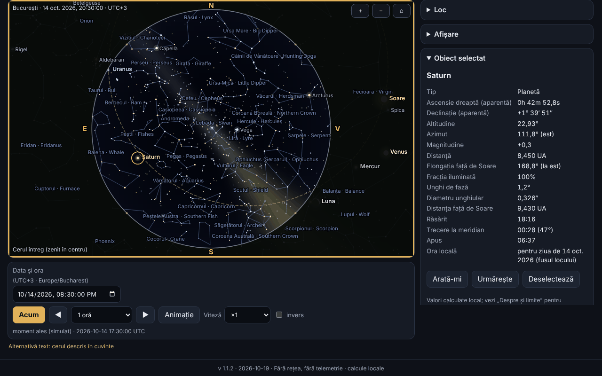

# Bolta — planetariu offline

[English](README.md) · **Română** · [Français](README.fr.md) · [Italiano](README.it.md) · [Español](README.es.md) · [Português](README.pt.md) · [Deutsch](README.de.md) · [Magyar](README.hu.md)

**Versiune:** 1.1.2 · **Ultima actualizare:** 2026-10-19

Limbile interfeței: **Română, English, Français, Italiano, Español, Português (PT), Deutsch, Magyar**

Bolta arată cerul pentru orice loc de pe Pământ și orice moment între 1900 și 2100: Soarele, Luna (cu faza desenată corect), planetele, 1627 de stele până la magnitudinea 5,0, constelațiile (cu nume românești și englezești), ecliptica, ecuatorul, grilele și o Cale Lactee stilizată. Calculează răsăritul, trecerea la meridian și apusul, poate lista evenimentele apropiate (faze lunare, conjuncții, opoziții, elongații, anotimpuri, eclipse) cu export `.ics` și are o pagină dedicată eclipsei totale de Soare din 2 august 2027, cu circumstanțe locale, numărătoare inversă, simulare a discurilor și schemă a benzii totalității. Totul rulează în browser, fără rețea.



Captura arată starea reală a aplicației pentru București, 14 octombrie 2026, ora 20:30 (UTC+3), cu Saturn selectat; toate valorile sunt calculate local, nimic nu este simulat.

**Live:** https://chiuta.github.io/apps/Bolta/

## Cum se folosește

1. **Cerul.** Alege locul (listă internă de 282 de orașe, coordonate scrise de tine — și în forma `44°25′36″ N` —, sau butonul GPS) și momentul (câmpul de dată/oră, „Acum”, pași înainte/înapoi, animație de la ×1 până la ×100000, opțional inversă). Fusul orar vine din `Intl`; pentru coordonate introduse manual îl poți schimba.
2. **Vederea.** „Cerul întreg” arată tot emisfera (zenitul în centru, nord sus, est la stânga, ca pe o hartă a cerului văzută de jos); altfel vezi o fereastră cu câmp variabil. Proiecție stereografică sau azimutală echidistantă. Roata mouse-ului sau ciupirea măresc, tragerea mută privirea. Secțiunea „Afișare” comută punctele cardinale, orizontul, numele stelelor și constelațiilor, liniile, Calea Lactee, ecliptica, ecuatorul, grilele alt-azimutală și ecuatorială, Neptun/Pluto, atmosfera (cer de zi și crepuscul), refracția și magnitudinea limită.
3. **Obiecte.** Clic/atingere pe un obiect sau căutare după nume (inclusiv numele românești ale constelațiilor): panou cu ascensie dreaptă și declinație aparente, altitudine, azimut, magnitudine, distanță, elongație, fază, răsărit/trecere/apus; „Arată-mi” centrează vederea, „Urmărește” o menține centrată.
4. **Evenimente.** Alegi intervalul și categoriile; Bolta calculează în fundal (fără blocarea paginii), arată tabelul în ora locului, „Salt la moment” duce cerul la momentul respectiv, „Exportă .ics” descarcă un calendar RFC 5545.
5. **Eclipsa 2027.** Avertismentele de siguranță sunt primele; urmează circumstanțele locale (C1, maxim, C4, magnitudine, obscurare, înălțimea Soarelui, iar în banda totalității și C2/C3 cu durata totalității), numărătoarea inversă, simularea discului Lunii peste Soare, schema benzii și tabelul obscurării calculate pentru orașele din România.
6. **Cerul în cuvinte.** Descriere text a cerului și tabel cu obiectele ordonate după altitudine, fiecare cu „Arată în cer”.
7. **Locuri și date.** Locuri salvate, copie de siguranță `.fff.json`, import, „Șterge tot”.
8. **Mod roșu de noapte** (selectorul de temă): toate culorile, inclusiv cele din canvas, devin roșii. Există și tema luminoasă și cea întunecată (implicit după sistem).
9. **Tipărire și export.** „Tipărește” folosește harta ca SVG vectorial; SVG și PNG se pot descărca (cu opțiune de culori inversate pentru hârtie).
10. **Tastatură.** Canvasul se controlează complet: săgeți (mută privirea), `+`/`−`, `Home`, `Spațiu` (animație), `N` (acum), `,` și `.` (pas), `F` (tot cerul), `G` (grila), `C` (constelații), `0`–`8` (Soare, Lună, planete), `Enter`, `Esc`, iar filele se schimbă cu săgețile.

## Ce NU face și limitele

- **Nu este instrument de navigație** și nu e potrivit pentru astrofotografie de precizie sau pentru ocultații.
- **Precizia** este cea declarată în `fff-kit/docs/ephem.md`: poziții aparente ale Soarelui și planetelor ≤ 3″ (Neptun ≤ 5″), Luna ≤ 1,5″, răsărit/apus ale Soarelui ≤ 6 s și ale Lunii ≤ 25 s față de modelul de referință, faze lunare ≤ 30 s, în 1900–2100. ΔT viitor este nesigur (secunde până în 2035, minute spre 2100). Nu sunt modelate aberația diurnă, paralaxa stelară și relieful local.
- **Stele:** doar cele cu magnitudinea ≤ 5,0 (1627, din Hipparcos); **nu există obiecte NGC/Messier**, comete, asteroizi sau sateliți. Numele proprii sunt cele IAU (156 de stele ≤ 3,0).
- **Calea Lactee este stilizată** (model din matricea galactică, nu fotografie) și servește doar la orientare. Culoarea cerului de amurg, strălucirea și magnitudinea limită în funcție de Soare sunt aproximări vizuale, nu un model fotometric. Culoarea stelelor vine din indicele B−V (aproximare).
- **Coordonatele orașelor** sunt rotunjite (≈ 0,01°); nu am inventat coordonate: lista conține doar orașe cunoscute. Pentru precizie, introdu coordonatele tale. Fusul orar vine din baza de date a browserului (`Intl`), deci zonele cu reguli noi pot fi învechite în browsere vechi.
- **Refracția** (Sæmundsson, 1010 hPa, 10 °C) este opțională și aproximativă lângă orizont.
- **Evenimente:** conjuncțiile Lună–planetă sunt geocentrice (paralaxa Lunii poate muta apropierea cu până la ~1° pentru un observator); eclipsele, în afara celei din 2027, sunt doar **semnalate** când Luna nouă/plină e aproape de nod (|β| < 1,58°), fără tip sau vizibilitate; eclipsele de Lună nu sunt calculate în detaliu. Eclipsa din 2027 este singura calculată cu circumstanțe locale.
- **Eclipsa din 2027:** valorile sunt calculate de Bolta, **nu sunt oficiale**; nu te baza pe ele pentru a scoate filtrul. Pentru România, marja de eroare declarată în `docs/ephem.md`: contacte și maxim ≈ ±3 s față de calculul independent de referință; obscurare ≤ 0,05 puncte procentuale (max. 0,01 față de referință) plus incertitudinea ΔT (≈ ±1 s ⇒ ±0,01 p.p.). Schema benzii nu are hartă de bază (doar grilă de coordonate și localități reper); limitele zonei parțiale nu sunt calculate. Simularea discurilor este ilustrativă (coroana e stilizată).
- **Siguranță:** nu privi Soarele fără filtre certificate ISO 12312-2; în România eclipsa este doar parțială, deci filtrul e necesar tot timpul.
- Intervalul de timp este limitat la 1900–2100; scanarea evenimentelor la cel mult ~20 de ani odată.
- Traducerile sunt automate (vezi mai jos).

## Confidențialitate

Rulează local, nu trimite nimic. CSP-ul blochează orice conexiune de rețea (`connect-src 'none'`). Poziția GPS se cere **numai** când apeși butonul „Folosește locația mea (GPS)” (cu explicație înainte), se folosește o singură dată și nu se transmite. Local (localStorage, chei `fff.bolta.*`) se păstrează doar limba, tema, opțiunile de afișare, ultimul loc și locurile salvate. „Șterge tot” elimină totul.

## Formate

- **Intrare:** copie de siguranță `.fff.json` (`{"format":"fff-bundle","schema":1,"app":"Bolta",…}`) cu locurile salvate; coordonate zecimale sau grade–minute–secunde (`44°25′36″ N`, `12.5 W`).
- **Ieșire:** `.ics` (RFC 5545: CRLF, linii împăturite la 75 de octeți UTF-8, escapări, UID unice), SVG, PNG, `.fff.json`, tipărire.

## Tehnic

Un singur fișier `index.html` (≈ 575 KiB), fără biblioteci externe sau fonturi externe. Modulele astronomice `ephem.js` și `ephem-stars.js` din `fff-kit` sunt **copiate inline, nemodificate**, ca aplicația să rămână autonomă; kitul nu este injectat și nu este modificat.

- **Desen:** canvas 2D. Proiecție stereografică (k = 2/(1+Z)) sau azimutală echidistantă (k = θ/sin θ) pe o bază de vedere ortonormală; în modul „tot cerul” vederea e în zenit (188,8° stereografic / 195,6° echidistant). Orizontul este poligonul eșantionat al cercului mare alt = 0, iar solul se umple cu regula par–impar.
- **Stele:** pozițiile vin din `starPosition` al bibliotecii (mișcare proprie, precesie, nutație, aberație). Pentru viteză, la fiecare cadru se calculează o matrice de rotație din 3 apeluri de bază și un vector de aberație de ordinul 1; diferența față de apelul direct pentru fiecare stea este ≤ 0,16″ pe 4660 de stele în testele de mai jos.
- **Cer:** fundalul de zi/crepuscul/noapte este o imagine de rezoluție mică în funcție de altitudinea Soarelui; magnitudinea limită scade ziua; Calea Lactee e un model în coordonate galactice.
- **Faza Lunii:** terminatorul e o elipsă; orientarea e direcția spre Soare pe cercul mare, pe ecran.
- **Evenimente:** Luna eșantionată la 4 h, planetele zilnic cu interpolare Catmull–Rom, rafinare prin căutare ternară/bisecție; execuție în felii asincrone. Anotimpurile prin bisecție pe longitudinea Soarelui.
- **Eclipsa:** circumstanțe locale din `E.eclipse.local` (elemente Bessel calculate direct din efemeride); simularea folosește aria de suprapunere a două cercuri cu raza topocentrică a Lunii (k = 0,2725076).
- **CSP:** `default-src 'none'; script-src` cu hash-uri sha256 (recalculate cu `fff-kit/lib/csp.mjs`, 6 scripturi inline); `style-src 'unsafe-inline'` (stilul e inline în fișier); `img-src data: blob:` (PNG exportat, pictogramă); `worker-src blob:` și `media-src data: blob:` rămân din șablonul comun, nefolosite; `connect-src 'none'`. Fără `eval`, fără handlere inline. Nicio relaxare față de șablon.
- **Testele** (`tests/test.mjs`, Playwright, rețea blocată, CSP aplicat) compară pozițiile afișate cu biblioteca de referință pe 20 de momente/locuri, verifică proiecția (steaua de la zenit în centru, proiecție/inversă), fazele lunare 2026–2027 cu o implementare independentă a lui Meeus (cap. 49) și cu date publicate, opozițiile/elongațiile/anotimpurile cunoscute, validitatea `.ics` (validator propriu și `icalendar` din Python), eclipsa 2027 (maxim 10:07:50 TD, Luxor totală 380 s, București 51,2 %), axe-core (0 încălcări în 3 teme × 6 file), tastatură, mobil 360 px, export/import și performanța de randare.

**Performanță măsurată** (Chromium headless, randare software, calculator partajat cu alte procese, deci cifrele sunt orientative): 1627 de stele cu linii, nume și Calea Lactee, canvas 864×548: mediana unui cadru complet (calcul + desen) ≈ 3,3 ms (≈ 300 cadre/s teoretic), media ≈ 15 ms din cauza întreruperilor sporadice ale mașinii încărcate; într-o buclă `requestAnimationFrame` cu animație s-au măsurat ≈ 48 cadre/s sub încărcare. Ținta de 60 de cadre/s este atinsă pe mediană, nu garantată pe un dispozitiv încărcat.

## Terți

Codul astronomic embedded provine din `fff-kit` (surse și licențe în `fff-kit/THIRD-PARTY.md`):

- **VSOP87D** (Bretagnon & Francou 1988; CDS VI/81), extrase prin `astronomia` (Sonia Keys, commenthol) — date științifice libere; ambalare MIT.
- **ELP/MPP02** (Chapront & Francou 2002) și tabelele **Meeus** (*Astronomical Algorithms*, ed. 2: Luna, nutație, Pluto) — coeficienți numerici cu citare; transcriere din `astronomia` (MIT).
- **ΔT:** polinoame Espenak–Meeus (NASA TP-2006-214141, public) și tabel IERS 1973–2027 (date publice).
- **Catalog stelar:** Hipparcos, noua reducere (van Leeuwen 2007; ESA — date publice), prin `hipparcos-catalog` (MIT); V, B−V, denumiri, figurile constelațiilor din **d3-celestial** (Olaf Frohn, BSD-3-Clause), derivat din XHIP și lista IAU WGSN.
- Denumirile românești ale constelațiilor sunt uzuale/propuse, **nu o nomenclatură oficială**.

Textele licențelor, necesare la redistribuire:

```
astronomia — The MIT License (MIT)
Copyright (c) 2013 Sonia Keys
Copyright (c) 2016 Commenthol

Permission is hereby granted, free of charge, to any person obtaining a copy of
this software and associated documentation files (the "Software"), to deal in
the Software without restriction, including without limitation the rights to
use, copy, modify, merge, publish, distribute, sublicense, and/or sell copies of
the Software, and to permit persons to whom the Software is furnished to do so,
subject to the following conditions:

The above copyright notice and this permission notice shall be included in all
copies or substantial portions of the Software.

THE SOFTWARE IS PROVIDED "AS IS", WITHOUT WARRANTY OF ANY KIND, EXPRESS OR
IMPLIED, INCLUDING BUT NOT LIMITED TO THE WARRANTIES OF MERCHANTABILITY, FITNESS
FOR A PARTICULAR PURPOSE AND NONINFRINGEMENT. IN NO EVENT SHALL THE AUTHORS OR
COPYRIGHT HOLDERS BE LIABLE FOR ANY CLAIM, DAMAGES OR OTHER LIABILITY, WHETHER
IN AN ACTION OF CONTRACT, TORT OR OTHERWISE, ARISING FROM, OUT OF OR IN
CONNECTION WITH THE SOFTWARE OR THE USE OR OTHER DEALINGS IN THE SOFTWARE.
```

```
d3-celestial — BSD-3-Clause
Copyright (c) 2015, Olaf Frohn
All rights reserved.

Redistribution and use in source and binary forms, with or without modification, are permitted provided that the following conditions are met:

1. Redistributions of source code must retain the above copyright notice, this list of conditions and the following disclaimer.

2. Redistributions in binary form must reproduce the above copyright notice, this list of conditions and the following disclaimer in the documentation and/or other materials provided with the distribution.

3. Neither the name of the copyright holder nor the names of its contributors may be used to endorse or promote products derived from this software without specific prior written permission.

THIS SOFTWARE IS PROVIDED BY THE COPYRIGHT HOLDERS AND CONTRIBUTORS "AS IS" AND ANY EXPRESS OR IMPLIED WARRANTIES, INCLUDING, BUT NOT LIMITED TO, THE IMPLIED WARRANTIES OF MERCHANTABILITY AND FITNESS FOR A PARTICULAR PURPOSE ARE DISCLAIMED. IN NO EVENT SHALL THE COPYRIGHT HOLDER OR CONTRIBUTORS BE LIABLE FOR ANY DIRECT, INDIRECT, INCIDENTAL, SPECIAL, EXEMPLARY, OR CONSEQUENTIAL DAMAGES (INCLUDING, BUT NOT LIMITED TO, PROCUREMENT OF SUBSTITUTE GOODS OR SERVICES; LOSS OF USE, DATA, OR PROFITS; OR BUSINESS INTERRUPTION) HOWEVER CAUSED AND ON ANY THEORY OF LIABILITY, WHETHER IN CONTRACT, STRICT LIABILITY, OR TORT (INCLUDING NEGLIGENCE OR OTHERWISE) ARISING IN ANY WAY OUT OF THE USE OF THIS SOFTWARE, EVEN IF ADVISED OF THE POSSIBILITY OF SUCH DAMAGE.
```

Hipparcos (ESA) este distribuit ca date publice; JPL DE421/DE423 au servit doar la verificarea bibliotecii (în `fff-kit`), nu sunt incluse.

## Traduceri

Interfața are 8 limbi: română (implicită) și engleză, scrise de autor; franceză, italiană, spaniolă, portugheză, maghiară și germană sunt traduceri automate, neverificate de vorbitori nativi. Numele constelațiilor sunt date în română și engleză.

## Licență

MIT — vezi fișierul `LICENSE` din rădăcina depozitului. Componentele terțe rămân sub licențele lor, enumerate mai sus.

## Istoric

- **1.1.2 — 2026-10-19:** buton „← înapoi la <sursă>” pentru `from=terra|orarium|vatra|fieldobserver|nota-zero` (8 limbi; alte valori ignorate). Parametrul `from` nu se salvează.
- **1.1.1 — 2026-10-18:** locul din link doar pentru sesiune, `#t&ll` fără filă, validare reală a datei.
- **1.1.0 — 2026-10-18:** link adânc `#sky&t=&ll=`.
- **1.0.0 — 2026-10-14:** prima versiune.

## Linkuri adânci

`#sky&t=2087-05-17T02:35:00Z&ll=59.9139,10.7522` deschide cerul la momentul (UTC, 1900–2100) și locul indicate; parametrii invalizi (inclusiv date inexistente precum 2026-02-31) sunt ignorați, cu un mesaj. Locul din link e valabil doar pentru sesiunea curentă: nu se salvează și nu înlocuiește locul tău (se folosește fusul orar al dispozitivului). Linkul merge și fără nume de tab (`#t=…&ll=…`). `#<filă>` (sky, events etc.) rămâne valabil.
