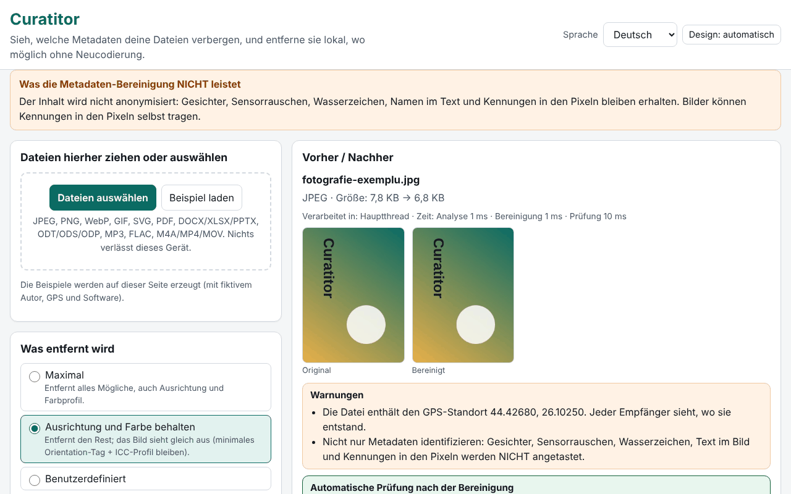

# Curatitor

[English](README.md) · [Română](README.ro.md) · [Français](README.fr.md) · [Italiano](README.it.md) · [Español](README.es.md) · [Português](README.pt.md) · **Deutsch** · [Magyar](README.hu.md)

**Version:** 1.0.0 · **Zuletzt aktualisiert:** 2026-10-14

Oberflächensprachen: **Română, English, Français, Italiano, Español, Português (PT), Deutsch, Magyar**

Curatitor zeigt Ihnen, welche Metadaten Ihre Dateien verbergen (GPS-Standort, Gerätemodell, Autorenname, Bearbeitungsprogramm, Daten, Kommentare, eingebettete Miniaturbilder), und entfernt sie lokal im Browser. Die Bereinigung erfolgt auf der Ebene von Segmenten/Blöcken, wo möglich ohne Neukodierung: Die Pixel eines JPEG, die Frames einer MP3 oder die Pakete einer MP4 bleiben byte-identisch. Nach jeder Bereinigung öffnet die Anwendung das Ergebnis erneut und prüft automatisch, dass kein entfernbares Feld übrig geblieben ist und die Bild-/Audio-/Videodaten unverändert sind.

**Online:** https://chiuta.github.io/apps/Curatitor/

## Verwendung

1. Ziehen Sie die Dateien auf den Bereich oder drücken Sie „Dateien auswählen“ (oder „Beispiel laden“, um mit auf der Seite erzeugten Dateien zu probieren).
2. Wählen Sie die Richtlinie: **Maximal**, **Ausrichtung und Farbe beibehalten** (Standard) oder **Benutzerdefiniert**.
3. Öffnen Sie „Details“ für das Panel Vorher/Nachher: Die sensiblen Felder (GPS, Autor, Seriennummern, Pfade) sind hervorgehoben; GPS-Koordinaten werden als Dezimalgrad angezeigt, mit einer Warnung.
4. „Bereinigen“ oder „Alle bereinigen“, dann einzeln „Herunterladen“ oder „ZIP mit allen herunterladen“.
5. „Nur prüfen“ zeigt den Inhalt, ohne etwas zu verändern. Der JSON/CSV-Bericht enthält keine Werte oder Dateinamen, es sei denn, Sie haken dies ausdrücklich an.

Alles funktioniert per Tastatur, in 8 Sprachen, mit hellem/dunklem Thema und unter Beachtung von `prefers-reduced-motion`.

## Was es NICHT tut (und Grenzen)

- **Es anonymisiert den Inhalt nicht.** Gesichter, Sensorrauschen, Wasserzeichen, Namen im Text und Kennungen in den Pixeln bleiben. Das Bereinigen von Metadaten bedeutet nicht Anonymisierung.
- **PDF:** wird an Ort und Stelle neutralisiert, mit gleicher Länge: Das /Info-Wörterbuch wird geleert, und die XMP-Streams werden durch ein minimales Paket ersetzt (auch für alte Versionen in inkrementellen Updates). Ein verschlüsseltes PDF oder eines mit /Info in einem komprimierten Objektstrom (ObjStm) wird **abgelehnt** (die Daten lassen sich dennoch einsehen). Die Kennung /ID bleibt; die PDF/A-Konformität geht verloren.
- **MP4/MOV/M4A:** fragmentiertes MP4 (moof) wird abgelehnt, ebenso HEIF/HEIC/AVIF. Zeitgesteuerte Metadatenspuren werden nur gemeldet, nicht gelöscht; Handler-Namen und SEI-Nachrichten im Videostrom werden nicht angetastet.
- **MP3:** Die Xing/LAME-Kodierzeichenfolge im ersten Frame bleibt.
- **Office/ODF:** Kommentare und nachverfolgte Änderungen im Dokument werden nur **aufgelistet**, nicht verändert (ihre Autoren bleiben im Inhalt). ZIP64 sowie verschlüsselte oder beschädigte Archive werden abgelehnt.
- **SVG:** Nicht-UTF-8-Kodierungen und SVGZ (gzip) werden abgelehnt.
- **GIF/WebP/PNG/JPEG:** Pixel werden nie gedreht; „Ausrichtung beibehalten“ lässt nur das Orientation-Tag in einem minimalen Exif.
- Nicht erkannte Formate werden mit einer klaren Meldung abgelehnt; für eine abgelehnte Datei wird nie ein Download erzeugt.

## Datenschutz

Die Dateien verlassen das Gerät nicht: Die Seite stellt keine Netzwerkanfragen (`connect-src 'none'`). Im Browser werden nur die Einstellungen (Sprache, Thema, Richtlinie) unter dem Präfix `fff.curatitor.` gespeichert; „Alles löschen“ entfernt sie. Die Einstellungen können als `.fff.json` exportiert/importiert werden. Ein aus einem Blob erzeugter Worker (`worker-src blob:`) wird nur für große Dateien verwendet, damit die Oberfläche flüssig bleibt.

## Formate

| Format | Was gelesen / entfernt wird |
|---|---|
| JPEG | EXIF (GPS, Gerät, Software, Datum, Ausrichtung), XMP, IPTC/Photoshop, COM, ICC, MPF, Miniaturbild; entfernt werden APP1, APP13, COM, Miniaturbilder, Daten nach EOI; ICC und Ausrichtung optional |
| PNG | tEXt/zTXt/iTXt, eXIf, tIME; optional pHYs und iCCP; kritische Chunks und CRCs bleiben korrekt |
| WebP | EXIF, XMP, ICCP (optional); die VP8X-Flags und -Abmessungen werden korrekt neu geschrieben |
| GIF | Kommentare, Anwendungserweiterungen (NETSCAPE/ANIMEXTS bleiben erhalten), XMP |
| SVG | Kommentare, `<metadata>`, Attribute `inkscape:`/`sodipodi:`, optional `<title>`/`<desc>`, eingebettete Rasterbilder |
| PDF | /Info und XMP |
| DOCX/XLSX/PPTX, ODT/ODS/ODP | core/app/custom, meta.xml, Miniaturbilder, eingebettete Bilder |
| MP3 | ID3v1, ID3v2 (auch mehrfach), APEv2, Lyrics3, 3DI |
| FLAC | VORBIS_COMMENT, PICTURE, PADDING und andere Blöcke; STREAMINFO und SEEKTABLE bleiben erhalten |
| M4A/MP4/MOV | udta/meta/uuid/free, Daten genullt, stco/co64-Offsets neu berechnet |

## Technik, kurz gefasst

- Eine einzige `index.html`, ohne Abhängigkeiten; die Engine ist eine Funktion, die im Hauptthread und im Worker identisch läuft.
- Jedes Format hat einen eigenen, von Grund auf geschriebenen Parser (JPEG-Segmente, PNG/RIFF/GIF-Chunks, ZIP mit eigenem Leser und Schreiber, PDF mit klassischem xref und xref-Stream, MP4-Boxen).
- Unveränderte Dateien in einem ZIP werden komprimiert kopiert, ohne Neukomprimierung; geänderte Teile werden neu komprimiert, mit der Zeit 1980-01-01.
- Strenge CSP: `default-src 'none'`, Skript per Hash, kein eval, keine Inline-Handler.
- Tests: `tests/test.mjs` (Playwright + unabhängige Parser in `tests/fixtures.mjs`; ffmpeg/qpdf/pikepdf/ImageMagick als externe Prüfer). Ausführung: `node tests/test.mjs` (`SKIP_BIG=1` lässt die Dateien mit 20–50 MB aus). 46 Tests, alle bestanden; die großen Dateien (19–49 MB) werden in 0,4–1,4 s verarbeitet.

## Drittanbieter

Kein Drittanbieter-Code.

## Übersetzungen

Die Oberfläche gibt es auf Rumänisch, Englisch, Französisch, Italienisch, Spanisch, Portugiesisch, Ungarisch und Deutsch. Die Übersetzungen fr/it/es/pt/hu/de sind automatisch und wurden nicht von Muttersprachlern geprüft.

## Lizenz

MIT — siehe Datei `LICENSE` im Wurzelverzeichnis des Repositorys.

## Verlauf

- 1.0.0 — 2026-10-14: erste Version
