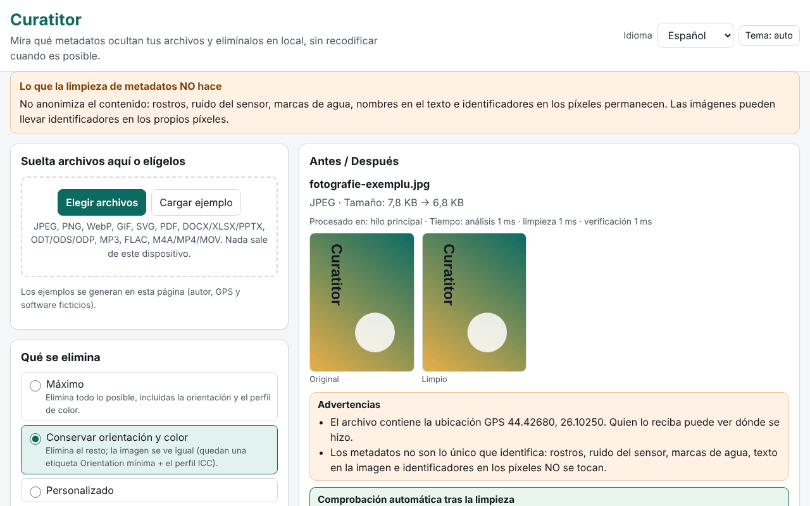

# Curatitor

[English](README.md) · [Română](README.ro.md) · [Français](README.fr.md) · [Italiano](README.it.md) · **Español** · [Português](README.pt.md) · [Deutsch](README.de.md) · [Magyar](README.hu.md)

**Versión:** 1.0.0 · **Última actualización:** 2026-10-14

Idiomas de la interfaz: **Română, English, Français, Italiano, Español, Português (PT), Deutsch, Magyar**

Curatitor te muestra qué metadatos ocultan tus archivos (ubicación GPS, modelo de dispositivo, nombre del autor, programa de edición, fechas, comentarios, miniaturas incrustadas) y los elimina localmente, en el navegador. La limpieza se hace a nivel de segmentos/bloques, sin recodificar cuando es posible: los píxeles de un JPEG, los fotogramas de un MP3 o los paquetes de un MP4 permanecen idénticos byte a byte. Tras cada limpieza, la aplicación reabre el resultado y verifica automáticamente que no ha quedado ningún campo eliminable y que los datos de imagen/audio/vídeo no han cambiado.

**En línea:** https://chiuta.github.io/apps/Curatitor/

## Cómo se usa

1. Arrastra los archivos a la zona o pulsa «Elegir archivos» (o «Cargar ejemplo», para probar con archivos generados en la página).
2. Elige la política: **Máxima**, **Conservar orientación y color** (predeterminada) o **Personalizada**.
3. Abre «Detalles» para el panel Antes/Después: los campos sensibles (GPS, autor, números de serie, rutas) aparecen resaltados; las coordenadas GPS se muestran en grados decimales, con una advertencia.
4. «Limpiar» o «Limpiar todo», luego «Descargar» individualmente o «Descargar ZIP con todos».
5. «Solo inspeccionar» muestra el contenido sin modificar nada. El informe JSON/CSV no contiene valores ni nombres de archivo a menos que lo marques explícitamente.

Todo funciona con el teclado, en 8 idiomas, con tema claro/oscuro y respeto de `prefers-reduced-motion`.

## Lo que NO hace (y límites)

- **No anonimiza el contenido.** Los rostros, el ruido del sensor, las marcas de agua, los nombres en el texto y los identificadores en los píxeles permanecen. Limpiar los metadatos no significa anonimizar.
- **PDF:** se neutraliza en el sitio, con la misma longitud: el diccionario /Info se vacía y los flujos XMP se sustituyen por un paquete mínimo (también para las versiones antiguas en actualizaciones incrementales). Un PDF cifrado o con /Info en un flujo de objetos comprimido (ObjStm) se **rechaza** (los datos aun así pueden verse). El identificador /ID permanece; se pierde la conformidad PDF/A.
- **MP4/MOV/M4A:** se rechaza el MP4 fragmentado (moof), así como HEIF/HEIC/AVIF. Las pistas de metadatos temporizados solo se señalan, no se borran; los nombres de handler y los mensajes SEI del flujo de vídeo no se tocan.
- **MP3:** la cadena de codificación Xing/LAME del primer fotograma permanece.
- **Office/ODF:** los comentarios y los cambios con seguimiento del documento solo se **enumeran**, no se modifican (sus autores permanecen en el contenido). Se rechazan ZIP64 y los archivos cifrados o dañados.
- **SVG:** se rechazan las codificaciones que no sean UTF-8 y SVGZ (gzip).
- **GIF/WebP/PNG/JPEG:** los píxeles nunca se giran; «Conservar orientación» deja solo la etiqueta Orientation, en un Exif mínimo.
- Los formatos no reconocidos se rechazan con un mensaje claro; nunca se produce una descarga para un archivo rechazado.

## Privacidad

Los archivos no salen del dispositivo: la página no hace solicitudes de red (`connect-src 'none'`). En el navegador solo se guardan las preferencias (idioma, tema, política), con el prefijo `fff.curatitor.`; «Borrar todo» las elimina. Los ajustes se pueden exportar/importar como `.fff.json`. Un Worker creado a partir de un blob (`worker-src blob:`) se usa solo para archivos grandes, para que la interfaz siga fluida.

## Formatos

| Formato | Qué se lee / elimina |
|---|---|
| JPEG | EXIF (GPS, dispositivo, software, fecha, orientación), XMP, IPTC/Photoshop, COM, ICC, MPF, miniatura; se eliminan APP1, APP13, COM, miniaturas, datos tras EOI; ICC y orientación opcionales |
| PNG | tEXt/zTXt/iTXt, eXIf, tIME; opcionalmente pHYs e iCCP; los bloques críticos y los CRC siguen siendo correctos |
| WebP | EXIF, XMP, ICCP (opcional); los indicadores y las dimensiones VP8X se reescriben correctamente |
| GIF | comentarios, extensiones de aplicación (se conservan NETSCAPE/ANIMEXTS), XMP |
| SVG | comentarios, `<metadata>`, atributos `inkscape:`/`sodipodi:`, opcionalmente `<title>`/`<desc>`, imágenes ráster incrustadas |
| PDF | /Info y XMP |
| DOCX/XLSX/PPTX, ODT/ODS/ODP | core/app/custom, meta.xml, miniaturas, imágenes incrustadas |
| MP3 | ID3v1, ID3v2 (incluidos múltiples), APEv2, Lyrics3, 3DI |
| FLAC | VORBIS_COMMENT, PICTURE, PADDING y otros bloques; se conservan STREAMINFO y SEEKTABLE |
| M4A/MP4/MOV | udta/meta/uuid/free, fechas puestas a cero, desplazamientos stco/co64 recalculados |

## Técnica, en breve

- Un único `index.html`, sin dependencias; el motor es una función que se ejecuta de forma idéntica en el hilo principal y en el Worker.
- Cada formato tiene su propio analizador, escrito desde cero (segmentos JPEG, bloques PNG/RIFF/GIF, ZIP con lector y escritor propios, PDF con xref clásico y flujo xref, cajas MP4).
- Los archivos sin modificar de un ZIP se copian comprimidos, sin recomprimir; las partes modificadas se recomprimen, con hora 1980-01-01.
- CSP estricta: `default-src 'none'`, script por hash, sin eval, sin manejadores en línea.
- Pruebas: `tests/test.mjs` (Playwright + analizadores independientes en `tests/fixtures.mjs`; ffmpeg/qpdf/pikepdf/ImageMagick como verificadores externos). Ejecución: `node tests/test.mjs` (`SKIP_BIG=1` omite los archivos de 20–50 MB). 46 pruebas, todas pasan; los archivos grandes (19–49 MB) se procesan en 0,4–1,4 s.

## Terceros

Ningún código de terceros.

## Traducciones

La interfaz existe en rumano, inglés, francés, italiano, español, portugués, húngaro y alemán. Las traducciones fr/it/es/pt/hu/de son automáticas y no han sido verificadas por hablantes nativos.

## Licencia

MIT — véase el archivo `LICENSE` en la raíz del repositorio.

## Historial

- 1.0.0 — 2026-10-14: primera versión
