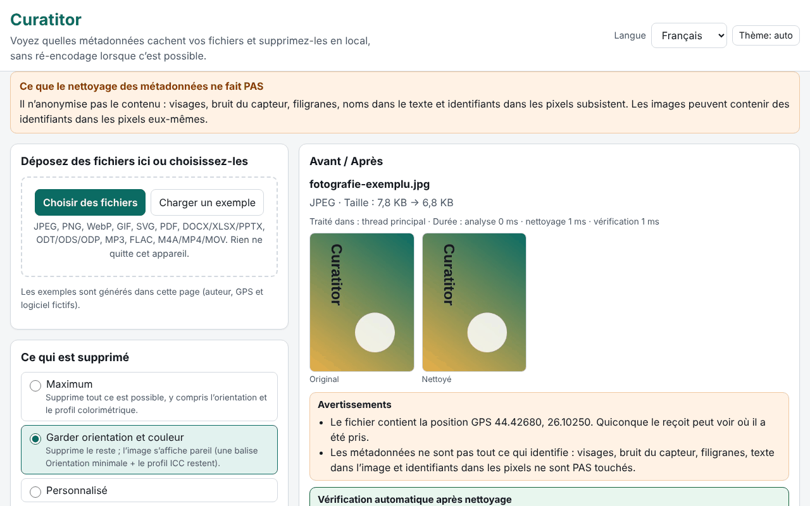

# Curatitor

[English](README.md) · [Română](README.ro.md) · **Français** · [Italiano](README.it.md) · [Español](README.es.md) · [Português](README.pt.md) · [Deutsch](README.de.md) · [Magyar](README.hu.md)

**Version :** 1.0.0 · **Dernière mise à jour :** 2026-10-14

Langues de l'interface : **Română, English, Français, Italiano, Español, Português (PT), Deutsch, Magyar**

Curatitor vous montre quelles métadonnées cachent vos fichiers (localisation GPS, modèle d'appareil, nom de l'auteur, logiciel d'édition, dates, commentaires, miniatures intégrées) et les supprime localement, dans le navigateur. Le nettoyage se fait au niveau des segments/blocs, sans ré-encodage là où c'est possible : les pixels d'un JPEG, les trames d'un MP3 ou les paquets d'un MP4 restent identiques à l'octet près. Après chaque nettoyage, l'application rouvre le résultat et vérifie automatiquement qu'il ne reste aucun champ supprimable et que les données d'image/son/vidéo sont inchangées.

**En ligne :** https://chiuta.github.io/apps/Curatitor/

## Mode d'emploi

1. Faites glisser les fichiers sur la zone ou appuyez sur « Choisir des fichiers » (ou « Charger un exemple », pour essayer avec des fichiers générés dans la page).
2. Choisissez la politique : **Maximum**, **Conserver l'orientation et la couleur** (par défaut) ou **Personnalisé**.
3. Ouvrez « Détails » pour le panneau Avant/Après : les champs sensibles (GPS, auteur, numéros de série, chemins) sont mis en évidence ; les coordonnées GPS sont affichées en degrés décimaux, avec un avertissement.
4. « Nettoyer » ou « Tout nettoyer », puis « Télécharger » individuellement ou « Télécharger le ZIP de tous ».
5. « Inspecter seulement » montre le contenu sans rien modifier. Le rapport JSON/CSV ne contient ni valeurs ni noms de fichiers, sauf si vous le cochez explicitement.

Tout fonctionne au clavier, en 8 langues, avec un thème clair/sombre et le respect de `prefers-reduced-motion`.

## Ce qu'il ne fait PAS (et limites)

- **Il n'anonymise pas le contenu.** Les visages, le bruit du capteur, les filigranes, les noms dans le texte et les identifiants dans les pixels demeurent. Nettoyer les métadonnées ne signifie pas anonymiser.
- **PDF :** neutralisé sur place, à longueur identique : le dictionnaire /Info est vidé et les flux XMP sont remplacés par un paquet minimal (y compris pour les anciennes versions des mises à jour incrémentielles). Un PDF chiffré ou dont /Info est dans un flux d'objets compressé (ObjStm) est **refusé** (les données peuvent tout de même être consultées). L'identifiant /ID demeure ; la conformité PDF/A est perdue.
- **MP4/MOV/M4A :** le MP4 fragmenté (moof) est refusé, de même que HEIF/HEIC/AVIF. Les pistes de métadonnées chronométrées sont seulement signalées, non supprimées ; les noms de handler et les messages SEI du flux vidéo ne sont pas touchés.
- **MP3 :** la chaîne d'encodage Xing/LAME de la première trame demeure.
- **Office/ODF :** les commentaires et les modifications suivies du document sont seulement **listés**, non modifiés (leurs auteurs restent dans le contenu). ZIP64 et les archives chiffrées ou corrompues sont refusés.
- **SVG :** les encodages non UTF-8 et SVGZ (gzip) sont refusés.
- **GIF/WebP/PNG/JPEG :** les pixels ne sont jamais pivotés ; « Conserver l'orientation » ne laisse que l'étiquette Orientation, dans un Exif minimal.
- Les formats non reconnus sont rejetés avec un message clair ; aucun téléchargement n'est jamais produit pour un fichier refusé.

## Confidentialité

Les fichiers ne quittent pas l'appareil : la page ne fait aucune requête réseau (`connect-src 'none'`). Seules les préférences (langue, thème, politique) sont conservées dans le navigateur, sous le préfixe `fff.curatitor.` ; « Tout effacer » les supprime. Les réglages peuvent être exportés/importés en `.fff.json`. Un Worker créé à partir d'un blob (`worker-src blob:`) n'est utilisé que pour les gros fichiers, afin que l'interface reste fluide.

## Formats

| Format | Ce qui est lu / supprimé |
|---|---|
| JPEG | EXIF (GPS, appareil, logiciel, date, orientation), XMP, IPTC/Photoshop, COM, ICC, MPF, miniature ; sont supprimés APP1, APP13, COM, miniatures, données après EOI ; ICC et orientation en option |
| PNG | tEXt/zTXt/iTXt, eXIf, tIME ; en option pHYs et iCCP ; les blocs critiques et les CRC restent corrects |
| WebP | EXIF, XMP, ICCP (en option) ; les indicateurs et dimensions VP8X sont correctement réécrits |
| GIF | commentaires, extensions d'application (NETSCAPE/ANIMEXTS conservées), XMP |
| SVG | commentaires, `<metadata>`, attributs `inkscape:`/`sodipodi:`, en option `<title>`/`<desc>`, images raster intégrées |
| PDF | /Info et XMP |
| DOCX/XLSX/PPTX, ODT/ODS/ODP | core/app/custom, meta.xml, miniatures, images intégrées |
| MP3 | ID3v1, ID3v2 (y compris multiples), APEv2, Lyrics3, 3DI |
| FLAC | VORBIS_COMMENT, PICTURE, PADDING et autres blocs ; STREAMINFO et SEEKTABLE sont conservés |
| M4A/MP4/MOV | udta/meta/uuid/free, dates mises à zéro, décalages stco/co64 recalculés |

## Technique, en bref

- Un seul `index.html`, sans dépendances ; le moteur est une fonction qui s'exécute de façon identique sur le fil principal et dans le Worker.
- Chaque format a son propre analyseur, écrit de zéro (segments JPEG, blocs PNG/RIFF/GIF, ZIP avec lecteur et écrivain propres, PDF avec xref classique et flux xref, boîtes MP4).
- Les fichiers non modifiés d'un ZIP sont copiés compressés, sans recompression ; les parties modifiées sont recompressées, avec l'heure 1980-01-01.
- CSP stricte : `default-src 'none'`, script par hash, sans eval, sans gestionnaires en ligne.
- Tests : `tests/test.mjs` (Playwright + analyseurs indépendants dans `tests/fixtures.mjs` ; ffmpeg/qpdf/pikepdf/ImageMagick comme vérificateurs externes). Exécution : `node tests/test.mjs` (`SKIP_BIG=1` omet les fichiers de 20–50 Mo). 46 tests, tous réussis ; les gros fichiers (19–49 Mo) sont traités en 0,4–1,4 s.

## Tiers

Aucun code tiers.

## Traductions

L'interface existe en roumain, anglais, français, italien, espagnol, portugais, hongrois et allemand. Les traductions fr/it/es/pt/hu/de sont automatiques et n'ont pas été vérifiées par des locuteurs natifs.

## Licence

MIT — voir le fichier `LICENSE` à la racine du dépôt.

## Historique

- 1.0.0 — 2026-10-14 : première version
