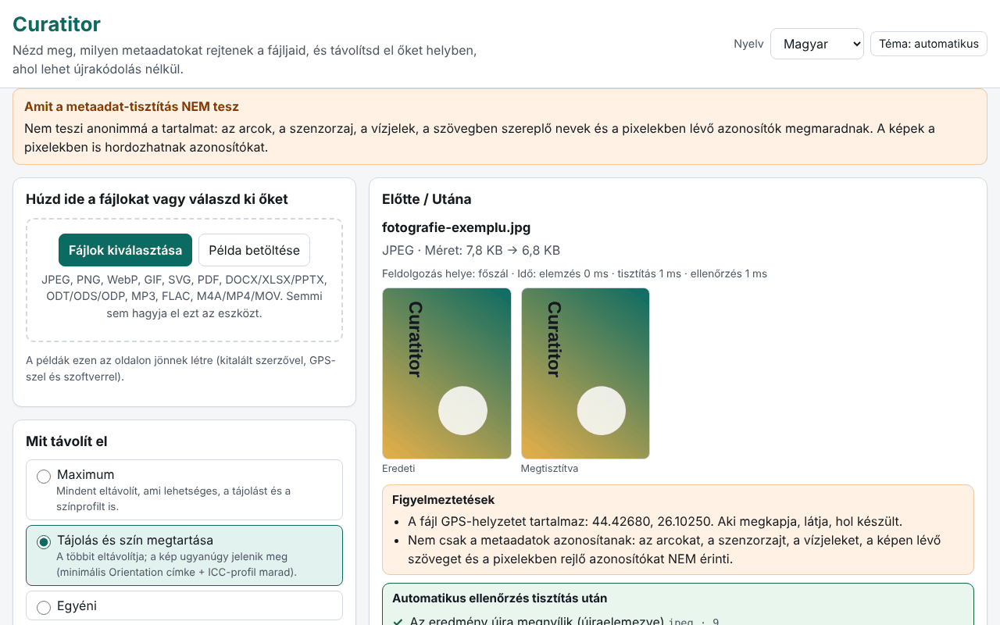

# Curatitor

[English](README.md) · [Română](README.ro.md) · [Français](README.fr.md) · [Italiano](README.it.md) · [Español](README.es.md) · [Português](README.pt.md) · [Deutsch](README.de.md) · **Magyar**

**Verzió:** 1.0.0 · **Utolsó frissítés:** 2026-10-14

A felület nyelvei: **Română, English, Français, Italiano, Español, Português (PT), Deutsch, Magyar**

A Curatitor megmutatja, milyen metaadatokat rejtenek a fájljai (GPS-hely, eszköz modellje, a szerző neve, szerkesztőprogram, dátumok, megjegyzések, beágyazott miniatűrök), és helyben, a böngészőben eltávolítja őket. A tisztítás szegmensek/blokkok szintjén történik, ahol lehet, újrakódolás nélkül: egy JPEG képpontjai, egy MP3 keretei vagy egy MP4 csomagjai bájtra azonosak maradnak. Minden tisztítás után az alkalmazás újra megnyitja az eredményt, és automatikusan ellenőrzi, hogy nem maradt eltávolítható mező, és hogy a kép-/hang-/videóadatok változatlanok.

**Élő változat:** https://chiuta.github.io/apps/Curatitor/

## Hogyan használható

1. Húzza a fájlokat a területre, vagy nyomja meg a „Fájlok kiválasztása” gombot (vagy a „Minta betöltése” gombot, hogy az oldalon generált fájlokkal próbálja ki).
2. Válassza ki a szabályzatot: **Maximális**, **Tájolás és szín megtartása** (alapértelmezett) vagy **Egyéni**.
3. Nyissa meg a „Részletek” gombot az Előtte/Utána panelhez: az érzékeny mezők (GPS, szerző, sorozatszámok, útvonalak) ki vannak emelve; a GPS-koordináták tizedes fokokban jelennek meg, figyelmeztetéssel.
4. „Tisztítás” vagy „Összes tisztítása”, majd „Letöltés” egyenként vagy „Az összes letöltése ZIP-ben”.
5. A „Csak vizsgálat” módosítás nélkül mutatja a tartalmat. A JSON/CSV-jelentés nem tartalmaz értékeket vagy fájlneveket, hacsak ezt kifejezetten be nem jelöli.

Minden működik billentyűzetről, 8 nyelven, világos/sötét témával, a `prefers-reduced-motion` tiszteletben tartásával.

## Mit NEM csinál (és korlátok)

- **Nem anonimizálja a tartalmat.** Az arcok, a szenzorzaj, a vízjelek, a szövegben szereplő nevek és a képpontokban lévő azonosítók megmaradnak. A metaadatok tisztítása nem jelent anonimizálást.
- **PDF:** helyben semlegesítve, azonos hosszal: a /Info szótár kiürül, az XMP-folyamokat minimális csomag váltja fel (a növekményes frissítések régi verzióiban is). A titkosított PDF-et, vagy azt, amelynek /Info-ja tömörített objektumfolyamban (ObjStm) van, **elutasítja** (az adatok ettől még megtekinthetők). A /ID azonosító megmarad; a PDF/A-megfelelés elvész.
- **MP4/MOV/M4A:** a töredezett MP4-et (moof) elutasítja, valamint a HEIF/HEIC/AVIF-et is. Az időzített metaadatsávokat csak jelzi, nem törli; a videófolyam handler-neveihez és SEI-üzeneteihez nem nyúl.
- **MP3:** az első keretben lévő Xing/LAME kódolási karakterlánc megmarad.
- **Office/ODF:** a dokumentum megjegyzéseit és követett módosításait csak **felsorolja**, nem módosítja (szerzőik a tartalomban maradnak). A ZIP64-et, a titkosított vagy sérült archívumokat elutasítja.
- **SVG:** a nem UTF-8 kódolásokat és az SVGZ-t (gzip) elutasítja.
- **GIF/WebP/PNG/JPEG:** a képpontokat soha nem forgatja; a „Tájolás megtartása” csak az Orientation címkét hagyja meg, minimális Exifben.
- A fel nem ismert formátumokat világos üzenettel elutasítja; elutasított fájlhoz soha nem készül letöltés.

## Adatvédelem

A fájlok nem hagyják el az eszközt: az oldal nem végez hálózati kéréseket (`connect-src 'none'`). A böngészőben csak a beállítások (nyelv, téma, szabályzat) maradnak meg, az `fff.curatitor.` előtag alatt; az „Összes törlése” eltávolítja őket. A beállítások `.fff.json` fájlként exportálhatók/importálhatók. A blobból létrehozott Worker (`worker-src blob:`) csak nagy fájlokhoz használatos, hogy a felület gördülékeny maradjon.

## Formátumok

| Formátum | Mit olvas / távolít el |
|---|---|
| JPEG | EXIF (GPS, eszköz, szoftver, dátum, tájolás), XMP, IPTC/Photoshop, COM, ICC, MPF, miniatűr; eltávolítja az APP1, APP13, COM szegmenseket, a miniatűröket, az EOI utáni adatokat; ICC és tájolás opcionális |
| PNG | tEXt/zTXt/iTXt, eXIf, tIME; opcionálisan pHYs és iCCP; a kritikus blokkok és a CRC-k helyesek maradnak |
| WebP | EXIF, XMP, ICCP (opcionális); a VP8X jelzői és méretei helyesen íródnak újra |
| GIF | megjegyzések, alkalmazásbővítmények (a NETSCAPE/ANIMEXTS megmarad), XMP |
| SVG | megjegyzések, `<metadata>`, `inkscape:`/`sodipodi:` attribútumok, opcionálisan `<title>`/`<desc>`, beágyazott raszterképek |
| PDF | /Info és XMP |
| DOCX/XLSX/PPTX, ODT/ODS/ODP | core/app/custom, meta.xml, miniatűrök, beágyazott képek |
| MP3 | ID3v1, ID3v2 (többszörös is), APEv2, Lyrics3, 3DI |
| FLAC | VORBIS_COMMENT, PICTURE, PADDING és más blokkok; a STREAMINFO és a SEEKTABLE megmarad |
| M4A/MP4/MOV | udta/meta/uuid/free, nullázott dátumok, újraszámolt stco/co64 eltolások |

## Műszaki rövid áttekintés

- Egyetlen `index.html`, függőségek nélkül; a motor egy függvény, amely azonosan fut a főszálon és a Workerben.
- Minden formátumnak saját, a nulláról írt elemzője van (JPEG-szegmensek, PNG/RIFF/GIF-blokkok, ZIP saját olvasóval és íróval, PDF klasszikus xref-fel és xref-folyammal, MP4-dobozok).
- A ZIP-ben a nem módosított fájlok tömörítve másolódnak, újratömörítés nélkül; a módosított részek újratömörítve, 1980-01-01-es idővel.
- Szigorú CSP: `default-src 'none'`, szkript hash alapján, eval nélkül, beágyazott eseménykezelők nélkül.
- Tesztek: `tests/test.mjs` (Playwright + független elemzők a `tests/fixtures.mjs` fájlban; ffmpeg/qpdf/pikepdf/ImageMagick külső ellenőrzőként). Futtatás: `node tests/test.mjs` (a `SKIP_BIG=1` kihagyja a 20–50 MB-os fájlokat). 46 teszt, mind sikeres; a nagy fájlokat (19–49 MB) 0,4–1,4 s alatt dolgozza fel.

## Harmadik felek

Nincs harmadik féltől származó kód.

## Fordítások

A felület román, angol, francia, olasz, spanyol, portugál, magyar és német nyelven érhető el. Az fr/it/es/pt/hu/de fordítások automatikusak, és anyanyelvi beszélők nem ellenőrizték őket.

## Licenc

MIT — lásd a tárhely gyökerében lévő `LICENSE` fájlt.

## Előzmények

- 1.0.0 — 2026-10-14: első verzió
