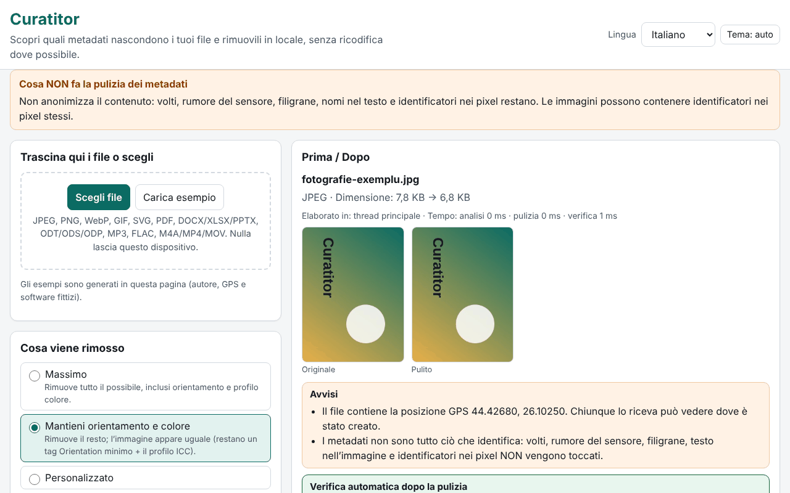

# Curatitor

[English](README.md) · [Română](README.ro.md) · [Français](README.fr.md) · **Italiano** · [Español](README.es.md) · [Português](README.pt.md) · [Deutsch](README.de.md) · [Magyar](README.hu.md)

**Versione:** 1.0.0 · **Ultimo aggiornamento:** 2026-10-14

Lingue dell'interfaccia: **Română, English, Français, Italiano, Español, Português (PT), Deutsch, Magyar**

Curatitor ti mostra quali metadati nascondono i tuoi file (posizione GPS, modello del dispositivo, nome dell'autore, programma di modifica, date, commenti, miniature incorporate) e li rimuove localmente, nel browser. La pulizia avviene a livello di segmenti/blocchi, senza ricodifica dove possibile: i pixel di un JPEG, i frame di un MP3 o i pacchetti di un MP4 restano identici byte per byte. Dopo ogni pulizia, l'applicazione riapre il risultato e verifica automaticamente che non sia rimasto alcun campo rimovibile e che i dati di immagine/audio/video siano invariati.

**Online:** https://chiuta.github.io/apps/Curatitor/

## Come si usa

1. Trascina i file sull'area o premi «Scegli file» (o «Carica esempio», per provare con file generati nella pagina).
2. Scegli la politica: **Massima**, **Mantieni orientamento e colore** (predefinita) o **Personalizzata**.
3. Apri «Dettagli» per il pannello Prima/Dopo: i campi sensibili (GPS, autore, numeri di serie, percorsi) sono evidenziati; le coordinate GPS sono mostrate in gradi decimali, con un avviso.
4. «Pulisci» o «Pulisci tutto», poi «Scarica» singolarmente o «Scarica ZIP con tutti».
5. «Solo ispezione» mostra il contenuto senza modificare nulla. Il rapporto JSON/CSV non contiene valori né nomi di file a meno che tu non lo spunti esplicitamente.

Tutto funziona da tastiera, in 8 lingue, con tema chiaro/scuro e rispetto di `prefers-reduced-motion`.

## Cosa NON fa (e limiti)

- **Non anonimizza il contenuto.** Volti, rumore del sensore, filigrane, nomi nel testo e identificatori nei pixel restano. Pulire i metadati non significa anonimizzare.
- **PDF:** viene neutralizzato sul posto, con la stessa lunghezza: il dizionario /Info viene svuotato e i flussi XMP sono sostituiti da un pacchetto minimo (anche per le vecchie versioni negli aggiornamenti incrementali). Un PDF cifrato o con /Info in un flusso di oggetti compresso (ObjStm) viene **rifiutato** (i dati si possono comunque vedere). L'identificatore /ID resta; la conformità PDF/A si perde.
- **MP4/MOV/M4A:** l'MP4 frammentato (moof) viene rifiutato, così come HEIF/HEIC/AVIF. Le tracce di metadati temporizzati sono solo segnalate, non cancellate; i nomi di handler e i messaggi SEI del flusso video non vengono toccati.
- **MP3:** la stringa di codifica Xing/LAME nel primo frame resta.
- **Office/ODF:** i commenti e le modifiche registrate nel documento sono solo **elencati**, non modificati (i loro autori restano nel contenuto). ZIP64 e archivi cifrati o corrotti vengono rifiutati.
- **SVG:** le codifiche non UTF-8 e SVGZ (gzip) vengono rifiutate.
- **GIF/WebP/PNG/JPEG:** i pixel non vengono mai ruotati; «Mantieni orientamento» lascia solo il tag Orientation, in un Exif minimo.
- I formati non riconosciuti sono respinti con un messaggio chiaro; non si produce mai un download per un file rifiutato.

## Privacy

I file non lasciano il dispositivo: la pagina non effettua richieste di rete (`connect-src 'none'`). Nel browser si conservano solo le preferenze (lingua, tema, politica), con il prefisso `fff.curatitor.`; «Cancella tutto» le elimina. Le impostazioni possono essere esportate/importate come `.fff.json`. Un Worker creato da un blob (`worker-src blob:`) è usato solo per i file grandi, affinché l'interfaccia resti fluida.

## Formati

| Formato | Cosa si legge / rimuove |
|---|---|
| JPEG | EXIF (GPS, dispositivo, software, data, orientamento), XMP, IPTC/Photoshop, COM, ICC, MPF, miniatura; si rimuovono APP1, APP13, COM, miniature, dati dopo EOI; ICC e orientamento opzionali |
| PNG | tEXt/zTXt/iTXt, eXIf, tIME; opzionalmente pHYs e iCCP; i chunk critici e i CRC restano corretti |
| WebP | EXIF, XMP, ICCP (opzionale); i flag e le dimensioni VP8X sono riscritti correttamente |
| GIF | commenti, estensioni di applicazione (NETSCAPE/ANIMEXTS conservate), XMP |
| SVG | commenti, `<metadata>`, attributi `inkscape:`/`sodipodi:`, opzionalmente `<title>`/`<desc>`, immagini raster incorporate |
| PDF | /Info e XMP |
| DOCX/XLSX/PPTX, ODT/ODS/ODP | core/app/custom, meta.xml, miniature, immagini incorporate |
| MP3 | ID3v1, ID3v2 (anche multipli), APEv2, Lyrics3, 3DI |
| FLAC | VORBIS_COMMENT, PICTURE, PADDING e altri blocchi; STREAMINFO e SEEKTABLE sono conservati |
| M4A/MP4/MOV | udta/meta/uuid/free, date azzerate, offset stco/co64 ricalcolati |

## Tecnica, in breve

- Un unico `index.html`, senza dipendenze; il motore è una funzione che gira in modo identico sul thread principale e nel Worker.
- Ogni formato ha un proprio parser, scritto da zero (segmenti JPEG, chunk PNG/RIFF/GIF, ZIP con lettore e scrittore propri, PDF con xref classico e flusso xref, box MP4).
- I file non modificati in uno ZIP sono copiati compressi, senza ricompressione; le parti modificate sono ricompresse, con orario 1980-01-01.
- CSP rigorosa: `default-src 'none'`, script tramite hash, senza eval, senza gestori inline.
- Test: `tests/test.mjs` (Playwright + parser indipendenti in `tests/fixtures.mjs`; ffmpeg/qpdf/pikepdf/ImageMagick come verificatori esterni). Esecuzione: `node tests/test.mjs` (`SKIP_BIG=1` salta i file da 20–50 MB). 46 test, tutti superati; i file grandi (19–49 MB) sono elaborati in 0,4–1,4 s.

## Terze parti

Nessun codice di terze parti.

## Traduzioni

L'interfaccia esiste in rumeno, inglese, francese, italiano, spagnolo, portoghese, ungherese e tedesco. Le traduzioni fr/it/es/pt/hu/de sono automatiche e non sono state verificate da madrelingua.

## Licenza

MIT — vedi il file `LICENSE` nella radice del repository.

## Storico

- 1.0.0 — 2026-10-14: prima versione
