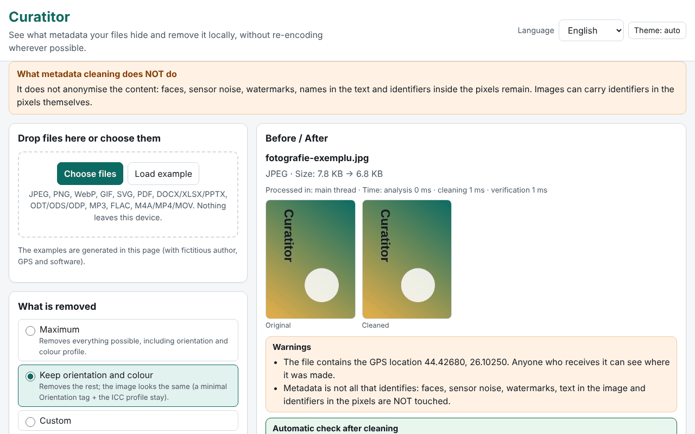

# Curatitor

**English** · [Română](README.ro.md) · [Français](README.fr.md) · [Italiano](README.it.md) · [Español](README.es.md) · [Português](README.pt.md) · [Deutsch](README.de.md) · [Magyar](README.hu.md)

**Version:** 1.0.0 · **Last updated:** 2026-10-14

Interface languages: **Română, English, Français, Italiano, Español, Português (PT), Deutsch, Magyar**

Curatitor shows you what metadata your files are hiding (GPS location, camera model, author name, editing software, dates, comments, embedded thumbnails) and removes it locally, in the browser. Cleaning is done at the level of segments/blocks, without re-encoding where possible: the pixels of a JPEG, the frames of an MP3 or the packets of an MP4 remain byte-for-byte identical. After each cleaning, the application reopens the result and automatically verifies that no removable field is left and that the image/audio/video data is unchanged.

**Live:** https://chiuta.github.io/apps/Curatitor/

## How to use

1. Drag the files onto the area or press "Choose files" (or "Load sample", to try with files generated on the page).
2. Choose the policy: **Maximum**, **Keep orientation and color** (default) or **Custom**.
3. Open "Details" for the Before/After panel: the sensitive fields (GPS, author, serial numbers, paths) are highlighted; GPS coordinates are shown as decimal degrees, with a warning.
4. "Clean" or "Clean all", then "Download" individually or "Download ZIP with all".
5. "Inspect only" shows the content without changing anything. The JSON/CSV report contains no values or file names unless you explicitly tick that.

Everything works from the keyboard, in 8 languages, with a light/dark theme and respect for `prefers-reduced-motion`.

## What it does NOT do (and limits)

- **It does not anonymize the content.** Faces, sensor noise, watermarks, names in text and identifiers in pixels remain. Cleaning metadata does not mean anonymization.
- **PDF:** neutralized in place, with the same length: the /Info dictionary is emptied, and the XMP streams are replaced with a minimal packet (also for old versions in incremental updates). An encrypted PDF or one with /Info in a compressed object stream (ObjStm) is **refused** (the data can still be viewed). The /ID identifier remains; PDF/A conformance is lost.
- **MP4/MOV/M4A:** fragmented MP4 (moof) is refused, as are HEIF/HEIC/AVIF. Timed metadata tracks are only flagged, not deleted; handler names and SEI messages in the video stream are not touched.
- **MP3:** the Xing/LAME encoding string in the first frame remains.
- **Office/ODF:** the comments and tracked changes in the document are only **listed**, not modified (their authors remain in the content). ZIP64, encrypted or corrupt archives are refused.
- **SVG:** non-UTF-8 encodings and SVGZ (gzip) are refused.
- **GIF/WebP/PNG/JPEG:** pixels are never rotated; "Keep orientation" leaves only the Orientation tag, in a minimal Exif.
- Unrecognized formats are rejected with a clear message; a download is never produced for a refused file.

## Privacy

Files do not leave the device: the page makes no network requests (`connect-src 'none'`). Only the preferences (language, theme, policy) are kept in the browser, under the prefix `fff.curatitor.`; "Clear all" removes them. The settings can be exported/imported as `.fff.json`. A Worker created from a blob (`worker-src blob:`) is used only for large files, so that the interface stays smooth.

## Formats

| Format | What is read / removed |
|---|---|
| JPEG | EXIF (GPS, camera, software, date, orientation), XMP, IPTC/Photoshop, COM, ICC, MPF, thumbnail; APP1, APP13, COM, thumbnails, data after EOI are removed; ICC and orientation optional |
| PNG | tEXt/zTXt/iTXt, eXIf, tIME; optionally pHYs and iCCP; critical chunks and CRCs remain correct |
| WebP | EXIF, XMP, ICCP (optional); the VP8X flags and dimensions are rewritten correctly |
| GIF | comments, application extensions (NETSCAPE/ANIMEXTS are kept), XMP |
| SVG | comments, `<metadata>`, `inkscape:`/`sodipodi:` attributes, optionally `<title>`/`<desc>`, embedded raster images |
| PDF | /Info and XMP |
| DOCX/XLSX/PPTX, ODT/ODS/ODP | core/app/custom, meta.xml, thumbnails, embedded images |
| MP3 | ID3v1, ID3v2 (including multiple), APEv2, Lyrics3, 3DI |
| FLAC | VORBIS_COMMENT, PICTURE, PADDING and other blocks; STREAMINFO and SEEKTABLE are kept |
| M4A/MP4/MOV | udta/meta/uuid/free, zeroed dates, stco/co64 offsets recalculated |

## Technical, in brief

- A single `index.html`, with no dependencies; the engine is a function that runs identically on the main thread and in the Worker.
- Each format has its own parser, written from scratch (JPEG segments, PNG/RIFF/GIF chunks, ZIP with its own reader and writer, PDF with classic xref and xref stream, MP4 boxes).
- Unmodified files in a ZIP are copied compressed, without recompression; modified parts are recompressed, with time 1980-01-01.
- Strict CSP: `default-src 'none'`, script by hash, no eval, no inline handlers.
- Tests: `tests/test.mjs` (Playwright + independent parsers in `tests/fixtures.mjs`; ffmpeg/qpdf/pikepdf/ImageMagick as external verifiers). Run: `node tests/test.mjs` (`SKIP_BIG=1` skips the 20–50 MB files). 46 tests, all pass; the large files (19–49 MB) are processed in 0.4–1.4 s.

## Third parties

No third-party code.

## Translations

The interface exists in Romanian, English, French, Italian, Spanish, Portuguese, Hungarian and German. The fr/it/es/pt/hu/de translations are automatic and have not been verified by native speakers.

## License

MIT — see the `LICENSE` file in the repository root.

## History

- 1.0.0 — 2026-10-14: first version
