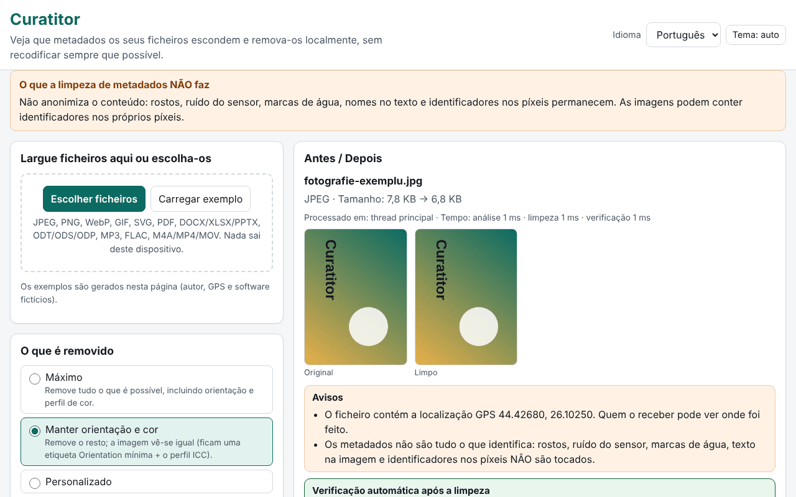

# Curatitor

[English](README.md) · [Română](README.ro.md) · [Français](README.fr.md) · [Italiano](README.it.md) · [Español](README.es.md) · **Português** · [Deutsch](README.de.md) · [Magyar](README.hu.md)

**Versão:** 1.0.0 · **Última atualização:** 2026-10-14

Idiomas da interface: **Română, English, Français, Italiano, Español, Português (PT), Deutsch, Magyar**

O Curatitor mostra-lhe que metadados escondem os seus ficheiros (localização GPS, modelo do dispositivo, nome do autor, programa de edição, datas, comentários, miniaturas incorporadas) e remove-os localmente, no navegador. A limpeza faz-se ao nível de segmentos/blocos, sem recodificação sempre que possível: os píxeis de um JPEG, as tramas de um MP3 ou os pacotes de um MP4 permanecem idênticos byte a byte. Após cada limpeza, a aplicação reabre o resultado e verifica automaticamente que não restou nenhum campo removível e que os dados de imagem/áudio/vídeo não foram alterados.

**Online:** https://chiuta.github.io/apps/Curatitor/

## Como se utiliza

1. Arraste os ficheiros para a zona ou carregue em «Escolher ficheiros» (ou «Carregar exemplo», para experimentar com ficheiros gerados na página).
2. Escolha a política: **Máxima**, **Manter orientação e cor** (por omissão) ou **Personalizada**.
3. Abra «Detalhes» para o painel Antes/Depois: os campos sensíveis (GPS, autor, números de série, caminhos) ficam realçados; as coordenadas GPS são apresentadas em graus decimais, com um aviso.
4. «Limpar» ou «Limpar tudo», depois «Transferir» individualmente ou «Transferir ZIP com todos».
5. «Apenas inspecionar» mostra o conteúdo sem alterar nada. O relatório JSON/CSV não contém valores nem nomes de ficheiros, a menos que o assinale explicitamente.

Tudo funciona pelo teclado, em 8 idiomas, com tema claro/escuro e respeito por `prefers-reduced-motion`.

## O que NÃO faz (e limites)

- **Não anonimiza o conteúdo.** Rostos, ruído do sensor, marcas de água, nomes no texto e identificadores nos píxeis permanecem. Limpar os metadados não significa anonimizar.
- **PDF:** é neutralizado no local, com o mesmo comprimento: o dicionário /Info é esvaziado e os fluxos XMP são substituídos por um pacote mínimo (também nas versões antigas das atualizações incrementais). Um PDF cifrado ou com /Info num fluxo de objetos comprimido (ObjStm) é **recusado** (os dados podem, ainda assim, ser vistos). O identificador /ID permanece; perde-se a conformidade PDF/A.
- **MP4/MOV/M4A:** recusa-se o MP4 fragmentado (moof), bem como HEIF/HEIC/AVIF. As pistas de metadados temporizados são apenas assinaladas, não apagadas; os nomes de handler e as mensagens SEI do fluxo de vídeo não são tocados.
- **MP3:** a cadeia de codificação Xing/LAME da primeira trama permanece.
- **Office/ODF:** os comentários e as alterações controladas do documento são apenas **listados**, não modificados (os seus autores permanecem no conteúdo). Recusam-se ZIP64 e arquivos cifrados ou corrompidos.
- **SVG:** recusam-se as codificações que não sejam UTF-8 e o SVGZ (gzip).
- **GIF/WebP/PNG/JPEG:** os píxeis nunca são rodados; «Manter orientação» deixa apenas a etiqueta Orientation, num Exif mínimo.
- Os formatos não reconhecidos são rejeitados com uma mensagem clara; nunca se produz uma transferência para um ficheiro recusado.

## Privacidade

Os ficheiros não saem do dispositivo: a página não faz pedidos de rede (`connect-src 'none'`). No navegador guardam-se apenas as preferências (idioma, tema, política), com o prefixo `fff.curatitor.`; «Apagar tudo» elimina-as. As definições podem ser exportadas/importadas como `.fff.json`. Um Worker criado a partir de um blob (`worker-src blob:`) é usado apenas para ficheiros grandes, para que a interface se mantenha fluida.

## Formatos

| Formato | O que se lê / remove |
|---|---|
| JPEG | EXIF (GPS, dispositivo, software, data, orientação), XMP, IPTC/Photoshop, COM, ICC, MPF, miniatura; removem-se APP1, APP13, COM, miniaturas, dados após EOI; ICC e orientação opcionais |
| PNG | tEXt/zTXt/iTXt, eXIf, tIME; opcionalmente pHYs e iCCP; os blocos críticos e os CRC permanecem corretos |
| WebP | EXIF, XMP, ICCP (opcional); os indicadores e as dimensões VP8X são reescritos corretamente |
| GIF | comentários, extensões de aplicação (NETSCAPE/ANIMEXTS são mantidas), XMP |
| SVG | comentários, `<metadata>`, atributos `inkscape:`/`sodipodi:`, opcionalmente `<title>`/`<desc>`, imagens raster incorporadas |
| PDF | /Info e XMP |
| DOCX/XLSX/PPTX, ODT/ODS/ODP | core/app/custom, meta.xml, miniaturas, imagens incorporadas |
| MP3 | ID3v1, ID3v2 (incluindo múltiplas), APEv2, Lyrics3, 3DI |
| FLAC | VORBIS_COMMENT, PICTURE, PADDING e outros blocos; STREAMINFO e SEEKTABLE são mantidos |
| M4A/MP4/MOV | udta/meta/uuid/free, datas postas a zero, desvios stco/co64 recalculados |

## Técnica, em resumo

- Um único `index.html`, sem dependências; o motor é uma função que corre de forma idêntica no fio principal e no Worker.
- Cada formato tem o seu próprio analisador, escrito de raiz (segmentos JPEG, blocos PNG/RIFF/GIF, ZIP com leitor e escritor próprios, PDF com xref clássico e fluxo xref, caixas MP4).
- Os ficheiros não modificados de um ZIP são copiados comprimidos, sem recompressão; as partes modificadas são recomprimidas, com a hora 1980-01-01.
- CSP rigorosa: `default-src 'none'`, script por hash, sem eval, sem manipuladores em linha.
- Testes: `tests/test.mjs` (Playwright + analisadores independentes em `tests/fixtures.mjs`; ffmpeg/qpdf/pikepdf/ImageMagick como verificadores externos). Execução: `node tests/test.mjs` (`SKIP_BIG=1` omite os ficheiros de 20–50 MB). 46 testes, todos passam; os ficheiros grandes (19–49 MB) são processados em 0,4–1,4 s.

## Terceiros

Nenhum código de terceiros.

## Traduções

A interface existe em romeno, inglês, francês, italiano, espanhol, português, húngaro e alemão. As traduções fr/it/es/pt/hu/de são automáticas e não foram verificadas por falantes nativos.

## Licença

MIT — veja o ficheiro `LICENSE` na raiz do repositório.

## Histórico

- 1.0.0 — 2026-10-14: primeira versão
