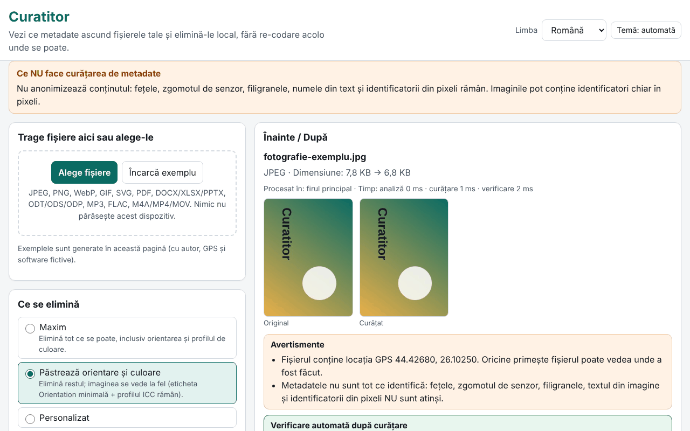

# Curatitor

[English](README.md) · **Română** · [Français](README.fr.md) · [Italiano](README.it.md) · [Español](README.es.md) · [Português](README.pt.md) · [Deutsch](README.de.md) · [Magyar](README.hu.md)

**Versiune:** 1.0.0 · **Ultima actualizare:** 2026-10-14

Limbile interfeței: **Română, English, Français, Italiano, Español, Português (PT), Deutsch, Magyar**

Curatitor îți arată ce metadate ascund fișierele tale (locație GPS, modelul aparatului, numele autorului, programul de editare, date, comentarii, miniaturi încorporate) și le elimină local, în browser. Curățarea se face la nivel de segmente/blocuri, fără re-codare acolo unde se poate: pixelii unui JPEG, cadrele unui MP3 sau pachetele unui MP4 rămân identice octet cu octet. După fiecare curățare, aplicația redeschide rezultatul și verifică automat că nu a mai rămas niciun câmp eliminabil și că datele de imagine/sunet/video sunt neschimbate.

**Live:** https://chiuta.github.io/apps/Curatitor/

## Cum se folosește

1. Trage fișierele pe zonă sau apasă „Alege fișiere” (sau „Încarcă exemplu”, ca să încerci cu fișiere generate în pagină).
2. Alege politica: **Maxim**, **Păstrează orientare și culoare** (implicit) sau **Personalizat**.
3. Deschide „Detalii” pentru panoul Înainte/După: câmpurile sensibile (GPS, autor, serii, căi) sunt evidențiate; coordonatele GPS sunt arătate ca grade zecimale, cu avertisment.
4. „Curăță” sau „Curăță tot”, apoi „Descarcă” individual sau „Descarcă ZIP cu toate”.
5. „Doar inspectează” arată conținutul fără să modifice nimic. Raportul JSON/CSV nu conține valori sau nume de fișiere decât dacă bifezi explicit.

Totul merge de la tastatură, în 8 limbi, cu temă luminoasă/întunecată și respectarea `prefers-reduced-motion`.

## Ce NU face (și limite)

- **Nu anonimizează conținutul.** Fețele, zgomotul de senzor, filigranele, numele din text și identificatorii din pixeli rămân. Curățarea metadatelor nu înseamnă anonimizare.
- **PDF:** se neutralizează pe loc, cu aceeași lungime: dicționarul /Info este golit, iar fluxurile XMP sunt înlocuite cu un pachet minimal (și pentru versiunile vechi din actualizări incrementale). PDF criptat sau cu /Info în flux de obiecte comprimat (ObjStm) este **refuzat** (datele se pot totuși vedea). Identificatorul /ID rămâne; conformitatea PDF/A se pierde.
- **MP4/MOV/M4A:** se refuză MP4 fragmentat (moof), precum și HEIF/HEIC/AVIF. Piste de metadate cronometrate sunt doar semnalate, nu șterse; numele de handler și mesajele SEI din fluxul video nu sunt atinse.
- **MP3:** șirul de codare Xing/LAME din primul cadru rămâne.
- **Office/ODF:** comentariile și modificările urmărite din document sunt doar **listate**, nu modificate (autorii lor rămân în conținut). Se refuză ZIP64, arhivele criptate sau corupte.
- **SVG:** se refuză codările non-UTF-8 și SVGZ (gzip).
- **GIF/WebP/PNG/JPEG:** pixelii nu sunt rotiți niciodată; „Păstrează orientare” lasă doar eticheta Orientation, într-un Exif minimal.
- Formatele nerecunoscute sunt respinse cu un mesaj clar; nu se produce niciodată o descărcare pentru un fișier refuzat.

## Confidențialitate

Fișierele nu părăsesc dispozitivul: pagina nu face cereri de rețea (`connect-src 'none'`). Se păstrează în browser doar preferințele (limbă, temă, politică), sub prefixul `fff.curatitor.`; „Șterge tot” le elimină. Setările se pot exporta/importa ca `.fff.json`. Un Worker creat dintr-un blob (`worker-src blob:`) este folosit doar pentru fișiere mari, ca interfața să rămână fluidă.

## Formate

| Format | Ce se citește / elimină |
|---|---|
| JPEG | EXIF (GPS, aparat, software, dată, orientare), XMP, IPTC/Photoshop, COM, ICC, MPF, miniatură; se elimină APP1, APP13, COM, miniaturi, date după EOI; ICC și orientare opționale |
| PNG | tEXt/zTXt/iTXt, eXIf, tIME; opțional pHYs și iCCP; blocurile critice și CRC-urile rămân corecte |
| WebP | EXIF, XMP, ICCP (opțional); steagurile și dimensiunile VP8X sunt rescrise corect |
| GIF | comentarii, extensii de aplicație (se păstrează NETSCAPE/ANIMEXTS), XMP |
| SVG | comentarii, `<metadata>`, atribute `inkscape:`/`sodipodi:`, opțional `<title>`/`<desc>`, imagini raster încorporate |
| PDF | /Info și XMP |
| DOCX/XLSX/PPTX, ODT/ODS/ODP | core/app/custom, meta.xml, miniaturi, imagini încorporate |
| MP3 | ID3v1, ID3v2 (inclusiv multiple), APEv2, Lyrics3, 3DI |
| FLAC | VORBIS_COMMENT, PICTURE, PADDING și alte blocuri; se păstrează STREAMINFO și SEEKTABLE |
| M4A/MP4/MOV | udta/meta/uuid/free, date zerorizate, offseturile stco/co64 recalculate |

## Tehnic, pe scurt

- Un singur `index.html`, fără dependențe; motorul este o funcție care rulează identic pe firul principal și în Worker.
- Fiecare format are un parser propriu, scris de la zero (segmente JPEG, blocuri PNG/RIFF/GIF, ZIP cu cititor și scriitor proprii, PDF cu xref clasic și flux xref, cutii MP4).
- Fișierele nemodificate dintr-un ZIP sunt copiate comprimate, fără re-comprimare; părțile modificate sunt re-comprimate, cu timp 1980-01-01.
- CSP strict: `default-src 'none'`, script cu hash, fără eval, fără handlere inline.
- Teste: `tests/test.mjs` (Playwright + parsere independente în `tests/fixtures.mjs`; ffmpeg/qpdf/pikepdf/ImageMagick ca verificatori externi). Rulare: `node tests/test.mjs` (`SKIP_BIG=1` omite fișierele de 20–50 MB). 46 de teste, toate trec; fișierele mari (19–49 MB) se procesează în 0,4–1,4 s.

## Terți

Niciun cod terț.

## Traduceri

Interfața există în română, engleză, franceză, italiană, spaniolă, portugheză, maghiară și germană. Traducerile în fr/it/es/pt/hu/de sunt automate și nu au fost verificate de vorbitori nativi.

## Licență

MIT — vezi fișierul `LICENSE` din rădăcina depozitului.

## Istoric

- 1.0.0 — 2026-10-14: prima versiune
