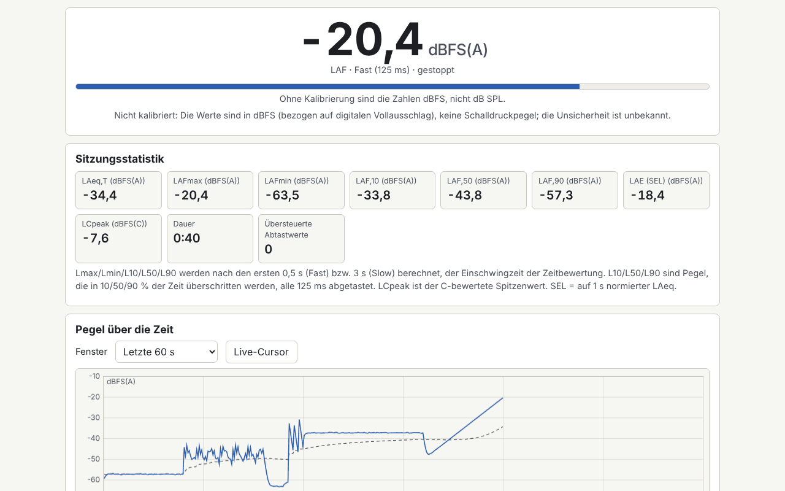

# Decibel

[English](README.md) · [Română](README.ro.md) · [Français](README.fr.md) · [Italiano](README.it.md) · [Español](README.es.md) · [Português](README.pt.md) · **Deutsch** · [Magyar](README.hu.md)

**Version:** 1.0.3 · **Zuletzt aktualisiert:** 2026-10-22

Oberflächensprachen: **Română, English, Français, Italiano, Español, Português (PT), Deutsch, Magyar**

Schallpegelmesser, Spektrumanalysator und orientierender Hörtest in einer einzigen HTML-Datei. Er misst den Schallpegel in Echtzeit mit den Bewertungen A, C und Z (IEC 61672, IIR-Filter), den Zeitbewertungen Fast/Slow, LAeq über ein wählbares Intervall, Lmax/Lmin, L10/L50/L90, einem Histogramm, SEL und der Lärmdosis gegenüber einem gewählten Grenzwert. Er zeigt das Spektrum in Terz- und Oktavbändern (20 Hz–20 kHz) sowie eine lineare FFT mit Spitzenfrequenz und Spektrogramm. Enthalten sind eine Kalibrierung mit dB-Offset, ein Generator für rosa/weißes Rauschen und einen 1-kHz-Sinus, ein separater audiometrischer Test und ein lokales Sitzungsprotokoll. Er ergänzt die Klang-Apps FrequencyLaboratory, generator-frecvente, Aurora, CalmWaves und ASMR.

**Online-App:** https://chiuta.github.io/apps/Decibel/

## Anwendung

1. **Messung:** „Pornește microfonul“ (Mikrofon starten) drücken (der Browser fragt nach der Berechtigung), Bewertung und Zeitkonstante wählen. „Marchează eveniment“ (Ereignis markieren, oder die Taste M) setzt eine Markierung im Diagramm. „Analizează fișier audio…“ (Audiodatei analysieren …) und „Încarcă exemplu“ (Beispiel laden) nutzen dieselbe Engine, ohne Mikrofon.
2. **Kalibrierung:** Ohne Kalibrierung sind die Werte in dBFS (nicht in dB SPL). Gib einen manuellen Offset ein oder nutze den Assistenten: Er misst 10 s lang einen Kalibrator oder ein Referenz-Schallpegelmessgerät, und du gibst den Referenzpegel ein. Der Offset wird pro Profil (Mikrofon und Browser) gespeichert und rückwirkend angewendet.
3. **Spektrum:** Terz- oder Oktavbänder, lineare FFT (Hann-Fenster), Spitze mit parabolischer Interpolation, Spektrogramm; NR-Kurven nur für kalibrierte Werte.
4. **Audiogramm:** Reintöne von 250 Hz bis 8 kHz, vereinfachtes Hughson-Westlake-Verfahren. Ohne Kalibrierung der Kopfhörer mit einem Schallpegelmesser ist das Ergebnis nur eine relative Schwelle, nicht dB HL.
5. **Protokoll:** Die Sitzungen (Datum, Dauer, LAeq, Lmax, Ort) werden lokal gespeichert; Export als CSV, JSON, `.fff.json` und Druck (PDF über den Druckdialog). Die Schaltfläche „Șterge tot“ (Alles löschen) löscht alle lokalen Daten.

## Was er NICHT leistet, und Grenzen

- **Er ist kein zertifizierter Schallpegelmesser.** Mikrofone von Smartphones/Laptops sind nicht kalibriert, haben einen ungleichmäßigen Frequenzgang und Kompression und übersteuern ab etwa 90–100 dB. Die Messungen sind rechtlich NICHT verwertbar und ersetzen NICHT die Beurteilung der Lärmexposition im Arbeitsschutz; prüfe die geltenden Rechtsvorschriften.
- Die Dosis verwendet orientierende Grenzwerte (NIOSH 85 dB(A)/8 h mit 3-dB-Austauschrate, die EU-Empfehlungen 80/85/87 dB(A) aus der Richtlinie 2003/10/EG oder eigene Werte); es werden keine gesetzlichen Werte erfunden.
- Die angezeigte Unsicherheit ist orientierend (±3/±4/±5 dB je nach Kalibriermethode, mit +5 dB außerhalb von 35–90 dB).
- Die Prüfung der Filter gegen die Toleranzen der Klasse 2 erfolgt nur für die Filter; die Tabellen und Toleranzen wurden aus dem Gedächtnis übertragen und können kleine Fehler enthalten. Oberhalb von ca. 8 kHz weichen die bilinearen Filter von der analogen Form ab.
- Lmax/Lmin/L10/L50/L90 schließen die ersten 0,5 s (Fast) bzw. 3 s (Slow) aus. Sitzungen unter 5 s werden nicht automatisch gespeichert.
- Keine NC-Kurven (unsichere Werte); NR beruht auf den Koeffizienten der ISO R 1996, aus dem Gedächtnis übertragen.
- **Das Audiogramm ist kein medizinischer Test** und liefert keine klinische Auswertung. Die voreingestellten RETSPL-Werte (TDH-39) sind editierbar und wurden aus dem Gedächtnis übertragen. Bei Hörproblemen wende dich an einen HNO-Arzt oder eine Audiologin bzw. einen Audiologen.
- Der Dateimodus verwendet den ersten Kanal, höchstens 60 Minuten. Verschlüsselte Bundles werden nicht akzeptiert.
- Der Browser kann das Abschalten von AGC/Echounterdrückung/Rauschunterdrückung ignorieren; die App prüft dies und warnt.

## Datenschutz

Die App läuft lokal und sendet nichts. Der Ton wird nicht aufgezeichnet und verlässt die Seite nicht; er wird in Echtzeit verarbeitet. Einstellungen, Kalibrierprofile und das Protokoll werden nur im `localStorage` (Präfix `fff.decibel.`) in deinem Browser gespeichert.

## Unterstützte Formate

Audiodateien: WAV PCM 8/16/24/32 Bit und Float 32/64 (eigener Parser), andere Formate über den Decoder des Browsers. Import/Export: `.fff.json`; Export als CSV und JSON.

## Technisches

- Eine einzige `index.html`, ohne externe Bibliotheken, ohne Netzwerk. Standardmäßig strikte CSP (`default-src 'none'`, Skript mit SHA-256-Hash, neu berechnet mit `fff-kit/lib/csp.mjs`, `connect-src 'none'`); Anpassungen der CSP waren nicht nötig.
- Pegel: dBFS RMS (ein Vollaussteuerungs-Sinus = −3,01 dBFS); SPL = dBFS + Offset, bei der Anzeige angewendet.
- Bewertungen: bilineare Biquads aus den Polen der IEC 61672, auf 0 dB bei 1 kHz normiert. Zeit: exponentielle Mittelung der Quadrate (125 ms / 1 s).
- Spektrum: eigene Radix-2-FFT, IEC-61260-Bänder zur Basis 10. Mikrofon: `getUserMedia` + `ScriptProcessorNode` (AudioWorklet wegen der CSP vermieden).
- Tests: `node tests/test.mjs` (Playwright, Mikrofon simuliert mit erzeugten WAV-Dateien: 1-kHz-Sinus, rosa Rauschen, Impulse; axe, Überlauf bei 360×740 und 1280×800, Tastatur).

## Drittanbieter

Keine Bibliothek und keine Ressource von Drittanbietern.

## Übersetzungen

Die Standardsprache ist Rumänisch. Die Übersetzungen ins Französische, Italienische, Spanische, Portugiesische, Ungarische und Deutsche sind automatisch erstellt und wurden nicht von Muttersprachlern geprüft.

## Lizenz

Lizenz: MIT — siehe die Datei `LICENSE` im Stammverzeichnis des Repositorys

## Verlauf

- 1.0.0 — 2026-10-14: erste Version
- 1.0.1 — 2026-10-22: die CSV-Exporte (Protokoll, Sitzung, Audiogramm) entschärfen Textzellen, die mit = + - @ (und Tab/CR) beginnen, gegen Formelinjektion; Touch-Ziele von mindestens 24 px für Kontrollkästchen und Optionsfelder.
- 1.0.2 — 2026-10-22: fff-kit 1.1.2: PBKDF2 mit 600.000 Iterationen, Schutz vor Clickjacking.
- 1.0.3 — 2026-10-22: fff-kit 1.1.4: Touch-Ziele und Mindestschriftgröße in der gemeinsamen Oberfläche.
