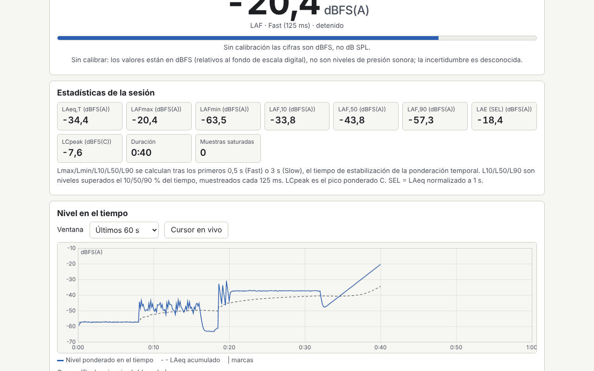

# Decibel

[English](README.md) · [Română](README.ro.md) · [Français](README.fr.md) · [Italiano](README.it.md) · **Español** · [Português](README.pt.md) · [Deutsch](README.de.md) · [Magyar](README.hu.md)

**Versión:** 1.0.6 · **Última actualización:** 2026-10-26

Idiomas de la interfaz: **Română, English, Français, Italiano, Español, Português (PT), Deutsch, Magyar**

Sonómetro, analizador de espectro y prueba auditiva orientativa, en un único archivo HTML. Mide el nivel sonoro en tiempo real con ponderaciones A, C y Z (IEC 61672, filtros IIR), constantes de tiempo Fast/Slow, LAeq en un intervalo elegido, Lmax/Lmin, L10/L50/L90, histograma, SEL y dosis de ruido respecto a un límite elegido. Muestra el espectro en bandas de 1/3 de octava y de 1/1 octava (20 Hz–20 kHz) y una FFT lineal, con la frecuencia de pico y un espectrograma. Incluye calibración con desfase en dB, un generador de ruido rosa/blanco y de seno de 1 kHz, una prueba audiométrica independiente y un registro local de sesiones. Complementa las aplicaciones de sonido FrequencyLaboratory, generator-frecvente, Aurora, CalmWaves y ASMR.

**Aplicación en línea:** https://chiuta.github.io/apps/Decibel/

## Cómo se usa

1. **Medición:** pulsa «Pornește microfonul» (Iniciar el micrófono; el navegador pide permiso), elige la ponderación y la constante de tiempo. «Marchează eveniment» (Marcar evento, o la tecla M) coloca una marca en el gráfico. «Analizează fișier audio…» (Analizar archivo de audio…) y «Încarcă exemplu» (Cargar ejemplo) usan el mismo motor, sin micrófono.
2. **Calibración:** sin calibración, los valores están en dBFS (no en dB SPL). Introduce un desfase manual o usa el asistente: mide durante 10 s un calibrador o un sonómetro de referencia, y tú introduces el nivel de referencia. El desfase se guarda por perfil (micrófono y navegador) y se aplica con efecto retroactivo.
3. **Espectro:** bandas de 1/3 o 1/1 de octava, FFT lineal (ventana de Hann), pico con interpolación parabólica, espectrograma; curvas NR solo para valores calibrados.
4. **Audiograma:** tonos puros de 250 Hz a 8 kHz, método de Hughson–Westlake simplificado. Sin calibrar los auriculares con un sonómetro, el resultado es solo un umbral relativo, no dB HL.
5. **Registro:** las sesiones (fecha, duración, LAeq, Lmax, ubicación) se guardan localmente; exportación a CSV, JSON, `.fff.json` e impresión (PDF desde el cuadro de diálogo de impresión). El botón «Șterge tot» (Borrar todo) elimina todos los datos locales.

## Lo que NO hace, y límites

- **No es un sonómetro certificado.** Los micrófonos de teléfono/portátil no están calibrados, tienen una respuesta en frecuencia irregular, compresión, y saturan por encima de ~90–100 dB. Las mediciones NO tienen validez legal y NO sustituyen la evaluación de la exposición al ruido exigida por la prevención de riesgos laborales; consulta la legislación aplicable.
- La dosis usa límites orientativos (NIOSH 85 dB(A)/8 h con una tasa de intercambio de 3 dB, las recomendaciones de la UE de 80/85/87 dB(A) de la Directiva 2003/10/CE, o valores propios); no se inventan valores legales.
- La incertidumbre mostrada es orientativa (±3/±4/±5 dB según el método de calibración, con +5 dB fuera del rango de 35–90 dB).
- La comprobación de los filtros respecto a las tolerancias de clase 2 se hace solo para los filtros; las tablas y las tolerancias se transcribieron de memoria y pueden contener pequeños errores. Por encima de ~8 kHz los filtros bilineales se desvían de la forma analógica.
- Lmax/Lmin/L10/L50/L90 excluyen los primeros 0,5 s (Fast) o 3 s (Slow). Las sesiones de menos de 5 s no se guardan automáticamente.
- Sin curvas NC (valores poco fiables); NR se basa en los coeficientes de ISO R 1996, transcritos de memoria.
- **El audiograma no es una prueba médica** y no ofrece interpretación clínica. Los valores RETSPL predeterminados (TDH-39) son editables y se transcribieron de memoria. Ante problemas de audición, consulta a un otorrinolaringólogo o a un audiólogo.
- El modo archivo usa el primer canal, con un máximo de 60 minutos. No se aceptan paquetes cifrados.
- El navegador puede ignorar la desactivación del AGC, la cancelación de eco y la reducción de ruido; la aplicación lo comprueba y avisa.

## Privacidad

Se ejecuta en local y no envía nada. El sonido no se graba ni sale de la página; se procesa en tiempo real. Los ajustes, los perfiles de calibración y el registro se conservan únicamente en `localStorage` (prefijo `fff.decibel.`), en tu navegador.

## Formatos admitidos

Archivos de audio: WAV PCM de 8/16/24/32 bits y coma flotante de 32/64 (analizador propio), otros formatos mediante el decodificador del navegador. Importación/exportación: `.fff.json`; exportación a CSV y JSON.

## Aspectos técnicos

- Un único `index.html`, sin bibliotecas externas, sin red. CSP estricta estándar (`default-src 'none'`, script con hash SHA-256 recalculado con `fff-kit/lib/csp.mjs`, `connect-src 'none'`); no hizo falta adaptar la CSP.
- Nivel: dBFS RMS (un seno a fondo de escala = −3,01 dBFS); SPL = dBFS + desfase, aplicado al mostrar.
- Ponderaciones: biquads bilineales a partir de los polos de la IEC 61672, normalizados a 0 dB a 1 kHz. Tiempo: media exponencial de los cuadrados (125 ms / 1 s).
- Espectro: FFT radix-2 propia, bandas IEC 61260 en base 10. Micrófono: `getUserMedia` + `ScriptProcessorNode` (se evitó AudioWorklet por la CSP).
- Pruebas: `node tests/test.mjs` (Playwright, micrófono simulado con WAV generados: seno de 1 kHz, ruido rosa, impulsos; axe, desbordamiento a 360×740 y 1280×800, teclado).

## Terceros

Ninguna biblioteca ni recurso de terceros.

## Traducciones

El idioma predeterminado es el rumano. Las traducciones al francés, italiano, español, portugués, húngaro y alemán son automáticas y no han sido revisadas por hablantes nativos.

## Licencia

Licencia: MIT — véase el archivo `LICENSE` en la raíz del repositorio

## Historial

- 1.0.0 — 2026-10-14: primera versión
- 1.0.1 — 2026-10-22: las exportaciones CSV (registro, sesión, audiograma) neutralizan las celdas de texto que empiezan por = + - @ (y tabulación/CR) contra la inyección de fórmulas; áreas táctiles de al menos 24 px para casillas y botones de opción.
- 1.0.2 — 2026-10-22: fff-kit 1.1.2: PBKDF2 con 600.000 iteraciones, protección anti-clickjacking.
- 1.0.3 — 2026-10-22: fff-kit 1.1.4: áreas táctiles y tamaño mínimo del texto en la interfaz común.
- 1.0.5 — 2026-10-23: mensaje alternativo cuando JavaScript está desactivado (noscript).
