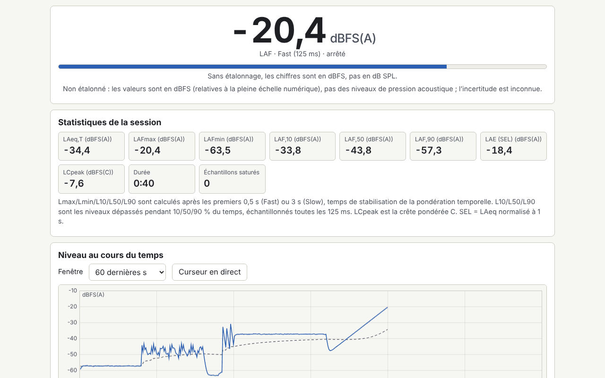

# Decibel

[English](README.md) · [Română](README.ro.md) · **Français** · [Italiano](README.it.md) · [Español](README.es.md) · [Português](README.pt.md) · [Deutsch](README.de.md) · [Magyar](README.hu.md)

**Version :** 1.0.5 · **Dernière mise à jour :** 2026-10-23

Langues de l'interface : **Română, English, Français, Italiano, Español, Português (PT), Deutsch, Magyar**

Sonomètre, analyseur de spectre et test auditif indicatif, dans un seul fichier HTML. Il mesure le niveau sonore en temps réel avec les pondérations A, C et Z (IEC 61672, filtres IIR), les constantes de temps Fast/Slow, le LAeq sur un intervalle choisi, Lmax/Lmin, L10/L50/L90, un histogramme, le SEL et la dose de bruit par rapport à une limite choisie. Il affiche le spectre en bandes de 1/3 d'octave et d'1/1 octave (20 Hz–20 kHz) et une FFT linéaire, avec la fréquence de crête et un spectrogramme. Il comprend un étalonnage par décalage en dB, un générateur de bruit rose/blanc et de sinus à 1 kHz, un test audiométrique séparé et un journal local des sessions. Il complète les applications sonores FrequencyLaboratory, generator-frecvente, Aurora, CalmWaves et ASMR.

**Application en ligne :** https://chiuta.github.io/apps/Decibel/

## Mode d'emploi

1. **Mesure :** appuyez sur « Pornește microfonul » (Démarrer le microphone ; le navigateur demande l'autorisation), choisissez la pondération et la constante de temps. « Marchează eveniment » (Marquer un événement, ou la touche M) place un repère sur le graphique. « Analizează fișier audio… » (Analyser un fichier audio…) et « Încarcă exemplu » (Charger un exemple) utilisent le même moteur, sans microphone.
2. **Étalonnage :** sans étalonnage, les valeurs sont en dBFS (pas en dB SPL). Saisissez un décalage manuel ou utilisez l'assistant : il mesure pendant 10 s un calibreur ou un sonomètre de référence, et vous saisissez le niveau de référence. Le décalage est enregistré par profil (microphone et navigateur) et appliqué rétroactivement.
3. **Spectre :** bandes de 1/3 ou 1/1 octave, FFT linéaire (fenêtre de Hann), crête avec interpolation parabolique, spectrogramme ; courbes NR uniquement pour les valeurs étalonnées.
4. **Audiogramme :** sons purs de 250 Hz à 8 kHz, méthode de Hughson–Westlake simplifiée. Sans étalonnage du casque avec un sonomètre, le résultat n'est qu'un seuil relatif, pas des dB HL.
5. **Journal :** les sessions (date, durée, LAeq, Lmax, lieu) sont enregistrées localement ; export CSV, JSON, `.fff.json` et impression (PDF depuis la boîte de dialogue d'impression). Le bouton « Șterge tot » (Tout effacer) supprime toutes les données locales.

## Ce qu'il ne fait PAS, et limites

- **Ce n'est pas un sonomètre certifié.** Les microphones de téléphone/ordinateur portable ne sont pas étalonnés, ont une réponse en fréquence irrégulière, de la compression, et saturent au-delà de ~90–100 dB. Les mesures n'ont PAS de valeur légale et ne remplacent PAS l'évaluation de l'exposition au bruit relevant de la santé et de la sécurité au travail ; vérifiez la législation applicable.
- La dose utilise des limites indicatives (NIOSH 85 dB(A)/8 h avec un taux d'échange de 3 dB, les recommandations de l'UE de 80/85/87 dB(A) de la directive 2003/10/CE, ou vos propres valeurs) ; aucune valeur légale n'est inventée.
- L'incertitude affichée est indicative (±3/±4/±5 dB selon la méthode d'étalonnage, avec +5 dB en dehors de 35–90 dB).
- La vérification des filtres par rapport aux tolérances de classe 2 ne porte que sur les filtres ; les tableaux et les tolérances ont été transcrits de mémoire et peuvent contenir de petites erreurs. Au-delà de ~8 kHz, les filtres bilinéaires s'écartent de la forme analogique.
- Lmax/Lmin/L10/L50/L90 excluent les premières 0,5 s (Fast) ou 3 s (Slow). Les sessions de moins de 5 s ne sont pas enregistrées automatiquement.
- Pas de courbes NC (valeurs peu fiables) ; NR repose sur les coefficients de l'ISO R 1996, transcrits de mémoire.
- **L'audiogramme n'est pas un test médical** et ne fournit aucune interprétation clinique. Les valeurs RETSPL par défaut (TDH-39) sont modifiables et ont été transcrites de mémoire. En cas de problème d'audition, consultez un médecin ORL ou un audiologiste.
- Le mode fichier utilise le premier canal, 60 minutes au maximum. Les bundles chiffrés ne sont pas acceptés.
- Le navigateur peut ignorer la désactivation de l'AGC, de l'annulation d'écho et de la réduction du bruit ; l'application vérifie et avertit.

## Confidentialité

Il s'exécute localement et n'envoie rien. Le son n'est pas enregistré et ne quitte pas la page ; il est traité en temps réel. Les réglages, les profils d'étalonnage et le journal sont conservés uniquement dans le `localStorage` (préfixe `fff.decibel.`), dans votre navigateur.

## Formats pris en charge

Fichiers audio : WAV PCM 8/16/24/32 bits et flottant 32/64 (analyseur maison), autres formats via le décodeur du navigateur. Import/export : `.fff.json` ; export CSV et JSON.

## Technique

- Un seul `index.html`, sans bibliothèque externe, sans réseau. CSP stricte standard (`default-src 'none'`, script avec un hachage SHA-256 recalculé avec `fff-kit/lib/csp.mjs`, `connect-src 'none'`) ; aucune adaptation de la CSP n'a été nécessaire.
- Niveau : dBFS RMS (un sinus pleine échelle = −3,01 dBFS) ; SPL = dBFS + décalage, appliqué à l'affichage.
- Pondérations : biquads bilinéaires issus des pôles de l'IEC 61672, normalisés à 0 dB à 1 kHz. Temps : moyenne exponentielle des carrés (125 ms / 1 s).
- Spectre : FFT radix-2 maison, bandes IEC 61260 en base 10. Microphone : `getUserMedia` + `ScriptProcessorNode` (AudioWorklet écarté à cause de la CSP).
- Tests : `node tests/test.mjs` (Playwright, microphone simulé avec des fichiers WAV générés : sinus à 1 kHz, bruit rose, impulsions ; axe, débordement à 360×740 et 1280×800, clavier).

## Tiers

Aucune bibliothèque ni ressource tierce.

## Traductions

La langue par défaut est le roumain. Les traductions en français, italien, espagnol, portugais, hongrois et allemand sont automatiques et n'ont pas été vérifiées par des locuteurs natifs.

## Licence

Licence : MIT — voir le fichier `LICENSE` à la racine du dépôt

## Historique

- 1.0.0 — 2026-10-14 : première version
- 1.0.1 — 2026-10-22 : les exports CSV (journal, session, audiogramme) neutralisent les cellules de texte commençant par = + - @ (et tabulation/CR) contre l’injection de formules ; cibles tactiles d’au moins 24 px pour les cases à cocher et boutons radio.
- 1.0.2 — 2026-10-22 : fff-kit 1.1.2 : PBKDF2 à 600 000 itérations, protection anti-clickjacking.
- 1.0.3 — 2026-10-22 : fff-kit 1.1.4 : cibles tactiles et taille minimale du texte dans l’interface commune.
- 1.0.5 — 2026-10-23 : les données locales (journal, profils, audiogrammes, casque, réglages, étalonnage) sont validées à la lecture et l’import .fff.json n’accepte que les clés et formes connues ; une session ne se perd plus silencieusement quand le stockage local est plein (avertissement) ; les paramètres de dose sont limités aux plages des champs ; NaN/Infini dans un WAV flottant n’empoisonnent plus les filtres ; les fréquences d’échantillonnage absurdes sont refusées ; le microphone est libéré si AudioContext échoue après l’autorisation ; les champs CSV contenant CR sont entre guillemets ; version interne alignée.
