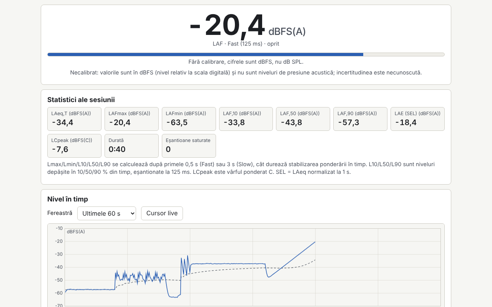

# Decibel

[English](README.md) · [Română](README.ro.md) · [Français](README.fr.md) · [Italiano](README.it.md) · [Español](README.es.md) · [Português](README.pt.md) · [Deutsch](README.de.md) · **Magyar**

**Verzió:** 1.0.0 · **Utolsó frissítés:** 2026-10-14

A felület nyelvei: **Română, English, Français, Italiano, Español, Português (PT), Deutsch, Magyar**

Hangszintmérő, spektrumanalizátor és tájékoztató jellegű hallásvizsgálat egyetlen HTML-fájlban. Valós időben méri a hangszintet A, C és Z súlyozással (IEC 61672, IIR-szűrők), Fast/Slow időállandókkal, a választott időtartamra vett LAeq-val, Lmax/Lmin, L10/L50/L90 értékekkel, hisztogrammal, SEL-lel és a választott határértékhez viszonyított zajdózissal. A spektrumot 1/3 oktávos és 1/1 oktávos sávokban (20 Hz–20 kHz), valamint lineáris FFT-vel jeleníti meg, a csúcsfrekvenciával és spektrogrammal. Tartalmaz dB-eltolásos kalibrálást, rózsaszín/fehér zaj- és 1 kHz-es szinuszgenerátort, különálló audiometriai tesztet és helyi munkamenet-naplót. Kiegészíti a FrequencyLaboratory, generator-frecvente, Aurora, CalmWaves és ASMR hangalkalmazásokat.

**Online alkalmazás:** https://chiuta.github.io/apps/Decibel/

## Használat

1. **Mérés:** nyomd meg a „Pornește microfonul” (Mikrofon indítása) gombot (a böngésző engedélyt kér), válaszd ki a súlyozást és az időállandót. A „Marchează eveniment” (Esemény megjelölése, vagy az M billentyű) jelölőt helyez a grafikonra. Az „Analizează fișier audio…” (Hangfájl elemzése…) és az „Încarcă exemplu” (Példa betöltése) ugyanazt a motort használja, mikrofon nélkül.
2. **Kalibrálás:** kalibrálás nélkül az értékek dBFS-ben vannak (nem dB SPL-ben). Adj meg kézi eltolást, vagy használd a varázslót: 10 másodpercig mér egy kalibrátort vagy egy referencia-hangszintmérőt, te pedig megadod a referenciaszintet. Az eltolás profilonként (mikrofon és böngésző) mentődik, és visszamenőleg érvényesül.
3. **Spektrum:** 1/3 vagy 1/1 oktávos sávok, lineáris FFT (Hann-ablak), csúcs parabolikus interpolációval, spektrogram; NR-görbék csak kalibrált értékekhez.
4. **Audiogram:** tiszta hangok 250 Hz–8 kHz között, egyszerűsített Hughson–Westlake-módszer. A fejhallgató hangszintmérővel végzett kalibrálása nélkül az eredmény csak viszonylagos küszöb, nem dB HL.
5. **Napló:** a munkamenetek (dátum, időtartam, LAeq, Lmax, helyszín) helyben mentődnek; exportálás CSV, JSON, `.fff.json` formátumban és nyomtatás (PDF a nyomtatási párbeszédablakból). A „Șterge tot” (Mindent töröl) gomb törli az összes helyi adatot.

## Amit NEM tud, és korlátok

- **Nem hitelesített hangszintmérő.** A telefonok/laptopok mikrofonjai nincsenek kalibrálva, egyenetlen az átviteli karakterisztikájuk, tömörítést alkalmaznak, és ~90–100 dB felett telítésbe mennek. A mérések jogilag NEM érvényesek, és NEM helyettesítik a munkavédelemben előírt zajexpozíció-értékelést; ellenőrizd az alkalmazandó jogszabályokat.
- A dózis tájékoztató határértékeket használ (NIOSH 85 dB(A)/8 óra 3 dB-es cserearánnyal, a 2003/10/EK irányelv szerinti uniós 80/85/87 dB(A) ajánlások, vagy saját értékek); jogszabályi értékeket nem talál ki.
- A megjelenített bizonytalanság tájékoztató jellegű (±3/±4/±5 dB a kalibrálási módszertől függően, a 35–90 dB tartományon kívül +5 dB).
- A szűrők 2. osztályú tűrésekkel szembeni ellenőrzése csak a szűrőkre vonatkozik; a táblázatokat és a tűréseket emlékezetből másoltuk át, és kisebb hibákat tartalmazhatnak. ~8 kHz felett a bilineáris szűrők eltérnek az analóg alaktól.
- Az Lmax/Lmin/L10/L50/L90 kihagyja az első 0,5 s-ot (Fast) vagy 3 s-ot (Slow). Az 5 másodpercnél rövidebb munkamenetek nem mentődnek automatikusan.
- NC-görbék nincsenek (megbízhatatlan értékek); az NR az ISO R 1996 együtthatóira épül, emlékezetből átmásolva.
- **Az audiogram nem orvosi vizsgálat**, és nem ad klinikai értelmezést. Az alapértelmezett RETSPL-értékek (TDH-39) szerkeszthetők, és emlékezetből másoltuk át őket. Hallásproblémák esetén fordulj fül-orr-gégész orvoshoz vagy audiológushoz.
- A fájl mód az első csatornát használja, legfeljebb 60 percig. A titkosított csomagok (bundle) nem támogatottak.
- A böngésző figyelmen kívül hagyhatja az AGC, a visszhangtörlés és a zajcsökkentés kikapcsolását; az alkalmazás ellenőrzi és figyelmeztet.

## Adatvédelem

Helyben fut, és semmit nem küld el. A hangot nem rögzíti, és nem hagyja el az oldalt; valós időben dolgozza fel. A beállítások, a kalibrációs profilok és a napló kizárólag a `localStorage`-ban (előtag: `fff.decibel.`), a böngésződben tárolódnak.

## Támogatott formátumok

Hangfájlok: WAV PCM 8/16/24/32 bites és lebegőpontos 32/64 (saját értelmező), más formátumok a böngésző dekódolóján keresztül. Import/export: `.fff.json`; CSV- és JSON-export.

## Műszaki adatok

- Egyetlen `index.html`, külső könyvtárak és hálózat nélkül. Szabványos szigorú CSP (`default-src 'none'`, a `fff-kit/lib/csp.mjs`-sel újraszámolt SHA-256 hash-sel védett szkript, `connect-src 'none'`); a CSP módosítására nem volt szükség.
- Szint: dBFS RMS (a teljes skálájú szinusz = −3,01 dBFS); SPL = dBFS + eltolás, megjelenítéskor alkalmazva.
- Súlyozások: az IEC 61672 pólusaiból származtatott bilineáris biquadok, 1 kHz-en 0 dB-re normalizálva. Idő: a négyzetek exponenciális átlagolása (125 ms / 1 s).
- Spektrum: saját radix-2 FFT, IEC 61260 szerinti 10-es alapú sávok. Mikrofon: `getUserMedia` + `ScriptProcessorNode` (az AudioWorkletet a CSP miatt kerültük).
- Tesztek: `node tests/test.mjs` (Playwright, a mikrofon generált WAV-fájlokkal szimulálva: 1 kHz-es szinusz, rózsaszín zaj, impulzusok; axe, túlcsordulás 360×740 és 1280×800 felbontásnál, billentyűzet).

## Harmadik felek

Nincs harmadik féltől származó könyvtár vagy erőforrás.

## Fordítások

Az alapértelmezett nyelv a román. A francia, olasz, spanyol, portugál, magyar és német fordítások automatikusak, és anyanyelvi beszélők nem ellenőrizték őket.

## Licenc

Licenc: MIT — lásd a `LICENSE` fájlt a tároló gyökerében

## Előzmények

- 1.0.0 — 2026-10-14: első verzió
