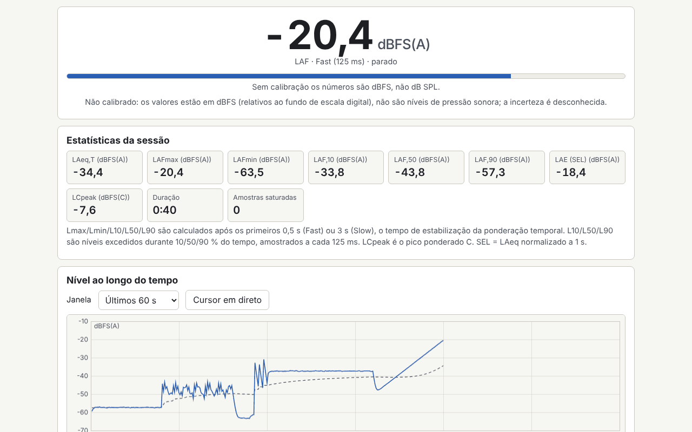

# Decibel

[English](README.md) · [Română](README.ro.md) · [Français](README.fr.md) · [Italiano](README.it.md) · [Español](README.es.md) · **Português** · [Deutsch](README.de.md) · [Magyar](README.hu.md)

**Versão:** 1.0.1 · **Última atualização:** 2026-10-22

Idiomas da interface: **Română, English, Français, Italiano, Español, Português (PT), Deutsch, Magyar**

Sonómetro, analisador de espetro e teste auditivo indicativo, num único ficheiro HTML. Mede o nível sonoro em tempo real com ponderações A, C e Z (IEC 61672, filtros IIR), constantes de tempo Fast/Slow, LAeq num intervalo escolhido, Lmax/Lmin, L10/L50/L90, histograma, SEL e dose de ruído face a um limite escolhido. Apresenta o espetro em bandas de 1/3 de oitava e de 1/1 oitava (20 Hz–20 kHz) e uma FFT linear, com a frequência de pico e um espetrograma. Inclui calibração com desvio em dB, um gerador de ruído rosa/branco e de sinusoide de 1 kHz, um teste audiométrico separado e um registo local de sessões. Complementa as aplicações de som FrequencyLaboratory, generator-frecvente, Aurora, CalmWaves e ASMR.

**Aplicação online:** https://chiuta.github.io/apps/Decibel/

## Como se utiliza

1. **Medição:** prima «Pornește microfonul» (Iniciar o microfone; o navegador pede autorização), escolha a ponderação e a constante de tempo. «Marchează eveniment» (Marcar evento, ou a tecla M) coloca uma marca no gráfico. «Analizează fișier audio…» (Analisar ficheiro de áudio…) e «Încarcă exemplu» (Carregar exemplo) usam o mesmo motor, sem microfone.
2. **Calibração:** sem calibração, os valores estão em dBFS (não em dB SPL). Introduza um desvio manual ou use o assistente: mede durante 10 s um calibrador ou um sonómetro de referência, e o utilizador introduz o nível de referência. O desvio é guardado por perfil (microfone e navegador) e aplicado retroativamente.
3. **Espetro:** bandas de 1/3 ou 1/1 de oitava, FFT linear (janela de Hann), pico com interpolação parabólica, espetrograma; curvas NR apenas para valores calibrados.
4. **Audiograma:** tons puros de 250 Hz a 8 kHz, método de Hughson–Westlake simplificado. Sem calibrar os auscultadores com um sonómetro, o resultado é apenas um limiar relativo, não dB HL.
5. **Registo:** as sessões (data, duração, LAeq, Lmax, localização) são guardadas localmente; exportação para CSV, JSON, `.fff.json` e impressão (PDF a partir da caixa de diálogo de impressão). O botão «Șterge tot» (Apagar tudo) elimina todos os dados locais.

## O que NÃO faz, e limites

- **Não é um sonómetro certificado.** Os microfones de telemóvel/portátil não estão calibrados, têm uma resposta em frequência irregular, compressão, e saturam acima de ~90–100 dB. As medições NÃO têm validade legal e NÃO substituem a avaliação da exposição ao ruído exigida pela segurança e saúde no trabalho; consulte a legislação aplicável.
- A dose usa limites indicativos (NIOSH 85 dB(A)/8 h com taxa de troca de 3 dB, as recomendações da UE de 80/85/87 dB(A) da Diretiva 2003/10/CE, ou valores próprios); não são inventados valores legais.
- A incerteza apresentada é indicativa (±3/±4/±5 dB consoante o método de calibração, com +5 dB fora do intervalo de 35–90 dB).
- A verificação dos filtros face às tolerâncias da classe 2 é feita apenas para os filtros; as tabelas e as tolerâncias foram transcritas de memória e podem conter pequenos erros. Acima de ~8 kHz, os filtros bilineares afastam-se da forma analógica.
- Lmax/Lmin/L10/L50/L90 excluem os primeiros 0,5 s (Fast) ou 3 s (Slow). As sessões com menos de 5 s não são guardadas automaticamente.
- Sem curvas NC (valores pouco fiáveis); NR baseia-se nos coeficientes da ISO R 1996, transcritos de memória.
- **O audiograma não é um teste médico** e não fornece interpretação clínica. Os valores RETSPL predefinidos (TDH-39) são editáveis e foram transcritos de memória. Em caso de problemas de audição, consulte um otorrinolaringologista ou um audiologista.
- O modo de ficheiro usa o primeiro canal, no máximo 60 minutos. Os pacotes cifrados não são aceites.
- O navegador pode ignorar a desativação do AGC, do cancelamento de eco e da redução de ruído; a aplicação verifica e avisa.

## Privacidade

Funciona localmente e não envia nada. O som não é gravado nem sai da página; é processado em tempo real. As definições, os perfis de calibração e o registo são guardados apenas no `localStorage` (prefixo `fff.decibel.`), no seu navegador.

## Formatos suportados

Ficheiros de áudio: WAV PCM de 8/16/24/32 bits e vírgula flutuante de 32/64 (analisador próprio), outros formatos através do descodificador do navegador. Importação/exportação: `.fff.json`; exportação para CSV e JSON.

## Aspetos técnicos

- Um único `index.html`, sem bibliotecas externas, sem rede. CSP estrita padrão (`default-src 'none'`, script com hash SHA-256 recalculado com `fff-kit/lib/csp.mjs`, `connect-src 'none'`); não foram necessárias adaptações da CSP.
- Nível: dBFS RMS (uma sinusoide em fundo de escala = −3,01 dBFS); SPL = dBFS + desvio, aplicado na apresentação.
- Ponderações: biquads bilineares a partir dos polos da IEC 61672, normalizados a 0 dB a 1 kHz. Tempo: média exponencial dos quadrados (125 ms / 1 s).
- Espetro: FFT radix-2 própria, bandas IEC 61260 em base 10. Microfone: `getUserMedia` + `ScriptProcessorNode` (AudioWorklet evitado por causa da CSP).
- Testes: `node tests/test.mjs` (Playwright, microfone simulado com WAV gerados: sinusoide de 1 kHz, ruído rosa, impulsos; axe, overflow a 360×740 e 1280×800, teclado).

## Terceiros

Nenhuma biblioteca ou recurso de terceiros.

## Traduções

O idioma predefinido é o romeno. As traduções para francês, italiano, espanhol, português, húngaro e alemão são automáticas e não foram verificadas por falantes nativos.

## Licença

Licença: MIT — ver o ficheiro `LICENSE` na raiz do repositório

## Histórico

- 1.0.0 — 2026-10-14: primeira versão
- 1.0.1 — 2026-10-22: as exportações CSV (registo, sessão, audiograma) neutralizam as células de texto que começam por = + - @ (e tabulação/CR) contra a injeção de fórmulas; áreas táteis de pelo menos 24 px para caixas de seleção e botões de opção.
