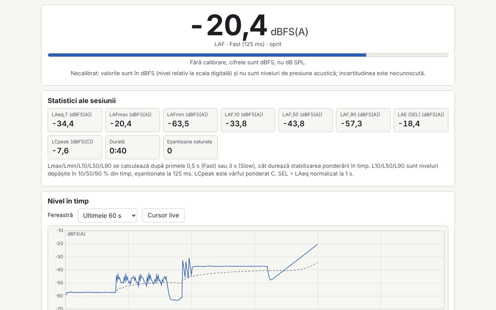

# Decibel

[English](README.md) · **Română** · [Français](README.fr.md) · [Italiano](README.it.md) · [Español](README.es.md) · [Português](README.pt.md) · [Deutsch](README.de.md) · [Magyar](README.hu.md)

**Versiune:** 1.0.5 · **Ultima actualizare:** 2026-10-23

Limbile interfeței: **Română, English, Français, Italiano, Español, Português (PT), Deutsch, Magyar**

Sonometru, analizor de spectru și test auditiv orientativ, într-un singur fișier HTML. Măsoară nivelul sonor în timp real cu ponderări A, C și Z (IEC 61672, filtre IIR), constante de timp Fast/Slow, LAeq pe un interval ales, Lmax/Lmin, L10/L50/L90, histogramă, SEL și doză de zgomot față de o limită aleasă. Afișează spectrul pe benzi de 1/3 și 1/1 octavă (20 Hz–20 kHz) și FFT liniar, cu frecvența de vârf și spectrogramă. Include calibrare cu decalaj în dB, generator de zgomot roz/alb și sinus de 1 kHz, un test audiometric separat și un jurnal local de sesiuni. Completează aplicațiile de sunet FrequencyLaboratory, generator-frecvente, Aurora, CalmWaves și ASMR.

**Live:** https://chiuta.github.io/apps/Decibel/

## Cum se folosește

1. **Măsurare:** apasă „Pornește microfonul” (browserul cere permisiunea), alege ponderarea și constanta de timp. „Marchează eveniment” (sau tasta M) pune un marcaj în grafic. „Analizează fișier audio…” și „Încarcă exemplu” folosesc același motor, fără microfon.
2. **Calibrare:** fără calibrare, valorile sunt în dBFS (nu dB SPL). Introdu un decalaj manual sau folosește asistentul: măsoară 10 s un calibrator sau un sonometru de referință, iar tu introduci nivelul de referință. Decalajul se salvează pe profil (microfon și browser) și se aplică retroactiv.
3. **Spectru:** benzi 1/3 sau 1/1 octavă, FFT liniar (fereastră Hann), vârf cu interpolare parabolică, spectrogramă; curbe NR doar pentru valori calibrate.
4. **Audiogramă:** tonuri pure 250 Hz–8 kHz, metodă Hughson–Westlake simplificată. Fără calibrarea căștilor cu un sonometru rezultatul este doar un prag relativ, nu dB HL.
5. **Jurnal:** sesiunile (dată, durată, LAeq, Lmax, locație) se salvează local; export CSV, JSON, `.fff.json` și tipărire (PDF din dialogul de tipărire). Butonul „Șterge tot” șterge toate datele locale.

## Ce NU face și limite

- **Nu este un sonometru certificat.** Microfoanele de telefon/laptop nu sunt calibrate, au răspuns în frecvență neuniform, compresie și saturează peste ~90–100 dB. Măsurătorile NU sunt valabile legal și NU înlocuiesc evaluarea expunerii la zgomot din protecția muncii; verifică legislația aplicabilă.
- Doza folosește limite orientative (NIOSH 85 dB(A)/8 h cu rată de schimb 3 dB, recomandările UE 80/85/87 dB(A) din Directiva 2003/10/CE, sau valori proprii); nu sunt inventate valori legale.
- Incertitudinea afișată este orientativă (±3/±4/±5 dB după metoda de calibrare, cu +5 dB în afara 35–90 dB).
- Verificarea filtrelor față de toleranțele clasei 2 se face doar pentru filtre; tabelele și toleranțele sunt transcrise din memorie și pot conține mici erori. Peste ~8 kHz filtrele bilineare se abat de la forma analogică.
- Lmax/Lmin/L10/L50/L90 exclud primele 0,5 s (Fast) sau 3 s (Slow). Sesiunile sub 5 s nu se salvează automat.
- Fără curbe NC (valori nesigure); NR se bazează pe coeficienți ISO R 1996, transcriși din memorie.
- **Audiograma nu este un test medical** și nu oferă interpretare clinică. Valorile RETSPL implicite (TDH-39) sunt editabile și transcrise din memorie. Pentru probleme de auz consultă un medic ORL sau un audiolog.
- Modul fișier folosește primul canal, maximum 60 de minute. Bundle-urile criptate nu sunt acceptate.
- Browserul poate ignora dezactivarea AGC/anulării ecoului/reducerii zgomotului; aplicația verifică și avertizează.

## Confidențialitate

Rulează local, nu trimite nimic. Sunetul nu este înregistrat și nu părăsește pagina; se procesează în timp real. Setările, profilurile de calibrare și jurnalul se păstrează doar în `localStorage` (prefix `fff.decibel.`), în browserul tău.

## Formate acceptate

Fișiere audio: WAV PCM 8/16/24/32 biți și float 32/64 (parser propriu), alte formate prin decodorul browserului. Import/export: `.fff.json`; export CSV și JSON.

## Tehnic

- Un singur `index.html`, fără biblioteci externe, fără rețea. CSP strict standard (`default-src 'none'`, script cu hash SHA-256 recalculat cu `fff-kit/lib/csp.mjs`, `connect-src 'none'`); nu a fost nevoie de adaptări ale CSP.
- Nivel: dBFS RMS (sinus la scara completă = −3,01 dBFS); SPL = dBFS + decalaj, aplicat la afișare.
- Ponderări: biquad-uri bilineare din polii IEC 61672, normalizate la 0 dB la 1 kHz. Timp: medie exponențială a pătratelor (125 ms / 1 s).
- Spectru: FFT radix-2 propriu, benzi IEC 61260 în baza 10. Microfon: `getUserMedia` + `ScriptProcessorNode` (AudioWorklet evitat din cauza CSP).
- Teste: `node tests/test.mjs` (Playwright, microfon simulat cu WAV-uri generate: sinus 1 kHz, zgomot roz, impulsuri; axe, depășire pe 360×740 și 1280×800, tastatură).

## Terți

Nicio bibliotecă sau resursă de la terți.

## Traduceri

Limba implicită este româna. Traducerile în franceză, italiană, spaniolă, portugheză, maghiară și germană sunt automate și nu au fost verificate de vorbitori nativi.

## Licență

Licență: MIT — vezi fișierul `LICENSE` din rădăcina depozitului

## Istoric

- 1.0.0 — 2026-10-14: prima versiune
- 1.0.1 — 2026-10-22: exporturile CSV (jurnal, sesiune, audiogramă) neutralizează celulele text care încep cu = + - @ (și tab/CR) împotriva injecției de formule în foi de calcul; ținte tactile de cel puțin 24 px pentru casete și butoane radio.
- 1.0.2 — 2026-10-22: fff-kit 1.1.2: PBKDF2 cu 600.000 de iterații, protecție anti-clickjacking.
- 1.0.3 — 2026-10-22: fff-kit 1.1.4: ținte tactile și text minim în interfața comună.
- 1.0.5 — 2026-10-23: datele locale (jurnal, profiluri, audiograme, căști, setări, calibrare) sunt validate la citire, iar importul .fff.json acceptă doar cheile și formele cunoscute; o sesiune nu se mai pierde tăcut când stocarea locală este plină (anunț); parametrii dozei sunt limitați la intervalele câmpurilor; NaN/Infinit dintr-un WAV float nu mai otrăvesc filtrele; frecvențe de eșantionare absurde sunt refuzate; microfonul se oprește dacă AudioContext eșuează după acordarea permisiunii; câmpurile CSV cu CR sunt puse între ghilimele; versiunea internă este aliniată.
