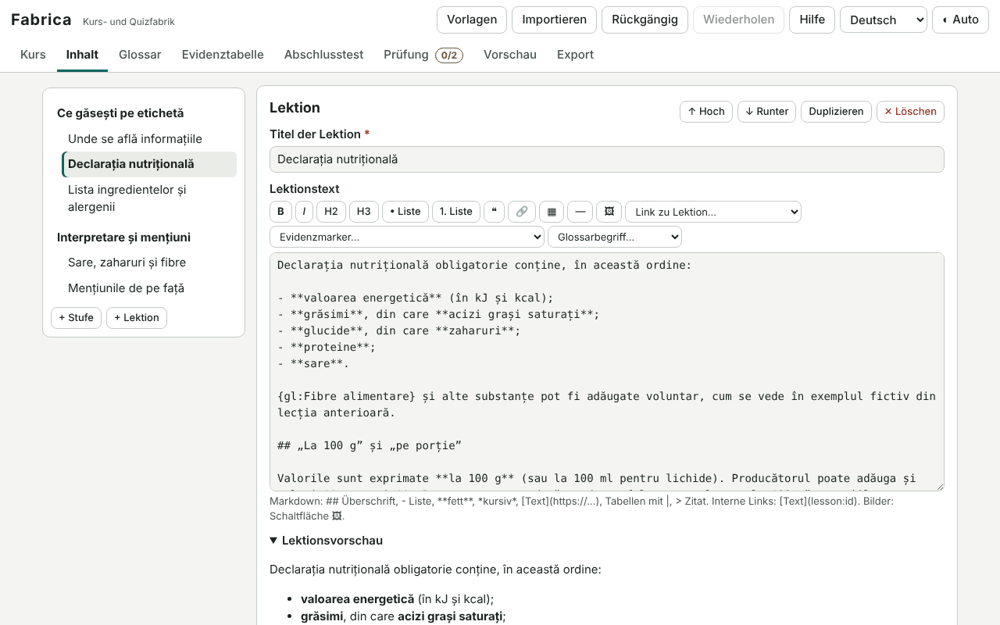

# Fabrica

[English](README.md) · [Română](README.ro.md) · [Français](README.fr.md) · [Italiano](README.it.md) · [Español](README.es.md) · [Português](README.pt.md) · **Deutsch** · [Magyar](README.hu.md)

**Version:** 1.1.5 · **Zuletzt aktualisiert:** 2026-10-23

Oberflächensprachen: **Română, English, Français, Italiano, Español, Português (PT), Deutsch, Magyar**

Fabrica ist eine Fabrik für Kurse und Quizze: Du schreibst einen Kurs (Daten, Hinweise, Stufen und Lektionen in einfachem Markdown, Fragen von sieben Typen, Glossar, Evidenztabelle, Abschlusstest mit Fragenbank und seed-bestimmter Ziehung), validierst ihn und exportierst ihn als **eine einzige eigenständige HTML-Datei** (optional ein ZIP mit README). Die erzeugte Datei läuft offline und bietet Navigation, lokal gespeicherten Fortschritt, verteilte Wiederholung für falsch beantwortete Fragen, Abschlusstest, druckbares Teilnahmezertifikat (ohne Akkreditierungswert), hellen/dunklen Modus und eine Oberfläche in 8 Sprachen. Sie enthält ein vollständiges Beispiel („Wie man ein Nährwertetikett liest“) und drei Startvorlagen.

**Online-App:** https://chiuta.github.io/apps/Fabrica/

## Anwendung

1. **Vorlagen** (oben) → wähle „Kurzer Kurs mit Test“, „Leitfaden mit Evidenztabelle“, „Einfaches Quiz“ oder das vollständige Beispiel; oder fülle direkt das Panel **Kurs** aus.
2. **Kurs**: Titel, Beschreibung, Autor, Inhaltslizenz, Inhaltssprache, Version, Hinweise (Vorlagen: informativ, keine medizinische / rechtliche / finanzielle Beratung), sensible Bereiche, Akzentfarbe, Zertifikat, verteilte Wiederholung.
3. **Inhalt**: Stufen und Lektionen (nach oben/unten verschieben, duplizieren, löschen); Lektionstext mit Markdown-Leiste (Überschriften, Listen, Fett/Kursiv, externe und interne Links `[Text](lesson:id)`, Tabellen, Zitate, Bilder); Übungsfragen pro Lektion.
4. **Fragetypen**: Einzelauswahl, Mehrfachauswahl, Wahr/Falsch, Lückentext (`[[Antwort|Variante]]`), Ordnen (mit Auf-/Ab-Schaltflächen, per Tastatur bedienbar), Paare zuordnen, Kurzantwort (akzeptierte Varianten; der Vergleich ignoriert Groß-/Kleinschreibung, Diakritika und Interpunktion). Jede hat eine Erklärung und Rückmeldung für richtige/falsche Antworten.
5. **Glossar** (`{gl:Begriff}` in den Lektionen) und **Evidenztabelle**: Aussagen mit einer Stufe (kontrollierte Studien / beobachtend / traditionell / ohne Belege), Textquellen, in den Lektionen mit `{ev:ID}` markiert.
6. **Abschlusstest**: Schwelle, Anzahl der aus der Bank gezogenen Fragen, Seed (gleicher Wert → gleiche Ziehung und Reihenfolge), bei jedem Versuch eine andere Ziehung (Seed + Versuchsnummer), optional auch die Fragen aus den Lektionen. „Ziehung simulieren“ zeigt das Ergebnis.
7. **Validierung**: leere Lektionen, Fragen ohne richtige Antwort, defekte interne Links, zu große/externe/alt-lose Bilder, fehlende Hinweise bei sensiblen Bereichen (explizit oder heuristisch), fehlende Quellen bei Aussagen, Duplikate usw. „Gehe zu“ führt zur Problemstelle.
8. **Vorschau**: die exakte Datei wie beim Export, in einem isolierten Frame (Sandbox), in voller Breite oder in Telefonbreite (360 px).
9. **Export**: HTML, ZIP (index.html + README.md + Quelle `.course.json`), die Quelle `.course.json`, Sicherung `.fff.json`. **Import**: `.course.json`, das exportierte HTML oder ZIP (der Kurs wird daraus wiederhergestellt), `.fff.json`; Fragen aus **CSV** (Spalten: `tip;întrebare;corect;greșit1;greșit2;greșit3;explicație`; Typen `unic, multi, adevarat-fals, completare, scurt, ordonare, potrivire`; mehrere Varianten werden durch `|` getrennt, Paare durch `links=rechts`; Trennzeichen `,` `;` oder Tabulator, RFC-4180-Anführungszeichen).

Rückgängig/Wiederholen: die Schaltflächen in der Kopfzeile, `Strg+Z` / `Strg+Y` (außerhalb von Textfeldern) und die Schaltfläche „Rückgängig“ in der Benachrichtigung nach einem Löschen.

## Was es NICHT kann, und seine Grenzen

- **Es akkreditiert nichts.** Das Zertifikat ist ein lokales Informationsdokument ohne Akkreditierungs- oder Anerkennungswert; sein Text sagt das.
- Es prüft nicht die wissenschaftliche, rechtliche oder medizinische Richtigkeit des Inhalts: Der Validator erkennt formale Probleme und (heuristisch, anhand von Schlüsselwörtern) das Fehlen eines Hinweises; die Verantwortung für den Inhalt bleibt beim Autor. Die Evidenzstufe wählt der Autor; Fabrica überprüft die Quellen nicht.
- Keine Konten, keine Synchronisierung, keine Echtzeit-Zusammenarbeit, keine Server. Der Fortschritt der Lernenden ist lokal (in ihrem Browser) und kann von niemandem überprüft werden; der Test wird nicht beaufsichtigt (die richtigen Antworten stehen in der Datei).
- Markdown ist eine Teilmenge (Überschriften, verschachtelte Listen, Fett/Kursiv, Code, Links, Bilder, Tabellen, Zitate, Linie); kein rohes HTML, keine mathematischen Formeln, kein eingebettetes Audio/Video. Bilder sind nur `data:` (png/jpeg/gif/webp), beim Einfügen auf maximal 1000 px verkleinert; externe Links werden offline nicht geprüft.
- Das Ordnen erfolgt mit Schaltflächen (nicht per Ziehen). Die Zufallsreihenfolge beruht auf einem Generator mit Seed, nicht auf einem kryptografischen.
- Die erzeugte Oberfläche hat 8 Sprachen, aber der **Inhalt** des Kurses liegt nur in der vom Autor geschriebenen Sprache vor. Die Startvorlagen sind auf Rumänisch und Englisch (die übrigen Sprachen erhalten die englische Fassung); das vollständige Beispiel ist auf Rumänisch.
- ZIP-Kompression: Der eigene Schreiber verwendet „stored“ (ohne Kompression); der Leser akzeptiert auch komprimierte (deflate) ZIPs, wo der Browser `DecompressionStream` bereitstellt.
- Der Entwurf wird in `localStorage` gespeichert; überschreiten die Bilder das Kontingent, erscheint eine Warnung, und der Kurs muss exportiert werden.

## Datenschutz

Es läuft lokal und **sendet nichts** (`connect-src 'none'`). Der Kursentwurf wird nur in diesem Browser aufbewahrt (`fff.fabrica.draft`, dazu Sprache und Design); „Alles löschen“ entfernt sie. Die erzeugte Datei enthält keine Telemetrie; der Fortschritt der Lernenden liegt in `fff.course.<id>.*` und kann auf der Seite „Einstellungen und Daten“ des Kurses exportiert/importiert/gelöscht werden.

## Sicherheit und CSP

Der Editor: `default-src 'none'; script-src 'sha256-…'; style-src 'unsafe-inline'; img-src data: blob:; media-src data: blob:; font-src data:; connect-src 'none'; base-uri 'none'; form-action 'none'; frame-src about:; object-src 'none'; worker-src blob:; manifest-src 'none'`. Begründete Abweichungen: `frame-src about:` für die Vorschau im isolierten Frame (`srcdoc`, `sandbox="allow-scripts allow-modals"`).

Die erzeugte Datei: `default-src 'none'; script-src 'sha256-<hash>'; style-src 'unsafe-inline'; img-src data:; font-src data:; connect-src 'none'; base-uri 'none'; form-action 'none'; frame-src 'none'; object-src 'none'; media-src 'none'; worker-src 'none'; manifest-src 'none'`. **Der SHA-256-Hash wird im Browser berechnet** (Web Crypto, mit JavaScript-Rückfall) zum Zeitpunkt des Exports, aus dem exakten Text des eingefügten Skripts, und in `<meta http-equiv="Content-Security-Policy">` geschrieben; nach dem Export parst Fabrica die Datei erneut und prüft den Hash sowie das Fehlen von Inline-Handlern und externen Ressourcen. Die Kursdaten liegen in einem nicht ausführbaren `application/json`-Block (mit maskierten `<`, `>`, `&`); alle Texte werden bei der Anzeige maskiert, Links sind auf `https:`, `mailto:` und interne Routen beschränkt.

## Formate

- `.course.json`: `{"format":"fabrica-course","schema":1,"app":"Fabrica","version":"1.0.0","saved":"…","course":{…}}` — das Schema ist versioniert; der Import normalisiert und validiert (Typen, eindeutige IDs, genau eine richtige Option bei Einzelauswahl, `data:`-Bilder nur vom Typ Bild erlaubt) und weist Dateien mit neuerem Schema zurück.
- `.fff.json` (Sicherung): `{"format":"fff-bundle","schema":1,"app":"fabrica","version":"1.0.0","updated":"2026-10-14","data":{"draft":{…}}}`.
- Fortschritt der Lernenden (aus der erzeugten Datei): `{"format":"fff-bundle","app":"course:<id>",…,"data":{"progress":{…}}}`.
- Import: `.course.json`, exportierte `.html`/`.zip`, `.fff.json`, `.csv` (Fragen). Export: `.html`, `.zip`, `.course.json`, `.fff.json`.

## Technik

Eine einzige `index.html` (HTML + CSS + JS inline, keine externen Bibliotheken). Die Kurs-Engine (Player) ist ein separates Skript in der Seite; **derselbe Text** wird in die exportierte Datei eingefügt und läuft in der Vorschau, sodass die Vorschau mit dem Ergebnis identisch ist. Die verteilte Wiederholung nutzt ein vereinfachtes SM-2 (minimaler EF 1,3; Intervalle 1 Tag, 6 Tage, danach Multiplikation mit EF; bei einem Fehler kehrt das Intervall auf 1 Tag zurück). Testauswahl: Fisher–Yates-Mischung mit einem mulberry32-Generator, initialisiert aus hash(Seed + Versuch). Eigener ZIP-Schreiber/-Leser und CRC-32. Barrierefreiheit: echte Legenden und Beschriftungen, `aria-live`-Meldungen, Fokusverwaltung beim Seitenwechsel, AA-Kontrast in beiden Designs (Akzente aus fünf geprüften Paletten wählbar), `prefers-reduced-motion`, scrollbare Tabellen mit Fokus. Tastenkürzel im erzeugten Kurs: `Alt+Shift+→` / `Alt+Shift+←` (nächste/vorherige Lektion).

Die Tests (`tests/test.mjs`, Playwright, Netzwerk blockiert) decken den Editor ab (Struktur mit Rückgängig, Fragen, Validator, Import/Export, CSV, ZIP, Bilder, Vorschau, axe) sowie die **ohne Netzwerk geladene erzeugte Datei** (0 pageerror/CSP, in Node neu berechneter CSP-Hash, Durchlaufen der Lektionen, Bewertung jedes Typs, dauerhafter Fortschritt, Wiederholung, Test mit Ziehung, Zertifikat, 8 Sprachen, axe in beiden Designs, 360 px).

## Drittanbieter

Kein Drittanbieter-Code. (Die Tests verwenden Playwright und axe-core, nur in der Entwicklung.)

## Übersetzungen

Die Oberfläche des Editors und der erzeugten Kurse: Rumänisch und Englisch vom Autor geschrieben; **fr, it, es, pt, hu, de sind automatische Übersetzungen, nicht von Muttersprachlern geprüft**. Die Hinweise der Vorlagen (informativ/medizinisch/rechtlich/finanziell) sind ebenfalls automatische Übersetzungen: Sie sollten vor öffentlicher Nutzung von einem Juristen/Muttersprachler geprüft werden.

## Lizenz

Lizenz: MIT — siehe die Datei `LICENSE` im Stammverzeichnis des Repositorys.

## Verlauf

- 1.0.0 — 2026-10-14: erste Version.
- 1.1.0 — 2026-10-19: Export „Quiz für Undava (.json)“ und Import aus Undava-Dateien (.json) über die Schaltfläche für den CSV-Import; übertragen werden nur Fragen mit Entsprechung (Einzelauswahl, Wahr/Falsch, Kurzantwort, Lückentext mit einer Lücke).
- 1.1.1 — 2026-10-22: kein window.confirm / window.prompt mehr: das Zurücksetzen des Fortschritts im Player, das Löschen des Entwurfs und die Abfrage des Bild-Alternativtexts nutzen Dialoge der Seite, übersetzt in 8 Sprachen; Touch-Ziele von mindestens 24 px für Kontrollkästchen und Optionsfelder; das technische Label meldet das CSP-Token about:srcdoc nicht mehr als Netzwerk-Host.
- 1.1.2 — 2026-10-22: fff-kit 1.1.2: PBKDF2 mit 600.000 Iterationen, Schutz vor Clickjacking.
- 1.1.3 — 2026-10-22: fff-kit 1.1.4: Touch-Ziele und Mindestschriftgröße in der gemeinsamen Oberfläche.
- 1.1.5 — 2026-10-23: audit: Fortschritt aus localStorage oder einer importierten Datei wird beim Laden normalisiert (er zerstört keine Lektionen mehr und kann kein HTML einschleusen); in Optionen, Rückmeldungen und Belegen verwendete Bilder werden exportiert; der ZIP-Import begrenzt die Dekompression (ZIP-Bombe) und entpackt nur die benötigten Einträge; das `last-updated`-Datum der erzeugten Datei; Touch-Ziele ≥44 px und kein horizontaler Überlauf bei 360 px (Editor und erzeugter Kurs).
