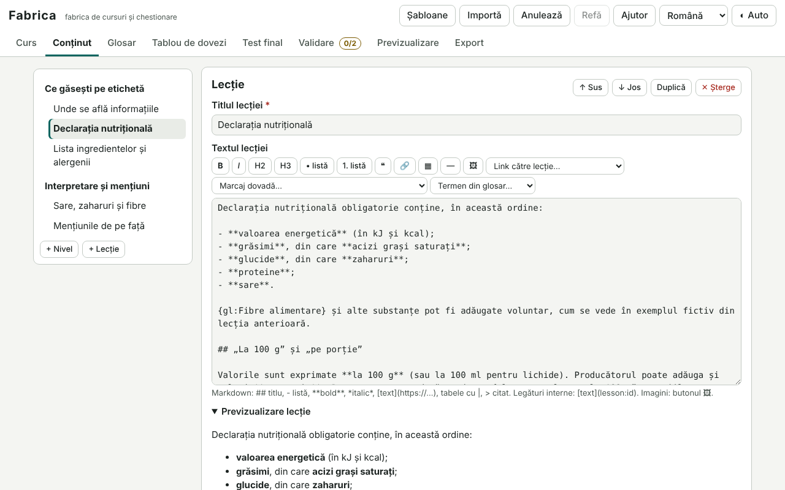

# Fabrica

[English](README.md) · [Română](README.ro.md) · [Français](README.fr.md) · [Italiano](README.it.md) · **Español** · [Português](README.pt.md) · [Deutsch](README.de.md) · [Magyar](README.hu.md)

**Versión:** 1.1.0 · **Última actualización:** 2026-10-19

Idiomas de la interfaz: **Română, English, Français, Italiano, Español, Português (PT), Deutsch, Magyar**

Fabrica es una fábrica de cursos y cuestionarios: escribes un curso (datos, advertencias, niveles y lecciones en Markdown sencillo, preguntas de siete tipos, glosario, tabla de pruebas, prueba final con banco de preguntas y extracción determinada por una semilla), lo validas y lo exportas como **un único archivo HTML autónomo** (opcionalmente un ZIP con un README). El archivo generado funciona sin conexión y tiene navegación, progreso guardado localmente, repetición espaciada para las preguntas falladas, prueba final, certificado de finalización imprimible (sin valor de acreditación), modo claro/oscuro e interfaz en 8 idiomas. Incluye un ejemplo completo («Cómo leer una etiqueta nutricional») y tres plantillas de partida.

**Aplicación en línea:** https://chiuta.github.io/apps/Fabrica/

## Cómo se usa

1. **Plantillas** (arriba) → elige «Curso corto con prueba», «Guía con tabla de pruebas», «Cuestionario sencillo» o el ejemplo completo; o rellena directamente el panel **Curso**.
2. **Curso**: título, descripción, autor, licencia del contenido, idioma del contenido, versión, advertencias (plantillas: informativo, no es consejo médico / jurídico / financiero), ámbitos sensibles, color de acento, certificado, repetición espaciada.
3. **Contenido**: niveles y lecciones (subir/bajar, duplicar, eliminar); texto de la lección con barra de Markdown (títulos, listas, negrita/cursiva, enlaces externos e internos `[texto](lesson:id)`, tablas, citas, imágenes); preguntas de práctica por lección.
4. **Tipos de preguntas**: elección única, elección múltiple, verdadero/falso, completar (`[[respuesta|variante]]`), ordenar (con botones subir/bajar, accesible por teclado), emparejar, respuesta corta (variantes aceptadas; la comparación ignora mayúsculas, diacríticos y puntuación). Cada una tiene explicación y comentarios para respuesta correcta/incorrecta.
5. **Glosario** (`{gl:Término}` en las lecciones) y **Tabla de pruebas**: afirmaciones con un nivel (estudios controlados / observacional / tradicional / sin pruebas), fuentes en texto, marcadas en las lecciones con `{ev:ID}`.
6. **Prueba final**: umbral, número de preguntas extraídas del banco, semilla (mismo valor → misma extracción y orden), extracción distinta en cada intento (semilla + número de intento), opcionalmente también las preguntas de las lecciones. «Simular la extracción» muestra el resultado.
7. **Validación**: lecciones vacías, preguntas sin respuesta correcta, enlaces internos rotos, imágenes demasiado grandes/externas/sin texto alternativo, advertencias ausentes en ámbitos sensibles (explícitas o heurísticas), fuentes ausentes en afirmaciones, duplicados, etc. «Ir a» lleva al lugar del problema.
8. **Vista previa**: el archivo exacto tal como se exporta, en un marco aislado (sandbox), a ancho completo o a ancho de teléfono (360 px).
9. **Exportar**: HTML, ZIP (index.html + README.md + fuente `.course.json`), la fuente `.course.json`, copia de seguridad `.fff.json`. **Importar**: `.course.json`, el HTML o el ZIP exportado (el curso se recupera de ellos), `.fff.json`; preguntas desde **CSV** (columnas: `tip;întrebare;corect;greșit1;greșit2;greșit3;explicație`; tipos `unic, multi, adevarat-fals, completare, scurt, ordonare, potrivire`; las variantes múltiples se separan con `|`, los pares con `izquierda=derecha`; delimitador `,` `;` o tabulador, comillas RFC 4180).

Deshacer/rehacer: los botones de la cabecera, `Ctrl+Z` / `Ctrl+Y` (fuera de los campos de texto) y el botón «Deshacer» de la notificación posterior a un borrado.

## Lo que NO hace y sus límites

- **No acredita nada.** El certificado es un documento informativo local, sin valor de acreditación ni reconocimiento; su texto lo dice.
- No verifica la corrección científica, jurídica o médica del contenido: el validador detecta problemas formales y (de forma heurística, por palabras clave) la falta de una advertencia; la responsabilidad del contenido sigue siendo del autor. El nivel de pruebas lo elige el autor; Fabrica no verifica las fuentes.
- Sin cuentas, sin sincronización, sin colaboración en tiempo real, sin servidores. El progreso del alumno es local (en su navegador) y nadie puede verificarlo; la prueba no está supervisada (las respuestas correctas están en el archivo).
- Markdown es un subconjunto (títulos, listas anidadas, negrita/cursiva, código, enlaces, imágenes, tablas, citas, línea); sin HTML en bruto, sin fórmulas matemáticas, sin audio/vídeo incrustado. Las imágenes son solo `data:` (png/jpeg/gif/webp), redimensionadas a un máximo de 1000 px al insertarlas; los enlaces externos no se comprueban sin conexión.
- Ordenar se hace con botones (no arrastrando). El orden aleatorio se basa en un generador con semilla, no en uno criptográfico.
- La interfaz generada tiene 8 idiomas, pero el **contenido** del curso está solo en el idioma escrito por el autor. Las plantillas de partida están en rumano e inglés (los demás idiomas reciben la versión en inglés); el ejemplo completo está en rumano.
- Compresión ZIP: el escritor propio usa «stored» (sin compresión); el lector también acepta ZIP comprimidos (deflate) cuando el navegador ofrece `DecompressionStream`.
- El borrador se guarda en `localStorage`; si las imágenes superan la cuota, aparece una advertencia y hay que exportar el curso.

## Privacidad

Funciona en local y **no envía nada** (`connect-src 'none'`). El borrador del curso se conserva solo en este navegador (`fff.fabrica.draft`, más el idioma y el tema); «Borrar todo» los elimina. El archivo generado no contiene telemetría; el progreso del alumno está en `fff.course.<id>.*` y puede exportarse/importarse/borrarse desde la página «Ajustes y datos» del curso.

## Seguridad y CSP

El editor: `default-src 'none'; script-src 'sha256-…'; style-src 'unsafe-inline'; img-src data: blob:; media-src data: blob:; font-src data:; connect-src 'none'; base-uri 'none'; form-action 'none'; frame-src about:; object-src 'none'; worker-src blob:; manifest-src 'none'`. Desviaciones justificadas: `frame-src about:` para la vista previa en marco aislado (`srcdoc`, `sandbox="allow-scripts allow-modals"`).

El archivo generado: `default-src 'none'; script-src 'sha256-<hash>'; style-src 'unsafe-inline'; img-src data:; font-src data:; connect-src 'none'; base-uri 'none'; form-action 'none'; frame-src 'none'; object-src 'none'; media-src 'none'; worker-src 'none'; manifest-src 'none'`. **El hash SHA-256 se calcula en el navegador** (Web Crypto, con alternativa en JavaScript) en el momento de la exportación, a partir del texto exacto del script insertado, y se escribe en `<meta http-equiv="Content-Security-Policy">`; tras la exportación, Fabrica vuelve a analizar el archivo y comprueba el hash, la ausencia de controladores en línea y de recursos externos. Los datos del curso están en un bloque `application/json` no ejecutable (con `<`, `>`, `&` escapados); todos los textos se escapan al mostrarse, los enlaces se limitan a `https:`, `mailto:` y rutas internas.

## Formatos

- `.course.json`: `{"format":"fabrica-course","schema":1,"app":"Fabrica","version":"1.0.0","saved":"…","course":{…}}` — el esquema tiene versión; la importación normaliza y valida (tipos, ids únicos, una sola opción correcta en elección única, imágenes `data:` permitidas solo de tipo imagen) y rechaza los archivos con un esquema más reciente.
- `.fff.json` (copia de seguridad): `{"format":"fff-bundle","schema":1,"app":"fabrica","version":"1.0.0","updated":"2026-10-14","data":{"draft":{…}}}`.
- Progreso del alumno (desde el archivo generado): `{"format":"fff-bundle","app":"course:<id>",…,"data":{"progress":{…}}}`.
- Importar: `.course.json`, `.html`/`.zip` exportados, `.fff.json`, `.csv` (preguntas). Exportar: `.html`, `.zip`, `.course.json`, `.fff.json`.

## Aspectos técnicos

Un único `index.html` (HTML + CSS + JS en línea, sin bibliotecas externas). El motor del curso (reproductor) es un script independiente en la página; **el mismo texto** se inserta en el archivo exportado y se ejecuta en la vista previa, por lo que la vista previa es idéntica al resultado. La repetición espaciada usa un SM-2 simplificado (EF mínimo 1,3; intervalos de 1 día, 6 días y luego multiplicación por EF; si se falla, el intervalo vuelve a 1 día). Selección de la prueba: barajado Fisher–Yates con generador mulberry32 inicializado a partir de hash(semilla + intento). Escritor/lector ZIP y CRC-32 propios. Accesibilidad: leyendas y etiquetas reales, mensajes `aria-live`, foco gestionado al cambiar de página, contraste AA en ambos temas (los acentos pueden elegirse entre cinco paletas verificadas), `prefers-reduced-motion`, tablas desplazables con foco. Atajos en el curso generado: `Alt+Shift+→` / `Alt+Shift+←` (lección siguiente/anterior).

Las pruebas (`tests/test.mjs`, Playwright, red bloqueada) cubren el editor (estructura con deshacer, preguntas, validador, importación/exportación, CSV, ZIP, imágenes, vista previa, axe) y el **archivo generado cargado sin red** (0 pageerror/CSP, hash CSP recalculado en Node, recorrido de las lecciones, puntuación de cada tipo, progreso persistente, repetición, prueba con extracción, certificado, 8 idiomas, axe en ambos temas, 360 px).

## Terceros

Ningún código de terceros. (Las pruebas usan Playwright y axe-core, solo en desarrollo.)

## Traducciones

La interfaz del editor y de los cursos generados: rumano e inglés escritos por el autor; **fr, it, es, pt, hu, de son traducciones automáticas, no verificadas por hablantes nativos**. Las advertencias de las plantillas (informativo/médico/jurídico/financiero) también son traducciones automáticas: deberían ser revisadas por un jurista/hablante nativo antes de su uso público.

## Licencia

Licencia: MIT — véase el archivo `LICENSE` en la raíz del repositorio.

## Historial

- 1.0.0 — 2026-10-14: primera versión.
- 1.1.0 — 2026-10-19: exportación «Quiz para Undava (.json)» e importación desde archivos de Undava (.json) mediante el botón de importación CSV; solo se transfieren las preguntas con equivalente (elección única, verdadero/falso, respuesta corta, completar con un solo hueco).
