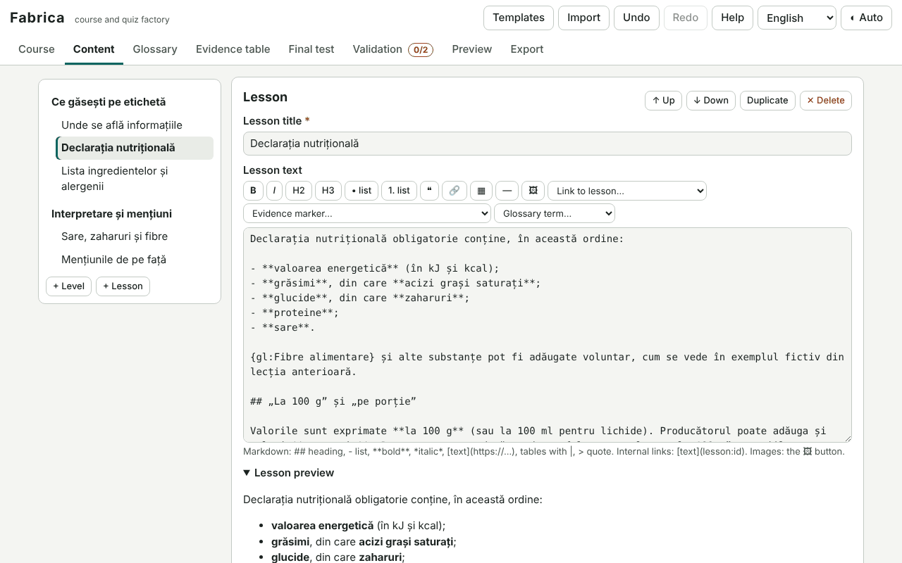

# Fabrica

**English** · [Română](README.ro.md) · [Français](README.fr.md) · [Italiano](README.it.md) · [Español](README.es.md) · [Português](README.pt.md) · [Deutsch](README.de.md) · [Magyar](README.hu.md)

**Version:** 1.1.1 · **Last updated:** 2026-10-22

Interface languages: **Română, English, Français, Italiano, Español, Português (PT), Deutsch, Magyar**

Fabrica is a factory for courses and quizzes: you write a course (data, warnings, levels and lessons in simple Markdown, questions of seven types, glossary, evidence table, final test with a question bank and seed-determined draw), validate it and export it as **a single self-contained HTML file** (optionally a ZIP with a README). The generated file runs offline and has navigation, locally saved progress, spaced repetition for wrong answers, a final test, a printable completion certificate (with no accreditation value), light/dark mode and an interface in 8 languages. It includes a complete example ("How to read a nutrition label") and three starter templates.

**Live app:** https://chiuta.github.io/apps/Fabrica/

## How to use

1. **Templates** (top) → choose "Short course with test", "Guide with evidence table", "Simple quiz" or the complete example; or fill in the **Course** panel directly.
2. **Course**: title, description, author, content licence, content language, version, warnings (templates: informational, not medical / legal / financial advice), sensitive domains, accent colour, certificate, spaced repetition.
3. **Content**: levels and lessons (move up/down, duplicate, delete); lesson text with a Markdown bar (headings, lists, bold/italic, external and internal links `[text](lesson:id)`, tables, quotes, images); practice questions per lesson.
4. **Question types**: single choice, multiple choice, true/false, fill-in (`[[answer|variant]]`), ordering (with up/down buttons, keyboard accessible), pair matching, short answer (accepted variants; the comparison ignores case, diacritics and punctuation). Each has an explanation and feedback for correct/wrong answers.
5. **Glossary** (`{gl:Term}` in lessons) and **Evidence table**: claims with a level (controlled studies / observational / traditional / no evidence), text sources, marked in lessons with `{ev:ID}`.
6. **Final test**: threshold, number of questions drawn from the bank, seed (same value → same draw and order), a different draw on each attempt (seed + attempt number), optionally also the lesson questions. "Simulate the draw" shows the result.
7. **Validation**: empty lessons, questions without a correct answer, broken internal links, images that are too large/external/without alt text, missing warnings for sensitive domains (explicit or heuristic), missing sources for claims, duplicates, etc. "Go to" takes you to the place of the problem.
8. **Preview**: the exact file as exported, in an isolated frame (sandbox), at full width or phone width (360 px).
9. **Export**: HTML, ZIP (index.html + README.md + `.course.json` source), the `.course.json` source, `.fff.json` backup. **Import**: `.course.json`, the exported HTML or ZIP (the course is recovered from them), `.fff.json`; questions from **CSV** (columns: `tip;întrebare;corect;greșit1;greșit2;greșit3;explicație`; types `unic, multi, adevarat-fals, completare, scurt, ordonare, potrivire`; multiple variants are separated by `|`, pairs by `left=right`; delimiter `,` `;` or tab, RFC 4180 quoting).

Undo/redo: the header buttons, `Ctrl+Z` / `Ctrl+Y` (outside text fields) and the "Undo" button in the notification after a deletion.

## What it does NOT do, and its limits

- **It accredits nothing.** The certificate is a local informational document, with no accreditation or recognition value; its text says so.
- It does not verify the scientific, legal or medical correctness of the content: the validator catches formal problems and (heuristically, by keywords) the lack of a warning; responsibility for the content remains with the author. The evidence level is chosen by the author; Fabrica does not verify the sources.
- No accounts, no synchronisation, no real-time collaboration, no servers. The learner's progress is local (in their browser) and cannot be verified by anyone; the test is not proctored (the correct answers are in the file).
- Markdown is a subset (headings, nested lists, bold/italic, code, links, images, tables, quotes, rule); no raw HTML, no mathematical formulas, no embedded audio/video. Images are `data:` only (png/jpeg/gif/webp), resized to a maximum of 1000 px on insertion; external links are not checked offline.
- Ordering is done with buttons (not by dragging). The random order is based on a seeded generator, not a cryptographic one.
- The generated interface has 8 languages, but the course **content** is only in the language written by the author. The starter templates are in Romanian and English (the other languages get the English version); the complete example is in Romanian.
- ZIP compression: the built-in writer uses "stored" (no compression); the reader also accepts compressed (deflate) ZIPs where the browser provides `DecompressionStream`.
- The draft is saved in `localStorage`; if images exceed the quota, a warning appears and the course must be exported.

## Privacy

It runs locally and **sends nothing** (`connect-src 'none'`). The course draft is kept only in this browser (`fff.fabrica.draft`, plus language and theme); "Delete everything" removes them. The generated file contains no telemetry; the learner's progress is in `fff.course.<id>.*` and can be exported/imported/deleted from the course's "Settings and data" page.

## Security and CSP

The editor: `default-src 'none'; script-src 'sha256-…'; style-src 'unsafe-inline'; img-src data: blob:; media-src data: blob:; font-src data:; connect-src 'none'; base-uri 'none'; form-action 'none'; frame-src about:; object-src 'none'; worker-src blob:; manifest-src 'none'`. Justified deviations: `frame-src about:` for the isolated-frame preview (`srcdoc`, `sandbox="allow-scripts allow-modals"`).

The generated file: `default-src 'none'; script-src 'sha256-<hash>'; style-src 'unsafe-inline'; img-src data:; font-src data:; connect-src 'none'; base-uri 'none'; form-action 'none'; frame-src 'none'; object-src 'none'; media-src 'none'; worker-src 'none'; manifest-src 'none'`. **The SHA-256 hash is computed in the browser** (Web Crypto, with a JavaScript fallback) at export time, from the exact text of the inserted script, and written into `<meta http-equiv="Content-Security-Policy">`; after export, Fabrica re-parses the file and checks the hash, the absence of inline handlers and of external resources. The course data lives in a non-executable `application/json` block (with `<`, `>`, `&` escaped); all texts are escaped on display, links are limited to `https:`, `mailto:` and internal routes.

## Formats

- `.course.json`: `{"format":"fabrica-course","schema":1,"app":"Fabrica","version":"1.0.0","saved":"…","course":{…}}` — the schema is versioned; import normalises and validates (types, unique ids, a single correct option for single choice, `data:` images allowed only of image type) and refuses files with a newer schema.
- `.fff.json` (backup): `{"format":"fff-bundle","schema":1,"app":"fabrica","version":"1.0.0","updated":"2026-10-14","data":{"draft":{…}}}`.
- Learner progress (from the generated file): `{"format":"fff-bundle","app":"course:<id>",…,"data":{"progress":{…}}}`.
- Import: `.course.json`, exported `.html`/`.zip`, `.fff.json`, `.csv` (questions). Export: `.html`, `.zip`, `.course.json`, `.fff.json`.

## Technical

A single `index.html` (HTML + CSS + JS inline, no external libraries). The course engine (player) is a separate script in the page; **the same text** is inserted into the exported file and runs in the preview, so the preview is identical to the result. Spaced repetition uses a simplified SM-2 (minimum EF 1.3; intervals 1 day, 6 days, then multiplied by EF; on failure the interval returns to 1 day). Test selection: Fisher–Yates shuffle with a mulberry32 generator initialised from hash(seed + attempt). Own ZIP writer/reader and CRC-32. Accessibility: real legends and labels, `aria-live` messages, focus managed on page change, AA contrast in both themes (accents can be chosen from five verified palettes), `prefers-reduced-motion`, scrollable tables with focus. Shortcuts in the generated course: `Alt+Shift+→` / `Alt+Shift+←` (next/previous lesson).

The tests (`tests/test.mjs`, Playwright, network blocked) cover the editor (structure with undo, questions, validator, import/export, CSV, ZIP, images, preview, axe) and the **generated file loaded without a network** (0 pageerror/CSP, CSP hash recomputed in Node, walking through the lessons, scoring of each type, persistent progress, repetition, test with draw, certificate, 8 languages, axe in both themes, 360 px).

## Third parties

No third-party code. (The tests use Playwright and axe-core, in development only.)

## Translations

The interface of the editor and of the generated courses: Romanian and English written by the author; **fr, it, es, pt, hu, de are automatic translations, not verified by native speakers**. The template warnings (informational/medical/legal/financial) are also automatic translations: they should be checked by a lawyer/native speaker before public use.

## Licence

Licence: MIT — see the `LICENSE` file in the repository root.

## History

- 1.0.0 — 2026-10-14: first release.
- 1.1.0 — 2026-10-19: "Quiz for Undava (.json)" export and import from Undava files (.json) through the CSV import button; only questions with an equivalent are transferred (single choice, true/false, short answer, fill-in with a single blank).
- 1.1.1 — 2026-10-22: no more window.confirm / window.prompt: resetting course progress in the player, wiping the draft and the image alt-text prompt use in-page dialogs translated into the 8 languages; touch targets of at least 24 px for check boxes and radio buttons; the technical label no longer reports the CSP token about:srcdoc as a network host.
