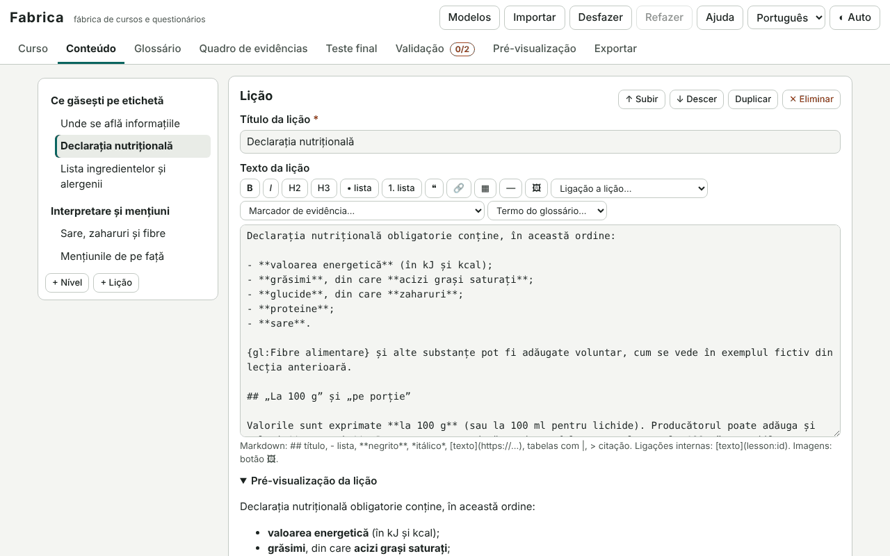

# Fabrica

[English](README.md) · [Română](README.ro.md) · [Français](README.fr.md) · [Italiano](README.it.md) · [Español](README.es.md) · **Português** · [Deutsch](README.de.md) · [Magyar](README.hu.md)

**Versão:** 1.1.3 · **Última atualização:** 2026-10-22

Idiomas da interface: **Română, English, Français, Italiano, Español, Português (PT), Deutsch, Magyar**

O Fabrica é uma fábrica de cursos e questionários: escreves um curso (dados, avisos, níveis e lições em Markdown simples, perguntas de sete tipos, glossário, quadro de provas, teste final com banco de perguntas e extração determinada por uma semente), validas-o e exportas-o como **um único ficheiro HTML autónomo** (opcionalmente um ZIP com um README). O ficheiro gerado funciona offline e tem navegação, progresso guardado localmente, repetição espaçada para as perguntas erradas, teste final, certificado de conclusão imprimível (sem valor de acreditação), modo claro/escuro e interface em 8 línguas. Inclui um exemplo completo («Como ler um rótulo nutricional») e três modelos de arranque.

**Aplicação online:** https://chiuta.github.io/apps/Fabrica/

## Como se utiliza

1. **Modelos** (em cima) → escolhe «Curso curto com teste», «Guia com quadro de provas», «Questionário simples» ou o exemplo completo; ou preenche diretamente o painel **Curso**.
2. **Curso**: título, descrição, autor, licença do conteúdo, língua do conteúdo, versão, avisos (modelos: informativo, não é aconselhamento médico / jurídico / financeiro), domínios sensíveis, cor de destaque, certificado, repetição espaçada.
3. **Conteúdo**: níveis e lições (mover para cima/baixo, duplicar, eliminar); texto da lição com barra de Markdown (títulos, listas, negrito/itálico, ligações externas e internas `[texto](lesson:id)`, tabelas, citações, imagens); perguntas de treino por lição.
4. **Tipos de perguntas**: escolha única, escolha múltipla, verdadeiro/falso, preenchimento (`[[resposta|variante]]`), ordenação (com botões para cima/baixo, acessível pelo teclado), correspondência de pares, resposta curta (variantes aceites; a comparação ignora maiúsculas, diacríticos e pontuação). Cada uma tem explicação e feedback para resposta certa/errada.
5. **Glossário** (`{gl:Termo}` nas lições) e **Quadro de provas**: afirmações com um nível (estudos controlados / observacional / tradicional / sem provas), fontes em texto, assinaladas nas lições com `{ev:ID}`.
6. **Teste final**: limiar, número de perguntas extraídas do banco, semente (mesmo valor → mesma extração e ordem), extração diferente em cada tentativa (semente + número da tentativa), opcionalmente também as perguntas das lições. «Simular a extração» mostra o resultado.
7. **Validação**: lições vazias, perguntas sem resposta correta, ligações internas quebradas, imagens demasiado grandes/externas/sem texto alternativo, avisos em falta para domínios sensíveis (explícitos ou heurísticos), fontes em falta nas afirmações, duplicados, etc. «Ir para» leva ao local do problema.
8. **Pré-visualização**: o ficheiro exato como exportado, numa moldura isolada (sandbox), em largura total ou em largura de telemóvel (360 px).
9. **Exportação**: HTML, ZIP (index.html + README.md + fonte `.course.json`), a fonte `.course.json`, cópia de segurança `.fff.json`. **Importação**: `.course.json`, o HTML ou o ZIP exportado (o curso é recuperado a partir deles), `.fff.json`; perguntas a partir de **CSV** (colunas: `tip;întrebare;corect;greșit1;greșit2;greșit3;explicație`; tipos `unic, multi, adevarat-fals, completare, scurt, ordonare, potrivire`; as variantes múltiplas separam-se com `|`, os pares com `esquerda=direita`; delimitador `,` `;` ou tabulação, aspas RFC 4180).

Anular/refazer: os botões do cabeçalho, `Ctrl+Z` / `Ctrl+Y` (fora dos campos de texto) e o botão «Anular» da notificação após uma eliminação.

## O que NÃO faz e os seus limites

- **Não acredita nada.** O certificado é um documento informativo local, sem valor de acreditação ou reconhecimento; o seu texto di-lo.
- Não verifica a correção científica, jurídica ou médica do conteúdo: o validador deteta problemas formais e (de forma heurística, por palavras-chave) a falta de um aviso; a responsabilidade pelo conteúdo continua a ser do autor. O nível de provas é escolhido pelo autor; o Fabrica não verifica as fontes.
- Sem contas, sem sincronização, sem colaboração em tempo real, sem servidores. O progresso do formando é local (no seu navegador) e ninguém o pode verificar; o teste não é vigiado (as respostas certas estão no ficheiro).
- O Markdown é um subconjunto (títulos, listas aninhadas, negrito/itálico, código, ligações, imagens, tabelas, citações, linha); sem HTML em bruto, sem fórmulas matemáticas, sem áudio/vídeo incorporado. As imagens são apenas `data:` (png/jpeg/gif/webp), redimensionadas para um máximo de 1000 px na inserção; as ligações externas não são verificadas offline.
- A ordenação faz-se com botões (não por arrastamento). A ordem aleatória baseia-se num gerador com semente, não num gerador criptográfico.
- A interface gerada tem 8 línguas, mas o **conteúdo** do curso está apenas na língua escrita pelo autor. Os modelos de arranque estão em romeno e inglês (as restantes línguas recebem a versão inglesa); o exemplo completo está em romeno.
- Compressão ZIP: o escritor próprio usa «stored» (sem compressão); o leitor aceita também ZIP comprimidos (deflate) onde o navegador oferece `DecompressionStream`.
- O rascunho é guardado em `localStorage`; se as imagens excederem a quota, surge um aviso e é preciso exportar o curso.

## Privacidade

Funciona localmente e **não envia nada** (`connect-src 'none'`). O rascunho do curso é guardado apenas neste navegador (`fff.fabrica.draft`, mais a língua e o tema); «Apagar tudo» elimina-os. O ficheiro gerado não contém telemetria; o progresso do formando está em `fff.course.<id>.*` e pode ser exportado/importado/apagado a partir da página «Definições e dados» do curso.

## Segurança e CSP

O editor: `default-src 'none'; script-src 'sha256-…'; style-src 'unsafe-inline'; img-src data: blob:; media-src data: blob:; font-src data:; connect-src 'none'; base-uri 'none'; form-action 'none'; frame-src about:; object-src 'none'; worker-src blob:; manifest-src 'none'`. Desvios justificados: `frame-src about:` para a pré-visualização em moldura isolada (`srcdoc`, `sandbox="allow-scripts allow-modals"`).

O ficheiro gerado: `default-src 'none'; script-src 'sha256-<hash>'; style-src 'unsafe-inline'; img-src data:; font-src data:; connect-src 'none'; base-uri 'none'; form-action 'none'; frame-src 'none'; object-src 'none'; media-src 'none'; worker-src 'none'; manifest-src 'none'`. **O hash SHA-256 é calculado no navegador** (Web Crypto, com alternativa em JavaScript) no momento da exportação, a partir do texto exato do script inserido, e escrito em `<meta http-equiv="Content-Security-Policy">`; após a exportação, o Fabrica volta a analisar o ficheiro e verifica o hash, a ausência de manipuladores inline e de recursos externos. Os dados do curso estão num bloco `application/json` não executável (com `<`, `>`, `&` escapados); todos os textos são escapados na apresentação, as ligações limitam-se a `https:`, `mailto:` e rotas internas.

## Formatos

- `.course.json`: `{"format":"fabrica-course","schema":1,"app":"Fabrica","version":"1.0.0","saved":"…","course":{…}}` — o esquema tem versão; a importação normaliza e valida (tipos, ids únicos, uma única opção correta na escolha única, imagens `data:` permitidas apenas do tipo imagem) e recusa ficheiros com um esquema mais recente.
- `.fff.json` (cópia de segurança): `{"format":"fff-bundle","schema":1,"app":"fabrica","version":"1.0.0","updated":"2026-10-14","data":{"draft":{…}}}`.
- Progresso do formando (a partir do ficheiro gerado): `{"format":"fff-bundle","app":"course:<id>",…,"data":{"progress":{…}}}`.
- Importação: `.course.json`, `.html`/`.zip` exportados, `.fff.json`, `.csv` (perguntas). Exportação: `.html`, `.zip`, `.course.json`, `.fff.json`.

## Aspetos técnicos

Um único `index.html` (HTML + CSS + JS inline, sem bibliotecas externas). O motor do curso (leitor) é um script separado na página; **o mesmo texto** é inserido no ficheiro exportado e executa-se na pré-visualização, pelo que a pré-visualização é idêntica ao resultado. A repetição espaçada usa um SM-2 simplificado (EF mínimo 1,3; intervalos de 1 dia, 6 dias e depois multiplicação por EF; em caso de falha, o intervalo volta a 1 dia). Seleção do teste: baralhação Fisher–Yates com gerador mulberry32 inicializado a partir de hash(semente + tentativa). Escritor/leitor ZIP e CRC-32 próprios. Acessibilidade: legendas e rótulos reais, mensagens `aria-live`, foco gerido na mudança de página, contraste AA em ambos os temas (os destaques podem ser escolhidos entre cinco paletas verificadas), `prefers-reduced-motion`, tabelas deslizantes com foco. Atalhos no curso gerado: `Alt+Shift+→` / `Alt+Shift+←` (lição seguinte/anterior).

Os testes (`tests/test.mjs`, Playwright, rede bloqueada) cobrem o editor (estrutura com anulação, perguntas, validador, importação/exportação, CSV, ZIP, imagens, pré-visualização, axe) e o **ficheiro gerado carregado sem rede** (0 pageerror/CSP, hash CSP recalculado em Node, percurso das lições, pontuação de cada tipo, progresso persistente, repetição, teste com extração, certificado, 8 línguas, axe em ambos os temas, 360 px).

## Terceiros

Nenhum código de terceiros. (Os testes usam Playwright e axe-core, apenas em desenvolvimento.)

## Traduções

A interface do editor e dos cursos gerados: romeno e inglês escritos pelo autor; **fr, it, es, pt, hu, de são traduções automáticas, não verificadas por falantes nativos**. Os avisos dos modelos (informativo/médico/jurídico/financeiro) são também traduções automáticas: devem ser verificados por um jurista/falante nativo antes de qualquer utilização pública.

## Licença

Licença: MIT — ver o ficheiro `LICENSE` na raiz do repositório.

## Histórico

- 1.0.0 — 2026-10-14: primeira versão.
- 1.1.0 — 2026-10-19: exportação «Quiz para Undava (.json)» e importação a partir de ficheiros Undava (.json) através do botão de importação CSV; só são transferidas as perguntas com equivalente (escolha única, verdadeiro/falso, resposta curta, preenchimento com uma só lacuna).
- 1.1.1 — 2026-10-22: sem window.confirm / window.prompt: a reposição do progresso no leitor, a eliminação do rascunho e o pedido do texto alternativo da imagem usam caixas de diálogo da página, traduzidas em 8 idiomas; áreas táteis de pelo menos 24 px para caixas de seleção e botões de opção; a etiqueta técnica deixa de indicar o token CSP about:srcdoc como anfitrião de rede.
- 1.1.2 — 2026-10-22: fff-kit 1.1.2: PBKDF2 com 600.000 iterações, proteção anti-clickjacking.
- 1.1.3 — 2026-10-22: fff-kit 1.1.4: áreas de toque e tamanho mínimo do texto na interface comum.
