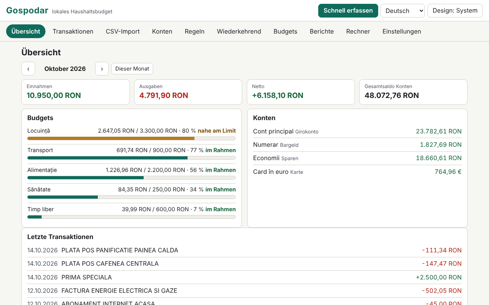

# Gospodar

[English](README.md) · [Română](README.ro.md) · [Français](README.fr.md) · [Italiano](README.it.md) · [Español](README.es.md) · [Português](README.pt.md) · **Deutsch** · [Magyar](README.hu.md)

**Version:** 1.0.0 · **Zuletzt aktualisiert:** 2026-10-14

Oberflächensprachen: **Română, English, Français, Italiano, Español, Português (PT), Deutsch, Magyar**

Gospodar ist ein Haushaltsbuch, das lokal in einer einzigen HTML-Datei läuft, ohne Konto und ohne Synchronisierung. Es führt Konten (Girokonto, Bargeld, Karte, Ersparnisse), Kategorien mit Unterkategorien (rumänischer Standardsatz, bearbeitbar), Transaktionen mit Tags und Notizen, Überweisungen zwischen Konten und Beträge in mehreren Währungen mit manuell eingegebenen Kursen. Es importiert CSV-Kontoauszüge über einen Assistenten zur Spaltenzuordnung, wendet Kategorisierungsregeln an, verfolgt wiederkehrende Transaktionen und Monatsbudgets, erstellt Berichte (SVG-Diagramme) und enthält sechs Rechner mit transparenten Formeln. Die Daten sind sensibel und bleiben in diesem Browser; die Passwortverschlüsselung des gespeicherten Datensatzes ist optional.

**Live-App:** https://chiuta.github.io/apps/Gospodar/

## Bedienung

- **Einstieg:** „Beispiel laden“ (Demodaten, mit Beispielkursen, nicht echt) oder „Konto hinzufügen“. Die Basiswährung ist standardmäßig RON (Konten › Währungen und Kurse).
- **Transaktionen:** Datum, Typ (Ausgabe/Einnahme) und Betrag (du kannst auch `-50` oder `+50` schreiben), Beschreibung, Kategorie (oder „automatisch, per Regeln“), Konto, Tags, Notiz. Filter (Text, Konto, Kategorie, Typ, Zeitraum, Tag), Mehrfachauswahl, CSV-Export. **Schnelleingabe:** Die Taste `n` (oder die Schaltfläche) öffnet ein Formular, in dem die Eingabetaste speichert und du für die nächste Transaktion bleibst.
- **Überweisungen:** zwischen zwei Konten; wenn die Währungen verschieden sind, wird der eingehende Betrag aus dem eingegebenen Kurs vorgeschlagen, und du kannst ihn korrigieren. Eine Überweisung zählt nicht zu den Einnahmen/Ausgaben.
- **CSV-Import:** Du wählst die Datei (oder fügst den Text ein) und das Zielkonto. Die Anwendung erkennt das Trennzeichen (`,` `;` Tab), die Kodierung (UTF-8 / Windows-1250 über `TextDecoder`; du kannst auch Windows-1252, ISO-8859-2, UTF-16 erzwingen), die Vorspannzeilen, die Kopfzeile, das Zahlenformat (`1.234,56` vs. `1,234.56`) und das Datumsformat (`TT.MM.JJJJ`, `JJJJ-MM-TT`, `MM/TT/JJJJ`, `TT/MM/JJJJ`, `TT-MM-JJJJ`, `JJJJ/MM/TT`, `TT.MM.JJ`, `JJJJMMTT`) und rät dann die Zuordnung. Du bestätigst: Datum, vorzeichenbehafteter Betrag **oder** getrennt Soll/Haben, Beschreibung (bis zu zwei Spalten), Saldo (nur Konsistenzprüfung). Die Vorschau zeigt jede Zeile mit ihrem Zustand (OK / Fehler / Duplikat) und wie viele Zeilen automatisch kategorisiert werden. Importe können stapelweise rückgängig gemacht werden.
- **Importprofile:** der Name + deine Zuordnung (Spalten nach Kopfzeilenname oder Position, Trennzeichen, Kodierung, Formate). Ein Profil ist nur deine eigene Einstellung; **es ist kein offizielles Format irgendeiner Bank**, und die Anwendung behauptet das auch nicht.
- **Duplikate:** Der Schlüssel ist Datum + Betrag + normalisierte Beschreibung (ohne Diakritika und Großbuchstaben, ohne Zeichen). Legitime identische Zeilen am selben Tag (z. B. zwei gleiche Abhebungen) werden gezählt: Beim erneuten Import ist eine Zeile nur dann ein Duplikat, wenn bereits ebenso viele Exemplare vorhanden sind.
- **Kategorisierungsregeln:** „enthält“ (durch `;` getrennte Begriffe, ohne Beachtung von Diakritika) oder regulärer Ausdruck, dazu Betrag zwischen (Absolutwert), Typ, Konto, zugewiesene Kategorie und hinzugefügte Tags. Die erste passende Regel gewinnt; die Reihenfolge wird mit ↑ ↓ geändert. Sie werden beim Import, bei der Schnelleingabe und auf Anforderung (auf nicht kategorisierte oder alle) angewendet, mit Vorschau der Wirkung und Rückgängig-Funktion.
- **Wiederkehrende:** Miete, Gehalt, Abonnements (täglich/wöchentlich/monatlich/jährlich, Intervall, Ende, Pausierung). Fällige Posten werden **nicht automatisch gebucht**: Ein Klick bucht sie. Die Prognose für den Folgemonat zeigt die fälligen Posten und das prognostizierte Netto.
- **Budgets:** Monatslimit je Kategorie (das Budget einer Hauptkategorie schließt die Unterkategorien ein), Fortschrittsbalken, Statustext (im Limit / nahe am Limit ≥ 80 % / überschritten) und eine Warnliste.
- **Berichte:** Ausgaben nach Kategorie, monatliche Entwicklung (12 Monate), Cashflow mit dem Gesamtsaldo zum Monatsende, Top-Händler, Monat-zu-Monat-Vergleich, Saldo pro Konto; jedes Diagramm hat einen Titel, eine Beschreibung und eine Tabelle. **Monatsbericht drucken** (Druck-CSS).
- **Rechner:** Kreditrate (Annuität und gleichbleibende Tilgungsraten, Diagramm und vollständiger Tilgungsplan), Zinseszins mit monatlichen Einzahlungen, Sparziel, Inflationsanpassung (den Satz gibst du ein), MwSt. (aufschlagen/herausrechnen, von dir eingegebener Satz), Währungsumrechnung (den Kurs gibst du ein). Jeder zeigt die Formeln, die Schritte mit deinen Werten, die Annahmen und den Hinweis, dass die Ergebnisse nur Richtwerte sind.
- **Einstellungen:** Sprache, Design, `.fff.json`-Export/-Import (unverschlüsselt oder passwortverschlüsselt), CSV-Export, Verschlüsselung, automatische Sperre, „Alles löschen“.

## Was es NICHT tut, und seine Grenzen

- **Es gibt keine Finanz-, Anlage- oder Steuerberatung.** Die Rechner sind Richtwerte und zeigen ihre Annahmen; sie berechnen keinen effektiven Jahreszins und enthalten keine Gebühren, Versicherungen oder Steuern.
- **Es lädt keine Wechselkurse herunter** und synchronisiert nichts. Die Kurse sind die von dir eingegebenen; Berichte und Summen rechnen mit den *aktuellen* Kursen der Tabelle um, nicht mit historischen. Transaktionen in Währungen ohne eingegebenen Kurs werden aus den Summen ausgeschlossen, mit einer Warnung.
- Einnahme/Ausgabe werden nach der Art der Kategorie bestimmt (bei nicht kategorisierten nach dem Vorzeichen); Erstattungen innerhalb einer Ausgabenkategorie verringern die Ausgabe dieser Kategorie. Überweisungen sind ausgeschlossen.
- Beträge sind ganze Zahlen in Untereinheiten (Cent), mit `BigInt` bei Produkten und Umrechnungen; die Rundung ist „kaufmännisch aufrunden“ und erfolgt nur einmal je Operation (bei Kredit/Zinsen in jeder Periode, wie angezeigt). Währungen mit einer anderen Genauigkeit als 2 Dezimalstellen sind nur für JPY, KRW (0) und BHD, KWD (3) bekannt.
- Datumsformate mit ausgeschriebenen Monatsnamen werden beim Import nicht erkannt. Eine CSV mit mehreren Konten oder Währungen in einer Datei wird in ein einziges gewähltes Konto importiert.
- Reguläre Ausdrücke werden gefiltert: Zurückverweise, Lookahead/Lookbehind, wiederholte Gruppen, die Wiederholungen oder Alternativen enthalten (z. B. `(a+)+`), und Ausdrücke über 200 Zeichen werden abgelehnt; anschließend wird jeder Ausdruck in einem Worker mit einem Limit von 300 ms getestet. Bei der Anwendung hat die Berechnung ein Budget von 3 s und stoppt mit einer Warnung. Die Heuristik kann auch harmlose Ausdrücke der Form `(foo|bar)+` ablehnen; du kannst sie als `(?:…)` ohne Wiederholung oder mit mehreren Regeln umschreiben.
- Die Top-Händler werden heuristisch nach den ersten Wörtern der Beschreibung gruppiert: näherungsweise.
- Die Speicherung erfolgt in `localStorage` (Limit von einigen MB; 20.000 Transaktionen belegen ≈ 1,6 MB). Wenn der Speicher voll oder gesperrt ist, warnt die Anwendung sichtbar, dass die letzten Änderungen nicht gespeichert wurden. Das Löschen der Websitedaten oder ein verlorenes Passwort bedeutet verlorene Daten: Bewahre Exporte auf.
- Der Import einer `.fff.json` ersetzt den aktuellen Datensatz (er wird nicht zusammengeführt).

## Datenschutz

Läuft lokal und sendet nichts. Es gibt keine Analytics, Cookies oder Netzwerkanfragen (`connect-src 'none'`). Die Daten liegen in `localStorage` unter dem Präfix `fff.gospodar.`: `data` (der Datensatz, im Klartext, oder nicht vorhanden, wenn verschlüsselt), `enc` (der verschlüsselte Datensatz), `lang`, `theme`.

**Optionale Verschlüsselung:** Der gespeicherte Datensatz wird mit 256-Bit-AES-GCM (Web Crypto) verschlüsselt; der Schlüssel wird aus dem Passwort per PBKDF2-SHA256 mit 600.000 Iterationen (≥ 310.000), einem zufälligen 16-Byte-Salt und einem neuen IV bei jedem Speichern abgeleitet. Das Passwort wird nicht gespeichert. Bei der Aktivierung wird die Klartextkopie aus dem Browser gelöscht. **Wenn du das Passwort verlierst, sind die verschlüsselten Daten endgültig verloren; es gibt keine Wiederherstellung.** Unverschlüsselte Daten befinden sich dennoch im Speicher der Seite, solange die Anwendung entsperrt ist; das Sperren (manuell oder automatisch) entfernt sie aus der Seite. Unverschlüsselte `.fff.json`-Exporte enthalten alles, was du eingegeben hast; es gibt auch einen passwortverschlüsselten Export.

## Formate

- **Import:** CSV/TSV/Text, UTF-8 (mit oder ohne BOM), Windows-1250, Windows-1252, ISO-8859-2, UTF-16 LE; Felder in Anführungszeichen (einschließlich `""` und Zeilenumbrüchen im Feld), Zeilenenden CRLF oder LF.
- **Export:** CSV (`date, amount, currency, description, category, account, tags, note, transfer`; Standardstil `,` und `.` oder regionales Excel `;` und `,`; Werte, die für Formeln gehalten werden könnten, erhalten ein Apostroph als Präfix) und `.fff.json`:
  `{"format":"fff-bundle","schema":1,"app":"gospodar","version":"1.0.0","updated":"2026-10-14","exported":"…","data":{"fff.gospodar.data":"<set de date JSON>","fff.gospodar.lang":"ro"}}`.
  Die verschlüsselte Variante: `{"format":"fff-bundle-enc","schema":1,"app":"gospodar",…,"kdf":"PBKDF2-SHA256","iter":600000,"salt":…,"iv":…,"ct":…}`, wobei der Klartext das gesamte obige Paket ist.

## Technik

- Eine einzige `index.html` (HTML, CSS und JS inline), keine Bibliotheken, kein `eval`, keine Inline-Handler. CSP: die Standardformel des Katalogs (`default-src 'none'; script-src 'sha256-…'; style-src 'unsafe-inline'; … worker-src blob:; connect-src 'none'`), ohne Abweichungen. `worker-src blob:` dient dem Zeittest der regulären Ausdrücke (Worker aus einem Blob) und lokal erzeugten Downloads; `style-src 'unsafe-inline'` dient den Breiten der Fortschrittsbalken.
- Die Kredit-/Zinsberechnungen verwenden 40-stellige Festkommaarithmetik mit `BigInt`; Annuität = P·r·(1+r)ⁿ/((1+r)ⁿ−1), mit in jeder Periode gerundetem Monatszins und angepasster letzter Rate.
- Regeln für kompakte Speicherung: Transaktionen werden als Arrays gespeichert, damit 20.000 Zeilen bequem in `localStorage` passen.
- Tests: `node tests/test.mjs` (Playwright, Chromium, Netzwerk gesperrt). Abgedeckt: exakte Berechnungen (Kreditraten, Zinseszins, Ziel, Inflation, MwSt. und Wechselkurs, verglichen mit einem unabhängigen, in Python mit exakten Brüchen (`fractions`) geschriebenen Orakel, `tests/gen_oracle.py` → `tests/oracle.json`), im Test geschriebene realistische CSV-Importe (Diakritika, Vorspann, Soll/Haben, UTF-8/BOM, Tab, Windows-1250, unterschiedliche Zahlen- und Datumsformate, ungültige Zeilen), Duplikate und Import-Rückgängig, Profile, Regeln (einschließlich abgelehnter gefährlicher Ausdrücke), Mehrwährung und Überweisungen, Schnelleingabe per Tastatur, Budgets, Wiederkehrende (kurze Monate, Schaltjahr), Berichte und Drucken, Ver-/Entschlüsselung (nichts im Klartext in `localStorage`, falsches Passwort, Änderung, Deaktivierung), Export/Import, 20.000 Transaktionen, 8 Sprachen, axe-core 0 Verstöße (einschließlich Dialogen, hellem und dunklem Design), kein Überlauf bei 360×740 und 1280×800, Tastatur, `prefers-reduced-motion`.

## Drittanbieter

Es enthält keinen Drittanbieter-Code. In den Tests werden Playwright und axe-core verwendet (axe-core wird nur in den Tests eingeschleust).

## Übersetzungen

Rumänisch ist die Referenzsprache. Englisch wurde zusammen mit dem Rumänischen geschrieben, aber nicht von einem Muttersprachler geprüft; **Französisch, Italienisch, Spanisch, Portugiesisch, Ungarisch und Deutsch sind maschinelle Übersetzungen, nicht von Muttersprachlern geprüft.** Korrekturen sind willkommen. Die Standardkategorien und die Demodaten bleiben auf Rumänisch (es sind Daten, bearbeitbar).

## Lizenz

MIT — siehe die Datei `LICENSE` im Stammverzeichnis des Repositorys.

## Verlauf

- 1.0.0 — 2026-10-14: erste Version.
