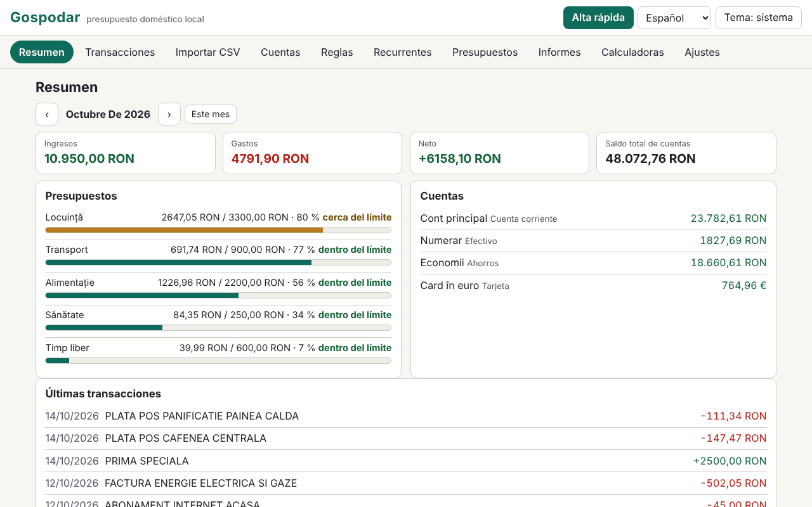

# Gospodar

[English](README.md) · [Română](README.ro.md) · [Français](README.fr.md) · [Italiano](README.it.md) · **Español** · [Português](README.pt.md) · [Deutsch](README.de.md) · [Magyar](README.hu.md)

**Versión:** 1.0.0 · **Última actualización:** 2026-10-14

Idiomas de la interfaz: **Română, English, Français, Italiano, Español, Português (PT), Deutsch, Magyar**

Gospodar es un presupuesto doméstico que se ejecuta en local, en un único archivo HTML, sin cuenta y sin sincronización. Lleva cuentas (cuenta corriente, efectivo, tarjeta, ahorros), categorías con subcategorías (conjunto predeterminado rumano, editable), transacciones con etiquetas y notas, transferencias entre cuentas e importes en varias monedas con tipos de cambio introducidos manualmente. Importa extractos CSV mediante un asistente de asignación de columnas, aplica reglas de categorización, hace seguimiento de transacciones recurrentes y presupuestos mensuales, produce informes (gráficos SVG) e incluye seis calculadoras con fórmulas transparentes. Los datos son sensibles y permanecen en este navegador; el cifrado con contraseña del conjunto guardado es opcional.

**Aplicación en línea:** https://chiuta.github.io/apps/Gospodar/

## Cómo se usa

- **Inicio:** «Cargar ejemplo» (datos de demostración, con tipos de cambio de ejemplo, no reales) o «Añadir cuenta». La moneda base es por defecto el RON (Cuentas › Monedas y tipos).
- **Transacciones:** fecha, tipo (gasto/ingreso) e importe (también puedes escribir `-50` o `+50`), descripción, categoría (o «automática, mediante reglas»), cuenta, etiquetas, nota. Filtros (texto, cuenta, categoría, tipo, intervalo, etiqueta), selección múltiple, exportación CSV. **Alta rápida:** la tecla `n` (o el botón) abre un formulario en el que Intro guarda y te quedas para la siguiente transacción.
- **Transferencias:** entre dos cuentas; si las monedas difieren, el importe de entrada se propone según el tipo de cambio introducido y puedes corregirlo. Una transferencia no cuenta como ingreso/gasto.
- **Importación CSV:** eliges el archivo (o pegas el texto) y la cuenta de destino. La aplicación detecta el separador (`,` `;` tabulador), la codificación (UTF-8 / Windows-1250 mediante `TextDecoder`; también puedes forzar Windows-1252, ISO-8859-2, UTF-16), las líneas de preámbulo, la cabecera, el formato numérico (`1.234,56` frente a `1,234.56`) y el formato de fecha (`dd.mm.aaaa`, `aaaa-mm-dd`, `mm/dd/aaaa`, `dd/mm/aaaa`, `dd-mm-aaaa`, `aaaa/mm/dd`, `dd.mm.aa`, `aaaammdd`), y después deduce la asignación. Tú confirmas: fecha, importe con signo **o** débito/crédito por separado, descripción (hasta dos columnas), saldo (solo comprobación de coherencia). La vista previa muestra cada fila con su estado (OK / error / duplicado) y cuántas filas se categorizarán automáticamente. Las importaciones pueden deshacerse por lotes.
- **Perfiles de importación:** el nombre + tu asignación (columnas por nombre de cabecera o posición, separador, codificación, formatos). Un perfil es solo un ajuste tuyo; **no es un formato oficial de ningún banco** y la aplicación no pretende lo contrario.
- **Duplicados:** la clave es fecha + importe + descripción normalizada (sin diacríticos ni mayúsculas, sin signos). Las filas idénticas legítimas del mismo día (p. ej. dos retiradas iguales) se cuentan: al reimportar, una fila es duplicada solo si ya existen tantos ejemplares.
- **Reglas de categorización:** «contiene» (términos separados por `;`, sin distinguir diacríticos) o expresión regular, además de importe entre (valor absoluto), tipo, cuenta, categoría asignada y etiquetas añadidas. Gana la primera regla que coincide; el orden se cambia con ↑ ↓. Se aplican al importar, en el alta rápida y a petición (a las no categorizadas o a todas), con vista previa del efecto y deshacer.
- **Recurrentes:** alquiler, salario, suscripciones (diaria/semanal/mensual/anual, intervalo, fin, suspensión). Los vencimientos **no se registran solos**: un clic los registra. La proyección del mes siguiente muestra los vencimientos y el neto proyectado.
- **Presupuestos:** límite mensual por categoría (el presupuesto de una categoría principal incluye las subcategorías), barra de progreso, texto de estado (dentro del límite / cerca del límite ≥ 80 % / superado) y una lista de avisos.
- **Informes:** gastos por categoría, evolución mensual (12 meses), flujo de caja con el saldo total a fin de mes, principales comercios, comparación mes a mes, saldo por cuenta; cada gráfico tiene título, descripción y tabla. **Impresión del informe mensual** (CSS de impresión).
- **Calculadoras:** cuota de préstamo (anualidad y cuotas de principal iguales, gráfico y cuadro de amortización completo), interés compuesto con aportaciones mensuales, objetivo de ahorro, actualización por inflación (la tasa la introduces tú), IVA (añadir/quitar, tipo introducido por ti), conversión de divisas (el tipo lo introduces tú). Cada una muestra las fórmulas, los pasos con tus valores, los supuestos y la advertencia de que los resultados son orientativos.
- **Ajustes:** idioma, tema, exportación/importación `.fff.json` (sin cifrar o cifrado con contraseña), exportación CSV, cifrado, bloqueo automático, «Borrar todo».

## Lo que NO hace y sus límites

- **No ofrece asesoramiento financiero, de inversión ni fiscal.** Las calculadoras son orientativas y muestran sus supuestos; no calculan la TAE y no incluyen comisiones, seguros ni impuestos.
- **No descarga tipos de cambio** y no sincroniza nada. Los tipos son los que has introducido; los informes y totales convierten con los tipos *actuales* de la tabla, no con los históricos. Las transacciones en monedas sin tipo introducido se excluyen de los totales, con una advertencia.
- Ingreso/gasto se determinan por la naturaleza de la categoría (las no categorizadas, por el signo); los reembolsos dentro de una categoría de gasto reducen el gasto de esa categoría. Las transferencias se excluyen.
- Los importes son números enteros en subunidades (céntimos), con `BigInt` para productos y conversiones; el redondeo es «mitad hacia arriba» y se hace una sola vez por operación (en préstamo/interés, en cada periodo, tal como se muestra). Las monedas con una precisión distinta de 2 decimales solo se conocen para JPY, KRW (0) y BHD, KWD (3).
- Los formatos de fecha con nombres de mes en letras no se reconocen al importar. Un CSV con varias cuentas o monedas en un solo archivo se importa en una única cuenta elegida.
- Las expresiones regulares se filtran: se rechazan las referencias hacia atrás, lookahead/lookbehind, los grupos repetidos que contienen repeticiones o alternancias (p. ej. `(a+)+`) y las expresiones de más de 200 caracteres; después cada expresión se prueba en un Worker con un límite de 300 ms. Al aplicarlas, el cálculo tiene un presupuesto de 3 s y se detiene con una advertencia. La heurística también puede rechazar expresiones inofensivas de la forma `(foo|bar)+`; puedes reescribirlas como `(?:…)` sin repetición o con varias reglas.
- Los principales comercios se agrupan heurísticamente según las primeras palabras de la descripción: aproximado.
- El almacenamiento es `localStorage` (límite de unos pocos MB; 20 000 transacciones ocupan ≈ 1,6 MB). Si el espacio se agota o el almacenamiento está bloqueado, la aplicación avisa de forma visible de que los últimos cambios no se han guardado. Borrar los datos del sitio o perder la contraseña significa perder los datos: conserva exportaciones.
- La importación de un `.fff.json` reemplaza el conjunto actual (no lo fusiona).

## Privacidad

Se ejecuta en local y no envía nada. No hay analítica, cookies ni solicitudes de red (`connect-src 'none'`). Los datos se guardan en `localStorage` con el prefijo `fff.gospodar.`: `data` (el conjunto de datos, en claro, o ausente si está cifrado), `enc` (el conjunto cifrado), `lang`, `theme`.

**Cifrado opcional:** el conjunto guardado se cifra con AES-GCM de 256 bits (Web Crypto); la clave deriva de la contraseña mediante PBKDF2-SHA256 con 600 000 iteraciones (≥ 310 000), una sal aleatoria de 16 bytes y un IV nuevo en cada guardado. La contraseña no se almacena. Al activarlo, la copia en claro se borra del navegador. **Si pierdes la contraseña, los datos cifrados se pierden definitivamente; no existe recuperación.** Los datos sin cifrar estarán, no obstante, en la memoria de la página mientras la aplicación esté desbloqueada; el bloqueo (manual o automático) los retira de la página. Las exportaciones `.fff.json` sin cifrar contienen todo lo que has introducido; también existe la exportación cifrada con contraseña.

## Formatos

- **Importación:** CSV/TSV/texto, UTF-8 (con o sin BOM), Windows-1250, Windows-1252, ISO-8859-2, UTF-16 LE; campos entre comillas (incluidos `""` y saltos de línea dentro de un campo), terminadores CRLF o LF.
- **Exportación:** CSV (`date, amount, currency, description, category, account, tags, note, transfer`; estilo estándar `,` y `.` o Excel regional `;` y `,`; los valores que podrían confundirse con fórmulas llevan un apóstrofo como prefijo) y `.fff.json`:
  `{"format":"fff-bundle","schema":1,"app":"gospodar","version":"1.0.0","updated":"2026-10-14","exported":"…","data":{"fff.gospodar.data":"<set de date JSON>","fff.gospodar.lang":"ro"}}`.
  La variante cifrada: `{"format":"fff-bundle-enc","schema":1,"app":"gospodar",…,"kdf":"PBKDF2-SHA256","iter":600000,"salt":…,"iv":…,"ct":…}`, donde el texto en claro es el paquete completo anterior.

## Aspectos técnicos

- Un único `index.html` (HTML, CSS y JS en línea), sin bibliotecas, sin `eval`, sin manejadores en línea. CSP: la fórmula estándar del catálogo (`default-src 'none'; script-src 'sha256-…'; style-src 'unsafe-inline'; … worker-src blob:; connect-src 'none'`), sin desviaciones. `worker-src blob:` sirve para la prueba de tiempo de las expresiones regulares (Worker desde un Blob) y para las descargas generadas localmente; `style-src 'unsafe-inline'` sirve para los anchos de las barras de progreso.
- Los cálculos de préstamo/interés usan coma fija de 40 dígitos con `BigInt`; anualidad = P·r·(1+r)ⁿ/((1+r)ⁿ−1), con el interés mensual redondeado en cada periodo y la última cuota ajustada.
- Reglas de almacenamiento compacto: las transacciones se guardan como matrices, de modo que 20 000 filas quepan cómodamente en `localStorage`.
- Pruebas: `node tests/test.mjs` (Playwright, Chromium, red bloqueada). Cobertura: cálculos exactos (cuotas de préstamo, interés compuesto, objetivo, inflación, IVA y cambio comparados con un oráculo independiente escrito en Python con racionales exactos (`fractions`), `tests/gen_oracle.py` → `tests/oracle.json`), importaciones CSV realistas escritas en la prueba (diacríticos, preámbulo, débito/crédito, UTF-8/BOM, tabulador, Windows-1250, distintos formatos numéricos y de fecha, filas no válidas), duplicados y deshacer importación, perfiles, reglas (incluidas expresiones peligrosas rechazadas), multimoneda y transferencias, alta rápida por teclado, presupuestos, recurrentes (meses cortos, año bisiesto), informes e impresión, cifrado/descifrado (nada en claro en `localStorage`, contraseña incorrecta, cambio, desactivación), exportación/importación, 20 000 transacciones, 8 idiomas, axe-core 0 infracciones (incluidos diálogos, tema claro y oscuro), sin desbordamiento a 360×740 y 1280×800, teclado, `prefers-reduced-motion`.

## Terceros

No contiene código de terceros. En las pruebas se usan Playwright y axe-core (axe-core inyectado solo en las pruebas).

## Traducciones

El rumano es el idioma de referencia. El inglés se escribió junto con el rumano, pero no ha sido verificado por un hablante nativo; **el francés, el italiano, el español, el portugués, el húngaro y el alemán son traducciones automáticas, no verificadas por hablantes nativos.** Las correcciones son bienvenidas. Las categorías predeterminadas y los datos de demostración permanecen en rumano (son datos, editables).

## Licencia

MIT — véase el archivo `LICENSE` en la raíz del repositorio.

## Historial

- 1.0.0 — 2026-10-14: primera versión.
