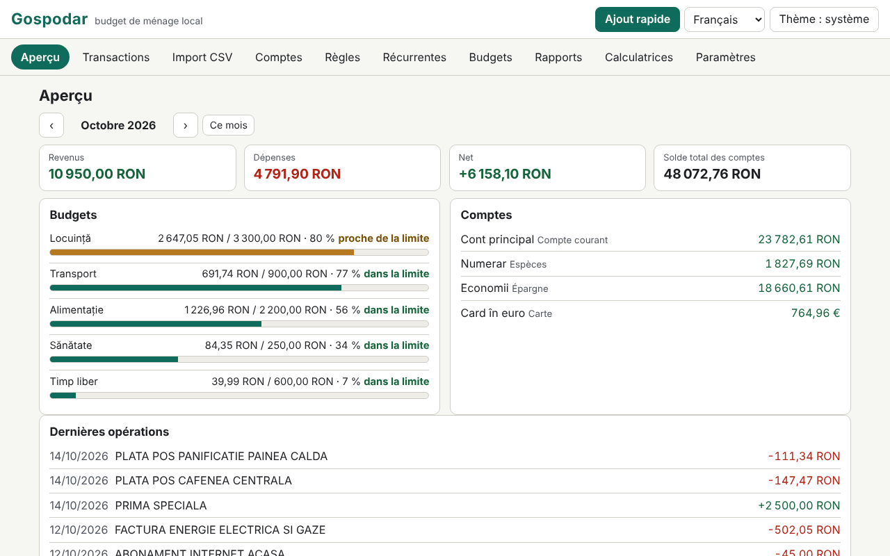

# Gospodar

[English](README.md) · [Română](README.ro.md) · **Français** · [Italiano](README.it.md) · [Español](README.es.md) · [Português](README.pt.md) · [Deutsch](README.de.md) · [Magyar](README.hu.md)

**Version :** 1.0.0 · **Dernière mise à jour :** 2026-10-14

Langues de l'interface : **Română, English, Français, Italiano, Español, Português (PT), Deutsch, Magyar**

Gospodar est un budget de ménage qui s'exécute localement, dans un seul fichier HTML, sans compte et sans synchronisation. Il tient des comptes (compte courant, espèces, carte, épargne), des catégories avec sous-catégories (jeu par défaut roumain, modifiable), des transactions avec étiquettes et notes, des virements entre comptes et des montants en plusieurs devises avec des taux saisis manuellement. Il importe des relevés CSV via un assistant de mappage des colonnes, applique des règles de catégorisation, suit les transactions récurrentes et les budgets mensuels, produit des rapports (graphiques SVG) et inclut six calculateurs aux formules transparentes. Les données sont sensibles et restent dans ce navigateur ; le chiffrement par mot de passe du jeu enregistré est facultatif.

**Application en ligne :** https://chiuta.github.io/apps/Gospodar/

## Mode d'emploi

- **Pour commencer :** « Charger un exemple » (données de démonstration, avec des taux d'exemple, non réels) ou « Ajouter un compte ». La devise de base est par défaut le RON (Comptes › Devises et taux).
- **Transactions :** date, type (dépense/revenu) et montant (vous pouvez aussi écrire `-50` ou `+50`), description, catégorie (ou « automatique, par règles »), compte, étiquettes, note. Filtres (texte, compte, catégorie, type, intervalle, étiquette), sélection en masse, export CSV. **Ajout rapide :** la touche `n` (ou le bouton) ouvre un formulaire où Entrée enregistre et vous restez pour la transaction suivante.
- **Virements :** entre deux comptes ; si les devises diffèrent, le montant entrant est proposé d'après le taux saisi et vous pouvez le corriger. Un virement n'entre pas dans les revenus/dépenses.
- **Import CSV :** vous choisissez le fichier (ou collez le texte) et le compte cible. L'application détecte le séparateur (`,` `;` tabulation), l'encodage (UTF-8 / Windows-1250 via `TextDecoder` ; vous pouvez aussi forcer Windows-1252, ISO-8859-2, UTF-16), les lignes de préambule, l'en-tête, le format numérique (`1.234,56` vs `1,234.56`) et le format de date (`jj.mm.aaaa`, `aaaa-mm-jj`, `mm/jj/aaaa`, `jj/mm/aaaa`, `jj-mm-aaaa`, `aaaa/mm/jj`, `jj.mm.aa`, `aaaammjj`), puis devine le mappage. Vous confirmez : date, montant signé **ou** débit/crédit séparés, description (jusqu'à deux colonnes), solde (simple vérification de cohérence). L'aperçu montre chaque ligne avec son état (OK / erreur / doublon) et combien de lignes seront catégorisées automatiquement. Les imports peuvent être annulés par lots.
- **Profils d'import :** le nom + votre mappage (colonnes par nom d'en-tête ou position, séparateur, encodage, formats). Un profil n'est que votre propre réglage ; **ce n'est pas un format officiel d'une banque** et l'application ne prétend pas le contraire.
- **Doublons :** la clé est date + montant + description normalisée (sans diacritiques ni majuscules, sans signes). Les lignes identiques légitimes du même jour (par ex. deux retraits égaux) sont comptées : lors d'un réimport, une ligne n'est un doublon que s'il existe déjà autant d'exemplaires.
- **Règles de catégorisation :** « contient » (termes séparés par `;`, insensible aux diacritiques) ou expression régulière, plus montant compris entre (valeur absolue), type, compte, catégorie attribuée et étiquettes ajoutées. La première règle qui correspond l'emporte ; l'ordre se change avec ↑ ↓. Elles s'appliquent à l'import, à l'ajout rapide et à la demande (aux non catégorisées ou à toutes), avec aperçu de l'effet et annulation.
- **Récurrentes :** loyer, salaire, abonnements (quotidien/hebdomadaire/mensuel/annuel, intervalle, fin, suspension). Les échéances **ne s'enregistrent pas toutes seules** : un clic les enregistre. La projection du mois suivant montre les échéances et le net projeté.
- **Budgets :** plafond mensuel par catégorie (le budget d'une catégorie principale inclut ses sous-catégories), barre de progression, texte d'état (dans la limite / proche de la limite ≥ 80 % / dépassé) et liste d'avertissements.
- **Rapports :** dépenses par catégorie, évolution mensuelle (12 mois), flux de trésorerie avec le solde total en fin de mois, principaux commerçants, comparaison mois par mois, solde par compte ; chaque graphique a un titre, une description et un tableau. **Impression du rapport mensuel** (CSS d'impression).
- **Calculateurs :** mensualité de crédit (annuité et amortissements constants, graphique et tableau d'amortissement complet), intérêts composés avec versements mensuels, objectif d'épargne, actualisation selon l'inflation (vous saisissez le taux), TVA (ajout/retrait, taux saisi par vous), conversion de devises (vous saisissez le taux). Chacun montre les formules, les étapes avec vos valeurs, les hypothèses et l'avertissement que les résultats sont indicatifs.
- **Paramètres :** langue, thème, export/import `.fff.json` (non chiffré ou chiffré par mot de passe), export CSV, chiffrement, verrouillage automatique, « Tout supprimer ».

## Ce qu'il ne fait PAS, et ses limites

- **Il ne donne aucun conseil financier, d'investissement ou fiscal.** Les calculateurs sont indicatifs et affichent leurs hypothèses ; ils ne calculent pas le TAEG et n'incluent ni commissions, ni assurances, ni impôts.
- **Il ne télécharge pas de taux de change** et ne synchronise rien. Les taux sont ceux que vous avez saisis ; les rapports et totaux convertissent avec les taux *actuels* du tableau, pas avec les taux historiques. Les transactions dans des devises sans taux saisi sont exclues des totaux, avec avertissement.
- Revenu/dépense se déterminent selon la nature de la catégorie (pour les non catégorisées, selon le signe) ; les remboursements dans une catégorie de dépenses diminuent la dépense de cette catégorie. Les virements sont exclus.
- Les montants sont des nombres entiers en sous-unités (centimes), avec `BigInt` pour les produits et conversions ; l'arrondi est « moitié vers le haut » et n'est effectué qu'une fois par opération (pour crédit/intérêts, à chaque période, tel qu'affiché). Les devises dont la précision n'est pas de 2 décimales ne sont connues que pour JPY, KRW (0) et BHD, KWD (3).
- Les formats de date avec noms de mois en lettres ne sont pas reconnus à l'import. Un CSV contenant plusieurs comptes ou devises dans un seul fichier s'importe dans un seul compte choisi.
- Les expressions régulières sont filtrées : sont rejetés les références arrière, lookahead/lookbehind, les groupes répétés contenant des répétitions ou des alternances (ex. `(a+)+`) et les expressions de plus de 200 caractères ; ensuite chaque expression est testée dans un Worker avec une limite de 300 ms. À l'application, le calcul dispose d'un budget de 3 s et s'arrête avec un avertissement. L'heuristique peut aussi rejeter des expressions inoffensives de la forme `(foo|bar)+` ; vous pouvez les réécrire en `(?:…)` sans répétition ou avec plusieurs règles.
- Les principaux commerçants sont regroupés de façon heuristique d'après les premiers mots de la description : approximatif.
- Le stockage est `localStorage` (limite de quelques Mo ; 20 000 transactions occupent ≈ 1,6 Mo). Si l'espace est saturé ou le stockage bloqué, l'application avertit visiblement que les dernières modifications n'ont pas été enregistrées. L'effacement des données du site ou un mot de passe perdu signifie des données perdues : conservez des exports.
- L'import d'un `.fff.json` remplace le jeu actuel (il ne le fusionne pas).

## Confidentialité

Il s'exécute localement et n'envoie rien. Il n'y a ni analytics, ni cookies, ni requêtes réseau (`connect-src 'none'`). Les données sont dans `localStorage` sous le préfixe `fff.gospodar.` : `data` (le jeu de données, en clair, ou absent s'il est chiffré), `enc` (le jeu chiffré), `lang`, `theme`.

**Chiffrement facultatif :** le jeu enregistré est chiffré avec AES-GCM 256 bits (Web Crypto) ; la clé est dérivée du mot de passe par PBKDF2-SHA256 avec 600 000 itérations (≥ 310 000), un sel aléatoire de 16 octets et un nouvel IV à chaque enregistrement. Le mot de passe n'est pas stocké. À l'activation, la copie en clair est effacée du navigateur. **Si vous perdez le mot de passe, les données chiffrées sont définitivement perdues ; il n'existe aucune récupération.** Les données non chiffrées se trouveront néanmoins en mémoire de la page tant que l'application est déverrouillée ; le verrouillage (manuel ou automatique) les retire de la page. Les exports `.fff.json` non chiffrés contiennent tout ce que vous avez saisi ; il existe aussi un export chiffré par mot de passe.

## Formats

- **Import :** CSV/TSV/texte, UTF-8 (avec ou sans BOM), Windows-1250, Windows-1252, ISO-8859-2, UTF-16 LE ; champs entre guillemets (y compris `""` et sauts de ligne dans un champ), terminateurs CRLF ou LF.
- **Export :** CSV (`date, amount, currency, description, category, account, tags, note, transfer` ; style standard `,` et `.` ou Excel régional `;` et `,` ; les valeurs pouvant être prises pour des formules sont préfixées d'une apostrophe) et `.fff.json` :
  `{"format":"fff-bundle","schema":1,"app":"gospodar","version":"1.0.0","updated":"2026-10-14","exported":"…","data":{"fff.gospodar.data":"<set de date JSON>","fff.gospodar.lang":"ro"}}`.
  La variante chiffrée : `{"format":"fff-bundle-enc","schema":1,"app":"gospodar",…,"kdf":"PBKDF2-SHA256","iter":600000,"salt":…,"iv":…,"ct":…}`, où le texte en clair est l'ensemble du paquet ci-dessus.

## Technique

- Un seul `index.html` (HTML, CSS et JS en ligne), sans bibliothèques, sans `eval`, sans gestionnaires en ligne. CSP : la formule standard du catalogue (`default-src 'none'; script-src 'sha256-…'; style-src 'unsafe-inline'; … worker-src blob:; connect-src 'none'`), sans écart. `worker-src blob:` sert au test de durée des expressions régulières (Worker depuis un Blob) et aux téléchargements générés localement ; `style-src 'unsafe-inline'` sert aux largeurs des barres de progression.
- Les calculs de crédit/intérêts utilisent une virgule fixe sur 40 chiffres avec `BigInt` ; annuité = P·r·(1+r)ⁿ/((1+r)ⁿ−1), avec l'intérêt mensuel arrondi à chaque période et la dernière échéance ajustée.
- Règles de stockage compact : les transactions sont enregistrées sous forme de tableaux, afin que 20 000 lignes tiennent confortablement dans `localStorage`.
- Tests : `node tests/test.mjs` (Playwright, Chromium, réseau bloqué). Couverture : calculs exacts (mensualités de crédit, intérêts composés, objectif, inflation, TVA et change comparés à un oracle indépendant écrit en Python avec des rationnels exacts (`fractions`), `tests/gen_oracle.py` → `tests/oracle.json`), imports CSV réalistes écrits dans le test (diacritiques, préambule, débit/crédit, UTF-8/BOM, tabulation, Windows-1250, formats numériques et de date différents, lignes invalides), doublons et annulation d'import, profils, règles (y compris expressions dangereuses rejetées), multidevise et virements, ajout rapide au clavier, budgets, récurrentes (mois courts, année bissextile), rapports et impression, chiffrement/déchiffrement (rien en clair dans `localStorage`, mauvais mot de passe, changement, désactivation), export/import, 20 000 transactions, 8 langues, axe-core 0 violation (y compris dialogues, thème clair et sombre), aucun débordement à 360×740 et 1280×800, clavier, `prefers-reduced-motion`.

## Tiers

Il ne contient aucun code tiers. Les tests utilisent Playwright et axe-core (axe-core injecté uniquement dans les tests).

## Traductions

Le roumain est la langue de référence. L'anglais a été rédigé avec le roumain, mais n'a pas été vérifié par un locuteur natif ; **le français, l'italien, l'espagnol, le portugais, le hongrois et l'allemand sont des traductions automatiques, non vérifiées par des locuteurs natifs.** Les corrections sont les bienvenues. Les catégories par défaut et les données de démonstration restent en roumain (ce sont des données, modifiables).

## Licence

MIT — voir le fichier `LICENSE` à la racine du dépôt.

## Historique

- 1.0.0 — 2026-10-14 : première version.
