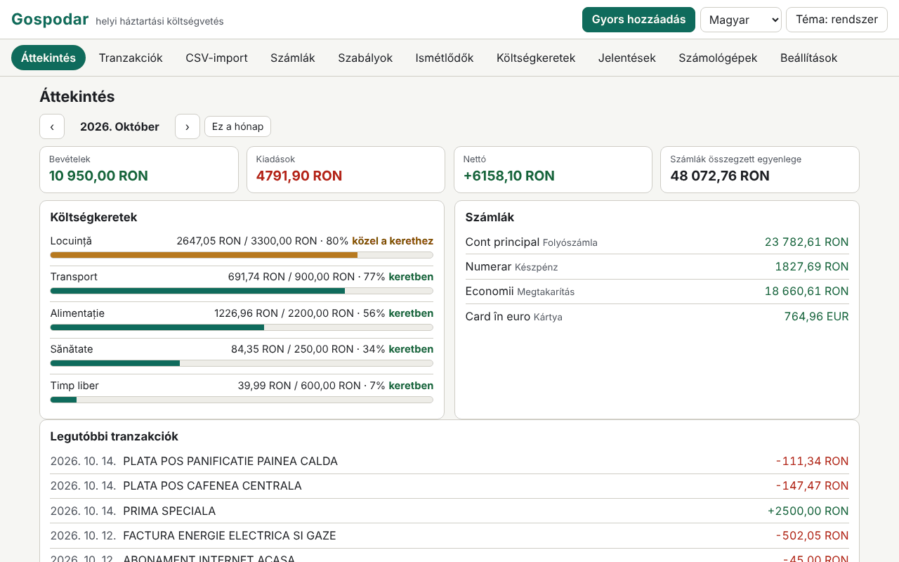

# Gospodar

[English](README.md) · [Română](README.ro.md) · [Français](README.fr.md) · [Italiano](README.it.md) · [Español](README.es.md) · [Português](README.pt.md) · [Deutsch](README.de.md) · **Magyar**

**Verzió:** 1.0.0 · **Utolsó frissítés:** 2026-10-14

A felület nyelvei: **Română, English, Français, Italiano, Español, Português (PT), Deutsch, Magyar**

A Gospodar egy háztartási költségvetés, amely helyben fut, egyetlen HTML-fájlban, fiók és szinkronizálás nélkül. Számlákat vezet (folyószámla, készpénz, kártya, megtakarítás), kategóriákat alkategóriákkal (román alapértelmezett készlet, szerkeszthető), tranzakciókat címkékkel és jegyzetekkel, számlák közötti átutalásokat, valamint több pénznemben megadott összegeket kézzel bevitt árfolyamokkal. CSV-kivonatokat importál oszlopleképező varázslóval, kategorizálási szabályokat alkalmaz, követi az ismétlődő tranzakciókat és a havi költségvetéseket, jelentéseket készít (SVG-diagramok), és hat átlátható képletű számológépet tartalmaz. Az adatok érzékenyek, és ebben a böngészőben maradnak; a mentett adatkészlet jelszavas titkosítása opcionális.

**Online alkalmazás:** https://chiuta.github.io/apps/Gospodar/

## Használat

- **Kezdés:** „Példa betöltése” (bemutató adatok, példaárfolyamokkal, nem valósakkal) vagy „Számla hozzáadása”. Az alappénznem alapértelmezés szerint a RON (Számlák › Pénznemek és árfolyamok).
- **Tranzakciók:** dátum, típus (kiadás/bevétel) és összeg (írhatsz `-50` vagy `+50` értéket is), leírás, kategória (vagy „automatikus, szabályokkal”), számla, címkék, jegyzet. Szűrők (szöveg, számla, kategória, típus, időszak, címke), tömeges kijelölés, CSV-export. **Gyors hozzáadás:** az `n` billentyű (vagy a gomb) megnyit egy űrlapot, ahol az Enter ment, és maradsz a következő tranzakcióhoz.
- **Átutalások:** két számla között; ha a pénznemek eltérnek, a beérkező összeget a megadott árfolyamból javasolja, és javíthatod. Az átutalás nem számít bele a bevételekbe/kiadásokba.
- **CSV-import:** kiválasztod a fájlt (vagy beillesztod a szöveget) és a célszámlát. Az alkalmazás felismeri az elválasztót (`,` `;` tabulátor), a kódolást (UTF-8 / Windows-1250 a `TextDecoder` segítségével; a Windows-1252, ISO-8859-2, UTF-16 is kikényszeríthető), az előzetes sorokat, a fejlécet, a számformátumot (`1.234,56` vs `1,234.56`) és a dátumformátumot (`nn.hh.éééé`, `éééé-hh-nn`, `hh/nn/éééé`, `nn/hh/éééé`, `nn-hh-éééé`, `éééé/hh/nn`, `nn.hh.éé`, `éééémmnn`), majd megsejti a leképezést. Te hagyod jóvá: dátum, előjeles összeg **vagy** külön tartozik/követel, leírás (legfeljebb két oszlop), egyenleg (csak konzisztencia-ellenőrzés). Az előnézet minden sort az állapotával (OK / hiba / duplikátum) mutat, valamint azt, hogy hány sor lesz automatikusan kategorizálva. Az importok kötegenként visszavonhatók.
- **Importprofilok:** a név + a te leképezésed (oszlopok fejlécnév vagy pozíció szerint, elválasztó, kódolás, formátumok). A profil csak a te saját beállításod; **nem egyetlen bank hivatalos formátuma**, és az alkalmazás ezt nem is állítja.
- **Duplikátumok:** a kulcs dátum + összeg + normalizált leírás (ékezetek és nagybetűk nélkül, jelek nélkül). Az ugyanazon a napon előforduló jogos azonos sorokat (pl. két egyforma pénzfelvétel) megszámolja: újraimportáláskor egy sor csak akkor duplikátum, ha már annyi példány létezik.
- **Kategorizálási szabályok:** „tartalmazza” (`;`-vel elválasztott kifejezések, ékezetfüggetlenül) vagy reguláris kifejezés, továbbá összeg közötte (abszolút érték), típus, számla, hozzárendelt kategória és hozzáadott címkék. Az első egyező szabály nyer; a sorrend a ↑ ↓ gombokkal módosítható. Alkalmazásuk importáláskor, gyors hozzáadáskor és kérésre (a nem kategorizáltakra vagy mindenre) történik, a hatás előnézetével és visszavonással.
- **Ismétlődők:** lakbér, fizetés, előfizetések (napi/heti/havi/éves, időköz, vég, felfüggesztés). Az esedékes tételeket **nem rögzíti magától**: egy kattintás rögzíti őket. A következő hónapra szóló előrejelzés megmutatja az esedékes tételeket és a várható nettót.
- **Költségvetések:** havi limit kategóriánként (a főkategória költségvetése tartalmazza az alkategóriákat), folyamatjelző sáv, állapotszöveg (limiten belül / limit közelében ≥ 80% / túllépve) és figyelmeztetések listája.
- **Jelentések:** kiadások kategóriák szerint, havi alakulás (12 hónap), pénzforgalom a hónap végi összegyenleggel, legnagyobb kereskedők, hónapról hónapra összehasonlítás, számlánkénti egyenleg; minden diagramnak van címe, leírása és táblázata. **Havi jelentés nyomtatása** (nyomtatási CSS).
- **Számológépek:** hiteltörlesztő részlet (annuitás és egyenlő tőketörlesztés, diagram és teljes törlesztési terv), kamatos kamat havi befizetésekkel, megtakarítási cél, inflációs korrekció (a kamatlábat te adod meg), ÁFA (hozzáadás/levonás, a te általad megadott kulcs), pénzváltás (az árfolyamot te adod meg). Mindegyik megmutatja a képleteket, a lépéseket a te értékeiddel, a feltevéseket és a figyelmeztetést, hogy az eredmények tájékoztató jellegűek.
- **Beállítások:** nyelv, téma, `.fff.json` export/import (titkosítatlan vagy jelszóval titkosított), CSV-export, titkosítás, automatikus zárolás, „Minden törlése”.

## Amit NEM tud, és a korlátai

- **Nem ad pénzügyi, befektetési vagy adótanácsot.** A számológépek tájékoztató jellegűek, és megjelenítik a feltevéseiket; nem számolnak THM-et, és nem tartalmaznak jutalékokat, biztosításokat vagy adókat.
- **Nem tölt le árfolyamokat**, és semmit nem szinkronizál. Az árfolyamok azok, amelyeket te adtál meg; a jelentések és az összesítések a táblázat *aktuális* árfolyamaival váltanak át, nem a történelmiekkel. A megadott árfolyam nélküli pénznemű tranzakciók figyelmeztetéssel kimaradnak az összesítésekből.
- A bevétel/kiadás a kategória természete szerint dől el (a nem kategorizáltaknál az előjel szerint); egy kiadási kategórián belüli visszatérítések csökkentik annak a kategóriának a kiadását. Az átutalások kizártak.
- Az összegek egész számok az alegységekben (fillér), szorzatoknál és átváltásoknál `BigInt`-tel; a kerekítés „fél felfelé”, és műveletenként csak egyszer történik (hitelnél/kamatnál minden időszakban, ahogyan megjelenik). A 2 tizedesjegytől eltérő pontosságú pénznemeket csak a JPY, KRW (0) és a BHD, KWD (3) esetében ismeri.
- A betűvel írt hónapnevet tartalmazó dátumformátumokat az import nem ismeri fel. Egy több számlát vagy pénznemet tartalmazó CSV egyetlen kiválasztott számlára importálódik.
- A reguláris kifejezések szűrve vannak: elutasítja a visszahivatkozásokat, a lookahead/lookbehind szerkezeteket, az ismétléseket vagy alternációkat tartalmazó ismételt csoportokat (pl. `(a+)+`) és a 200 karakternél hosszabb kifejezéseket; ezután minden kifejezést egy Workerben tesztel 300 ms-os korláttal. Alkalmazáskor a számításnak 3 s a kerete, és figyelmeztetéssel leáll. A heurisztika ártalmatlan, `(foo|bar)+` alakú kifejezéseket is elutasíthat; átírhatod őket `(?:…)` alakra ismétlés nélkül, vagy több szabállyal.
- A legnagyobb kereskedőket heurisztikusan, a leírás első szavai szerint csoportosítja: közelítő.
- A tárolás `localStorage` (néhány MB korlát; 20 000 tranzakció ≈ 1,6 MB-ot foglal). Ha elfogy a hely vagy a tárolás blokkolva van, az alkalmazás szembetűnően figyelmeztet, hogy az utolsó módosítások nem lettek mentve. A webhelyadatok törlése vagy az elveszett jelszó adatvesztést jelent: őrizz meg exportokat.
- Egy `.fff.json` importálása felváltja az aktuális adatkészletet (nem fésüli össze).

## Adatvédelem

Helyben fut, és semmit nem küld el. Nincs analitika, süti vagy hálózati kérés (`connect-src 'none'`). Az adatok a `localStorage`-ban vannak az `fff.gospodar.` előtag alatt: `data` (az adatkészlet, nyílt szövegként, vagy hiányzik, ha titkosított), `enc` (a titkosított készlet), `lang`, `theme`.

**Opcionális titkosítás:** a mentett adatkészletet 256 bites AES-GCM-mel titkosítja (Web Crypto); a kulcs a jelszóból PBKDF2-SHA256-tal származik 600 000 iterációval (≥ 310 000), véletlenszerű 16 bájtos sóval és minden mentésnél új IV-vel. A jelszót nem tárolja. Aktiváláskor a nyílt szövegű másolat törlődik a böngészőből. **Ha elveszíted a jelszót, a titkosított adatok véglegesen elvesznek; nincs helyreállítás.** A titkosítatlan adatok mindazonáltal az oldal memóriájában lesznek, amíg az alkalmazás fel van oldva; a zárolás (kézi vagy automatikus) eltávolítja őket az oldalról. A titkosítatlan `.fff.json` exportok mindent tartalmaznak, amit bevittél; jelszóval titkosított export is van.

## Formátumok

- **Import:** CSV/TSV/szöveg, UTF-8 (BOM-mal vagy anélkül), Windows-1250, Windows-1252, ISO-8859-2, UTF-16 LE; idézőjelek közötti mezők (beleértve a `""`-t és a mezőn belüli sortöréseket), CRLF vagy LF sorvégek.
- **Export:** CSV (`date, amount, currency, description, category, account, tags, note, transfer`; szabványos stílus `,` és `.` vagy regionális Excel `;` és `,`; a képletnek vélhető értékek elé aposztróf kerül) és `.fff.json`:
  `{"format":"fff-bundle","schema":1,"app":"gospodar","version":"1.0.0","updated":"2026-10-14","exported":"…","data":{"fff.gospodar.data":"<set de date JSON>","fff.gospodar.lang":"ro"}}`.
  A titkosított változat: `{"format":"fff-bundle-enc","schema":1,"app":"gospodar",…,"kdf":"PBKDF2-SHA256","iter":600000,"salt":…,"iv":…,"ct":…}`, ahol a nyílt szöveg a fenti teljes csomag.

## Műszaki részletek

- Egyetlen `index.html` (beágyazott HTML, CSS és JS), függvénykönyvtárak nélkül, `eval` nélkül, beágyazott eseménykezelők nélkül. CSP: a katalógus szabványos képlete (`default-src 'none'; script-src 'sha256-…'; style-src 'unsafe-inline'; … worker-src blob:; connect-src 'none'`), eltérés nélkül. A `worker-src blob:` a reguláris kifejezések időtesztjét (Worker Blobból) és a helyben generált letöltéseket szolgálja; a `style-src 'unsafe-inline'` a folyamatjelző sávok szélességét szolgálja.
- A hitel-/kamatszámítások 40 jegyű fixpontos aritmetikát használnak `BigInt`-tel; annuitás = P·r·(1+r)ⁿ/((1+r)ⁿ−1), a havi kamatot minden időszakban kerekítve, az utolsó részletet kiigazítva.
- Kompakt tárolási szabályok: a tranzakciók tömbökként kerülnek mentésre, hogy 20 000 sor kényelmesen elférjen a `localStorage`-ban.
- Tesztek: `node tests/test.mjs` (Playwright, Chromium, hálózat blokkolva). Lefedett területek: pontos számítások (hitelrészletek, kamatos kamat, cél, infláció, ÁFA és deviza, összevetve egy pontos racionális számokkal (`fractions`) Pythonban írt független orákulummal, `tests/gen_oracle.py` → `tests/oracle.json`), a tesztben írt valósághű CSV-importok (ékezetek, előzetes sorok, tartozik/követel, UTF-8/BOM, tabulátor, Windows-1250, eltérő szám- és dátumformátumok, érvénytelen sorok), duplikátumok és importvisszavonás, profilok, szabályok (beleértve az elutasított veszélyes kifejezéseket), többpénznemű és átutalások, gyors hozzáadás billentyűzetről, költségvetések, ismétlődők (rövid hónapok, szökőév), jelentések és nyomtatás, titkosítás/visszafejtés (semmi nyílt szövegben a `localStorage`-ban, hibás jelszó, módosítás, kikapcsolás), export/import, 20 000 tranzakció, 8 nyelv, axe-core 0 szabálysértés (beleértve a párbeszédpaneleket, a világos és sötét témát), túlcsordulás nélkül 360×740 és 1280×800 mellett, billentyűzet, `prefers-reduced-motion`.

## Harmadik felek

Nem tartalmaz harmadik féltől származó kódot. A tesztekben Playwright és axe-core szerepel (az axe-core csak a tesztekben kerül beinjektálásra).

## Fordítások

A román a referencianyelv. Az angol a románnal együtt készült, de anyanyelvi beszélő nem ellenőrizte; **a francia, olasz, spanyol, portugál, magyar és német gépi fordítások, anyanyelvi beszélők által nem ellenőrizve.** A javításokat szívesen fogadjuk. Az alapértelmezett kategóriák és a bemutató adatok románul maradnak (adatok, szerkeszthetők).

## Licenc

MIT — lásd a `LICENSE` fájlt a tároló gyökerében.

## Előzmények

- 1.0.0 — 2026-10-14: első verzió.
