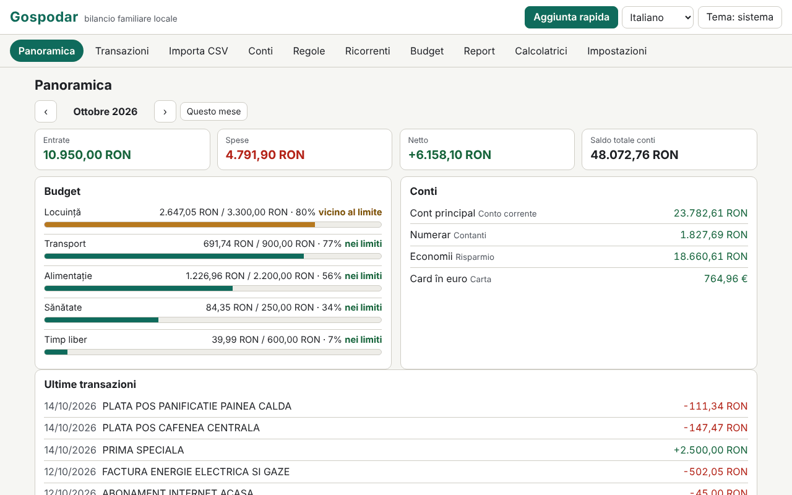

# Gospodar

[English](README.md) · [Română](README.ro.md) · [Français](README.fr.md) · **Italiano** · [Español](README.es.md) · [Português](README.pt.md) · [Deutsch](README.de.md) · [Magyar](README.hu.md)

**Versione:** 1.0.0 · **Ultimo aggiornamento:** 2026-10-14

Lingue dell'interfaccia: **Română, English, Français, Italiano, Español, Português (PT), Deutsch, Magyar**

Gospodar è un budget familiare che funziona in locale, in un unico file HTML, senza account e senza sincronizzazione. Gestisce conti (conto corrente, contanti, carta, risparmi), categorie con sottocategorie (set predefinito romeno, modificabile), transazioni con etichette e note, trasferimenti tra conti e importi in più valute con tassi inseriti manualmente. Importa estratti conto CSV tramite una procedura guidata di mappatura delle colonne, applica regole di categorizzazione, tiene traccia delle transazioni ricorrenti e dei budget mensili, produce report (grafici SVG) e include sei calcolatori con formule trasparenti. I dati sono sensibili e restano in questo browser; la cifratura con password del set salvato è facoltativa.

**App online:** https://chiuta.github.io/apps/Gospodar/

## Come si usa

- **Per iniziare:** «Carica esempio» (dati dimostrativi, con tassi di esempio, non reali) oppure «Aggiungi conto». La valuta di base è per impostazione predefinita il RON (Conti › Valute e tassi).
- **Transazioni:** data, tipo (spesa/entrata) e importo (puoi scrivere anche `-50` o `+50`), descrizione, categoria (o «automatica, tramite regole»), conto, etichette, nota. Filtri (testo, conto, categoria, tipo, intervallo, etichetta), selezione multipla, esportazione CSV. **Aggiunta rapida:** il tasto `n` (o il pulsante) apre un modulo in cui Invio salva e resti per la transazione successiva.
- **Trasferimenti:** tra due conti; se le valute differiscono, l'importo in entrata viene proposto in base al tasso inserito e puoi correggerlo. Un trasferimento non rientra nelle entrate/spese.
- **Importazione CSV:** scegli il file (o incolli il testo) e il conto di destinazione. L'applicazione rileva il separatore (`,` `;` tab), la codifica (UTF-8 / Windows-1250 tramite `TextDecoder`; puoi forzare anche Windows-1252, ISO-8859-2, UTF-16), le righe di preambolo, l'intestazione, il formato numerico (`1.234,56` vs `1,234.56`) e il formato della data (`gg.mm.aaaa`, `aaaa-mm-gg`, `mm/gg/aaaa`, `gg/mm/aaaa`, `gg-mm-aaaa`, `aaaa/mm/gg`, `gg.mm.aa`, `aaaammgg`), poi ipotizza la mappatura. Tu confermi: data, importo con segno **oppure** dare/avere separati, descrizione (fino a due colonne), saldo (solo verifica di coerenza). L'anteprima mostra ogni riga con il suo stato (OK / errore / duplicato) e quante righe saranno categorizzate automaticamente. Le importazioni possono essere annullate per lotti.
- **Profili di importazione:** il nome + la tua mappatura (colonne per nome dell'intestazione o posizione, separatore, codifica, formati). Un profilo è solo una tua impostazione; **non è un formato ufficiale di alcuna banca** e l'applicazione non pretende il contrario.
- **Duplicati:** la chiave è data + importo + descrizione normalizzata (senza segni diacritici e maiuscole, senza simboli). Le righe identiche legittime dello stesso giorno (ad es. due prelievi uguali) vengono contate: alla reimportazione, una riga è un duplicato solo se esistono già altrettanti esemplari.
- **Regole di categorizzazione:** «contiene» (termini separati da `;`, senza distinzione dei segni diacritici) oppure espressione regolare, più importo compreso tra (valore assoluto), tipo, conto, categoria assegnata ed etichette aggiunte. Vince la prima regola che corrisponde; l'ordine si cambia con ↑ ↓. Si applicano all'importazione, all'aggiunta rapida e su richiesta (alle non categorizzate o a tutte), con anteprima dell'effetto e annullamento.
- **Ricorrenti:** affitto, stipendio, abbonamenti (giornaliero/settimanale/mensile/annuale, intervallo, fine, sospensione). Le scadenze **non si registrano da sole**: un clic le registra. La proiezione per il mese successivo mostra le scadenze e il netto previsto.
- **Budget:** limite mensile per categoria (il budget di una categoria principale include le sottocategorie), barra di avanzamento, testo di stato (entro il limite / vicino al limite ≥ 80% / superato) e un elenco di avvisi.
- **Report:** spese per categoria, andamento mensile (12 mesi), flusso di cassa con il saldo totale a fine mese, principali esercenti, confronto mese su mese, saldo per conto; ogni grafico ha un titolo, una descrizione e una tabella. **Stampa del report mensile** (CSS di stampa).
- **Calcolatori:** rata del prestito (annualità e quote capitale costanti, grafico e piano di ammortamento completo), interesse composto con versamenti mensili, obiettivo di risparmio, adeguamento all'inflazione (il tasso lo inserisci tu), IVA (aggiunta/scorporo, aliquota inserita da te), conversione valutaria (il tasso lo inserisci tu). Ognuno mostra le formule, i passaggi con i tuoi valori, le ipotesi e l'avviso che i risultati sono indicativi.
- **Impostazioni:** lingua, tema, esportazione/importazione `.fff.json` (non cifrato o cifrato con password), esportazione CSV, cifratura, blocco automatico, «Elimina tutto».

## Cosa NON fa e i suoi limiti

- **Non fornisce consulenza finanziaria, di investimento o fiscale.** I calcolatori sono indicativi e mostrano le ipotesi; non calcolano il TAEG e non includono commissioni, assicurazioni o imposte.
- **Non scarica i tassi di cambio** e non sincronizza nulla. I tassi sono quelli che hai inserito; i report e i totali convertono con i tassi *correnti* della tabella, non con quelli storici. Le transazioni in valute senza tasso inserito sono escluse dai totali, con un avviso.
- Entrata/spesa si stabiliscono in base alla natura della categoria (per quelle non categorizzate, in base al segno); i rimborsi in una categoria di spesa riducono la spesa di quella categoria. I trasferimenti sono esclusi.
- Gli importi sono numeri interi in sottounità (centesimi), con `BigInt` per i prodotti e le conversioni; l'arrotondamento è «metà verso l'alto» e viene effettuato una sola volta per operazione (per prestito/interessi, a ogni periodo, come mostrato). Le valute con precisione diversa da 2 decimali sono note solo per JPY, KRW (0) e BHD, KWD (3).
- I formati di data con i nomi dei mesi in lettere non sono riconosciuti all'importazione. Un CSV con più conti o valute in un solo file viene importato in un unico conto scelto.
- Le espressioni regolari sono filtrate: vengono respinti i riferimenti all'indietro, lookahead/lookbehind, i gruppi ripetuti che contengono ripetizioni o alternanze (ad es. `(a+)+`) e le espressioni oltre i 200 caratteri; poi ogni espressione viene testata in un Worker con un limite di 300 ms. In fase di applicazione il calcolo ha un budget di 3 s e si ferma con un avviso. L'euristica può respingere anche espressioni innocue della forma `(foo|bar)+`; puoi riscriverle come `(?:…)` senza ripetizione o con più regole.
- I principali esercenti sono raggruppati in modo euristico in base alle prime parole della descrizione: approssimativo.
- L'archiviazione è `localStorage` (limite di alcuni MB; 20.000 transazioni occupano ≈ 1,6 MB). Se lo spazio si esaurisce o l'archiviazione è bloccata, l'applicazione avverte in modo visibile che le ultime modifiche non sono state salvate. La cancellazione dei dati del sito o una password persa significa dati persi: conserva delle esportazioni.
- L'importazione di un `.fff.json` sostituisce il set corrente (non lo unisce).

## Privacy

Funziona in locale e non invia nulla. Non ci sono analytics, cookie o richieste di rete (`connect-src 'none'`). I dati risiedono in `localStorage` con il prefisso `fff.gospodar.`: `data` (il set di dati, in chiaro, oppure assente se cifrato), `enc` (il set cifrato), `lang`, `theme`.

**Cifratura facoltativa:** il set salvato viene cifrato con AES-GCM a 256 bit (Web Crypto); la chiave deriva dalla password tramite PBKDF2-SHA256 con 600.000 iterazioni (≥ 310.000), un salt casuale di 16 byte e un nuovo IV a ogni salvataggio. La password non viene memorizzata. All'attivazione, la copia in chiaro viene cancellata dal browser. **Se perdi la password, i dati cifrati sono persi definitivamente; non esiste alcun recupero.** I dati non cifrati saranno comunque nella memoria della pagina finché l'applicazione è sbloccata; il blocco (manuale o automatico) li rimuove dalla pagina. Le esportazioni `.fff.json` non cifrate contengono tutto ciò che hai inserito; esiste anche l'esportazione cifrata con password.

## Formati

- **Importazione:** CSV/TSV/testo, UTF-8 (con o senza BOM), Windows-1250, Windows-1252, ISO-8859-2, UTF-16 LE; campi tra virgolette (inclusi `""` e a capo nel campo), terminatori CRLF o LF.
- **Esportazione:** CSV (`date, amount, currency, description, category, account, tags, note, transfer`; stile standard `,` e `.` oppure Excel regionale `;` e `,`; i valori che potrebbero essere scambiati per formule sono preceduti da un apostrofo) e `.fff.json`:
  `{"format":"fff-bundle","schema":1,"app":"gospodar","version":"1.0.0","updated":"2026-10-14","exported":"…","data":{"fff.gospodar.data":"<set de date JSON>","fff.gospodar.lang":"ro"}}`.
  La variante cifrata: `{"format":"fff-bundle-enc","schema":1,"app":"gospodar",…,"kdf":"PBKDF2-SHA256","iter":600000,"salt":…,"iv":…,"ct":…}`, dove il testo in chiaro è l'intero pacchetto qui sopra.

## Aspetti tecnici

- Un unico `index.html` (HTML, CSS e JS inline), senza librerie, senza `eval`, senza gestori inline. CSP: la formula standard del catalogo (`default-src 'none'; script-src 'sha256-…'; style-src 'unsafe-inline'; … worker-src blob:; connect-src 'none'`), senza deviazioni. `worker-src blob:` serve al test dei tempi delle espressioni regolari (Worker da Blob) e ai download generati in locale; `style-src 'unsafe-inline'` serve alle larghezze delle barre di avanzamento.
- I calcoli di prestito/interessi usano la virgola fissa a 40 cifre con `BigInt`; annualità = P·r·(1+r)ⁿ/((1+r)ⁿ−1), con l'interesse mensile arrotondato a ogni periodo e l'ultima rata aggiustata.
- Regole di memorizzazione compatta: le transazioni vengono salvate come array, in modo che 20.000 righe stiano comodamente in `localStorage`.
- Test: `node tests/test.mjs` (Playwright, Chromium, rete bloccata). Copertura: calcoli esatti (rate del prestito, interesse composto, obiettivo, inflazione, IVA e cambio confrontati con un oracolo indipendente scritto in Python con razionali esatti (`fractions`), `tests/gen_oracle.py` → `tests/oracle.json`), importazioni CSV realistiche scritte nel test (segni diacritici, preambolo, dare/avere, UTF-8/BOM, tab, Windows-1250, formati numerici e di data diversi, righe non valide), duplicati e annullamento dell'importazione, profili, regole (comprese espressioni pericolose respinte), multivaluta e trasferimenti, aggiunta rapida da tastiera, budget, ricorrenti (mesi brevi, anno bisestile), report e stampa, cifratura/decifratura (nulla in chiaro in `localStorage`, password errata, cambio, disattivazione), esportazione/importazione, 20.000 transazioni, 8 lingue, axe-core 0 violazioni (inclusi dialoghi, tema chiaro e scuro), nessun overflow a 360×740 e 1280×800, tastiera, `prefers-reduced-motion`.

## Terze parti

Non contiene codice di terze parti. Nei test si usano Playwright e axe-core (axe-core iniettato solo nei test).

## Traduzioni

Il romeno è la lingua di riferimento. L'inglese è stato scritto insieme al romeno, ma non è stato verificato da un madrelingua; **francese, italiano, spagnolo, portoghese, ungherese e tedesco sono traduzioni automatiche, non verificate da madrelingua.** Le correzioni sono benvenute. Le categorie predefinite e i dati dimostrativi restano in romeno (sono dati, modificabili).

## Licenza

MIT — vedi il file `LICENSE` nella radice del repository.

## Cronologia

- 1.0.0 — 2026-10-14: prima versione.
