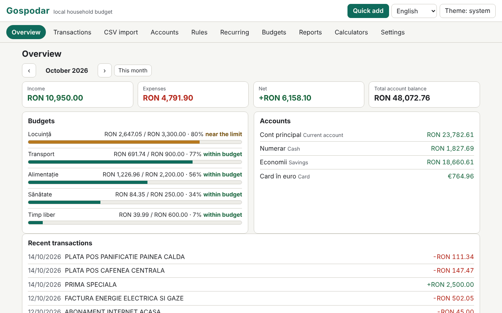

# Gospodar

**English** · [Română](README.ro.md) · [Français](README.fr.md) · [Italiano](README.it.md) · [Español](README.es.md) · [Português](README.pt.md) · [Deutsch](README.de.md) · [Magyar](README.hu.md)

**Version:** 1.0.0 · **Last updated:** 2026-10-14

Interface languages: **Română, English, Français, Italiano, Español, Português (PT), Deutsch, Magyar**

Gospodar is a household budget that runs locally, in a single HTML file, with no account and no sync. It keeps accounts (current account, cash, card, savings), categories with subcategories (a default Romanian set, editable), transactions with tags and notes, transfers between accounts and amounts in several currencies with manually entered exchange rates. It imports CSV statements through a column-mapping wizard, applies categorisation rules, tracks recurring transactions and monthly budgets, produces reports (SVG charts) and includes six calculators with transparent formulas. The data is sensitive and stays in this browser; password encryption of the saved set is optional.

**Live app:** https://chiuta.github.io/apps/Gospodar/

## How to use

- **Getting started:** "Load example" (demo data, with sample exchange rates, not real ones) or "Add account". The base currency is RON by default (Accounts › Currencies and rates).
- **Transactions:** date, type (expense/income) and amount (you can also type `-50` or `+50`), description, category (or "automatic, by rules"), account, tags, note. Filters (text, account, category, type, range, tag), bulk selection, CSV export. **Quick add:** the `n` key (or the button) opens a form where Enter saves and you stay for the next transaction.
- **Transfers:** between two accounts; if the currencies differ, the incoming amount is proposed from the exchange rate you entered and you can correct it. A transfer does not count towards income/expenses.
- **CSV import:** you choose the file (or paste the text) and the target account. The app detects the separator (`,` `;` tab), the encoding (UTF-8 / Windows-1250 via `TextDecoder`; you can also force Windows-1252, ISO-8859-2, UTF-16), the preamble lines, the header, the number format (`1.234,56` vs `1,234.56`) and the date format (`dd.mm.yyyy`, `yyyy-mm-dd`, `mm/dd/yyyy`, `dd/mm/yyyy`, `dd-mm-yyyy`, `yyyy/mm/dd`, `dd.mm.yy`, `yyyymmdd`), then guesses the mapping. You confirm: date, signed amount **or** separate debit/credit, description (up to two columns), balance (consistency check only). The preview shows each row with its status (OK / error / duplicate) and how many rows will be categorised automatically. Imports can be undone by batch.
- **Import profiles:** the name + your mapping (columns by header name or position, separator, encoding, formats). A profile is just your own setting; **it is not an official format of any bank** and the app does not claim otherwise.
- **Duplicates:** the key is date + amount + normalised description (without diacritics and capitals, without signs). Legitimate identical rows within the same day (e.g. two equal withdrawals) are counted: on re-import, a row is a duplicate only if as many copies already exist.
- **Categorisation rules:** "contains" (terms separated by `;`, diacritics-insensitive) or a regular expression, plus amount between (absolute value), type, account, assigned category and added tags. The first rule that matches wins; the order is changed with ↑ ↓. They are applied on import, on quick add and on demand (to uncategorised or to all), with a preview of the effect and undo.
- **Recurring:** rent, salary, subscriptions (daily/weekly/monthly/yearly, interval, end, pause). Due items are **not recorded automatically**: one click records them. The projection for the next month shows the due items and the projected net.
- **Budgets:** monthly limit per category (a main category's budget includes its subcategories), progress bar, status text (within limit / near limit ≥ 80% / exceeded) and a list of warnings.
- **Reports:** expenses by category, monthly trend (12 months), cash flow with the total balance at month end, top merchants, month-over-month comparison, balance per account; each chart has a title, a description and a table. **Print monthly report** (print CSS).
- **Calculators:** loan payment (annuity and equal principal instalments, chart and full amortisation schedule), compound interest with monthly deposits, savings goal, inflation adjustment (you enter the rate), VAT (add/remove, rate entered by you), currency conversion (you enter the rate). Each shows the formulas, the steps with your values, the assumptions and the warning that results are indicative.
- **Settings:** language, theme, `.fff.json` export/import (unencrypted or password-encrypted), CSV export, encryption, auto-lock, "Delete all".

## What it does NOT do, and its limits

- **It gives no financial, investment or tax advice.** The calculators are indicative and display their assumptions; they do not compute APR/APRC and do not include fees, insurance or taxes.
- **It does not download exchange rates** and does not sync anything. The rates are the ones you entered; reports and totals convert using the *current* rates in the table, not historical ones. Transactions in currencies without an entered rate are excluded from totals, with a warning.
- Income/expense is determined by the nature of the category (uncategorised ones, by sign); refunds within an expense category reduce that category's expense. Transfers are excluded.
- Amounts are integers in subunits (cents), with `BigInt` for products and conversions; rounding is "half up" and is done only once per operation (for loans/interest, at each period, as displayed). Currencies with a precision other than 2 decimals are known only for JPY, KRW (0) and BHD, KWD (3).
- Date formats with month names in letters are not recognised on import. A CSV with several accounts or currencies in one file is imported into a single chosen account.
- Regular expressions are filtered: back-references, lookahead/lookbehind, repeated groups containing repetitions or alternations (e.g. `(a+)+`) and expressions over 200 characters are rejected; then each expression is tested in a Worker with a 300 ms limit. When applied, the computation has a 3 s budget and stops with a warning. The heuristic may also reject harmless expressions of the form `(foo|bar)+`; you can rewrite them as `(?:…)` without repetition or with several rules.
- The top merchants are grouped heuristically by the first words of the description: approximate.
- Storage is `localStorage` (limit of a few MB; 20,000 transactions take up ≈ 1.6 MB). If space runs out or storage is blocked, the app visibly warns that the latest changes were not saved. Clearing the site's data or a lost password means lost data: keep exports.
- Importing a `.fff.json` replaces the current set (it does not merge it).

## Privacy

It runs locally and sends nothing. There are no analytics, cookies or network requests (`connect-src 'none'`). The data is kept in `localStorage` under the prefix `fff.gospodar.`: `data` (the dataset, in clear text, or absent if encrypted), `enc` (the encrypted set), `lang`, `theme`.

**Optional encryption:** the saved set is encrypted with 256-bit AES-GCM (Web Crypto); the key is derived from the password via PBKDF2-SHA256 with 600,000 iterations (≥ 310,000), a random 16-byte salt and a fresh IV on every save. The password is not stored. On activation, the clear-text copy is erased from the browser. **If you lose the password, the encrypted data is lost permanently; there is no recovery.** Unencrypted data will nevertheless be in the page's memory while the app is unlocked; locking (manual or automatic) removes it from the page. Unencrypted `.fff.json` exports contain everything you entered; there is also a password-encrypted export.

## Formats

- **Import:** CSV/TSV/text, UTF-8 (with or without BOM), Windows-1250, Windows-1252, ISO-8859-2, UTF-16 LE; quoted fields (including `""` and line breaks inside a field), CRLF or LF terminators.
- **Export:** CSV (`date, amount, currency, description, category, account, tags, note, transfer`; standard style `,` and `.` or regional Excel `;` and `,`; values that could be mistaken for formulas are prefixed with an apostrophe) and `.fff.json`:
  `{"format":"fff-bundle","schema":1,"app":"gospodar","version":"1.0.0","updated":"2026-10-14","exported":"…","data":{"fff.gospodar.data":"<set de date JSON>","fff.gospodar.lang":"ro"}}`.
  The encrypted variant: `{"format":"fff-bundle-enc","schema":1,"app":"gospodar",…,"kdf":"PBKDF2-SHA256","iter":600000,"salt":…,"iv":…,"ct":…}`, where the plaintext is the entire bundle above.

## Technical

- A single `index.html` (inline HTML, CSS and JS), no libraries, no `eval`, no inline handlers. CSP: the catalogue's standard formula (`default-src 'none'; script-src 'sha256-…'; style-src 'unsafe-inline'; … worker-src blob:; connect-src 'none'`), with no deviations. `worker-src blob:` serves the regular-expression timing test (Worker from a Blob) and locally generated downloads; `style-src 'unsafe-inline'` serves the widths of the progress bars.
- The loan/interest calculations use 40-digit fixed-point arithmetic with `BigInt`; annuity = P·r·(1+r)ⁿ/((1+r)ⁿ−1), with the monthly interest rounded at each period and the last instalment adjusted.
- Compact storage rules: transactions are saved as arrays, so that 20,000 rows fit comfortably in `localStorage`.
- Tests: `node tests/test.mjs` (Playwright, Chromium, network blocked). Coverage: exact calculations (loan instalments, compound interest, goal, inflation, VAT and FX compared with an independent oracle written in Python with exact rationals (`fractions`), `tests/gen_oracle.py` → `tests/oracle.json`), realistic CSV imports written in the test (diacritics, preamble, debit/credit, UTF-8/BOM, tab, Windows-1250, different number and date formats, invalid rows), duplicates and import undo, profiles, rules (including dangerous expressions rejected), multi-currency and transfers, quick add from the keyboard, budgets, recurring (short months, leap year), reports and printing, encryption/decryption (nothing in clear text in `localStorage`, wrong password, change, disabling), export/import, 20,000 transactions, 8 languages, axe-core 0 violations (including dialogs, light and dark theme), no overflow at 360×740 and 1280×800, keyboard, `prefers-reduced-motion`.

## Third parties

It contains no third-party code. Playwright and axe-core are used in the tests (axe-core injected only in the tests).

## Translations

Romanian is the reference language. English was written together with Romanian, but has not been verified by a native speaker; **French, Italian, Spanish, Portuguese, Hungarian and German are machine translations, not verified by native speakers.** Corrections are welcome. The default categories and the demo data remain in Romanian (they are data, editable).

## License

MIT — see the `LICENSE` file at the repository root.

## History

- 1.0.0 — 2026-10-14: first release.
