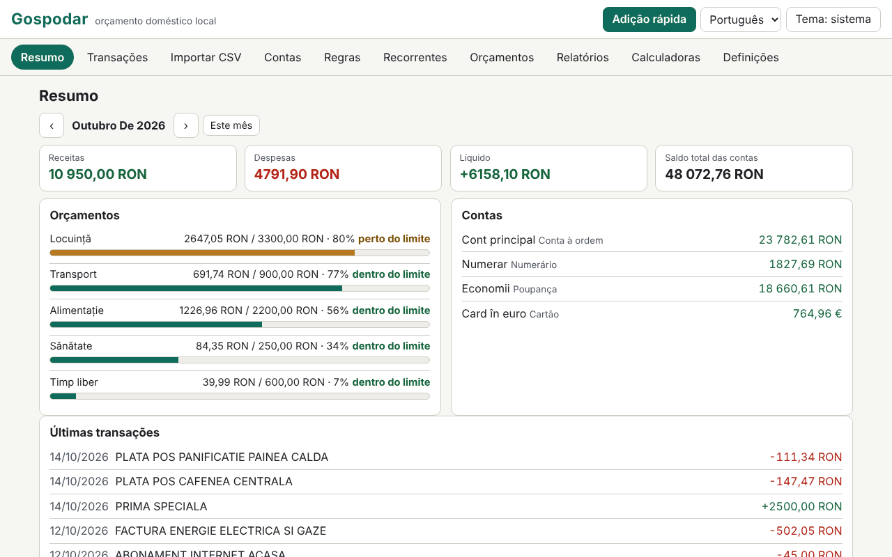

# Gospodar

[English](README.md) · [Română](README.ro.md) · [Français](README.fr.md) · [Italiano](README.it.md) · [Español](README.es.md) · **Português** · [Deutsch](README.de.md) · [Magyar](README.hu.md)

**Versão:** 1.0.0 · **Última atualização:** 2026-10-14

Idiomas da interface: **Română, English, Français, Italiano, Español, Português (PT), Deutsch, Magyar**

O Gospodar é um orçamento doméstico que funciona localmente, num único ficheiro HTML, sem conta e sem sincronização. Gere contas (conta corrente, numerário, cartão, poupanças), categorias com subcategorias (conjunto predefinido romeno, editável), transações com etiquetas e notas, transferências entre contas e montantes em várias moedas com taxas de câmbio introduzidas manualmente. Importa extratos CSV através de um assistente de mapeamento de colunas, aplica regras de categorização, acompanha transações recorrentes e orçamentos mensais, produz relatórios (gráficos SVG) e inclui seis calculadoras com fórmulas transparentes. Os dados são sensíveis e permanecem neste navegador; a cifragem com palavra-passe do conjunto guardado é opcional.

**Aplicação online:** https://chiuta.github.io/apps/Gospodar/

## Como se utiliza

- **Início:** «Carregar exemplo» (dados de demonstração, com taxas de exemplo, não reais) ou «Adicionar conta». A moeda de base é por predefinição o RON (Contas › Moedas e taxas).
- **Transações:** data, tipo (despesa/receita) e montante (pode também escrever `-50` ou `+50`), descrição, categoria (ou «automática, por regras»), conta, etiquetas, nota. Filtros (texto, conta, categoria, tipo, intervalo, etiqueta), seleção em massa, exportação CSV. **Adição rápida:** a tecla `n` (ou o botão) abre um formulário em que Enter guarda e fica para a transação seguinte.
- **Transferências:** entre duas contas; se as moedas diferirem, o montante recebido é proposto a partir da taxa introduzida e pode corrigi-lo. Uma transferência não conta como receita/despesa.
- **Importação CSV:** escolhe o ficheiro (ou cola o texto) e a conta de destino. A aplicação deteta o separador (`,` `;` tabulação), a codificação (UTF-8 / Windows-1250 através de `TextDecoder`; pode também forçar Windows-1252, ISO-8859-2, UTF-16), as linhas de preâmbulo, o cabeçalho, o formato numérico (`1.234,56` vs `1,234.56`) e o formato da data (`dd.mm.aaaa`, `aaaa-mm-dd`, `mm/dd/aaaa`, `dd/mm/aaaa`, `dd-mm-aaaa`, `aaaa/mm/dd`, `dd.mm.aa`, `aaaammdd`), e depois adivinha o mapeamento. Confirma: data, montante com sinal **ou** débito/crédito separados, descrição (até duas colunas), saldo (apenas verificação de coerência). A pré-visualização mostra cada linha com o seu estado (OK / erro / duplicado) e quantas linhas serão categorizadas automaticamente. As importações podem ser anuladas por lotes.
- **Perfis de importação:** o nome + o seu mapeamento (colunas por nome de cabeçalho ou posição, separador, codificação, formatos). Um perfil é apenas uma definição sua; **não é um formato oficial de qualquer banco** e a aplicação não o pretende.
- **Duplicados:** a chave é data + montante + descrição normalizada (sem diacríticos e maiúsculas, sem sinais). As linhas idênticas legítimas do mesmo dia (p. ex. dois levantamentos iguais) são contadas: na reimportação, uma linha é duplicada apenas se já existirem tantos exemplares.
- **Regras de categorização:** «contém» (termos separados por `;`, sem distinção de diacríticos) ou expressão regular, mais montante entre (valor absoluto), tipo, conta, categoria atribuída e etiquetas adicionadas. Ganha a primeira regra que corresponde; a ordem altera-se com ↑ ↓. Aplicam-se na importação, na adição rápida e a pedido (às não categorizadas ou a todas), com pré-visualização do efeito e anulação.
- **Recorrentes:** renda, salário, subscrições (diária/semanal/mensal/anual, intervalo, fim, suspensão). Os vencimentos **não se registam sozinhos**: um clique regista-os. A projeção para o mês seguinte mostra os vencimentos e o saldo líquido projetado.
- **Orçamentos:** limite mensal por categoria (o orçamento de uma categoria principal inclui as subcategorias), barra de progresso, texto de estado (dentro do limite / perto do limite ≥ 80% / excedido) e uma lista de avisos.
- **Relatórios:** despesas por categoria, evolução mensal (12 meses), fluxo de caixa com o saldo total no fim do mês, principais comerciantes, comparação mês a mês, saldo por conta; cada gráfico tem título, descrição e tabela. **Impressão do relatório mensal** (CSS de impressão).
- **Calculadoras:** prestação de empréstimo (anuidade e amortizações de capital constantes, gráfico e mapa de amortização completo), juro composto com depósitos mensais, objetivo de poupança, atualização pela inflação (a taxa é introduzida por si), IVA (adicionar/retirar, taxa introduzida por si), conversão cambial (a taxa é introduzida por si). Cada uma mostra as fórmulas, os passos com os seus valores, os pressupostos e o aviso de que os resultados são indicativos.
- **Definições:** idioma, tema, exportação/importação `.fff.json` (não cifrado ou cifrado com palavra-passe), exportação CSV, cifragem, bloqueio automático, «Apagar tudo».

## O que NÃO faz e os seus limites

- **Não dá aconselhamento financeiro, de investimento ou fiscal.** As calculadoras são indicativas e mostram os pressupostos; não calculam a TAEG e não incluem comissões, seguros ou impostos.
- **Não descarrega taxas de câmbio** e não sincroniza nada. As taxas são as que introduziu; os relatórios e totais convertem com as taxas *atuais* da tabela, não com as históricas. As transações em moedas sem taxa introduzida são excluídas dos totais, com um aviso.
- Receita/despesa determinam-se pela natureza da categoria (as não categorizadas, pelo sinal); os reembolsos numa categoria de despesa diminuem a despesa dessa categoria. As transferências são excluídas.
- Os montantes são números inteiros em subunidades (cêntimos), com `BigInt` nos produtos e conversões; o arredondamento é «meio para cima» e faz-se uma única vez por operação (em empréstimo/juro, a cada período, tal como apresentado). As moedas com precisão diferente de 2 casas decimais só são conhecidas para JPY, KRW (0) e BHD, KWD (3).
- Os formatos de data com nomes de meses por extenso não são reconhecidos na importação. Um CSV com várias contas ou moedas num único ficheiro é importado para uma única conta escolhida.
- As expressões regulares são filtradas: são rejeitadas as referências anteriores, lookahead/lookbehind, os grupos repetidos que contêm repetições ou alternâncias (p. ex. `(a+)+`) e as expressões com mais de 200 carateres; depois cada expressão é testada num Worker com um limite de 300 ms. Na aplicação, o cálculo tem um orçamento de 3 s e pára com um aviso. A heurística pode também rejeitar expressões inofensivas da forma `(foo|bar)+`; pode reescrevê-las como `(?:…)` sem repetição ou com várias regras.
- Os principais comerciantes são agrupados heuristicamente pelas primeiras palavras da descrição: aproximado.
- O armazenamento é `localStorage` (limite de alguns MB; 20 000 transações ocupam ≈ 1,6 MB). Se o espaço se esgotar ou o armazenamento estiver bloqueado, a aplicação avisa de forma visível que as últimas alterações não foram guardadas. Apagar os dados do sítio ou perder a palavra-passe significa perder os dados: mantenha exportações.
- A importação de um `.fff.json` substitui o conjunto atual (não o funde).

## Privacidade

Funciona localmente e não envia nada. Não há analytics, cookies nem pedidos de rede (`connect-src 'none'`). Os dados ficam em `localStorage` com o prefixo `fff.gospodar.`: `data` (o conjunto de dados, em claro, ou ausente se estiver cifrado), `enc` (o conjunto cifrado), `lang`, `theme`.

**Cifragem opcional:** o conjunto guardado é cifrado com AES-GCM de 256 bits (Web Crypto); a chave deriva da palavra-passe através de PBKDF2-SHA256 com 600 000 iterações (≥ 310 000), um sal aleatório de 16 bytes e um novo IV em cada gravação. A palavra-passe não é armazenada. Na ativação, a cópia em claro é apagada do navegador. **Se perder a palavra-passe, os dados cifrados perdem-se definitivamente; não existe recuperação.** Os dados não cifrados estarão, ainda assim, na memória da página enquanto a aplicação estiver desbloqueada; o bloqueio (manual ou automático) retira-os da página. As exportações `.fff.json` não cifradas contêm tudo o que introduziu; existe também a exportação cifrada com palavra-passe.

## Formatos

- **Importação:** CSV/TSV/texto, UTF-8 (com ou sem BOM), Windows-1250, Windows-1252, ISO-8859-2, UTF-16 LE; campos entre aspas (incluindo `""` e quebras de linha dentro de um campo), terminadores CRLF ou LF.
- **Exportação:** CSV (`date, amount, currency, description, category, account, tags, note, transfer`; estilo padrão `,` e `.` ou Excel regional `;` e `,`; os valores que possam ser confundidos com fórmulas levam um apóstrofo como prefixo) e `.fff.json`:
  `{"format":"fff-bundle","schema":1,"app":"gospodar","version":"1.0.0","updated":"2026-10-14","exported":"…","data":{"fff.gospodar.data":"<set de date JSON>","fff.gospodar.lang":"ro"}}`.
  A variante cifrada: `{"format":"fff-bundle-enc","schema":1,"app":"gospodar",…,"kdf":"PBKDF2-SHA256","iter":600000,"salt":…,"iv":…,"ct":…}`, em que o texto em claro é todo o pacote acima.

## Aspetos técnicos

- Um único `index.html` (HTML, CSS e JS inline), sem bibliotecas, sem `eval`, sem manipuladores inline. CSP: a fórmula padrão do catálogo (`default-src 'none'; script-src 'sha256-…'; style-src 'unsafe-inline'; … worker-src blob:; connect-src 'none'`), sem desvios. `worker-src blob:` serve o teste de tempo das expressões regulares (Worker a partir de um Blob) e as transferências geradas localmente; `style-src 'unsafe-inline'` serve as larguras das barras de progresso.
- Os cálculos de empréstimo/juro usam vírgula fixa de 40 dígitos com `BigInt`; anuidade = P·r·(1+r)ⁿ/((1+r)ⁿ−1), com o juro mensal arredondado a cada período e a última prestação ajustada.
- Regras de armazenamento compacto: as transações são guardadas como matrizes, para que 20 000 linhas caibam confortavelmente em `localStorage`.
- Testes: `node tests/test.mjs` (Playwright, Chromium, rede bloqueada). Cobertura: cálculos exatos (prestações de empréstimo, juro composto, objetivo, inflação, IVA e câmbio comparados com um oráculo independente escrito em Python com racionais exatos (`fractions`), `tests/gen_oracle.py` → `tests/oracle.json`), importações CSV realistas escritas no teste (diacríticos, preâmbulo, débito/crédito, UTF-8/BOM, tabulação, Windows-1250, diferentes formatos numéricos e de data, linhas inválidas), duplicados e anulação de importação, perfis, regras (incluindo expressões perigosas rejeitadas), multimoeda e transferências, adição rápida pelo teclado, orçamentos, recorrentes (meses curtos, ano bissexto), relatórios e impressão, cifragem/decifragem (nada em claro em `localStorage`, palavra-passe errada, alteração, desativação), exportação/importação, 20 000 transações, 8 idiomas, axe-core 0 violações (incluindo diálogos, tema claro e escuro), sem transbordo a 360×740 e 1280×800, teclado, `prefers-reduced-motion`.

## Terceiros

Não contém código de terceiros. Nos testes usam-se o Playwright e o axe-core (axe-core injetado apenas nos testes).

## Traduções

O romeno é a língua de referência. O inglês foi escrito em conjunto com o romeno, mas não foi verificado por um falante nativo; **o francês, o italiano, o espanhol, o português, o húngaro e o alemão são traduções automáticas, não verificadas por falantes nativos.** As correções são bem-vindas. As categorias predefinidas e os dados de demonstração permanecem em romeno (são dados, editáveis).

## Licença

MIT — ver o ficheiro `LICENSE` na raiz do repositório.

## Histórico

- 1.0.0 — 2026-10-14: primeira versão.
