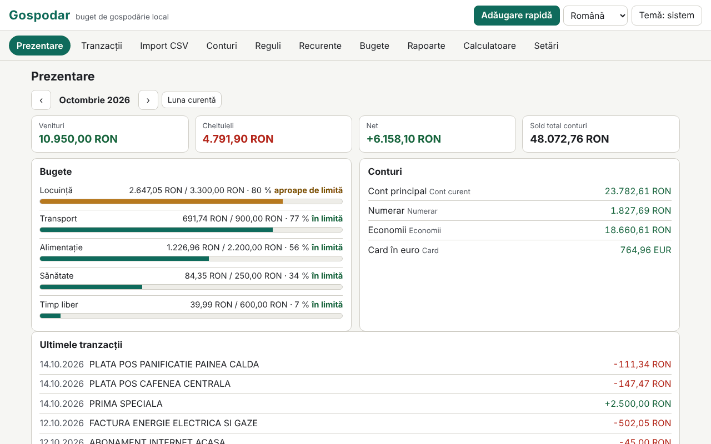

# Gospodar

[English](README.md) · **Română** · [Français](README.fr.md) · [Italiano](README.it.md) · [Español](README.es.md) · [Português](README.pt.md) · [Deutsch](README.de.md) · [Magyar](README.hu.md)

**Versiune:** 1.0.0 · **Ultima actualizare:** 2026-10-14

Limbile interfeței: **Română, English, Français, Italiano, Español, Português (PT), Deutsch, Magyar**

Gospodar este un buget de gospodărie care rulează local, într-un singur fișier HTML, fără cont și fără sincronizare. Ține conturi (cont curent, numerar, card, economii), categorii cu subcategorii (set implicit românesc, editabil), tranzacții cu etichete și note, transferuri între conturi și sume în mai multe monede cu cursuri introduse manual. Importă extrase CSV printr-un asistent de mapare a coloanelor, aplică reguli de categorizare, urmărește tranzacții recurente și bugete lunare, produce rapoarte (grafice SVG) și include șase calculatoare cu formule transparente. Datele sunt sensibile și rămân în acest browser; criptarea cu parolă a setului salvat este opțională.

**Live:** https://chiuta.github.io/apps/Gospodar/

## Cum se folosește

- **Început:** „Încarcă exemplu” (date demonstrative, cu cursuri de exemplu, nu reale) sau „Adaugă cont”. Moneda de bază este implicit RON (Conturi › Monede și cursuri).
- **Tranzacții:** dată, tip (cheltuială/venit) și sumă (poți scrie și `-50` sau `+50`), descriere, categorie (sau „automat, prin reguli”), cont, etichete, notă. Filtre (text, cont, categorie, tip, interval, etichetă), selecție în masă, export CSV. **Adăugare rapidă:** tasta `n` (sau butonul) deschide un formular în care Enter salvează și rămâi pentru următoarea tranzacție.
- **Transferuri:** între două conturi; dacă monedele diferă, suma intrată se propune din cursul introdus și o poți corecta. Un transfer nu intră în venituri/cheltuieli.
- **Import CSV:** alegi fișierul (sau lipești textul) și contul țintă. Aplicația detectează separatorul (`,` `;` tab), codarea (UTF-8 / Windows-1250 prin `TextDecoder`; poți forța și Windows-1252, ISO-8859-2, UTF-16), liniile de preambul, antetul, formatul numeric (`1.234,56` vs `1,234.56`) și formatul datei (`zz.ll.aaaa`, `aaaa-ll-zz`, `ll/zz/aaaa`, `zz/ll/aaaa`, `zz-ll-aaaa`, `aaaa/ll/zz`, `zz.ll.aa`, `aaaammzz`), apoi ghicește maparea. Tu confirmi: dată, sumă cu semn **sau** debit/credit separate, descriere (până la două coloane), sold (doar verificare de coerență). Previzualizarea arată fiecare rând cu starea lui (OK / eroare / duplicat) și câte rânduri vor fi categorizate automat. Importurile se pot anula pe loturi.
- **Profiluri de import:** numele + maparea ta (coloane după nume de antet sau poziție, separator, codare, formate). Un profil este doar setarea ta; **nu este un format oficial al vreunei bănci** și aplicația nu pretinde acest lucru.
- **Duplicate:** cheia este dată + sumă + descriere normalizată (fără diacritice și majuscule, fără semne). Rândurile identice legitime din aceeași zi (de ex. două retrageri egale) se numără: la reimport, un rând e duplicat doar dacă există deja tot atâtea exemplare.
- **Reguli de categorizare:** „conține” (termeni separați prin `;`, insensibil la diacritice) sau expresie regulată, plus sumă între (valoare absolută), tip, cont, categorie atribuită și etichete adăugate. Prima regulă care se potrivește câștigă; ordinea se schimbă cu ↑ ↓. Se aplică la import, la adăugarea rapidă și la cerere (pe necategorizate sau pe toate), cu previzualizare a efectului și anulare.
- **Recurente:** chirie, salariu, abonamente (zilnic/săptămânal/lunar/anual, interval, sfârșit, suspendare). Scadențele **nu se înregistrează singure**: un clic le înregistrează. Proiecția pentru luna următoare arată scadențele și netul proiectat.
- **Bugete:** limită lunară pe categorie (bugetul unei categorii principale include subcategoriile), bară de progres, text de stare (în limită / aproape de limită ≥ 80 % / depășit) și o listă de avertizări.
- **Rapoarte:** cheltuieli pe categorii, evoluție lunară (12 luni), flux de numerar cu soldul total la sfârșit de lună, top comercianți, comparație lună cu lună, sold pe cont; fiecare grafic are titlu, descriere și tabel. **Tipărire raport lunar** (CSS de tipărire).
- **Calculatoare:** rată credit (anuitate și rate egale de principal, grafic și grafic complet de amortizare), dobândă compusă cu depuneri lunare, obiectiv de economisire, actualizare cu inflația (rata o introduci tu), TVA (adăugare/scoatere, cota introdusă de tine), conversie valutară (cursul îl introduci tu). Fiecare arată formulele, pașii cu valorile tale, ipotezele și avertismentul că rezultatele sunt orientative.
- **Setări:** limbă, temă, export/import `.fff.json` (necriptat sau criptat cu parolă), export CSV, criptare, blocare automată, „Șterge tot”.

## Ce NU face și limitele

- **Nu dă sfaturi financiare, de investiții sau fiscale.** Calculatoarele sunt orientative și afișează ipotezele; nu calculează DAE/TAEG și nu includ comisioane, asigurări sau impozite.
- **Nu descarcă cursuri valutare** și nu sincronizează nimic. Cursurile sunt cele introduse de tine; rapoartele și totalurile convertesc cu cursurile *curente* din tabel, nu cu cele istorice. Tranzacțiile în monede fără curs introdus sunt excluse din totaluri, cu avertisment.
- Venit/cheltuială se stabilesc după natura categoriei (cele necategorizate, după semn); rambursările dintr-o categorie de cheltuieli scad cheltuiala acelei categorii. Transferurile sunt excluse.
- Sumele sunt numere întregi în subunități (bani), cu `BigInt` la produse și conversii; rotunjirea este „jumătate în sus” și se face o singură dată per operație (la credit/dobândă, la fiecare perioadă, așa cum e afișat). Monedele cu altă precizie decât 2 zecimale sunt cunoscute doar pentru JPY, KRW (0) și BHD, KWD (3).
- Formatele de dată cu nume de lună în litere nu sunt recunoscute la import. Un CSV cu mai multe conturi sau monede într-un singur fișier se importă într-un singur cont ales.
- Expresiile regulate sunt filtrate: sunt respinse referințele înapoi, lookahead/lookbehind, grupurile repetate care conțin repetiții sau alternanțe (ex. `(a+)+`) și expresiile peste 200 de caractere; apoi fiecare expresie este testată într-un Worker cu limită de 300 ms. La aplicare, calculul are un buget de 3 s și se oprește cu avertisment. Euristica poate respinge și expresii inofensive de forma `(foo|bar)+`; poți rescrie ca `(?:…)` fără repetiție sau cu mai multe reguli.
- Comercianții din top sunt grupați euristic după primele cuvinte ale descrierii: aproximativ.
- Stocarea este `localStorage` (limită de câțiva MB; 20.000 de tranzacții ocupă ≈ 1,6 MB). Dacă spațiul se umple sau stocarea e blocată, aplicația avertizează vizibil că ultimele modificări nu s-au salvat. Ștergerea datelor site-ului sau o parolă pierdută înseamnă date pierdute: păstrează exporturi.
- Importul `.fff.json` înlocuiește setul curent (nu îl îmbină).

## Confidențialitate

Rulează local, nu trimite nimic. Nu există analitice, cookie-uri sau cereri de rețea (`connect-src 'none'`). Datele stau în `localStorage` sub prefixul `fff.gospodar.`: `data` (setul de date, în clar sau absent dacă e criptat), `enc` (setul criptat), `lang`, `theme`.

**Criptare opțională:** setul salvat se criptează cu AES-GCM pe 256 de biți (Web Crypto); cheia derivă din parolă prin PBKDF2-SHA256 cu 600.000 de iterații (≥ 310.000), sare aleatoare de 16 octeți și IV nou la fiecare salvare. Parola nu se stochează. La activare, copia în clar este ștearsă din browser. **Dacă pierzi parola, datele criptate sunt pierdute definitiv; nu există recuperare.** Datele necriptate vor fi totuși în memoria paginii cât timp aplicația e deblocată; blocarea (manuală sau automată) le scoate din pagină. Exporturile `.fff.json` necriptate conțin tot ce ai introdus; există și export criptat cu parolă.

## Formate

- **Import:** CSV/TSV/text, UTF-8 (cu sau fără BOM), Windows-1250, Windows-1252, ISO-8859-2, UTF-16 LE; câmpuri între ghilimele (inclusiv `""` și linii noi în câmp), terminatori CRLF sau LF.
- **Export:** CSV (`date, amount, currency, description, category, account, tags, note, transfer`; stil standard `,` și `.` sau Excel regional `;` și `,`; valorile care ar putea fi luate drept formule sunt prefixate cu apostrof) și `.fff.json`:
  `{"format":"fff-bundle","schema":1,"app":"gospodar","version":"1.0.0","updated":"2026-10-14","exported":"…","data":{"fff.gospodar.data":"<set de date JSON>","fff.gospodar.lang":"ro"}}`.
  Varianta criptată: `{"format":"fff-bundle-enc","schema":1,"app":"gospodar",…,"kdf":"PBKDF2-SHA256","iter":600000,"salt":…,"iv":…,"ct":…}`, unde textul clar este întregul pachet de mai sus.

## Tehnic

- Un singur `index.html` (HTML, CSS și JS inline), fără biblioteci, fără `eval`, fără handlere inline. CSP: formula standard a catalogului (`default-src 'none'; script-src 'sha256-…'; style-src 'unsafe-inline'; … worker-src blob:; connect-src 'none'`), fără abateri. `worker-src blob:` servește testul de timp al expresiilor regulate (Worker din Blob) și descărcările generate local; `style-src 'unsafe-inline'` servește lățimile barelor de progres.
- Calculele de credit/dobândă folosesc virgulă fixă pe 40 de cifre cu `BigInt`; anuitatea = P·r·(1+r)ⁿ/((1+r)ⁿ−1), cu dobânda lunară rotunjită la fiecare perioadă și ultima rată ajustată.
- Regulile de memorare compactă: tranzacțiile se salvează ca tablouri, ca 20.000 de rânduri să încapă confortabil în `localStorage`.
- Teste: `node tests/test.mjs` (Playwright, Chromium, rețea blocată). Acoperă: calcule exacte (rate credit, dobândă compusă, obiectiv, inflație, TVA și FX comparate cu un oracol independent scris în Python cu raționale exacte (`fractions`), `tests/gen_oracle.py` → `tests/oracle.json`), importuri CSV realiste scrise în test (diacritice, preambul, debit/credit, UTF-8/BOM, tab, Windows-1250, formate numerice și de dată diferite, rânduri invalide), duplicate și anulare de import, profiluri, reguli (inclusiv expresii periculoase respinse), multi-monedă și transferuri, adăugare rapidă din tastatură, bugete, recurente (luni scurte, an bisect), rapoarte și tipărire, criptare/decriptare (nimic în clar în `localStorage`, parolă greșită, schimbare, dezactivare), export/import, 20.000 de tranzacții, 8 limbi, axe-core 0 violări (inclusiv dialoguri, temă luminoasă și întunecată), fără depășire la 360×740 și 1280×800, tastatură, `prefers-reduced-motion`.

## Terți

Nu conține cod terț. În teste se folosesc Playwright și axe-core (injectat doar în teste).

## Traduceri

Româna este limba de referință. Engleza este scrisă împreună cu româna, dar nu este verificată de un vorbitor nativ; **franceza, italiana, spaniola, portugheza, maghiara și germana sunt traduceri automate, neverificate de vorbitori nativi.** Corecturile sunt binevenite. Categoriile implicite și datele demonstrative rămân în română (sunt date, editabile).

## Licență

MIT — vezi fișierul `LICENSE` din rădăcina depozitului.

## Istoric

- 1.0.0 — 2026-10-14: prima versiune.
