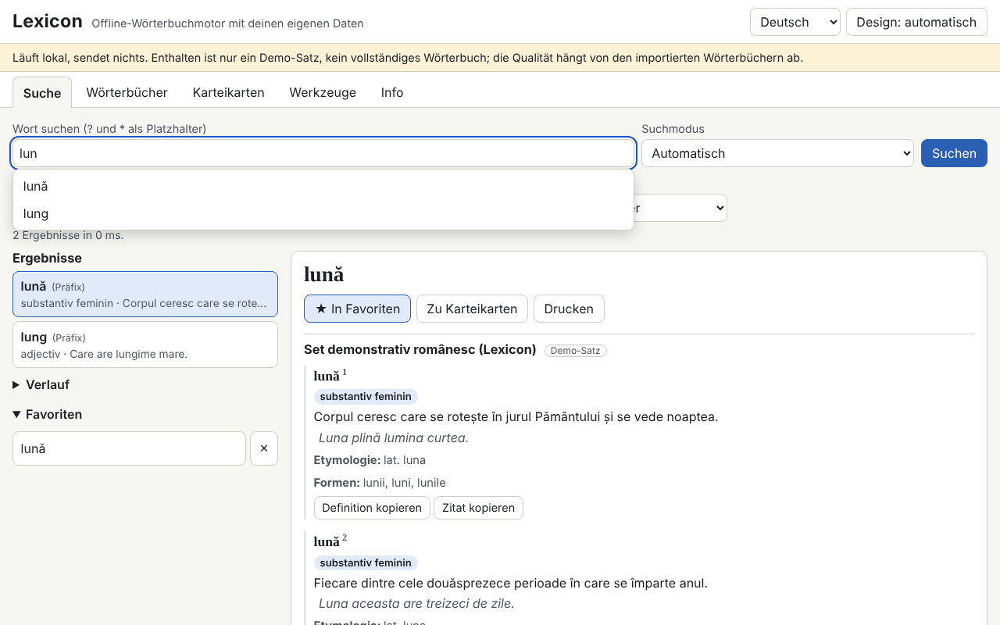

# Lexicon

[English](README.md) · [Română](README.ro.md) · [Français](README.fr.md) · [Italiano](README.it.md) · [Español](README.es.md) · [Português](README.pt.md) · **Deutsch** · [Magyar](README.hu.md)

**Version:** 1.0.6 · **Zuletzt aktualisiert:** 2026-10-26

Oberflächensprachen: **Română, English, Français, Italiano, Español, Português (PT), Deutsch, Magyar**

Lexicon ist eine Wörterbuch-Engine, die vollständig offline in einer einzigen HTML-Datei läuft. Sie enthält kein vollständiges Wörterbuch: Du bringst deine eigenen Wörterbücher mit (TSV/CSV, JSON, StarDict, dictd, XDXF), speicherst sie in IndexedDB und durchsuchst sie sofort: Präfix, exakt, ohne diakritische Zeichen, näherungsweise (Damerau–Levenshtein), Flexionsformen, Volltext in den Definitionen und Platzhalter (`?`, `*`). Es gibt Verlauf, Favoriten, Wort des Tages, Karteikarten mit verteilter Wiederholung, Export und Rechtschreibprüfung. Das mitgelieferte Set (345 originale Einträge auf Rumänisch) ist ein **Demo-Set, kein vollständiges Wörterbuch**.

**Online-App:** https://chiuta.github.io/apps/Lexicon/

## Anwendung
1. Öffne den Tab **Wörterbücher** und wähle die Dateien aus (mehrere können gleichzeitig importiert werden). Für TSV/CSV/JSON werden eine Vorschau und die Spaltenzuordnung angezeigt.
2. Fülle die Metadaten aus: Titel, Sprachen, Quelle und **Lizenz** (Pflichtfeld; ohne sie erscheint eine Warnung).
3. Aktiviere/deaktiviere die Wörterbücher und ändere die Anzeigereihenfolge.
4. Gib unter **Suche** das Wort ein: Die Vorschläge erscheinen in Echtzeit; `[[Wort]]` und interne Links in den Artikeln öffnen sich direkt. Tastenkürzel: `/` setzt den Cursor in das Suchfeld.
5. **Karteikarten** (vereinfachtes SM-2), **Werkzeuge** (Export der Favoriten als CSV/JSON/Markdown, Export der gesuchten Teilmenge, „Rechtschreibung eines Textes prüfen“, Sicherung als `.fff.json`, „Alles löschen“).

## Bring dein eigenes Wörterbuch mit
Der Ordner `exemple/` enthält `model.tsv` und `model.json` (Minimalformat: Wort, Definition, optional Formen, Kategorie, Beispiele, Etymologie).

**Prüfe die Lizenz jeder Quelle (zum Beispiel haben die von dexonline veröffentlichten Daten eigene Lizenz- und Namensnennungsbedingungen; ich habe die aktuellen Bedingungen nicht geprüft).** Die App enthält und lädt kein Wörterbuch mit unklarer Lizenz herunter; die Verantwortung für die importierten Daten liegt bei dir.

## Unterstützte Formate
- **TSV / CSV** mit Kopfzeile (Trennzeichen wird erkannt, Felder in Anführungszeichen, Kodierungen UTF-8, Windows-1250/1252, ISO-8859-2). Die Felder `forme` und `exemple` werden durch `|` getrennt.
- **JSON**: Liste von Objekten, Objekt Wort→Definition, Liste von Listen oder das native Format `lexicon-dict`.
- **StarDict**: `.ifo` + `.idx` (+ `.idx.gz`) + `.dict` oder `.dict.dz` (gzip/dictzip, über `DecompressionStream`), `.syn` (werden zu Formen), 32- oder 64-Bit-Offsets, `sametypesequence`.
- **dictd**: `.index` + `.dict` / `.dict.dz`, Offsets zur Basis 64.
- Einfaches **XDXF** (`<ar>`, `<k>`).

## Was es NICHT kann, und seine Grenzen
- Es hat keinen eigenen lexikografischen Inhalt außerhalb des Demo-Sets.
- Die Datei wird beim Import vollständig in den Arbeitsspeicher gelesen; sehr große Dateien (Hunderte MB) können den Speicher des Browsers überschreiten.
- Die Suche in den Definitionen durchläuft alle Einträge (ohne invertierten Index) und sortiert nicht nach Relevanz.
- Externe Links in den Artikeln sind nicht aktiv: Sie werden als Text mit der Adresse angezeigt.
- XDXF wird nur in der einfachen Form unterstützt; das HTML wird von einem eigenen Parser mit einer Liste erlaubter Tags bereinigt, sodass komplexe Formatierungen verloren gehen.
- Der Import von 300.000 Einträgen ist langsam (siehe unten); die Suche danach ist sofortig.
- Die Rechtschreibprüfung stützt sich nur auf die aktiven Wörterbücher (Wörter und Formen); sie führt keine grammatische Analyse durch.
- Ohne IndexedDB (privater Modus) bleiben die Daten nur im Arbeitsspeicher und gehen beim Neuladen verloren; die App warnt davor.

## Datenschutz
Es läuft lokal und sendet nichts. Es gibt keine Netzwerkanfragen (`connect-src 'none'`). Die Wörterbücher liegen in IndexedDB, Verlauf, Favoriten, Sprache und Design in `localStorage` (Schlüssel `fff.lexicon.*`). „Alles löschen“ entfernt alles.

## Gemessene Leistung (im Test, Chromium headless, ausgelasteter Rechner)
Synthetisches Set mit 300.000 Einträgen (32,8 MB TSV, 100.000 mit Formen):
- Import und Indexierung: 270–353 s (Schreiben in IndexedDB; hängt stark von der Rechnerauslastung ab);
- Echtzeit-Vorschläge: Mittelwert 0,02 ms, p95 0,1 ms, Maximum 4 ms (708 Abfragen; Ziel war unter 50 ms);
- exakt 0,4 ms, Präfix 0,2 ms, Platzhalter `*` am Anfang 37–427 ms, vollständige unscharfe Suche 49–464 ms, unscharfe Vorschläge ohne Präfix 0,2–1,9 s;
- Volltext in den Definitionen: 2–3 s (5,7 s ohne Treffer);
- Neuladen mit dem 300.000er-Set in IndexedDB: 150–250 ms; Heap etwa 141 MB.

## Technik
Eine einzige `index.html`, Inline-Skript mit Hash in der CSP (`script-src 'sha256-…'`, `default-src 'none'`, `connect-src 'none'`, keine Inline-Handler, kein `eval`; `worker-src blob:` ist aus der Vorlage geerbt). Index im Arbeitsspeicher (sortierte normalisierte Schlüssel, binäre Suche), IndexedDB für Einträge und Volltext. Der HTML-Inhalt durchläuft einen eigenen Parser und wird mit `createElement`/`textContent` aufgebaut. Erkennt optional `window.FFF`; funktioniert auch ohne vollständig. Tests: `node tests/test.mjs` (Playwright; 292 Prüfungen: StarDict-/dictd-Parsing mit im Test erzeugten Dateien, Abfragen, 28 XSS-Payloads, Persistenz, 300.000 Einträge, axe 0, Überlauf bei 360×740 und 1280×800). Die Variable `LEXICON_SKIP_PERF=1` überspringt den großen Test.

## Drittanbieter
Es gibt keinen Drittanbieter-Code in der App (axe-core wird nur in den Tests verwendet).

## Übersetzungen
Die Oberfläche ist auf Rumänisch (Standard), Englisch, Französisch, Italienisch, Spanisch, Portugiesisch, Ungarisch und Deutsch verfügbar. Die Übersetzungen fr/it/es/pt/hu/de sind automatisch und nicht von Muttersprachlern geprüft.

## Lizenz
MIT — siehe die Datei `LICENSE` im Stammverzeichnis des Repositorys.

## Verlauf
- 1.0.0 — 2026-10-14: erste Version.
- 1.0.1 — 2026-10-22: eine erfolglose Suche weist jetzt ausdrücklich darauf hin, dass der mitgelieferte Satz nur eine Demonstration ist (wenn der Demo-Satz aktiv ist); der CSV-Export entschärft Zellen, die mit = + - @ beginnen, gegen Formelinjektion, und der TSV/CSV-Import entfernt das Apostroph wieder; Touch-Ziele von mindestens 24 px; das technische Label listet alle 8 Sprachen.
- 1.0.2 — 2026-10-22: fff-kit 1.1.2: PBKDF2 mit 600.000 Iterationen, Schutz vor Clickjacking.
- 1.0.3 — 2026-10-22: fff-kit 1.1.4: Touch-Ziele und Mindestschriftgröße in der gemeinsamen Oberfläche.
- 1.0.5 — 2026-10-23: Hinweistext bei deaktiviertem JavaScript (noscript).
