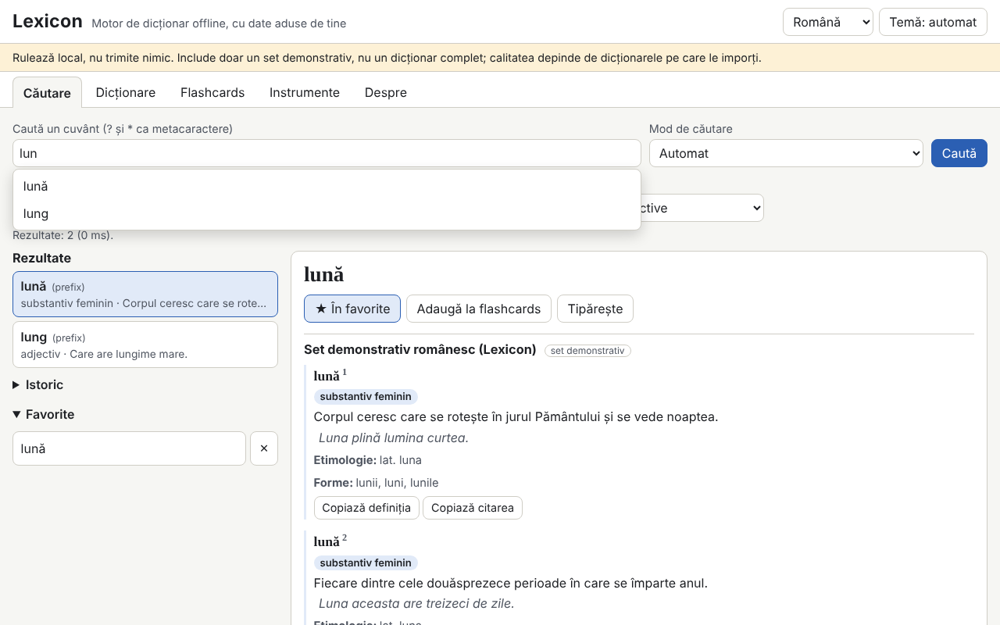

# Lexicon

[English](README.md) · [Română](README.ro.md) · [Français](README.fr.md) · [Italiano](README.it.md) · **Español** · [Português](README.pt.md) · [Deutsch](README.de.md) · [Magyar](README.hu.md)

**Versión:** 1.0.0 · **Última actualización:** 2026-10-14

Idiomas de la interfaz: **Română, English, Français, Italiano, Español, Português (PT), Deutsch, Magyar**

Lexicon es un motor de diccionario que funciona completamente sin conexión, en un único archivo HTML. No incluye un diccionario completo: tú aportas tus propios diccionarios (TSV/CSV, JSON, StarDict, dictd, XDXF), los guardas en IndexedDB y los consultas al instante: prefijo, exacto, sin diacríticos, aproximado (Damerau–Levenshtein), formas flexionadas, texto completo en las definiciones y comodines (`?`, `*`). Tiene historial, favoritos, palabra del día, tarjetas de estudio con repetición espaciada, exportación y corrección ortográfica. El conjunto incluido (345 entradas originales en rumano) es un **conjunto de demostración, no un diccionario completo**.

**Aplicación en línea:** https://chiuta.github.io/apps/Lexicon/

## Cómo se usa
1. Abre la pestaña **Diccionarios** y elige los archivos (se pueden importar varios a la vez). Para TSV/CSV/JSON se muestra una vista previa y la asignación de columnas.
2. Rellena los metadatos: título, idiomas, fuente y **licencia** (obligatoria; sin ella aparece una advertencia).
3. Activa/desactiva los diccionarios y cambia el orden de visualización.
4. En **Búsqueda**, escribe la palabra: las sugerencias aparecen en tiempo real; `[[palabra]]` y los enlaces internos de los artículos se abren directamente. Atajo: `/` coloca el cursor en el campo de búsqueda.
5. **Tarjetas de estudio** (SM-2 simplificado), **Herramientas** (exportar favoritos en CSV/JSON/Markdown, exportar el subconjunto buscado, «Comprobar la ortografía de un texto», copia de seguridad `.fff.json`, «Borrar todo»).

## Trae tu propio diccionario
La carpeta `exemple/` contiene `model.tsv` y `model.json` (formato mínimo: palabra, definición, opcionalmente formas, categoría, ejemplos, etimología).

**Comprueba la licencia de cada fuente (por ejemplo, los datos publicados por dexonline tienen sus propias condiciones de licencia y atribución; no he verificado las condiciones actuales).** La aplicación no incluye ni descarga ningún diccionario de licencia incierta; la responsabilidad sobre los datos importados es tuya.

## Formatos admitidos
- **TSV / CSV** con encabezado (delimitador detectado, campos entre comillas, codificaciones UTF-8, Windows-1250/1252, ISO-8859-2). Los campos `forme` y `exemple` se separan con `|`.
- **JSON**: lista de objetos, objeto palabra→definición, lista de listas o formato nativo `lexicon-dict`.
- **StarDict**: `.ifo` + `.idx` (+ `.idx.gz`) + `.dict` o `.dict.dz` (gzip/dictzip, mediante `DecompressionStream`), `.syn` (pasan a ser formas), desplazamientos de 32 o 64 bits, `sametypesequence`.
- **dictd**: `.index` + `.dict` / `.dict.dz`, desplazamientos en base 64.
- **XDXF** simple (`<ar>`, `<k>`).

## Lo que NO hace y sus límites
- No tiene contenido lexicográfico propio aparte del conjunto de demostración.
- El archivo se lee íntegramente en memoria al importar; los archivos muy grandes (cientos de MB) pueden superar la memoria del navegador.
- La búsqueda en las definiciones recorre todas las entradas (sin índice invertido) y no ordena por relevancia.
- Los enlaces externos de los artículos no están activos: se muestran como texto con la dirección.
- XDXF solo se admite en su forma simple; el HTML se depura con un analizador propio con una lista de etiquetas permitidas, por lo que los formatos complejos se pierden.
- La importación de 300 000 entradas es lenta (véase más abajo); la búsqueda posterior es instantánea.
- La corrección ortográfica se basa únicamente en los diccionarios activos (palabras y formas); no realiza análisis gramatical.
- Sin IndexedDB (modo privado) los datos permanecen solo en memoria y se pierden al recargar; la aplicación avisa.

## Privacidad
Funciona en local y no envía nada. No hay solicitudes de red (`connect-src 'none'`). Los diccionarios están en IndexedDB, mientras que el historial, los favoritos, el idioma y el tema están en `localStorage` (claves `fff.lexicon.*`). «Borrar todo» lo elimina todo.

## Rendimiento medido (en pruebas, Chromium headless, máquina cargada)
Conjunto sintético de 300 000 entradas (TSV de 32,8 MB, 100 000 con formas):
- importación e indexación: 270–353 s (escritura en IndexedDB; depende mucho de la carga de la máquina);
- sugerencias en tiempo real: media 0,02 ms, p95 0,1 ms, máximo 4 ms (708 consultas; el objetivo era menos de 50 ms);
- exacto 0,4 ms, prefijo 0,2 ms, comodín `*` al principio 37–427 ms, búsqueda difusa completa 49–464 ms, sugerencias difusas sin prefijo 0,2–1,9 s;
- texto completo en las definiciones: 2–3 s (5,7 s sin coincidencias);
- recarga con el conjunto de 300 000 en IndexedDB: 150–250 ms; heap de unos 141 MB.

## Aspectos técnicos
Un único `index.html`, script en línea con hash en la CSP (`script-src 'sha256-…'`, `default-src 'none'`, `connect-src 'none'`, sin controladores en línea, sin `eval`; `worker-src blob:` se hereda de la plantilla). Índice en memoria (claves normalizadas ordenadas, búsqueda binaria), IndexedDB para las entradas y el texto completo. El contenido HTML pasa por un analizador propio y se construye con `createElement`/`textContent`. Detecta opcionalmente `window.FFF`; funciona por completo también sin él. Pruebas: `node tests/test.mjs` (Playwright; 292 comprobaciones: análisis de StarDict/dictd con archivos generados en la prueba, consultas, 28 cargas XSS, persistencia, 300 000 entradas, axe 0, desbordamiento a 360×740 y 1280×800). La variable `LEXICON_SKIP_PERF=1` omite la prueba grande.

## Terceros
No hay código de terceros en la aplicación (axe-core se usa solo en las pruebas).

## Traducciones
La interfaz está en rumano (por defecto), inglés, francés, italiano, español, portugués, húngaro y alemán. Las traducciones fr/it/es/pt/hu/de son automáticas, no verificadas por hablantes nativos.

## Licencia
MIT — véase el archivo `LICENSE` en la raíz del repositorio.

## Historial
- 1.0.0 — 2026-10-14: primera versión.
