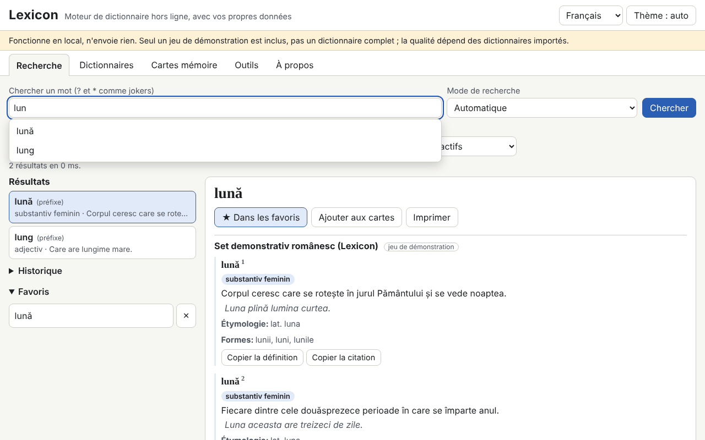

# Lexicon

[English](README.md) · [Română](README.ro.md) · **Français** · [Italiano](README.it.md) · [Español](README.es.md) · [Português](README.pt.md) · [Deutsch](README.de.md) · [Magyar](README.hu.md)

**Version :** 1.0.4 · **Dernière mise à jour :** 2026-10-23

Langues de l'interface : **Română, English, Français, Italiano, Español, Português (PT), Deutsch, Magyar**

Lexicon est un moteur de dictionnaire qui fonctionne entièrement hors ligne, dans un seul fichier HTML. Il n'inclut pas de dictionnaire complet : vous apportez vos propres dictionnaires (TSV/CSV, JSON, StarDict, dictd, XDXF), vous les conservez dans IndexedDB et vous les consultez instantanément : préfixe, exact, sans diacritiques, approximatif (Damerau–Levenshtein), formes fléchies, plein texte dans les définitions et jokers (`?`, `*`). Il propose historique, favoris, mot du jour, cartes mémoire avec répétition espacée, export et correction orthographique. Le jeu inclus (345 entrées originales en roumain) est un **jeu de démonstration, pas un dictionnaire complet**.

**Application en ligne :** https://chiuta.github.io/apps/Lexicon/

## Mode d'emploi
1. Ouvrez l'onglet **Dictionnaires** et choisissez les fichiers (plusieurs peuvent être importés à la fois). Pour TSV/CSV/JSON, un aperçu et l'association des colonnes sont affichés.
2. Renseignez les métadonnées : titre, langues, source et **licence** (obligatoire ; sans elle, un avertissement s'affiche).
3. Activez/désactivez les dictionnaires et modifiez l'ordre d'affichage.
4. Dans **Recherche**, saisissez le mot : les suggestions apparaissent en temps réel ; `[[mot]]` et les liens internes des articles s'ouvrent directement. Raccourci : `/` place le curseur dans le champ de recherche.
5. **Cartes mémoire** (SM-2 simplifié), **Outils** (export des favoris en CSV/JSON/Markdown, export du sous-ensemble recherché, « Vérifier l'orthographe d'un texte », sauvegarde `.fff.json`, « Tout supprimer »).

## Apportez votre propre dictionnaire
Le dossier `exemple/` contient `model.tsv` et `model.json` (format minimal : mot, définition, éventuellement formes, catégorie, exemples, étymologie).

**Vérifiez la licence de chaque source (par exemple, les données publiées par dexonline ont leurs propres conditions de licence et d'attribution ; je n'ai pas vérifié les conditions actuelles).** L'application n'inclut ni ne télécharge aucun dictionnaire de licence incertaine ; la responsabilité des données importées vous incombe.

## Formats pris en charge
- **TSV / CSV** avec en-tête (délimiteur détecté, champs entre guillemets, encodages UTF-8, Windows-1250/1252, ISO-8859-2). Les champs `forme` et `exemple` sont séparés par `|`.
- **JSON** : liste d'objets, objet mot→définition, liste de listes ou format natif `lexicon-dict`.
- **StarDict** : `.ifo` + `.idx` (+ `.idx.gz`) + `.dict` ou `.dict.dz` (gzip/dictzip, via `DecompressionStream`), `.syn` (deviennent des formes), décalages sur 32 ou 64 bits, `sametypesequence`.
- **dictd** : `.index` + `.dict` / `.dict.dz`, décalages en base 64.
- **XDXF** simple (`<ar>`, `<k>`).

## Ce qu'il ne fait PAS et ses limites
- Il n'a pas de contenu lexicographique propre en dehors du jeu de démonstration.
- Le fichier est lu intégralement en mémoire à l'import ; les très gros fichiers (des centaines de Mo) peuvent dépasser la mémoire du navigateur.
- La recherche dans les définitions parcourt toutes les entrées (sans index inversé) et ne trie pas par pertinence.
- Les liens externes dans les articles ne sont pas actifs : ils sont affichés sous forme de texte avec l'adresse.
- XDXF n'est pris en charge que sous sa forme simple ; le HTML est nettoyé par un analyseur maison avec une liste blanche de balises, de sorte que les mises en forme complexes sont perdues.
- L'import de 300 000 entrées est lent (voir ci-dessous) ; la recherche ensuite est instantanée.
- La correction orthographique repose uniquement sur les dictionnaires actifs (mots et formes) ; elle ne fait aucune analyse grammaticale.
- Sans IndexedDB (navigation privée), les données restent uniquement en mémoire et sont perdues au rechargement ; l'application vous en avertit.

## Confidentialité
Il fonctionne en local et n'envoie rien. Il n'y a aucune requête réseau (`connect-src 'none'`). Les dictionnaires sont dans IndexedDB, tandis que l'historique, les favoris, la langue et le thème sont dans `localStorage` (clés `fff.lexicon.*`). « Tout supprimer » efface tout.

## Performances mesurées (en test, Chromium headless, machine chargée)
Jeu synthétique de 300 000 entrées (TSV de 32,8 Mo, 100 000 avec formes) :
- import et indexation : 270–353 s (écriture dans IndexedDB ; dépend fortement de la charge de la machine) ;
- suggestions en temps réel : moyenne 0,02 ms, p95 0,1 ms, maximum 4 ms (708 requêtes ; l'objectif était inférieur à 50 ms) ;
- exact 0,4 ms, préfixe 0,2 ms, joker `*` en tête 37–427 ms, recherche floue complète 49–464 ms, suggestions floues sans préfixe 0,2–1,9 s ;
- plein texte dans les définitions : 2–3 s (5,7 s sans correspondance) ;
- rechargement avec le jeu de 300 000 dans IndexedDB : 150–250 ms ; tas d'environ 141 Mo.

## Technique
Un seul `index.html`, script en ligne avec hachage dans la CSP (`script-src 'sha256-…'`, `default-src 'none'`, `connect-src 'none'`, sans gestionnaires en ligne, sans `eval` ; `worker-src blob:` est hérité du modèle). Index en mémoire (clés normalisées triées, recherche binaire), IndexedDB pour les entrées et le plein texte. Le contenu HTML passe par un analyseur maison et est construit avec `createElement`/`textContent`. Détecte facultativement `window.FFF` ; il fonctionne parfaitement sans. Tests : `node tests/test.mjs` (Playwright ; 292 vérifications : analyse StarDict/dictd avec des fichiers générés pendant le test, requêtes, 28 charges XSS, persistance, 300 000 entrées, axe 0, débordement à 360×740 et 1280×800). La variable `LEXICON_SKIP_PERF=1` omet le gros test.

## Tiers
Il n'y a aucun code tiers dans l'application (axe-core n'est utilisé que dans les tests).

## Traductions
L'interface est en roumain (par défaut), anglais, français, italien, espagnol, portugais, hongrois et allemand. Les traductions fr/it/es/pt/hu/de sont automatiques, non vérifiées par des locuteurs natifs.

## Licence
MIT — voir le fichier `LICENSE` à la racine du dépôt.

## Historique
- 1.0.0 — 2026-10-14 : première version.
- 1.0.1 — 2026-10-22 : une recherche sans résultat indique désormais explicitement que le jeu inclus n’est qu’une démonstration (lorsque le jeu de démonstration est actif) ; l’export CSV neutralise les cellules commençant par = + - @ contre l’injection de formules et l’import TSV/CSV retire de nouveau l’apostrophe ; cibles tactiles d’au moins 24 px ; l’étiquette technique liste les 8 langues.
- 1.0.2 — 2026-10-22 : fff-kit 1.1.2 : PBKDF2 à 600 000 itérations, protection anti-clickjacking.
- 1.0.3 — 2026-10-22 : fff-kit 1.1.4 : cibles tactiles et taille minimale du texte dans l’interface commune.
