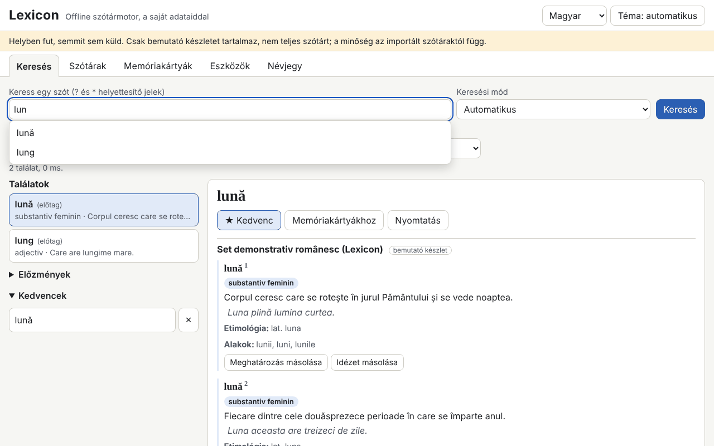

# Lexicon

[English](README.md) · [Română](README.ro.md) · [Français](README.fr.md) · [Italiano](README.it.md) · [Español](README.es.md) · [Português](README.pt.md) · [Deutsch](README.de.md) · **Magyar**

**Verzió:** 1.0.6 · **Utolsó frissítés:** 2026-10-26

A felület nyelvei: **Română, English, Français, Italiano, Español, Português (PT), Deutsch, Magyar**

A Lexicon egy szótármotor, amely teljesen offline, egyetlen HTML-fájlban fut. Nem tartalmaz teljes szótárat: te hozod a saját szótáraidat (TSV/CSV, JSON, StarDict, dictd, XDXF), IndexedDB-ben tárolod őket, és azonnal keresel bennük: előtag, pontos, ékezetek nélküli, hozzávetőleges (Damerau–Levenshtein), ragozott alakok, teljes szöveg a definíciókban és helyettesítő karakterek (`?`, `*`). Van előzmény, kedvencek, a nap szava, térközökkel ismétlő kártyák, exportálás és helyesírás-ellenőrzés. A mellékelt készlet (345 eredeti román nyelvű szócikk) **bemutató készlet, nem teljes szótár**.

**Online alkalmazás:** https://chiuta.github.io/apps/Lexicon/

## Használat
1. Nyisd meg a **Szótárak** lapot, és válaszd ki a fájlokat (egyszerre többet is importálhatsz). TSV/CSV/JSON esetén előnézet és oszlop-hozzárendelés jelenik meg.
2. Töltsd ki a metaadatokat: cím, nyelvek, forrás és **licenc** (kötelező; nélküle figyelmeztetés jelenik meg).
3. Kapcsold be/ki a szótárakat, és módosítsd a megjelenítési sorrendet.
4. A **Keresés** lapon írd be a szót: a javaslatok valós időben jelennek meg; a `[[szó]]` és a cikkekben lévő belső hivatkozások közvetlenül megnyílnak. Gyorsbillentyű: a `/` a kurzort a keresőmezőbe viszi.
5. **Memóriakártyák** (egyszerűsített SM-2), **Eszközök** (kedvencek exportálása CSV/JSON/Markdown formátumban, a keresett részhalmaz exportálása, „Szöveg helyesírásának ellenőrzése”, `.fff.json` biztonsági mentés, „Minden törlése”).

## Hozd a saját szótáradat
Az `exemple/` mappa tartalmazza a `model.tsv` és a `model.json` fájlt (minimális formátum: szó, definíció, opcionálisan alakok, kategória, példák, etimológia).

**Ellenőrizd minden forrás licencét (például a dexonline által közzétett adatoknak saját licenc- és forrásmegjelölési feltételeik vannak; a jelenlegi feltételeket nem ellenőriztem).** Az alkalmazás nem tartalmaz és nem tölt le bizonytalan licencű szótárat; az importált adatokért a felelősség téged terhel.

## Támogatott formátumok
- **TSV / CSV** fejléccel (felismert elválasztó, idézőjelek közötti mezők, UTF-8, Windows-1250/1252, ISO-8859-2 kódolás). A `forme` és az `exemple` mezőket `|` választja el.
- **JSON**: objektumok listája, szó→definíció objektum, listák listája vagy a natív `lexicon-dict` formátum.
- **StarDict**: `.ifo` + `.idx` (+ `.idx.gz`) + `.dict` vagy `.dict.dz` (gzip/dictzip, a `DecompressionStream` segítségével), `.syn` (alakokká válnak), 32 vagy 64 bites eltolások, `sametypesequence`.
- **dictd**: `.index` + `.dict` / `.dict.dz`, 64-es alapú eltolások.
- Egyszerű **XDXF** (`<ar>`, `<k>`).

## Amit NEM tud, és korlátai
- A bemutató készleten kívül nincs saját lexikográfiai tartalma.
- A fájlt importáláskor teljes egészében beolvassa a memóriába; a nagyon nagy fájlok (több száz MB) meghaladhatják a böngésző memóriáját.
- A definíciókban való keresés minden szócikket végigjár (fordított index nélkül), és nem rendez relevancia szerint.
- A cikkekben található külső hivatkozások nem aktívak: szövegként jelennek meg a címmel együtt.
- Az XDXF csak egyszerű formában támogatott; a HTML-t egy saját elemző tisztítja az engedélyezett címkék listája alapján, ezért az összetett formázások elvesznek.
- 300 000 szócikk importálása lassú (lásd alább); utána a keresés azonnali.
- A helyesírás-ellenőrzés kizárólag az aktív szótárakra (szavak és alakok) támaszkodik; nem végez nyelvtani elemzést.
- IndexedDB nélkül (privát mód) az adatok csak a memóriában maradnak, és újratöltéskor elvesznek; az alkalmazás figyelmeztet erre.

## Adatvédelem
Helyben fut, és semmit sem küld el. Nincsenek hálózati kérések (`connect-src 'none'`). A szótárak az IndexedDB-ben vannak, az előzmények, a kedvencek, a nyelv és a téma pedig a `localStorage`-ban (`fff.lexicon.*` kulcsok). A „Minden törlése” mindent eltávolít.

## Mért teljesítmény (tesztben, fej nélküli Chromium, terhelt gép)
300 000 szócikkes szintetikus készlet (32,8 MB TSV, 100 000 alakokkal):
- importálás és indexelés: 270–353 s (írás az IndexedDB-be; erősen függ a gép terheltségétől);
- valós idejű javaslatok: átlag 0,02 ms, p95 0,1 ms, maximum 4 ms (708 lekérdezés; a cél 50 ms alatt volt);
- pontos 0,4 ms, előtag 0,2 ms, `*` helyettesítő karakter az elején 37–427 ms, teljes fuzzy 49–464 ms, fuzzy javaslatok előtag nélkül 0,2–1,9 s;
- teljes szöveg a definíciókban: 2–3 s (5,7 s találat nélkül);
- újratöltés a 300 000-es készlettel az IndexedDB-ben: 150–250 ms; heap körülbelül 141 MB.

## Műszaki részletek
Egyetlen `index.html`, beágyazott szkript hash-sel a CSP-ben (`script-src 'sha256-…'`, `default-src 'none'`, `connect-src 'none'`, beágyazott eseménykezelők és `eval` nélkül; a `worker-src blob:` a sablonból öröklődik). Memóriabeli index (rendezett normalizált kulcsok, bináris keresés), IndexedDB a szócikkeknek és a teljes szövegnek. A HTML-tartalom egy saját elemzőn halad át, és `createElement`/`textContent` segítségével épül fel. Opcionálisan felismeri a `window.FFF`-et; nélküle is teljes értékűen működik. Tesztek: `node tests/test.mjs` (Playwright; 292 ellenőrzés: StarDict/dictd elemzés a tesztben előállított fájlokkal, lekérdezések, 28 XSS-adatcsomag, tartósság, 300 000 szócikk, axe 0, túlcsordulás 360×740 és 1280×800 mellett). A `LEXICON_SKIP_PERF=1` változó kihagyja a nagy tesztet.

## Harmadik felek
Az alkalmazásban nincs harmadik féltől származó kód (az axe-core-t csak a tesztek használják).

## Fordítások
A felület román (alapértelmezett), angol, francia, olasz, spanyol, portugál, magyar és német nyelven érhető el. Az fr/it/es/pt/hu/de fordítások automatikusak, anyanyelvi beszélők nem ellenőrizték őket.

## Licenc
MIT — lásd a `LICENSE` fájlt a tároló gyökerében.

## Előzmények
- 1.0.0 — 2026-10-14: első verzió.
- 1.0.1 — 2026-10-22: az eredménytelen keresés most kifejezetten jelzi, hogy a mellékelt készlet csak bemutató (ha a demókészlet aktív); a CSV-export semlegesíti a = + - @ karakterrel kezdődő cellákat a képletbefecskendezés ellen, a TSV/CSV-import pedig ismét eltávolítja az aposztrófot; legalább 24 px-es érintési célok; a műszaki címke mind a 8 nyelvet felsorolja.
- 1.0.2 — 2026-10-22: fff-kit 1.1.2: PBKDF2 600 000 iterációval, clickjacking elleni védelem.
- 1.0.3 — 2026-10-22: fff-kit 1.1.4: érintési célok és minimális szövegméret a közös felületen.
- 1.0.5 — 2026-10-23: tartalék üzenet kikapcsolt JavaScript esetén (noscript).
